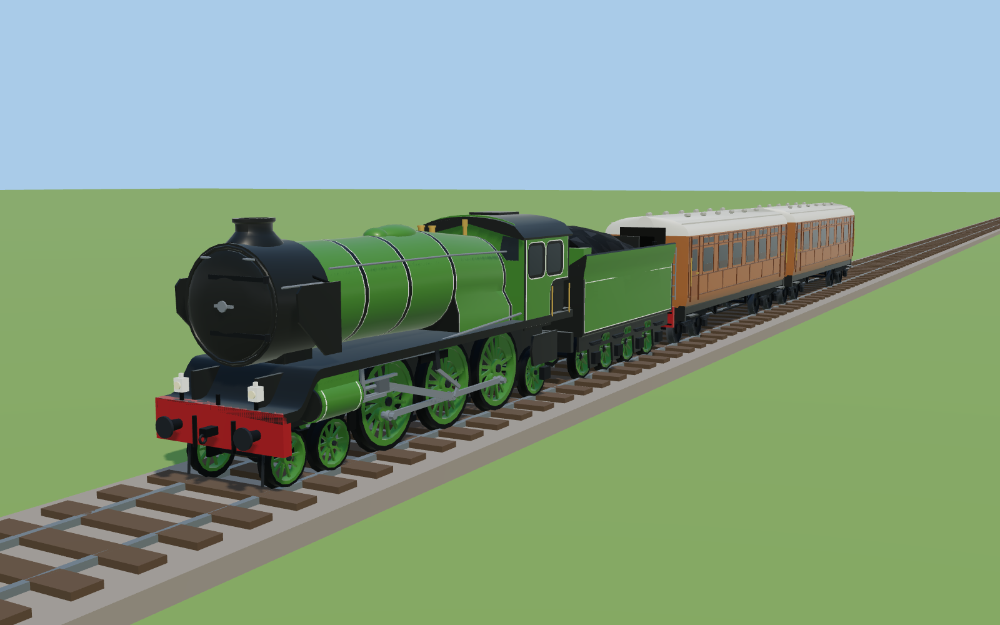
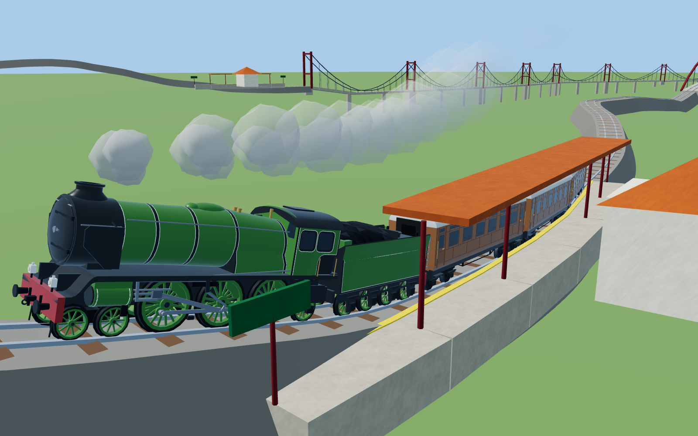
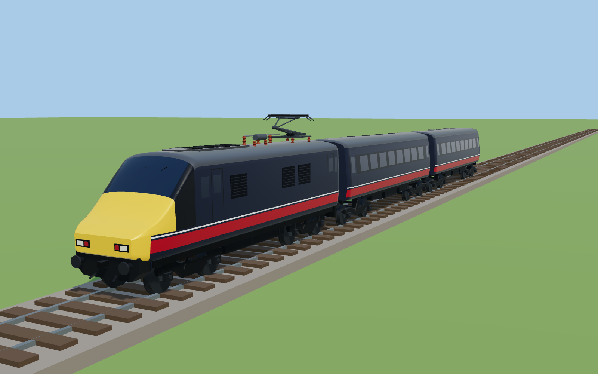
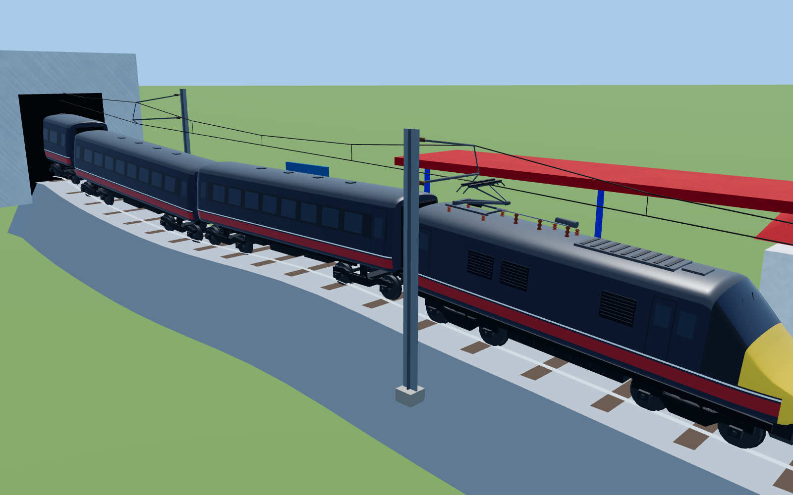
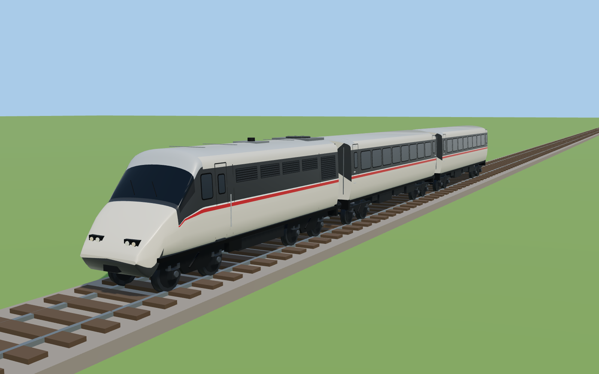
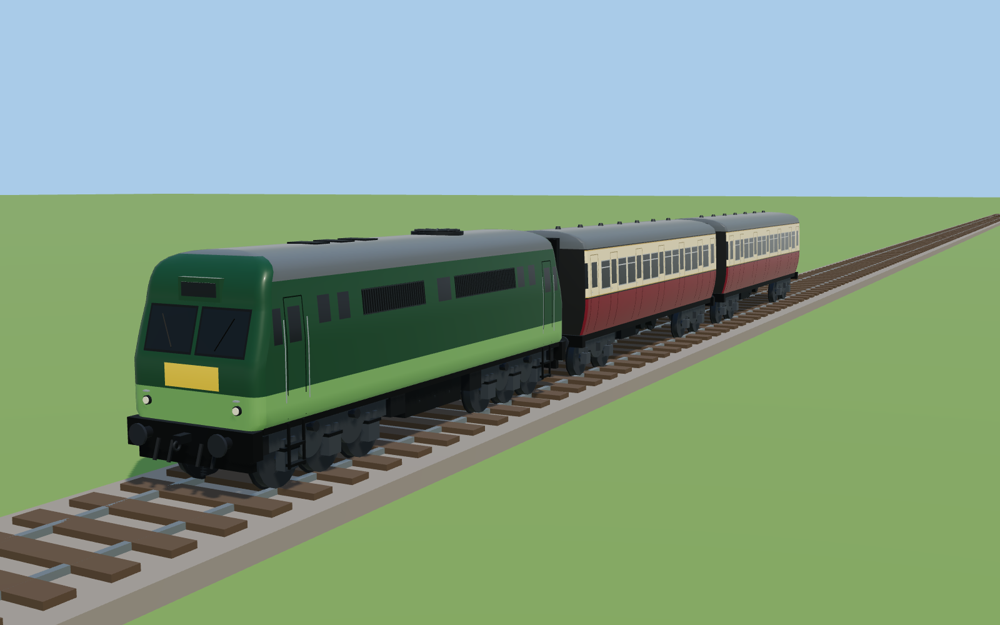
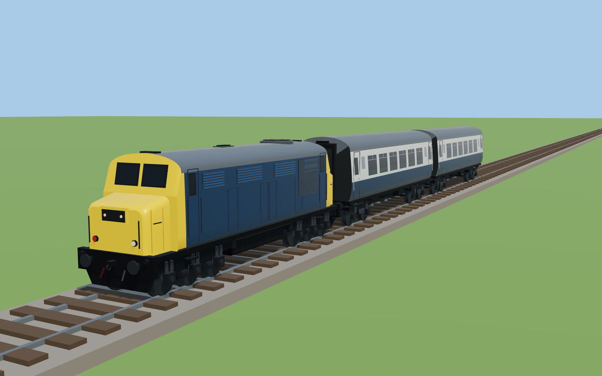
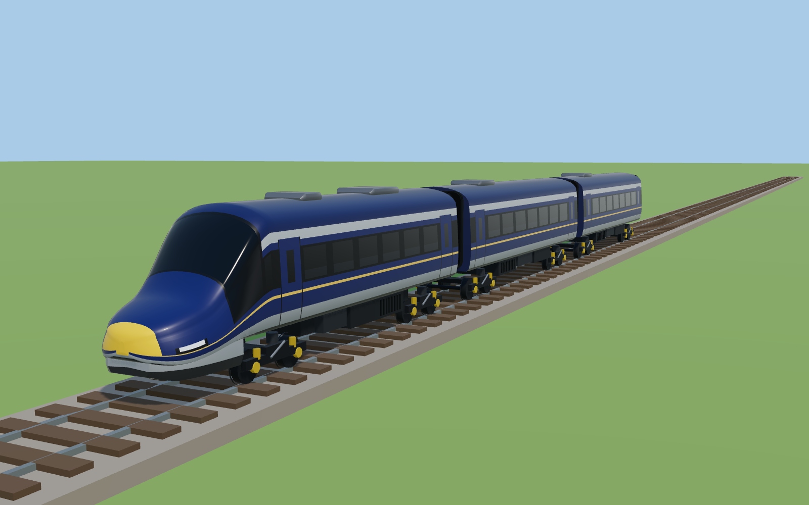

# British engines and each Island's own carriages

> **Personal use only.** Wizzaroo is intended for your own personal use only. It is not intended for use with or by a school, teacher, parent or student. Only use it for yourself.

Supersedes in part [0046](./0046-railways-roads-and-vehicles-on-every-island.md) and [0047](./0047-the-railway-and-its-train-on-the-world-map.md).

The owner said the Trains were just carriages with no engine (on the World Map every vehicle was the same box) and that the engines and carriages looked childish. They asked for each Island's Train to have a different British engine pulling it, one of them a steam engine that puffs smoke and one an electric engine under overhead wires, and for every Island's carriages to be different, all looking high-quality and professional.

## The six Trains

Each Train is modelled on a real British class and livery, without names, numbers or logos, in its own file in `src/client/islands/trains/`:

| Island          | Train                      | Engine                                                                                                        | Carriages                               |
| --------------- | -------------------------- | ------------------------------------------------------------------------------------------------------------- | --------------------------------------- |
| Meadow Isle     | the Meadow Steam Express   | an LNER A3-style 4-6-2 steam locomotive in lined apple green, with its eight-wheel tender (`meadow-steam.ts`) | Gresley varnished-teak corridor coaches |
| Frost Isle      | the Frost Peak Electric    | a Class 91-style electric with a raised single-arm pantograph, in navy with a red band (`frost-electric.ts`)  | Mark 4 coaches in the same livery       |
| Sunscorch Sands | the Sunscorch Desert Flyer | an HST Class 43-style power car in InterCity grey, charcoal and red (`sunscorch-high-speed.ts`)               | Mark 3 coaches                          |
| Jungle Reach    | the Jungle Reach Express   | a Class 47-style diesel in BR two-tone green (`jungle-diesel.ts`)                                             | Mark 1 coaches in carmine and cream     |
| Ember Isle      | the Ember Valley Growler   | a Class 37-style diesel with nose bonnets, in BR blue with yellow ends (`ember-diesel.ts`)                    | Mark 2 coaches in blue and grey         |
| Starfall Isle   | the Starfall Star Glider   | a Class 800-style bi-mode driving car in midnight blue with a gold stripe (`starfall-bi-mode.ts`)             | matching Class 800-style cars           |

`island-train-design.ts` names them and gives each Island its Train. The style names change to `steam`, `electric`, `high-speed-diesel`, `mainline-diesel`, `mixed-traffic-diesel` and `bi-mode`.

## How they are built

- **A shared kit.** `trains/train-kit.ts` has a `VehicleBuilder` that lofts smooth bodies through cross-sections, painting each face so liveries and windows stay crisp while the shading stays smooth. It also has a British coach section, wheelsets, bogies, buffers, gangways and lamps. Every vehicle is one geometry in three groups: **paint** (glossy, clear-coated), **glass** and **metal**. Each group is drawn with its own `MeshPhysicalMaterial` (`finishLooks`), so the bodies shine, the windows reflect the sky and the running gear looks like steel. The old vehicles were one matte material with each face darkened by hand.
- **Real proportions.** The vehicles are longer than before: engines 5.6 to 7, carriages 6.2 to 6.8, so they are about four and a half times as long as they are wide instead of three. Every Train has three carriages, and the vehicles are spaced 0.06 apart, buffer to buffer. Buffers and couplings are at one height on every vehicle.
- **A tender.** A Train may have a tender between the engine and its carriages, its own vehicle that follows the track on curves. The Character rides in the first carriage (`findFirstCarriageIndex`).
- **Two levels of detail.** Each vehicle builds `"explore"` (seen up close) or `"map"` (seen 2.6 times bigger from the World Map's height): the same silhouette and livery with the small parts left out.

## The steam engine's smoke

`island-steam-smoke.tsx` puffs a cluster of lumpy smoke from the chimney with every chuff, slowly while the train stands and faster as it speeds up. Each puff rises, swells and fades where it was left, so a moving train trails its smoke. The puffs are one instanced mesh of 54, faded one by one with a per-puff opacity. On the World Map the puffs are moving parts of the Train's mesh instead, and shrink away rather than fade.

## The overhead line

`island-overhead-line.ts` electrifies the Railway of the Train that has a pantograph. It runs on Frost Isle only:

- **The masts.** Steel H-section masts on concrete bases stand beside the track, on the side away from each Station's platform. Each has a cantilever, a stay and insulators.
- **The wires.** A contact wire is hung at exactly the height of the pantograph's head and zig-zags a little from mast to mast. A catenary wire sags above it, hung on droppers.
- **Spacing.** Spans are up to 12 long and shorten on curves, so the wire stays over the pantograph. The wire runs on through tunnels, where no masts stand.

It is one mesh when exploring, and is merged into the Dock's mesh on the World Map, drawn at the map Train's size.

## The World Map

The World Map's Train is now drawn from the real models' map detail instead of boxes (`island-map-train.tsx`). The locomotive, any tender, two carriages and the steam engine's smoke are still one mesh, moved part by part each frame. Its vertices are laid out finish by finish, so the one mesh still draws paint, glass and metal with their own materials. That is about 5,000 to 7,500 triangles and up to about 22,000 vertices moved a frame, against the 38,000 that [0047](./0047-the-railway-and-its-train-on-the-world-map.md) avoided by drawing boxes.

## Within the budget

- **Exploring.** A Train is now 26,000 to 49,000 triangles (the locomotive 8,700 to 14,000, a tender 4,800, three carriages 17,000 to 21,000, and the steam engine's smoke 9,700), and adds a mesh for a tender and one for the smoke. The overhead line adds about 29,000 triangles and one mesh on Frost Isle. Meadow Isle is the busiest, at about 352,000 triangles and 112 meshes, within the 380,000 and 150 of the exploring budget.
- **The World Map.** The map Train and the map overhead line (about 3,900 triangles, merged into the Dock) keep the World Map within its 280,000 triangles and 64 meshes.

## Consequences

- The trains look like real British trains, and each Island's engine and carriages are its own.
- The Train's vehicles are drawn with three materials, so each costs three draw calls instead of one.
- The Train still isn't solid; the Character can walk through it.
- A new Train needs only a file in `trains/` exporting a `TrainModel` and a line in `island-train-design.ts`; `island-train-design.test.ts` checks every vehicle's size, ends, triangle budget and finishes, and that each Island's livery is its own.

## Pictures

|                                                                                  |                                                                                      |
| -------------------------------------------------------------------------------- | ------------------------------------------------------------------------------------ |
|                  |  |
|              |               |
|  |                    |
|                    |                     |
