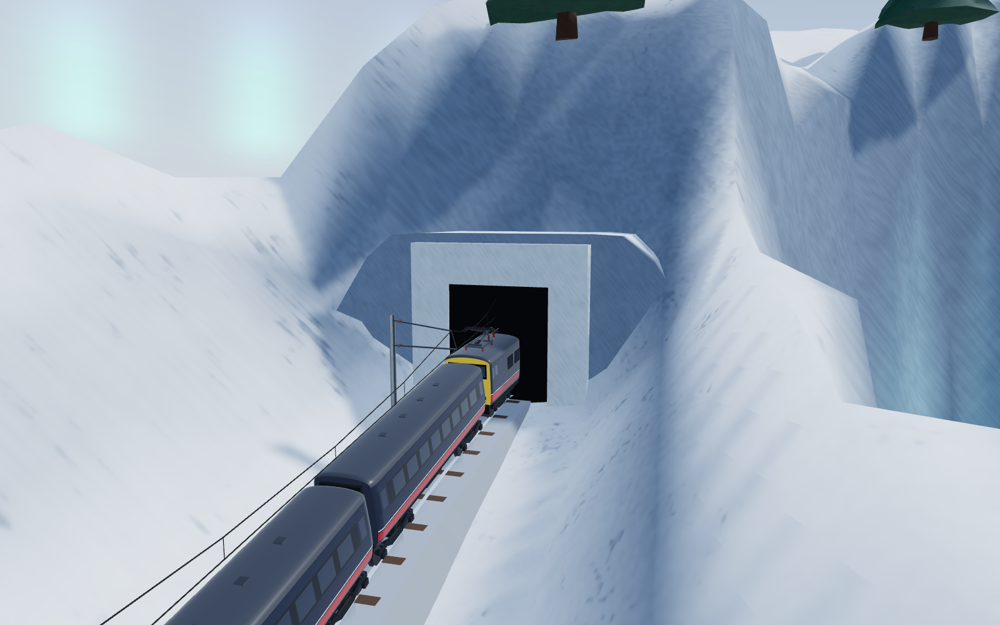
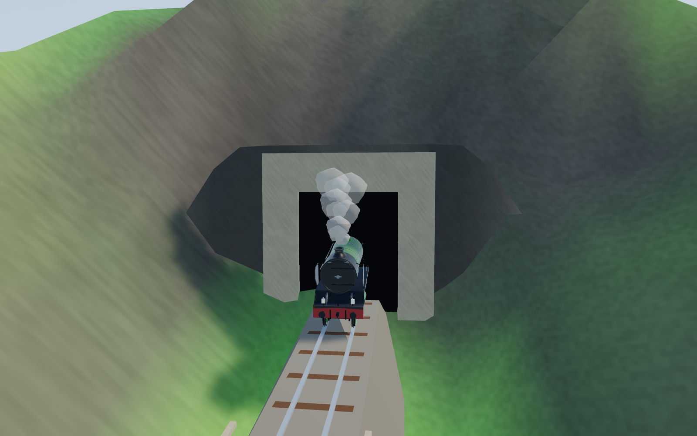

# Trains go into their tunnels

> **Personal use only.** Wizzaroo is intended for your own personal use only. It is not intended for use with or by a school, teacher, parent or student. Only use it for yourself.

The owner said the Trains didn't go through the tunnels correctly.

## What was wrong

A tunnel ([0046](./0046-railways-roads-and-vehicles-on-every-island.md)) is the stretch of track that runs below the ground, but the track only has to be 0.2 below the ground inside it, and the Island's ground isn't cut away for it. Measured on all six Islands, the rail is level with the ground at almost every portal, and for about a third of each tunnel the hill is lower than the top of the Train. So a Train went in at the portal and carried on along the hillside, visible over the hill, until it came out of the other portal. The steam engine puffed smoke out of the top of the hill, and Frost Isle's overhead wires ran up over the hill too.

## What changes

The Train is cut off at the tunnel's portals, as a train in a game usually is (`island-train-tunnels.ts`).

- **The portals.** Each tunnel is the track between its two portals, each with the direction out of the tunnel (`listTunnelBores`).
- **Clipping at the portal.** The Train's paint, glass and metal are drawn with two clipping planes, one at each portal of the tunnel it is going through, facing out of it, with `clipIntersection`. Only what is past both portals, inside the tunnel, isn't drawn. A Train going in vanishes into the portal's dark opening, and one coming out appears from it. With no tunnel near, the planes are moved where they clip nothing, so the materials never change and no shader is compiled again.
- **Hidden inside.** A vehicle wholly inside the tunnel isn't drawn at all, in case the tunnel bends enough for a plane to miss it.
- **No smoke underground.** The steam engine doesn't puff while its chimney is inside a tunnel; puffs it made before it went in drift away as before.
- **The wires.** The overhead line is held at each portal and isn't drawn through the hill; no masts stand between the portals.
- **The World Map.** The map's Train is cut off and hidden the same way, at its larger size.

## Consequences

- The track's heights and the tunnels themselves don't change, so the Railway, its Stations and the timetable are as before.
- The hill over a tunnel can still be thin near the portals; nothing is drawn inside it, so that no longer shows.
- `island-train-tunnels.test.ts` checks the portals, which vehicles are hidden going in, deep inside and coming out, that the planes clip only inside the tunnel, and that the chimney doesn't puff inside.

## Pictures

| Going in                                                                        | Coming out                                                                            |
| ------------------------------------------------------------------------------- | ------------------------------------------------------------------------------------- |
|  |  |
