# Attractions on every Island

> **Personal use only.** Wizzaroo is intended for your own personal use only. It is not intended for use with or by a school, teacher, parent or student. Only use it for yourself.

The owner asked for thirty new things to find on the Islands: places to play, village and town life, nature and the outdoors, and landmarks. All of them had to look high-quality and professional. They don't all need to be on every Island, so they are placed at random across the six. Some were asked for on a particular Island: the adventure playground on Jungle Reach, the hedge maze on Meadow Isle, the ice rink and hot springs on Frost Isle, the fire station and volcano lookout on Ember Isle, the oasis on Sunscorch Sands and the rocket on Starfall Isle. A school goes on every Island, and the funfair is kept well away from the Brainwave Big Top.

## Where they are

Each Island has five or six **Attractions**, all on its new lands ([0041](./0041-islands-grow-new-lands-with-ring-races-and-the-ship-sails-the-world-map.md)):

| Island          | Attractions                                                                               |
| --------------- | ----------------------------------------------------------------------------------------- |
| Meadow Isle     | hedge maze, skate park, farm, school, beehives and wildflower meadow                      |
| Frost Isle      | ice rink, hot springs, lighthouse, rock pools, library, school                            |
| Sunscorch Sands | oasis, playground, treehouse, shipwreck, post office, school                              |
| Jungle Reach    | adventure playground, village green, campsite, bandstand, bakery, school                  |
| Ember Isle      | fire station, volcano lookout, castle, crazy golf, allotments, school                     |
| Starfall Isle   | rocket launch pad, seaside pier, splash pool, funfair, bird hide and nature trail, school |

- **Dealt from a fixed seed.** `island-attraction-placing.ts` puts the pinned ones where the owner asked and a school on every Island. It shuffles the rest from a fixed seed and deals each one to the Island with the fewest so far. They land at random but stay put from one visit to the next.
- **Placed where they fit.** The placer looks for a site for each one, the biggest first. A site needs dry land clear of the trails, rivers, the Railway and its Stations, the Runway, Helipad and Balloon Field, the Wonders and every Region, sight and place. It also needs to be at least 40 from any other Attraction. Four Attractions belong by the sea: the seaside pier, the lighthouse, the rock pools and the shipwreck. Each of those is turned so its sea side faces out over the water, with its own sample points checked for beach and sea. The volcano lookout is turned so its telescope points at Ember Isle's volcano.
- **Kept, not searched for.** Searching takes about a second per Island, so `pnpm run generate:attraction-sites` writes what it finds to `island-attraction-sites.ts`, and the game reads that. A test checks every kept site still fits, and that the placer still finds the same ones.
- **On a terrace.** The new lands roll, so an Attraction stands on a round pad of ground, level with the highest point of its site. A grassy bank slopes down from the pad to the land round it. The Character and Vehicles can walk and drive up the bank. The pier and the lighthouse stand on their own ground instead.
- **Scenery keeps clear.** The Island's scattered trees, rocks and houses, and the Wonders' groves and flowers, keep clear of every Attraction.

## How they are built

- **One file each.** Each Attraction is a model in its own file in `src/client/islands/attractions/`. They all follow one contract (`attraction-kit.ts`):
  - what it is and the fact on its sign
  - its footprint and where it can stand
  - a builder for everything that doesn't move
  - its moving parts, wanderers (animals and people) and smoke
  - its blockers, decks and rides
- **Finishes.** The trains' `VehicleBuilder` becomes `FinishedModelBuilder`, which takes any list of finishes. Attractions use six, each drawn with its own material: glossy paint, matte (stone, brick, timber, foliage), metal, glass, see-through water, and glow. Glow is unlit and brighter after dark: lamps, flames and lit windows.
- **Two levels of detail.** Each one has a near model (up to 16,000 triangles, moving parts and animals included) and a far model (up to 6,000).
  - **Near:** within 40 of the Character.
  - **Far:** out to 300.
  - **Beyond 300:** not drawn.
- **Motions.** Every motion is worked out from the scene clock alone: a spin, a swing, a bob, an orbit, a launch, a splash or a flicker. A ride and the part it moves with stay in step.

## What they do

- **Have a go.** Walking onto some things gives the Character a go on them. The ride carries them along its path and puts them down at the end. It doesn't start again until they walk away.
  - the playground's swings, slide, roundabout and climbing dome
  - the adventure playground's zip wire, rope net and tyre swing
  - the skate park's half-pipe
  - the pier's helter-skelter
  - the funfair's carousel
  - the treehouse's ladder, slide and tyre swing
  - the school's hopscotch and climbing wall
  - the rock pools' rocks, the hot spring, the volcano lookout's telescope and the bird hide's telescope
- **Walk on them.** Each Attraction can add decks to what the Character stands on (`addAttractionLanes`, joined with the Railway's walk lanes):
  - the skate park's ramps and half-pipe, which Vehicles ride up too
  - the pier's deck out over the sea
  - the castle's drawbridge
  - the volcano lookout's ramp and platform
  - the treehouse's platform
  - the ice rink, which is ice, so the Character slides about on it
- **Walls.** Blockers keep the Character out of buildings and in the hedge maze's corridors. The maze is solvable from its entrance to the statue in the middle.
- **Moving and glowing.**
  - **Moving parts:** the big wheel turns with its gondolas upright, the carousel horses go round and up and down, and the crazy golf windmill's sails turn. The splash pad's jets leap up as the Character comes near.
  - **Animals:** sheep and cows wander the farm, ducks paddle on the ponds, crabs scuttle on the beaches and bees fly round the hives.
  - **Smoke:** the bakery's chimney smokes and the hot springs steam.
  - **After dark:** the lighthouse beam sweeps round and the campfire glows.
  - **The rocket:** it takes off every 75 seconds, flies out of sight and comes back down to land on its pad.
- **Visiting them.** Every Attraction has a sign at its entrance. Walking up to it offers **Visit**, which opens a card with a fact tied to the National Curriculum where one fits, such as pollination at the beehives (Science, Year 3), the Normans at the castle (History, Key Stage 2) or Grace Darling at the lighthouse (History, Key Stage 1).
  - **The library:** offers to open a reading Game in the Island's English Region, when that Region is open.
  - **The post office:** gives the Character a parcel to deliver to another Attraction on the Island, each one in turn. Walking up to it delivers the parcel.
  - **The bandstand:** plays a short brass-band tune as the Character comes near, unless music is muted.

## Within the budget

The near model of only the Attraction the Character is at, and the far models of the rest, keep every Island within the exploring budget of 380,000 triangles and 150 meshes. Meadow Isle is the busiest, at about 373,000 triangles and 115 meshes next to its school. `island-explore.sweep.test.tsx` stands the Character at every Attraction on every Island and checks the budget. `island-attractions.test.ts` checks every model's triangles, near and far, and that it has at most six moving parts.

## Consequences

- Each Island has more to find, and a reason to explore its new lands.
- A new Attraction needs a model file, a line in `attraction-models.ts` and its kind in `attractionKinds`. Then run `pnpm run generate:attraction-sites`.
- The Attractions are drawn only when exploring, not on the World Map.

## Pictures

|                                                                        |                                                                   |
| ---------------------------------------------------------------------- | ----------------------------------------------------------------- |
| 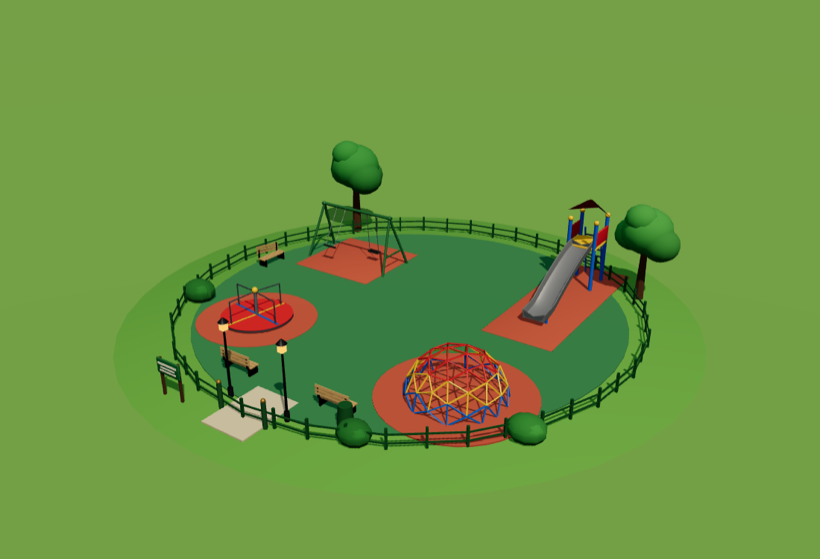                | 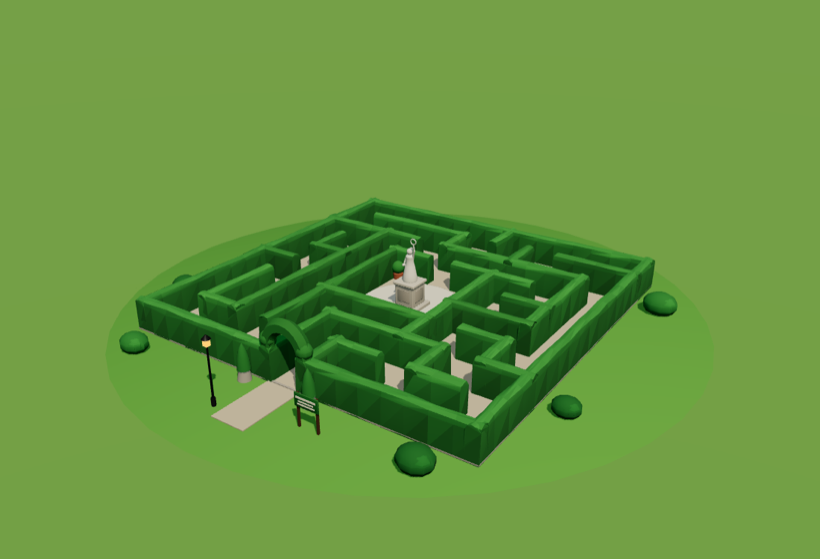           |
| 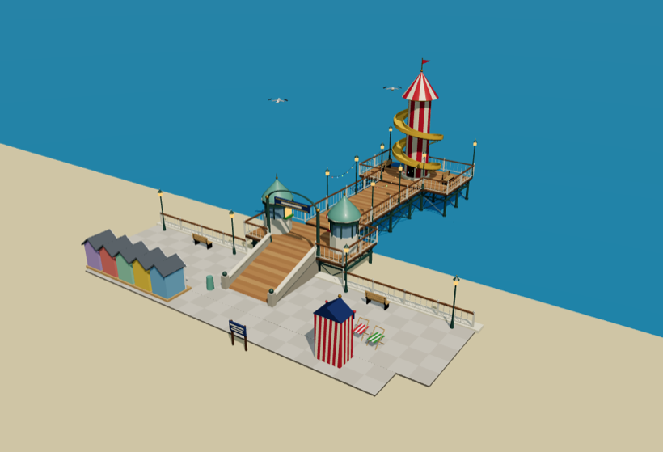            | 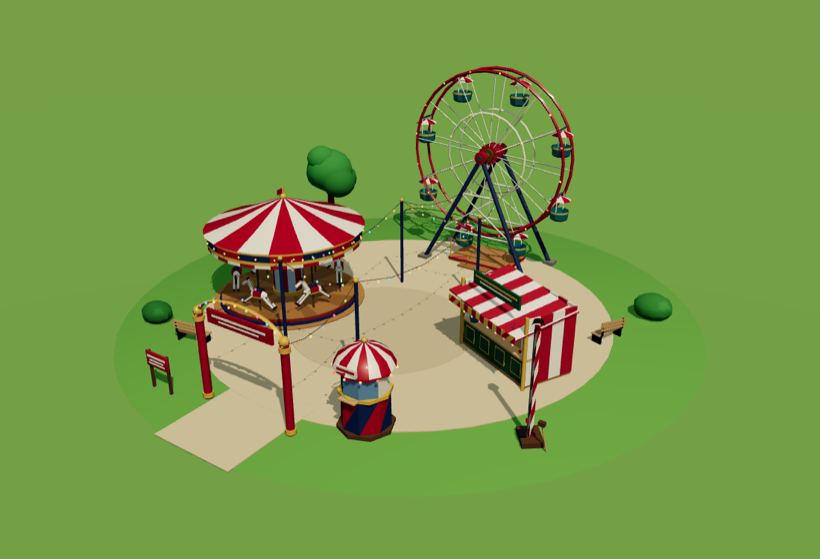                 |
| 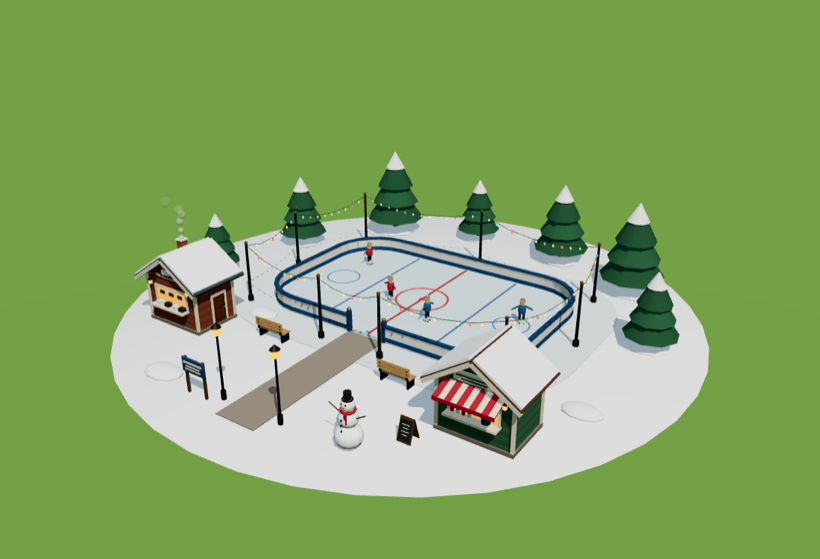                    | 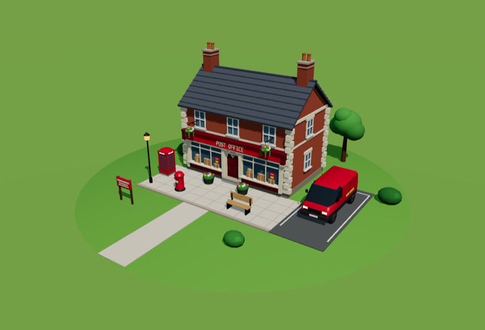         |
| 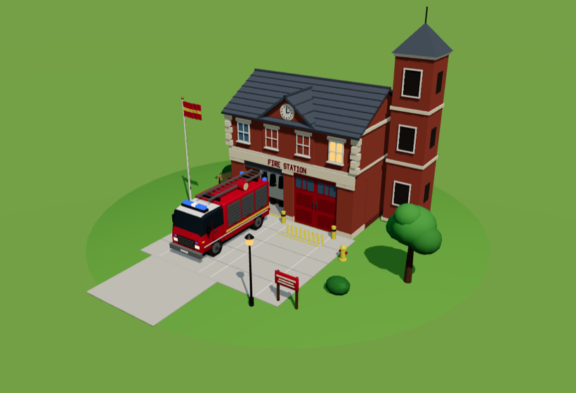            | 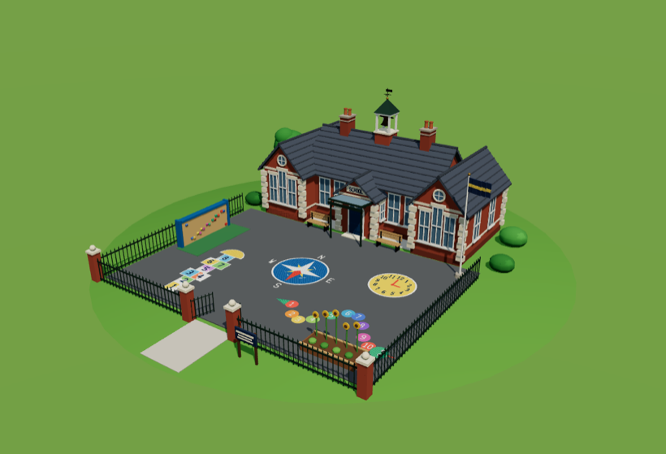                   |
| 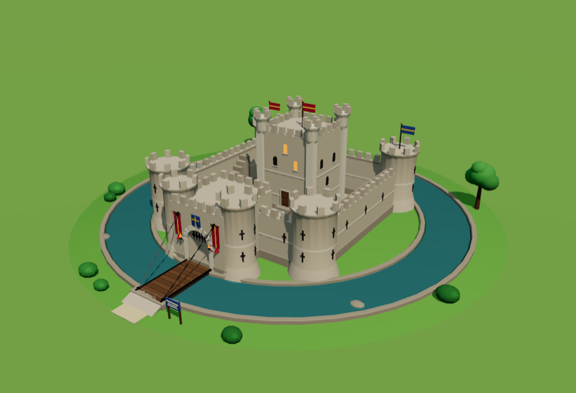                        | 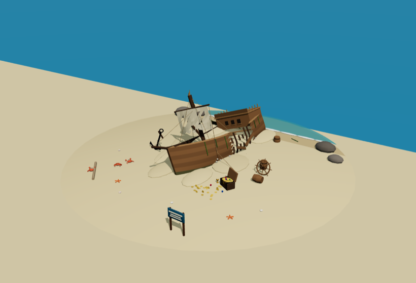             |
| 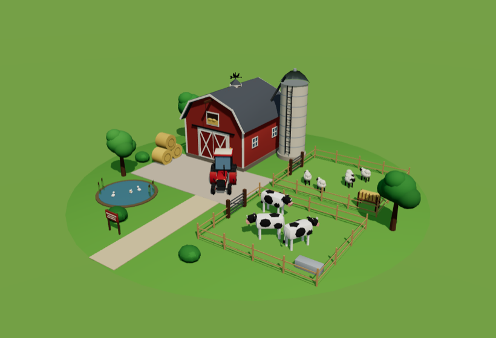                            | 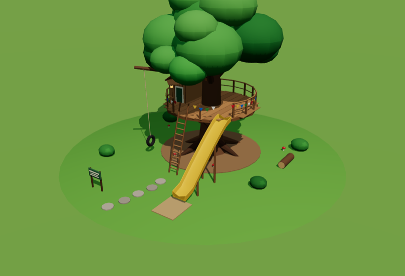             |
| 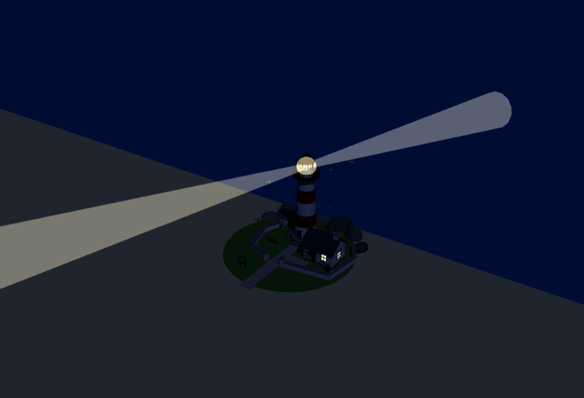 | 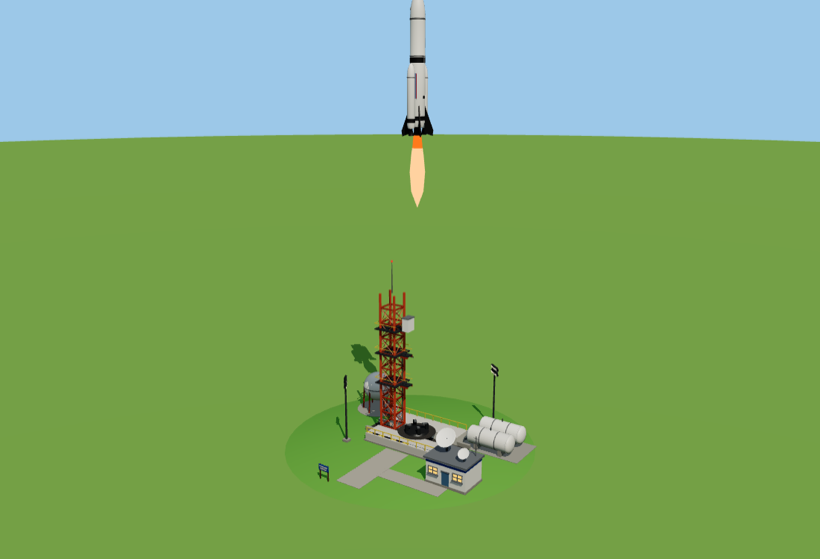 |
