# The Attractions

[← Back to the README](../../README.md) · [All guides](README.md)

> **Personal use only.** Wizzaroo is intended for your own personal use only. It is not intended for use with or by a school, teacher, parent or student. Only use it for yourself.

Every Island's new lands have twenty or twenty-one Attractions to find while exploring on foot, 120 kinds in all. Five or six on each were dealt out at random, with a school on every Island, from a playground and a funfair to a castle and a rocket launch pad. The other fifteen are the Island's own, out on the far reaches of its new lands, from Meadow Isle's swan boat lake to Starfall Isle's drop tower ([the new lands' own](#the-new-lands-own-attractions)). Where each one stands was dealt out at random once and is kept in the repo, so it is in the same place every visit (`src/client/islands/island-attraction-sites.ts`, written by `pnpm run generate:attraction-sites`). Each is modelled in its own file in `src/client/islands/attractions/`, with glossy, matte, metal, glass, water and glowing finishes, near and far detail, moving parts, wanderers and smoke ([ADR 0055](../architectural-decision-record/0055-attractions-on-every-island.md)).

- **Visiting.** Walking up to an Attraction's sign offers **Visit**, a card with a fact linked to the National Curriculum. The fifteen of each Island's own also have a button on their card, such as **Shine the laser**.
- **Having a go.** Walking onto a swing, a slide, the zip wire, the helter-skelter, the carousel or another ride gives the Character a go on it.
- **More to find.** Every Island also has twenty Curiosities of its own, such as Meadow Isle's windmill or Starfall Isle's observatory, which aren't listed here ([ADR 0056](../architectural-decision-record/0056-twenty-curiosities-on-every-island.md)). See [the Islands](islands.md) and [the World Map](world-map.md).

The table lists every Island's Attractions: the five or six dealt out at random, and the fifteen of its own. Below, all 120 are grouped by kind, each with where it stands, what to do there and what its sign teaches. The pictures show each Attraction's own 3D model on its patch of ground, drawn as it is in the game, by day (the lighthouse by night).

| Island          | Dealt out at random                                                                                                                                                  | Its own fifteen, on the far reaches                                                                                                                                                                                                                                                                                                                                                                                                                                                                                                                                 |
| --------------- | -------------------------------------------------------------------------------------------------------------------------------------------------------------------- | ------------------------------------------------------------------------------------------------------------------------------------------------------------------------------------------------------------------------------------------------------------------------------------------------------------------------------------------------------------------------------------------------------------------------------------------------------------------------------------------------------------------------------------------------------------------- |
| Meadow Isle     | [Skate Park](#skate-park), [Hedge Maze](#hedge-maze), [School](#school), [Farm](#farm), [Beehives](#beehives)                                                        | [Swan Boat Lake](#swan-boat-lake), [Bouncy Castle](#bouncy-castle), [Strawberry Field](#strawberry-field), [Tractor Train](#tractor-train), [Sheepdog Trials](#sheepdog-trials), [Village Fete](#village-fete), [Pony Stables](#pony-stables), [Grass Sledge Hill](#grass-sledge-hill), [Apple Orchard](#apple-orchard), [Bluebell Wood](#bluebell-wood), [Puppet Theatre](#puppet-theatre), [Canal Lock](#canal-lock), [Duck Race](#duck-race), [Kite Hill](#kite-hill), [Cricket Pitch](#cricket-pitch)                                                           |
| Frost Isle      | [Ice Rink](#ice-rink), [Lighthouse](#lighthouse), [School](#school), [Library](#library), [Rock Pools](#rock-pools), [Hot Springs](#hot-springs)                     | [Ice Palace](#ice-palace), [Bobsleigh Track](#bobsleigh-track), [Ski Jump](#ski-jump), [Snowball Range](#snowball-range), [Glacier Bridge](#glacier-bridge), [Curling Sheet](#curling-sheet), [Polar Research Base](#polar-research-base), [Icebreaker Ship](#icebreaker-ship), [Mountain Rescue Hut](#mountain-rescue-hut), [Snowmobile Trail](#snowmobile-trail), [Seal Lagoon](#seal-lagoon), [Snow Tubing Hill](#snow-tubing-hill), [Yeti Cave](#yeti-cave), [Ice Climbing Wall](#ice-climbing-wall), [Mammoth Museum](#mammoth-museum)                         |
| Sunscorch Sands | [Playground](#playground), [Post Office](#post-office), [School](#school), [Treehouse](#treehouse), [Oasis](#oasis), [Shipwreck](#shipwreck)                         | [Stone Age Village](#stone-age-village), [Iron Age Hillfort](#iron-age-hillfort), [Chariot Racetrack](#chariot-racetrack), [Desert Fort](#desert-fort), [Sand Yachts](#sand-yachts), [Dune Buggy Track](#dune-buggy-track), [Date Palm Grove](#date-palm-grove), [Papyrus Workshop](#papyrus-workshop), [Sandstone Arches](#sandstone-arches), [Dinosaur Park](#dinosaur-park), [Archimedes Screw](#archimedes-screw), [Pottery Kiln](#pottery-kiln), [Sand Slide Tower](#sand-slide-tower), [Windcatcher House](#windcatcher-house), [Painted Cave](#painted-cave) |
| Jungle Reach    | [Adventure Playground](#adventure-playground), [Bandstand](#bandstand), [Village Green](#village-green), [Bakery](#bakery), [School](#school), [Campsite](#campsite) | [Vine Swing Glade](#vine-swing-glade), [Strangler Fig Ruins](#strangler-fig-ruins), [Rainforest Biome](#rainforest-biome), [Stilt Village](#stilt-village), [Cacao Farm](#cacao-farm), [Gorilla Sanctuary](#gorilla-sanctuary), [Elephant Pool](#elephant-pool), [Jungle Coaster](#jungle-coaster), [Bat Cave](#bat-cave), [Hummingbird Garden](#hummingbird-garden), [Hydro Power House](#hydro-power-house), [Giant Kapok Climb](#giant-kapok-climb), [Orchid House](#orchid-house), [High Ropes Course](#high-ropes-course), [Insect House](#insect-house)       |
| Ember Isle      | [Crazy Golf](#crazy-golf), [Fire Station](#fire-station), [School](#school), [Allotments](#allotments), [Castle](#castle), [Volcano Lookout](#volcano-lookout)       | [Volcano Museum](#volcano-museum), [Dragon Boat Lake](#dragon-boat-lake), [Minotaur Labyrinth](#minotaur-labyrinth), [Greek Temple](#greek-temple), [Sutton Hoo Mound](#sutton-hoo-mound), [Glassblowing Studio](#glassblowing-studio), [Geothermal Plant](#geothermal-plant), [Mine Cart Ride](#mine-cart-ride), [Chilli Farm](#chilli-farm), [Pompeii Street](#pompeii-street), [Bronze Colossus](#bronze-colossus), [Firework Tower](#firework-tower), [Lava Flume](#lava-flume), [Obsidian Quarry](#obsidian-quarry), [Dragon Hatchery](#dragon-hatchery)       |
| Starfall Isle   | [Splash Pool](#splash-pool), [Seaside Pier](#seaside-pier), [Funfair](#funfair), [School](#school), [Bird Hide](#bird-hide), [Rocket Launch Pad](#rocket-launch-pad) | [Planetarium Dome](#planetarium-dome), [Mars Base](#mars-base), [Drop Tower](#drop-tower), [Space Shuttle](#space-shuttle), [Star Flyer](#star-flyer), [Mirror Maze](#mirror-maze), [Camera Obscura](#camera-obscura), [Astronaut Centrifuge](#astronaut-centrifuge), [Beagle Ship](#beagle-ship), [Giant Heart](#giant-heart), [Home Front House](#home-front-house), [Lunar Lander](#lunar-lander), [Black Hole Slide](#black-hole-slide), [Shadow Garden](#shadow-garden), [Inventors' Hall](#inventors-hall)                                                    |

## The new lands' own Attractions

Every Island has fifteen Attractions of its own, in its own style, out on the far reaches of its two new lands: eight on the west and seven on the east ([ADR 0068](../architectural-decision-record/0068-fifteen-more-attractions-on-the-far-reaches-of-every-island.md)). A trail runs out to each far reach over a little bridge and loops round it, past every one. They are built to the same standard as the thirty dealt out at random and are on the World Map too, in far detail. Each also has a button on its card as well as its fact, such as **Ring the rescue bell** or **Ride the Jungle Coaster**, which shows what happened and plays its notes unless sound is muted. Where they stand is kept in `src/client/islands/island-new-land-attraction-sites.ts`, and each is modelled in its own file in `src/client/islands/new-land-attractions/`.

## Play

### Playground

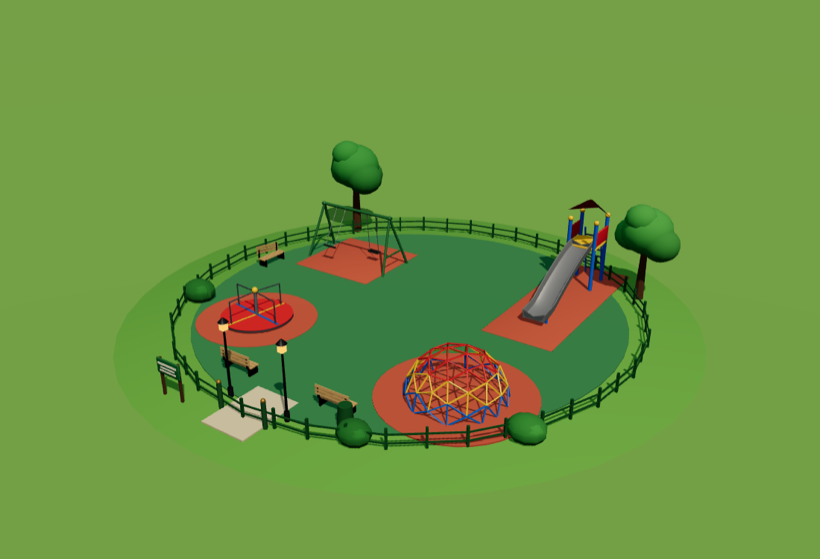

- **Where:** Sunscorch Sands.
- **Have a go on:** the swings, the slide, the roundabout and the climbing dome.
- **Its sign says:** "Have a go on the swings, the slide, the roundabout and the climbing dome! A swing is a pendulum: each push makes it swing higher, and the pull of gravity brings it back down."
- **National Curriculum:** Science, Year 3: forces. Pushes, pulls and gravity on the swings and the slide.

### Adventure Playground

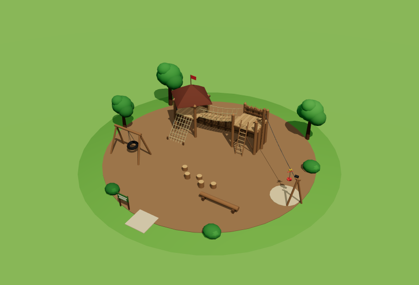

- **Where:** Jungle Reach.
- **Have a go on:** the zip wire, the rope net and the tyre swing.
- **Its sign says:** "This wooden fort is built from logs, which come from trees. Wood is strong and a little bendy, which makes it a good material for climbing frames and bridges."
- **National Curriculum:** Science, Year 1 and Year 2: everyday materials. Why wood and rope suit a climbing fort.

### Skate Park

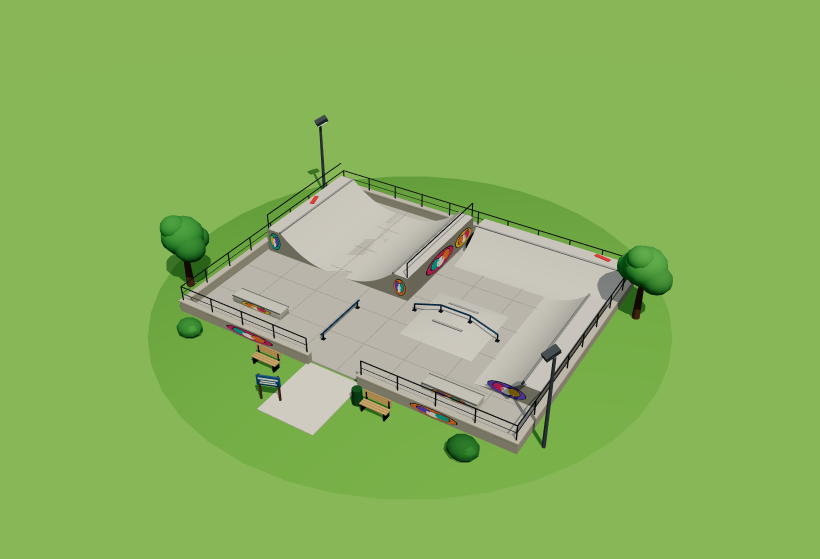

- **Where:** Meadow Isle.
- **Have a go on:** the half-pipe.
- Vehicles can ride up and down its ramps.
- **Its sign says:** "Skaters ride down a ramp and back up the other side. Gravity pulls them down the slope, and their speed carries them up again, a little lower each time because friction slows the wheels."
- **National Curriculum:** Science, Year 5: forces. Gravity and friction acting on a skateboard on a ramp.

### Hedge Maze

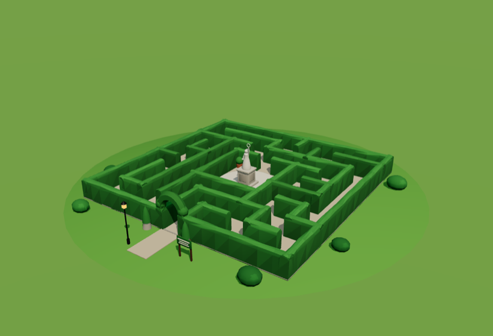

- **Where:** Meadow Isle.
- The Character can walk the maze all the way to the statue in the middle.
- **Its sign says:** "A maze like this is made of hedges grown close together and clipped flat. Hedges are plants: they need light, water and air to grow. A good trick for many mazes is to keep one hand on the same hedge all the way round."
- **National Curriculum:** Science, Year 3: plants. What plants need to grow, using clipped hedges.

### Bandstand

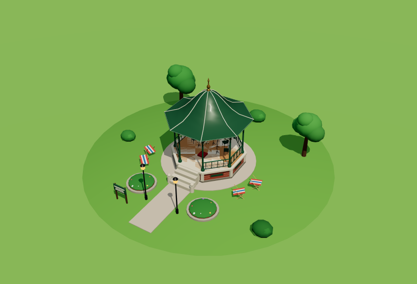

- **Where:** Jungle Reach.
- It plays a tune as the Character comes near.
- **Its sign says:** "Bandstands were built in parks in Victorian times so that brass bands could play on summer afternoons. Every sound is made by something vibrating: in a trumpet or a tuba it is the air inside the tube. The roof helps carry the music out to the listeners."
- **National Curriculum:** Science, Year 4: sound. Sounds are made by vibrations that travel to the ear.

### Crazy Golf

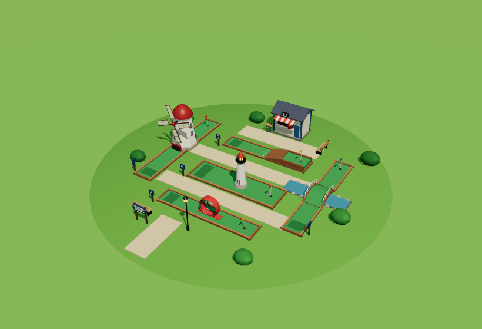

- **Where:** Ember Isle.
- **Its sign says:** "A golf ball slows down as it rolls because of friction between the ball and the green. On the rough felt there is more friction than on a smooth surface, so you need a firmer push to reach the hole."
- **National Curriculum:** Science, Year 5: forces. Friction acts between moving surfaces and slows them down.

### Splash Pool

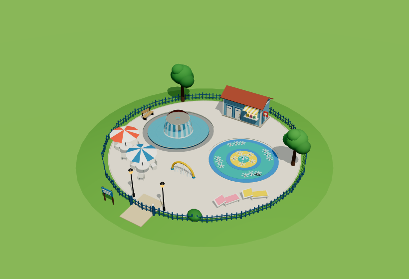

- **Where:** Starfall Isle.
- It plays a tune as the Character comes near.
- **Its sign says:** "Step near the fountains and watch them leap. On a sunny day the wet ground soon dries, because the sun's warmth turns the water into an invisible gas called water vapour. This is called evaporation."
- **National Curriculum:** Science, Year 4: states of matter. Evaporation, and how temperature affects it.

### Seaside Pier

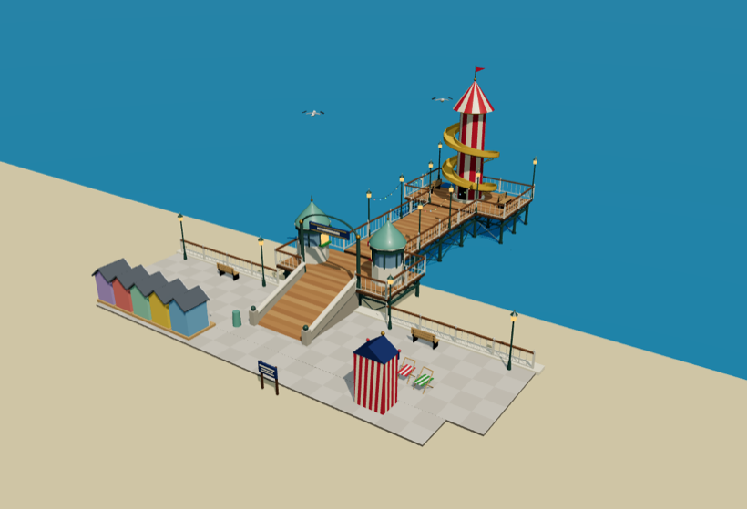

- **Where:** Starfall Isle, on the shore.
- **Have a go on:** the helter-skelter.
- It plays a tune as the Character comes near.
- **Its sign says:** "The Victorians built seaside piers so that people could stroll out over the sea in the fresh air. New railways in the 1800s brought families from the towns to the seaside for the day. Southend Pier, in Essex, is the longest pleasure pier in the world, at over two kilometres."
- **National Curriculum:** History, Key Stage 1: changes beyond living memory. Seaside holidays in the past.

### Funfair

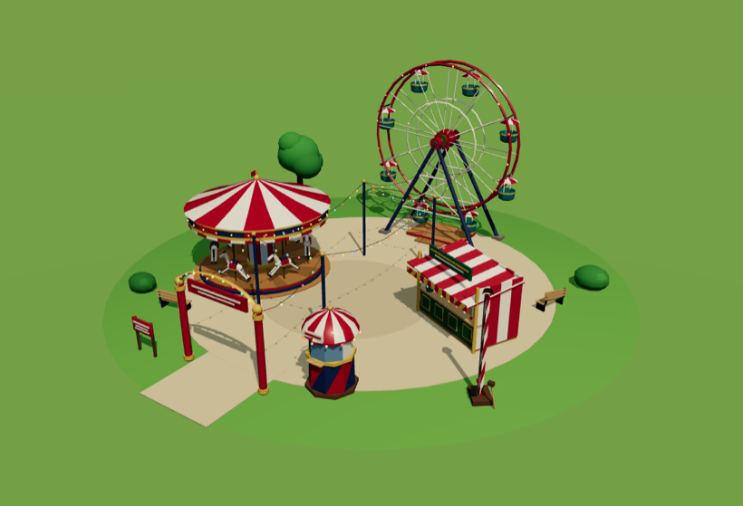

- **Where:** Starfall Isle.
- **Have a go on:** the carousel.
- It plays a tune as the Character comes near.
- **Its sign says:** "In Victorian times, travelling fairs went from town to town, and the gallopers were turned by a steam engine in the middle. The first big wheel was built by George Ferris in Chicago in 1893, so big wheels are still called Ferris wheels."
- **National Curriculum:** History, Key Stage 1: changes beyond living memory. How Victorian fairs and rides compare with today's.

### Swan Boat Lake

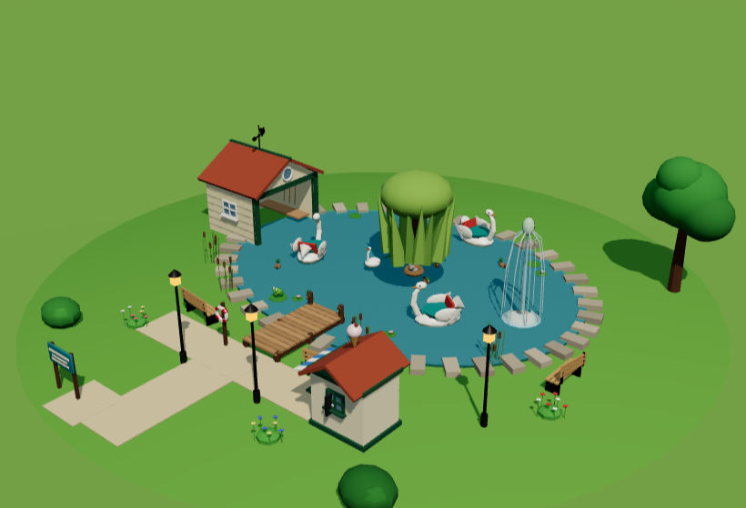

- **Where:** Meadow Isle, on the west far reach.
- An oval lake round a willow island, with three swan pedal-boats, a jetty, a boathouse and an ice-cream kiosk. A swan nods, the fountain leaps and a frog hops onto its lily pad as the Character comes near.
- **Have a go on:** the swan boats.
- **Its button:** **Wave at the swans**.
- **Its sign says:** "A swan is a bird: it has feathers, two wings, two legs and a beak, and it lays eggs. Its webbed feet push the water like paddles, which is just how you pedal a swan boat along. Baby swans are called cygnets and are fluffy and grey."
- **National Curriculum:** Science, Year 1: animals, including humans. Identify and name a variety of common animals, including birds, and describe and compare their structure.

### Bouncy Castle

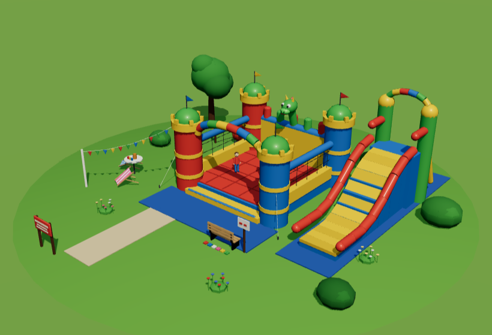

- **Where:** Meadow Isle, on the east far reach.
- A red, yellow, blue and green inflatable castle with turrets and a rainbow arch, a tall inflatable slide and a humming blower. The blower's fan spins up and an inflatable dragon nods hello.
- **Have a go on:** the bouncy castle and the inflatable slide.
- **Its button:** **Switch on the blower**.
- **Its sign says:** "A bouncy castle is made of a thick plastic fabric that is strong, bendy and waterproof, so it can be squashed and spring back. A fan blows air into it all the time to keep it firm. Air is all around us, even though we cannot see it!"
- **National Curriculum:** Science, Year 1: everyday materials. Describe the simple physical properties of a variety of everyday materials, such as plastic that is bendy, strong and waterproof.

### Tractor Train

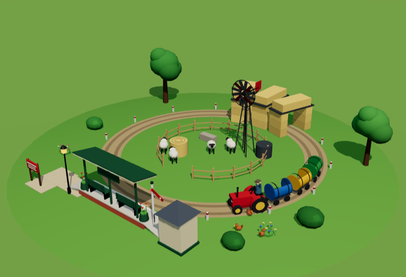

- **Where:** Meadow Isle, on the east far reach.
- A little red tractor tows three barrel carriages round a farm track and through a hay-bale tunnel, past a sheep paddock and a windpump, from its own station halt.
- **Have a go on:** the tractor train.
- **Its button:** **Toot the horn**.
- **Its sign says:** "A farm is a place where people grow crops and keep animals, such as sheep for their wool. Farmers drive tractors, whose huge back wheels grip the muddy ground, to pull ploughs and trailers. Farms, villages and houses are all human features: things that people have built."
- **National Curriculum:** Geography, Key Stage 1: human and physical features. Use basic geographical vocabulary to refer to key human features, including farm, village and house.

### Grass Sledge Hill

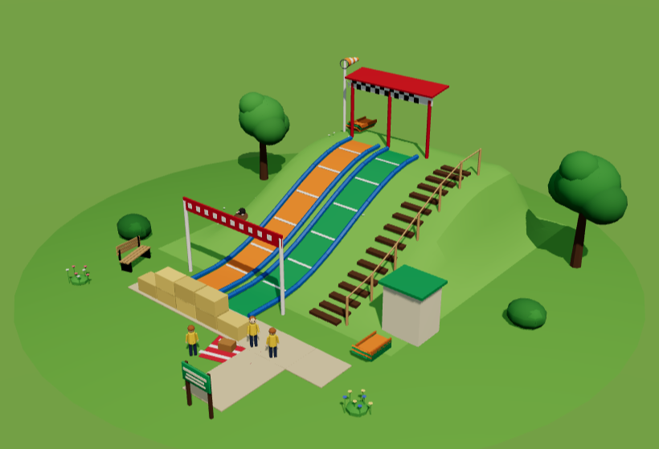

- **Where:** Meadow Isle, on the east far reach.
- A grassy hill with coloured sledging lanes, steps up to a starting gate and straw bales at the bottom. The windsock spins and a mole pops out of its molehill.
- **Have a go on:** the grass sledges.
- **Its button:** **Race down the hill**.
- **Its sign says:** "You don't need snow to go sledging! A grass sledge has a smooth, shiny plastic bottom that slips easily over the grass, while a rough, bumpy bottom would rub and slow you down. Plastic is a good material for sledges because it is smooth, light and waterproof."
- **National Curriculum:** Science, Year 1: everyday materials. Describe the simple physical properties of a variety of everyday materials, such as smooth, rough, shiny and waterproof.

### Duck Race

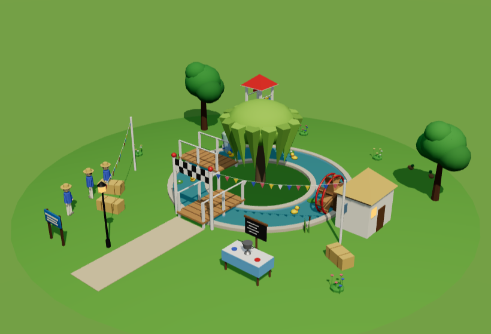

- **Where:** Meadow Isle, on the west far reach.
- Six rubber ducks race round a millstream under a chequered arch, past a waterwheel. The Character slides down the starting chute into the water.
- **Have a go on:** the duck chute.
- **Its button:** **Start the duck race**.
- **Its sign says:** "Rubber ducks float because they are hollow and full of air, which makes them light for their size. Things that are heavy for their size, like stones and coins, sink. Rubber and plastic make good bath toys because they are waterproof and bendy."
- **National Curriculum:** Science, Year 1: everyday materials. Describe the simple physical properties of everyday materials, such as which ones are waterproof, bendy or float.

### Kite Hill

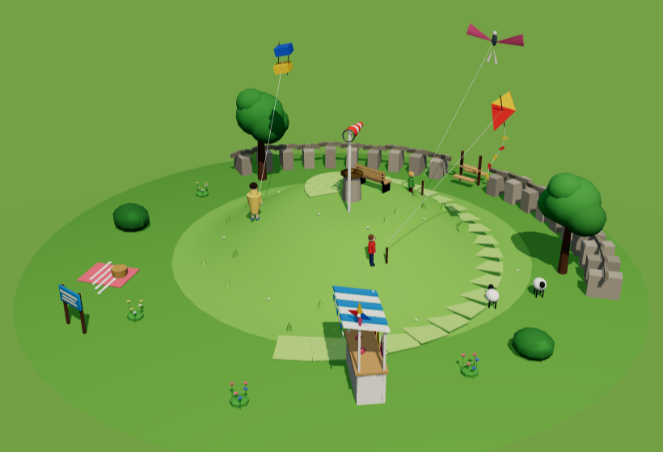

- **Where:** Meadow Isle, on the east far reach.
- A round hill with a spiral path to a toposcope at the top, three kites on their strings, a kite stall, a rabbit warren and lambs.
- **Have a go on:** the hill roll and the big gust.
- **Its button:** **Fly a kite**.
- **Its sign says:** "Wind is air on the move. You cannot see it, but you can see what it does: it bends the grass, turns windmills and lifts kites high into the sky. In the UK, autumn and spring are often the windiest seasons, which makes them the best times to fly a kite."
- **National Curriculum:** Science, Year 1: seasonal changes. Observe changes across the four seasons, and observe and describe the weather associated with the seasons, such as wind.

### Cricket Pitch

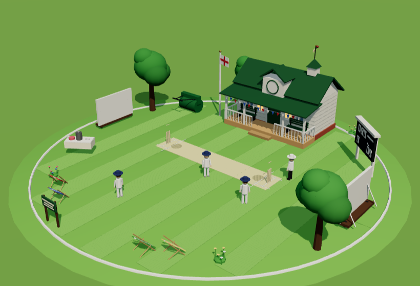

- **Where:** Meadow Isle, on the west far reach.
- A striped outfield with the pitch and wickets, a white pavilion with a railed veranda, a scoreboard and fielders in whites. The bails pop off as the Character comes near.
- **Have a go on:** the batting crease.
- **Its button:** **Bowl a ball**.
- **Its sign says:** "Cricket has been played on English village greens for more than 400 years. Two teams of eleven players take turns to bat and to bowl, and a batter scores a run each time they run from one wicket to the other. Running, throwing and catching are skills you can practise for games like this."
- **National Curriculum:** Physical Education, Key Stage 1: master basic movements, including running, throwing and catching, and take part in simple team games.

### Bobsleigh Track

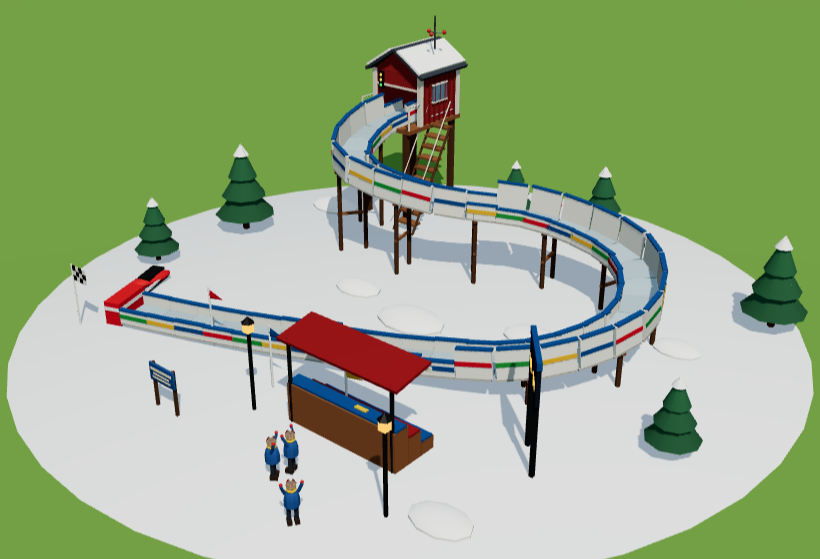

- **Where:** Frost Isle, on the east far reach.
- A red start house on stilts and an icy S-shaped track down to the finish, with a grandstand and a glowing timing board. The start lights come on as the Character comes near.
- **Have a go on:** the bobsleigh run.
- **Its button:** **Start the race**.
- **Its sign says:** "A bobsleigh races down a twisting track made of smooth ice. Ice is so slippery that there is hardly any friction to slow the sleigh down, so it goes faster and faster, up to 150 kilometres an hour! Rough surfaces, like snow or grass, have more friction and would slow it right down."
- **National Curriculum:** Science, Year 3: forces and magnets. Compare how things move on different surfaces.

### Ski Jump

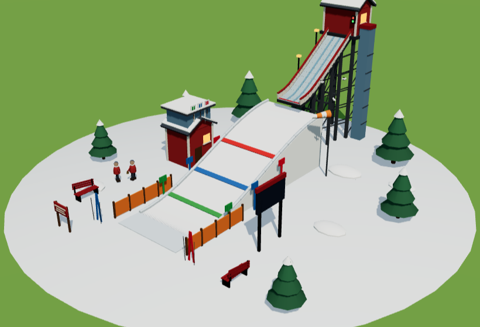

- **Where:** Frost Isle, on the west far reach.
- A steel tower with a lift, an in-run and a take-off, and a landing hill to walk on. The judges' score cards pop up after each jump.
- **Have a go on:** the ski jump.
- **Its button:** **Take a flying leap**.
- **Its sign says:** "Ski jumpers whoosh down a steep slope and fly through the air, sometimes for more than 100 metres! Their long skis are made from layers of wood, plastic and metal, because together these materials are strong, light and bendy, and slide smoothly over the snow."
- **National Curriculum:** Science, Year 2: identify and compare the suitability of a variety of everyday materials, including wood, metal and plastic, for particular uses.

### Snowball Range

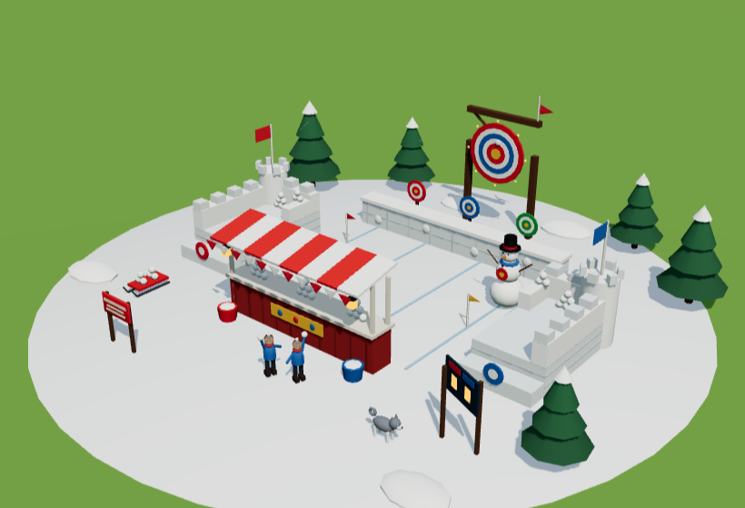

- **Where:** Frost Isle, on the east far reach.
- A throwing booth facing pop-up targets behind a snow wall, with red and blue team snow forts to climb. A snowman target wobbles and the bullseye spins.
- **Its button:** **Throw a snowball**.
- **Its sign says:** "Snow is made of millions of tiny ice crystals. When you squeeze a handful of snow, you change its shape and press the crystals together into a hard ball. Slightly wet snow makes the best snowballs, because a thin layer of water helps the crystals stick together."
- **National Curriculum:** Science, Year 2: find out how the shapes of solid objects made from some materials can be changed by squashing, bending, twisting and stretching.

### Curling Sheet

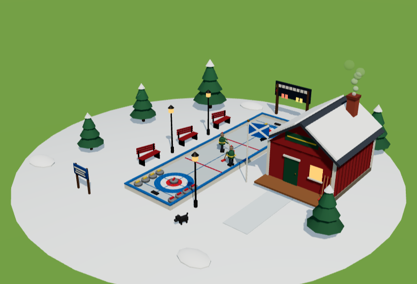

- **Where:** Frost Isle, on the east far reach.
- A long sheet of ice with targets and stones, beside a red clubhouse. A stone spins in the house and the scoreboard lights up.
- **Have a go on:** the curling sheet.
- **Its button:** **Slide a curling stone**.
- **Its sign says:** "Curling was first played on frozen ponds and lochs in Scotland, about 500 years ago. The heavy, round stones are made of granite, a very hard rock, and many of them come from a tiny Scottish island called Ailsa Craig. Players sweep the ice in front of a stone to help it slide further."
- **National Curriculum:** Geography, Key Stage 1: name, locate and identify characteristics of the four countries and capital cities of the United Kingdom.

### Snowmobile Trail

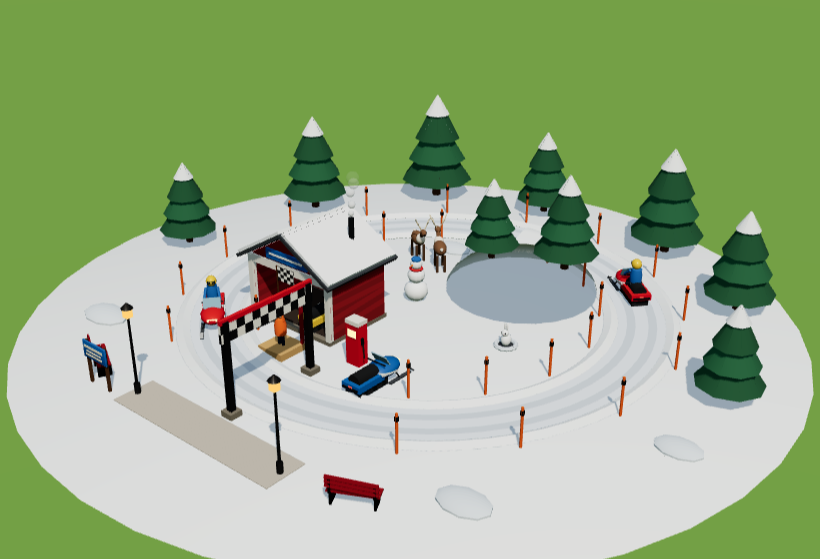

- **Where:** Frost Isle, on the east far reach.
- A groomed ring trail with a kicker and a chequered gantry, where snowmobiles race round a snowy hill. An arctic hare pops out of its burrow.
- **Have a go on:** the snowmobile trail.
- **Its button:** **Wave the chequered flag**.
- **Its sign says:** "A snowmobile has skis at the front to steer and a wide rubber track at the back that grips the snow. Wide skis and tracks spread the snowmobile's weight out, so it floats over soft snow instead of sinking in, just like snowshoes do for people."
- **National Curriculum:** Science, Year 2: identify and compare the suitability of everyday materials for particular uses, such as rubber tracks that grip and smooth metal skis that slide over snow.

### Snow Tubing Hill

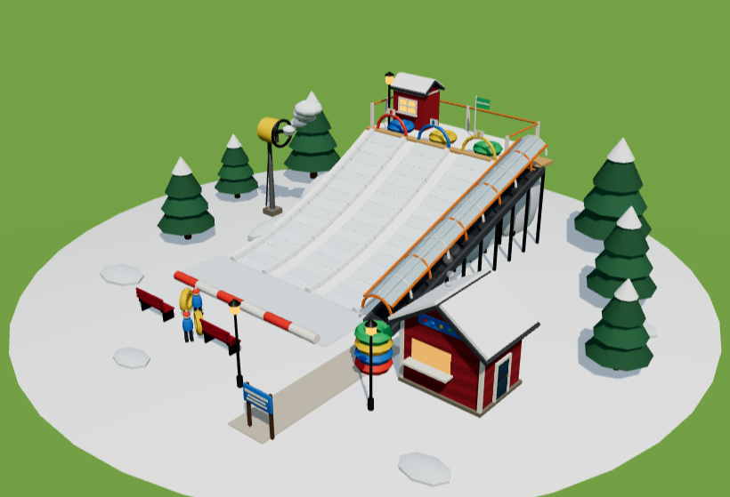

- **Where:** Frost Isle, on the east far reach.
- A snow hill with three lanes, a magic carpet up the side and a snow cannon that sprays as the Character comes near.
- **Have a go on:** the snow tubing hill.
- **Its button:** **Spin down the hill**.
- **Its sign says:** "A snow tube is a big rubber ring filled with air. It is smooth and slippery underneath, so it slides fast over snow, and its squashy, bouncy air keeps riders comfy over the bumps. The slope of the hill pulls the tube down, faster and faster."
- **National Curriculum:** Science, Year 2: identify and compare the suitability of everyday materials, including rubber and plastic, for particular uses, and find out how the shapes of solid objects can be changed by squashing.

### Ice Climbing Wall

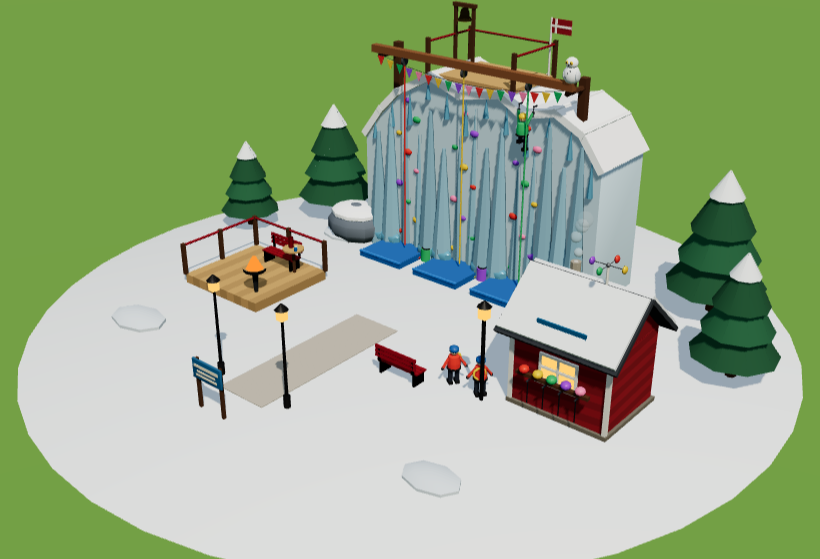

- **Where:** Frost Isle, on the east far reach.
- A frozen waterfall with three climbing lanes, a summit bell and a viewing deck with a brazier. A climber bobs up and down the ice.
- **Have a go on:** the ice climbing wall.
- **Its button:** **Ring the summit bell**.
- **Its sign says:** "When a waterfall freezes in winter, climbers can climb it! Ice is hard and slippery, so they wear boots with sharp metal spikes called crampons and carry ice axes to grip it. They wear helmets and are tied to a strong rope, so they are safe if they slip."
- **National Curriculum:** Science, Year 2: identify and compare the suitability of everyday materials for particular uses, such as hard metal spikes for gripping ice and strong ropes for keeping climbers safe.

### Chariot Racetrack

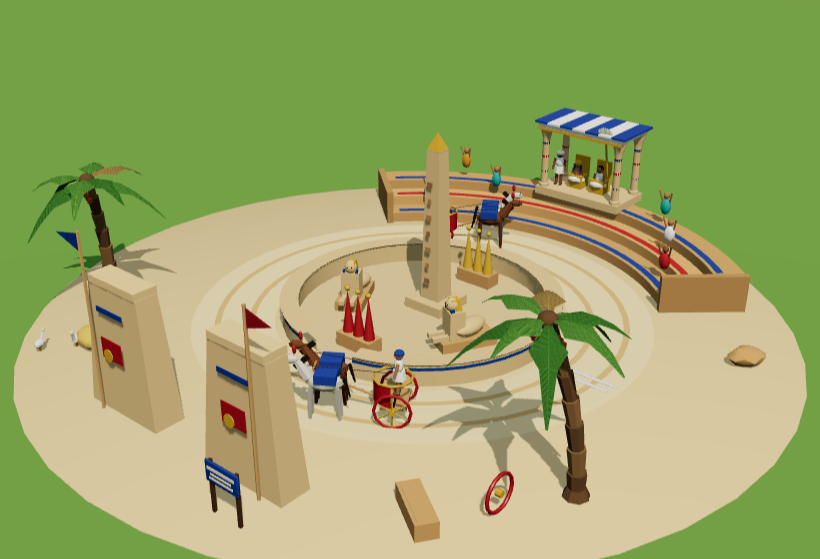

- **Where:** Sunscorch Sands, on the west far reach.
- An Egyptian racetrack where two chariots race round an obelisk, with a grandstand for the king and queen. The crowd jumps up cheering as the Character comes near.
- **Have a go on:** a chariot race.
- **Its button:** **Start the race**.
- **Its sign says:** "Ancient Egyptian chariots were light and fast, made of wood and leather, with two spoked wheels and two horses to pull them. A charioteer drove while a soldier stood beside him. The young pharaoh Tutankhamun was buried with six chariots, and his gilded ones can still be seen today."
- **National Curriculum:** History, Key Stage 2: the achievements of the earliest civilizations. A depth study of Ancient Egypt: pharaohs, horses and chariots.

### Sand Yachts

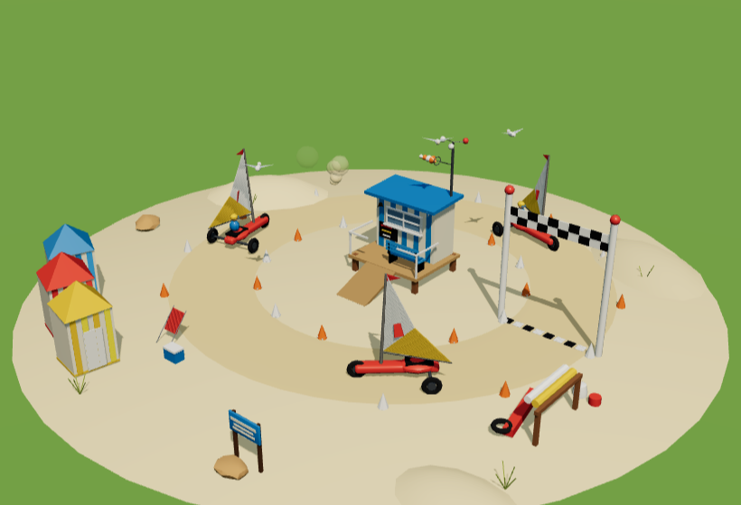

- **Where:** Sunscorch Sands, on the west far reach.
- Three sand yachts sail round a course of cones past a race-control hut on stilts. The wind-cups spin and the windsock swings.
- **Have a go on:** a sand-yacht sail.
- **Its button:** **Feel the wind**.
- **Its sign says:** "A sand yacht is a land yacht: a three-wheeled cart with a sail. When the wind blows, it pushes on the sail, and that push is a force that makes the yacht roll across the flat sand. The harder the wind pushes, the faster it goes, and the fastest land yachts have raced at over 120 miles an hour!"
- **National Curriculum:** Science, Year 3: forces and magnets. Pushes and pulls, and noticing that some forces need contact between two objects, such as the wind pushing on a sail.

### Dune Buggy Track

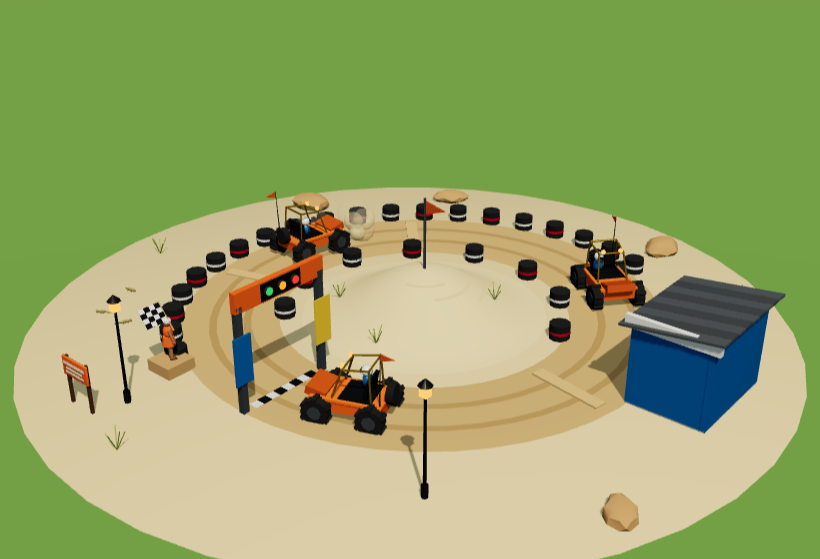

- **Where:** Sunscorch Sands, on the east far reach.
- Bouncing dune buggies race round a sand circuit with tyre walls and a dune to climb. The start lights come on and a marshal waves the flag.
- **Have a go on:** a dune-buggy lap.
- **Its button:** **Rev the engines**.
- **Its sign says:** "Dune buggies have huge, knobbly tyres that spread their weight over the soft sand, so they don't sink in. The knobbles grip the sand, and that grip between the tyres and the ground is a force called friction. On slippery or loose surfaces there is less friction, so wheels can spin and dig holes instead of pushing the buggy along!"
- **National Curriculum:** Science, Year 3: forces and magnets. Compare how things move on different surfaces, and notice that some forces, like friction, need contact between two objects.

### Sand Slide Tower

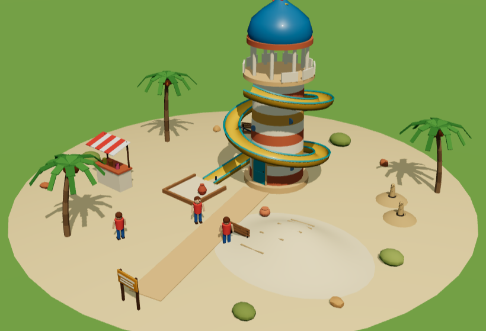

- **Where:** Sunscorch Sands, on the west far reach.
- A striped tower with a yellow slide spiralling twice round it to a sand pit, a sun-spinner on top and meerkats popping up from their burrows.
- **Have a go on:** the spiral sand slide.
- **Its button:** **Polish the slide**.
- **Its sign says:** "When you whizz down a slide, gravity pulls you down while friction between you and the slide slows you. A smooth, polished slide has less friction, so you go faster; on a rough or sandy slide there is more friction, and you slow down."
- **National Curriculum:** Science, Year 3: forces. How gravity pulls things down, and how friction slows things moving over different surfaces.

### Vine Swing Glade

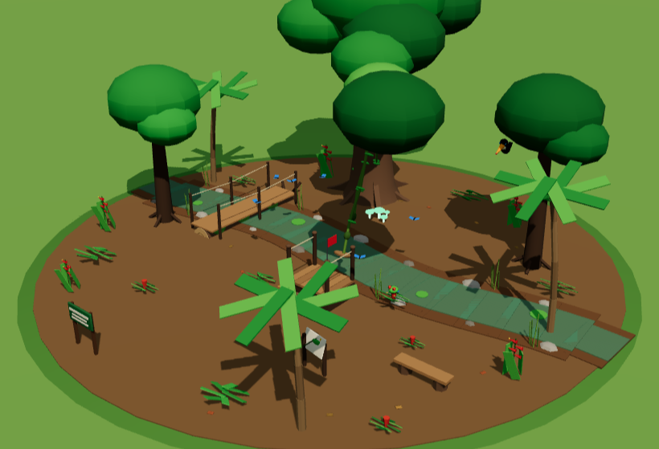

- **Where:** Jungle Reach, on the west far reach.
- A glade split by a creek under a giant tree, with a vine swing over the creek and a log bridge. A tree frog rises from its bromeliad and toadstools glow.
- **Have a go on:** the vine swing.
- **Its button:** **Swing across the creek**.
- **Its sign says:** "Lianas are woody vines that start on the shady forest floor and climb up the trees towards the sunlight. Plants need light to make their food, so climbing is a clever way to reach it. Some lianas grow more than 100 metres long!"
- **National Curriculum:** Science, Year 3: plants. Explore the requirements of plants for life and growth (light, water and room to grow): why lianas climb towards the sunlight.

### Jungle Coaster

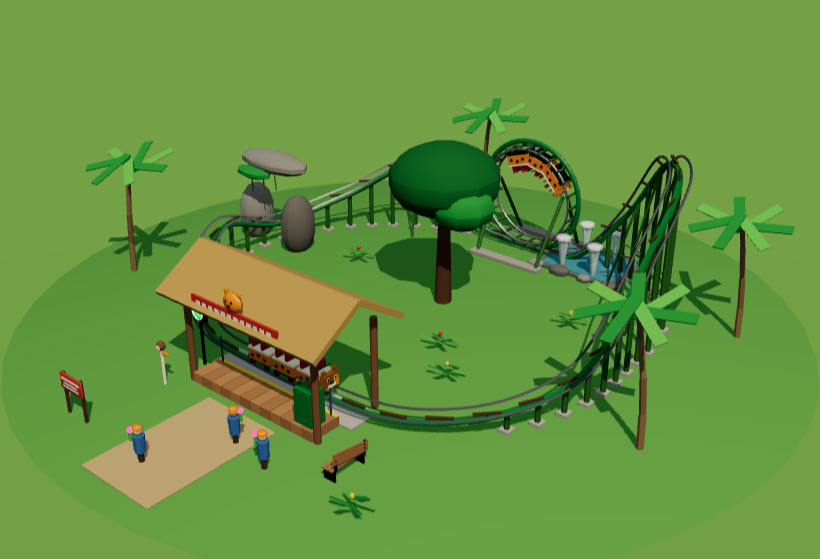

- **Where:** Jungle Reach, on the east far reach.
- A roller coaster with a lift hill, a drop over a splash pool, a vertical loop and a rock arch, and a jaguar-faced train.
- **Have a go on:** the Jungle Coaster.
- **Its button:** **Ride the Jungle Coaster**.
- **Its sign says:** "A roller coaster has no engine to push it round. A chain pulls the train up the first big hill, then gravity pulls it down, and its speed carries it up the next hill and round the loop. Friction and air resistance slow it a little all the way, so every hill after the first must be lower."
- **National Curriculum:** Science, Year 5: forces. Explain that unsupported objects fall towards the Earth because of gravity, and identify the effects of air resistance and friction (a roller coaster's hills).

### High Ropes Course

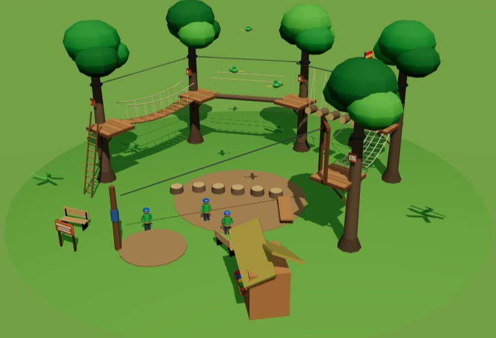

- **Where:** Jungle Reach, on the east far reach.
- Five platforms linked by a rope bridge, a balance log, swinging logs and a cargo net, with a zip wire down. The finish bell rings and the flag rises.
- **Have a go on:** the high ropes and zip wire.
- **Its button:** **Ring the finish bell**.
- **Its sign says:** "Your sense of balance comes from tiny tubes of liquid deep inside your ears. When you wobble, the liquid sloshes about and tells your brain which way is up, so your muscles can hold you steady. Practising on beams, rope bridges and nets makes your balance and your muscles stronger."
- **National Curriculum:** Physical education, Key Stage 2: develop flexibility, strength, technique, control and balance, and take part in outdoor and adventurous activity challenges, both individually and within a team.

### Giant Kapok Climb

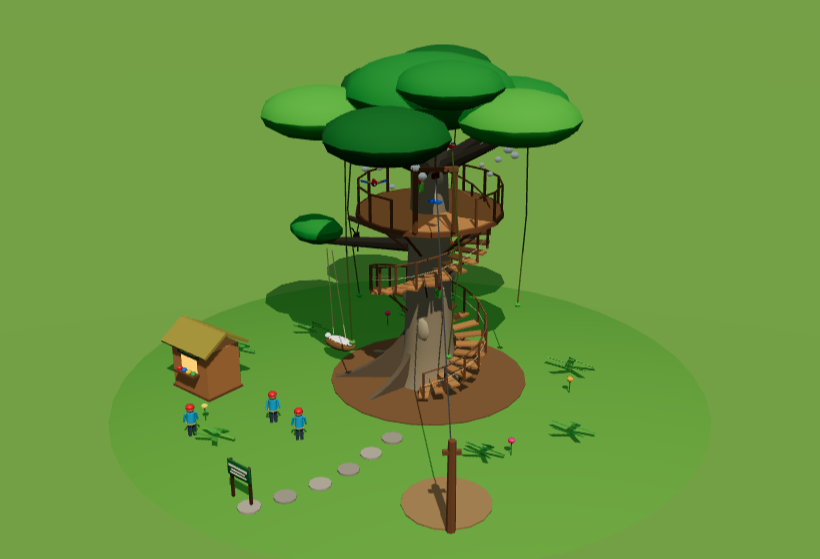

- **Where:** Jungle Reach, on the east far reach.
- A huge kapok tree with a spiral stair to a lookout and a zip wire down, and a seed-pod swing. A toucan nods and fluff bursts from the pods.
- **Have a go on:** the spiral climb and zip wire and the seed-pod swing.
- **Its button:** **Shake the seed pods**.
- **Its sign says:** "The kapok is one of the tallest trees in the rainforest, growing up to 60 metres, high above the other trees. Huge buttress roots, like wooden walls, hold it steady in the thin soil. A single kapok is a habitat for thousands of animals, from frogs and insects to monkeys and eagles, and its seeds float away on fluffy fibres to grow new trees."
- **National Curriculum:** Science, Year 4: living things and their habitats. Recognise that environments can change and that a habitat such as a rainforest tree is home to many different living things (the kapok, the giant of the rainforest).

### Dragon Boat Lake

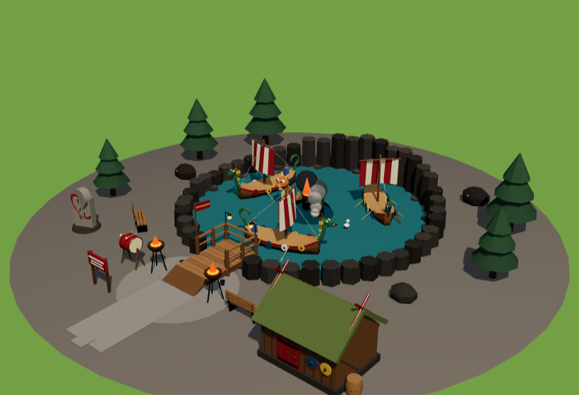

- **Where:** Ember Isle, on the east far reach.
- A crater lake with three dragon-prowed longships sailing round it, a jetty and a boathouse. A friendly lake dragon rises from the water.
- **Have a go on:** the dragon boat.
- **Its button:** **Beat the rowing drum**.
- **Its sign says:** "Viking longships were long, narrow and light, so they could cross the open sea and still row up shallow rivers. They had a big square sail for the wind and rows of oars for rowing, and some had a carved dragon's head on the prow. From about AD 793, Vikings sailed them from Scandinavia to raid and settle in Britain."
- **National Curriculum:** History, Key Stage 2: the Viking and Anglo-Saxon struggle for the Kingdom of England. How Viking longships carried raiders and settlers to Britain.

### Mine Cart Ride

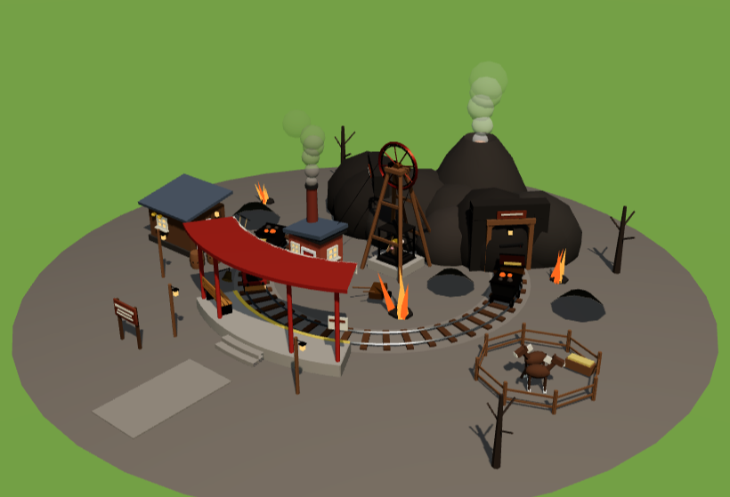

- **Where:** Ember Isle, on the east far reach.
- A railway through a smoking volcano tunnel, with little steam engines pulling carts of glowing ore. A miner mole rises up the shaft to wave.
- **Have a go on:** the mine train.
- **Its button:** **Ring the station bell**.
- **Its sign says:** "Mine carts have smooth steel wheels that roll on smooth steel rails, so there is very little friction to slow them down, and a pony or a little engine can pull a heavy load of rock. Friction is a force between two surfaces that rub or roll over each other. To stop a cart, a brake presses on its wheels to make more friction."
- **National Curriculum:** Science, Year 5: forces. The effects of friction between moving surfaces, using mine carts on steel rails.

### Lava Flume

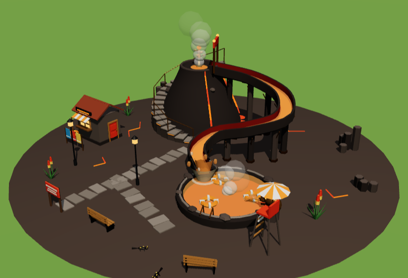

- **Where:** Ember Isle, on the west far reach.
- A water slide running with glowing orange 'lava' from a volcano crater down to a splash pool with a dragon-head spout.
- **Have a go on:** the lava flume.
- **Its button:** **Ride the Lava Flume**.
- **Its sign says:** "Friction is a force that slows things down when they rub against each other. On a flume, a thin layer of running water between you and the slide makes the friction much smaller, so gravity can pull you down faster and faster until you splash into the pool!"
- **National Curriculum:** Science, Year 5: forces. Explain that unsupported objects fall towards the Earth because of gravity, and identify the effects of friction and water resistance.

### Firework Tower

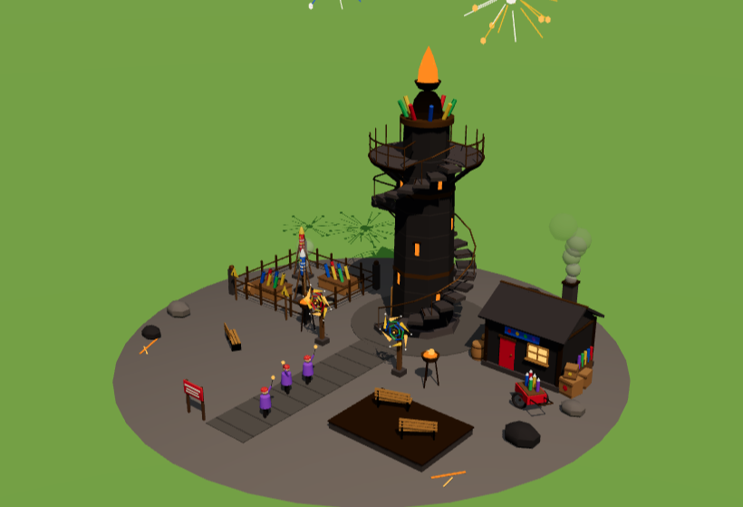

- **Where:** Ember Isle, on the east far reach.
- A tower with a spiral stair and a crown of mortar tubes, a launch field and Catherine wheels. Star bursts bloom over the tower.
- **Have a go on:** the Firework Tower's spiral stair.
- **Its button:** **Light the fuse**.
- **Its sign says:** "When a firework's powder burns, it turns into brand new materials, such as smoke, gases and ash, which can never be turned back into powder: burning is an irreversible change. A pinch of a different metal in each star gives its colour, so copper glows blue, strontium glows red and sodium glows yellow."
- **National Curriculum:** Science, Year 5: properties and changes of materials. Explain that some changes result in the formation of new materials, and that this kind of change is not usually reversible, including changes associated with burning.

### Drop Tower

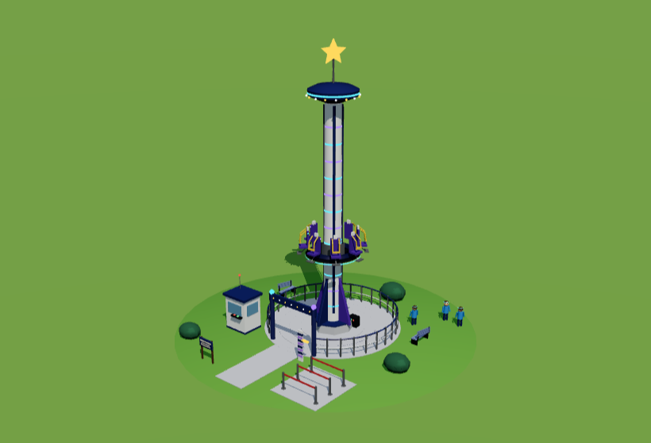

- **Where:** Starfall Isle, on the west far reach.
- A tall tower whose ring of seats climbs to the top and drops back down, with a gold star whirling on top.
- **Have a go on:** the drop tower.
- **Its button:** **Press the big drop button**.
- **Its sign says:** "Everything falls because gravity pulls it towards the middle of the Earth. Without air to push against them, a hammer and a feather fall at exactly the same speed, as astronaut David Scott showed on the Moon in 1971. On Earth, air resistance pushes up against falling things and slows them down."
- **National Curriculum:** Science, Year 5: forces. Explain that unsupported objects fall towards the Earth because of the force of gravity, and identify the effects of air resistance.

### Star Flyer

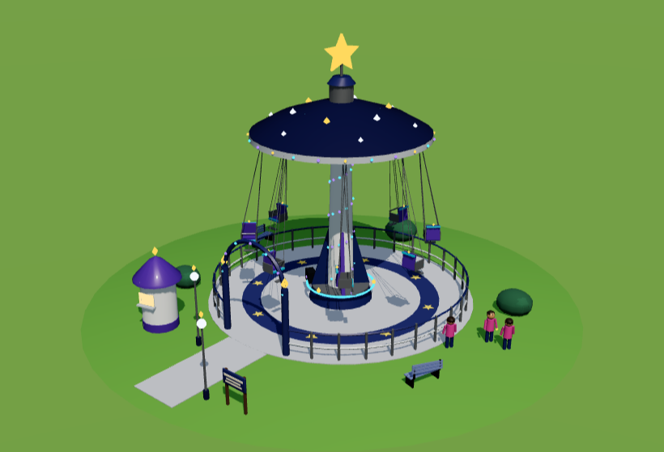

- **Where:** Starfall Isle, on the west far reach.
- A chair-swing ride under a starry canopy, whose chairs fly out on their chains as it spins.
- **Have a go on:** the star flyer.
- **Its button:** **Spin the Star Flyer faster**.
- **Its sign says:** "The swing chairs fly round in a circle because their chains keep pulling them in towards the tower. In the same way, the pull of the Earth's gravity keeps the Moon travelling round the Earth, once about every 27 days, instead of flying off into space. The Moon is about a quarter as wide as the Earth."
- **National Curriculum:** Science, Year 5: Earth and space. Describe the movement of the Moon relative to the Earth.

### Mirror Maze

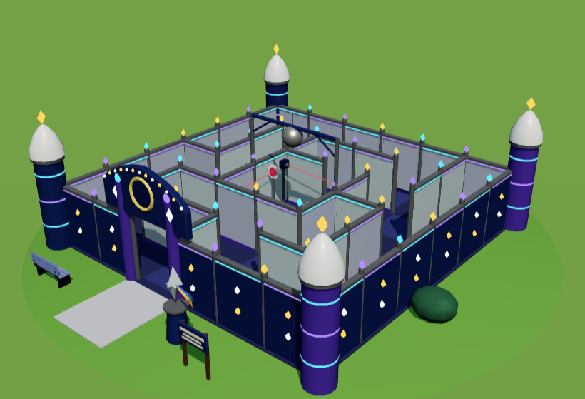

- **Where:** Starfall Isle, on the east far reach.
- A walkable maze of mirrors with turrets at the corners, leading to a court where a laser bounces between mirrors and the floor spins.
- **Have a go on:** the spinning mirror floor.
- **Its button:** **Shine the laser**.
- **Its sign says:** "Light travels in straight lines. When it hits a mirror it bounces off, or reflects, at the same angle it arrived, which is why a mirror maze seems to go on for ever. We see things because light from them travels into our eyes, so a mirror shows us light that has bounced off it."
- **National Curriculum:** Science, Year 6: light. Recognise that light appears to travel in straight lines, and use this to explain how objects are seen and how mirrors reflect light.

### Astronaut Centrifuge

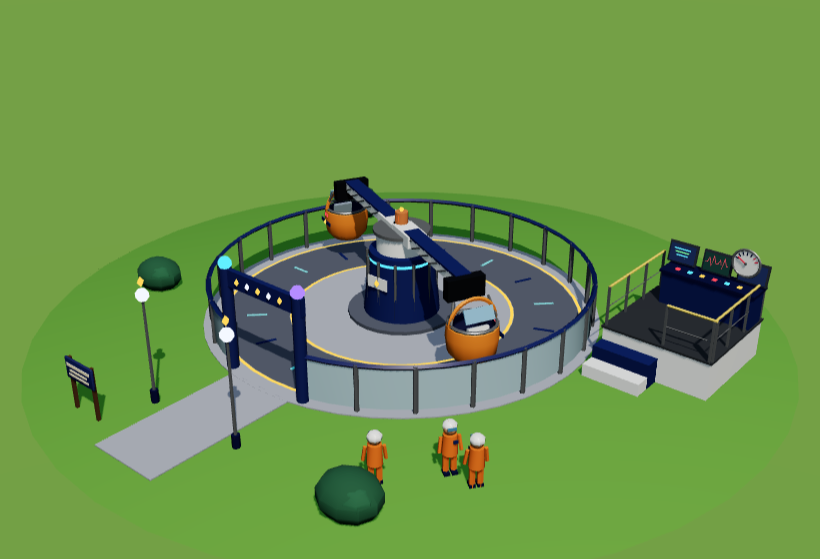

- **Where:** Starfall Isle, on the east far reach.
- Two long arms whirl their pods round a hub, watched from a gallery with a control desk and a heartbeat trace.
- **Have a go on:** the astronaut centrifuge.
- **Its button:** **Check your heartbeat**.
- **Its sign says:** "Astronauts ride centrifuges like this to get ready for the push of a rocket launch. As it spins faster, riders are pressed into their seats and blood is pulled towards their feet, so the heart has to pump harder to push blood up to the brain. Blood travels from the heart in arteries and comes back in veins."
- **National Curriculum:** Science, Year 6: animals, including humans. Identify and name the main parts of the human circulatory system, and describe the functions of the heart, blood vessels and blood.

### Black Hole Slide

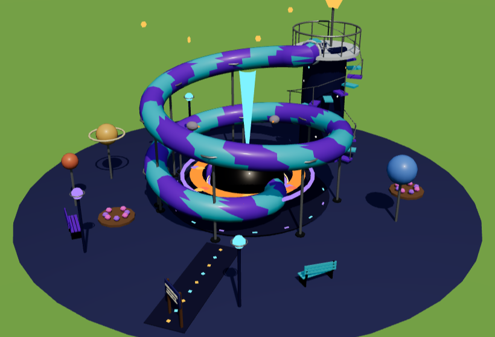

- **Where:** Starfall Isle, on the west far reach.
- A tube slide spiralling down from a starry tower into a glowing black hole, and out through a wormhole.
- **Have a go on:** the black hole slide.
- **Its button:** **Drop a marble in**.
- **Its sign says:** "Gravity is a force that pulls things towards each other: it is what makes you slide down a slide and keeps the planets going round the Sun. A black hole is a place in space where gravity is so strong that nothing can escape from it, not even light, which is why it looks completely black."
- **National Curriculum:** Science, Year 5: forces, and Earth and space. Unsupported objects fall because of the force of gravity, and gravity holds the planets in their orbits.

## Village and town

### Ice Rink

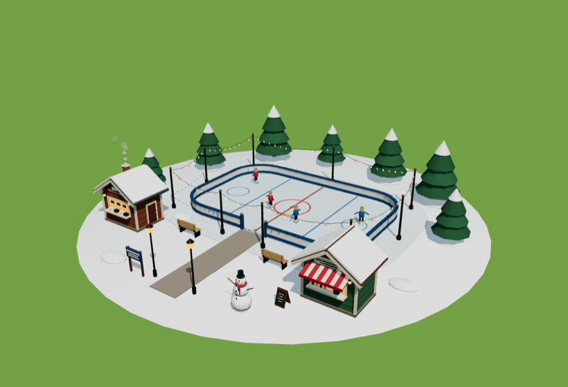

- **Where:** Frost Isle.
- The ice is slippery, so the Character slides about on it.
- **Its sign says:** "When water cools to 0 degrees Celsius it freezes into solid ice, and when it warms up again it melts back into liquid water. Ice is a little lighter than water, so ponds freeze from the top down."
- **National Curriculum:** Science, Year 4: states of matter. Water freezes at 0 °C and melts back into a liquid when it warms.

### Village Green

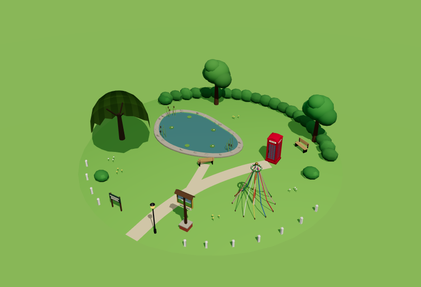

- **Where:** Jungle Reach.
- **Its sign says:** "A pond is a habitat: ducks, frogs, newts, water snails and dragonflies all find food and shelter there. Mallard ducks dabble, tipping head-down to nibble plants under the water."
- **National Curriculum:** Science, Year 2: living things and their habitats. A pond is a habitat that gives animals food and shelter.

### Post Office

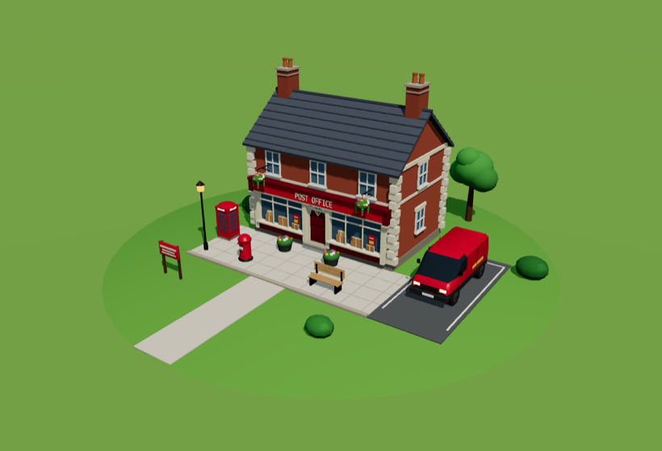

- **Where:** Sunscorch Sands.
- **Visit** gives the Character a parcel to deliver to another Attraction on the Island.
- **Its sign says:** "Every letter needs an address: the person's name, the house, the street, the town and a postcode. The postcode tells the sorting office which street to send it to, so it can reach anywhere in the United Kingdom."
- **National Curriculum:** Geography, Key Stage 1: locational knowledge. Using addresses and maps to find places in the United Kingdom.

### Bakery

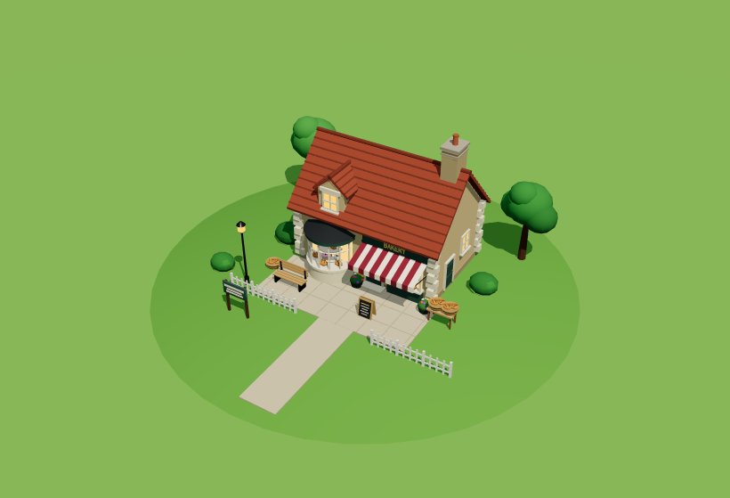

- **Where:** Jungle Reach.
- **Its sign says:** "Baking is a change that cannot be undone. The heat of the oven turns soft dough into crusty bread, and nobody can turn a loaf back into flour, water and yeast again."
- **National Curriculum:** Science, Year 5: properties and changes of materials. Some changes, like baking, make new materials and cannot be reversed.

### Fire Station

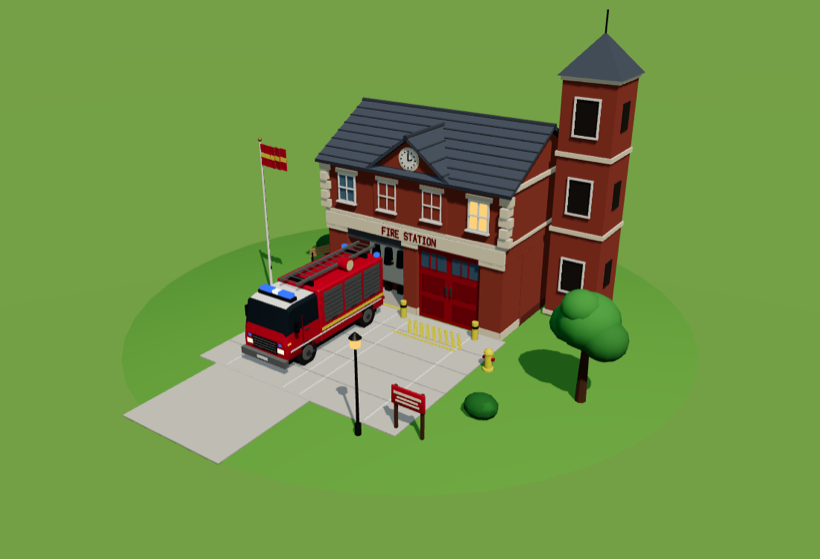

- **Where:** Ember Isle.
- **Its sign says:** "In 1666 the Great Fire of London started in a bakery on Pudding Lane and burned for four days. Houses were made of wood and packed close together, and there was no fire brigade, so people fought the flames with leather buckets and water squirts."
- **National Curriculum:** History, Key Stage 1: events beyond living memory. The Great Fire of London.

### Lighthouse

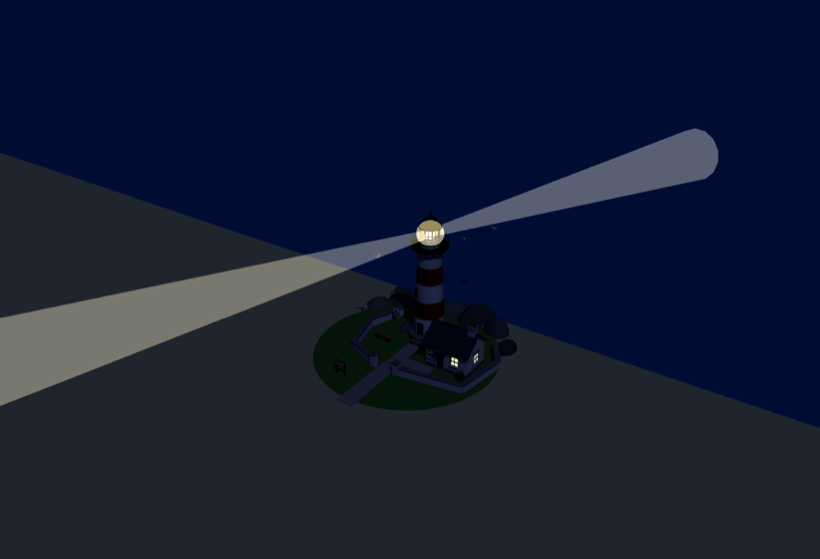

- **Where:** Frost Isle, on the shore.
- Its lamp turns and shines out to sea after dark, as here.
- **Its sign says:** "A lighthouse shines its light out to sea to warn ships away from dangerous rocks. In 1838 Grace Darling, the daughter of a lighthouse keeper, rowed through a storm with her father to rescue nine people from a shipwreck off the coast of Northumberland."
- **National Curriculum:** History, Key Stage 1: significant individuals. Grace Darling and the work of lighthouse keepers.

### School

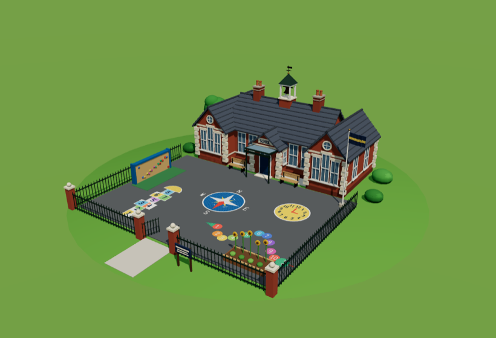

- **Where:** Every Island.
- **Have a go on:** the hopscotch and the climbing wall.
- **Its sign says:** "Before 1870 many children in England never went to school, and lots of them worked instead. Victorian schools had one big classroom, slates to write on, and a bell that rang to call everyone in from the playground."
- **National Curriculum:** History, Key Stage 1: changes within living memory and beyond. How schools have changed since Victorian times.

### Library

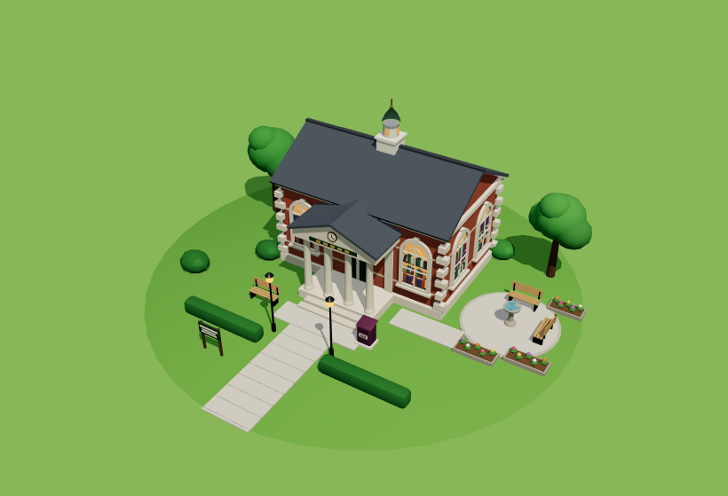

- **Where:** Frost Isle.
- **Visit** offers a story from the Island's English Region.
- **Its sign says:** "A library lends books for free, so anyone can borrow a story, read it at home and bring it back for someone else. Fiction books are stories from an author's imagination, and they are kept in alphabetical order by the author's surname."
- **National Curriculum:** English, Key Stage 1 and 2: reading. Listening to, reading and choosing a wide range of stories, poems and information books.

### Allotments

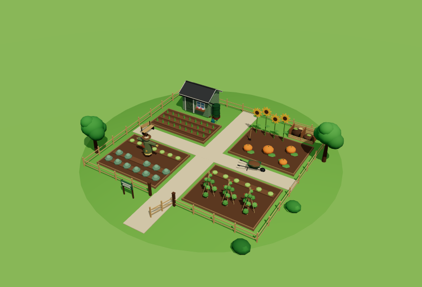

- **Where:** Ember Isle.
- **Its sign says:** "Plants need water, light and warmth to grow well, and their roots take in water and goodness from the soil. Allotment gardeners add compost made from rotted plant scraps to feed the soil, and runner beans climb tall canes towards the light."
- **National Curriculum:** Science, Years 2 and 3: plants. What plants need to grow and stay healthy, and the jobs of roots, stems, leaves and flowers.

### Village Fete

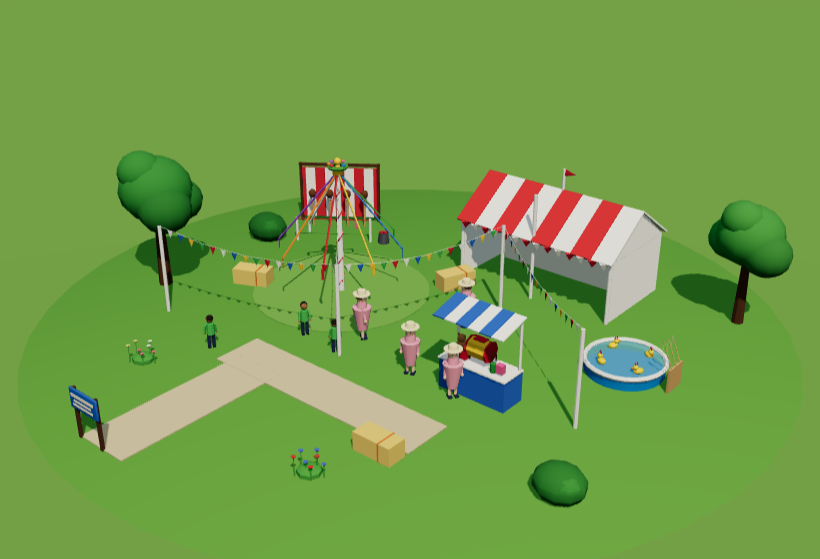

- **Where:** Meadow Isle, on the east far reach.
- A maypole whose ribbons whirl, a striped tea marquee, a tombola, a hook-a-duck pool and a coconut shy under bunting.
- **Have a go on:** the maypole dance.
- **Its button:** **Spin the tombola**.
- **Its sign says:** "A village fete is held in summer, when the days are long and warm. In the UK the longest day of the year is in June, when the Sun is up for more than sixteen hours, and the shortest day is in December, with less than eight. Village fetes often keep a maypole from the spring, when dancing round it on May Day welcomed the summer."
- **National Curriculum:** Science, Year 1: seasonal changes. Observe changes across the four seasons, and how day length varies.

### Pony Stables

- **Where:** Meadow Isle, on the west far reach.
- A brick stable block with ponies looking out over their doors, a clock cupola, a tack room and a sand arena with jumps where a pony circles.
- **Have a go on:** a pony ride.
- **Its button:** **Brush the pony**.
- **Its sign says:** "Ponies are mammals: they have hair, breathe air and feed their babies, called foals, on milk. They are herbivores that eat grass and hay. A pony has hard hooves on its four legs, and a long mane and tail of thick hair."
- **National Curriculum:** Science, Year 1: animals, including humans. Identify and name a variety of common animals, including mammals, and describe and compare their structure.

### Puppet Theatre

- **Where:** Meadow Isle, on the west far reach.
- A striped booth showing The Three Little Pigs on a wooden stage, with benches for the audience. The pig pops up, the wolf sways and the show plays Pop Goes the Weasel.
- **Have a go on:** the trapdoor.
- **Its button:** **Raise the curtain**.
- **Its sign says:** "Puppet shows are one of the oldest ways of telling stories. A glove puppet is worked by a hand inside it, and a marionette hangs from strings and is moved from above. Acting out a traditional tale like The Three Little Pigs helps you remember its beginning, middle and end."
- **National Curriculum:** English, Year 1: reading. Become very familiar with key stories, fairy stories and traditional tales, retelling them and considering their particular characteristics.

### Canal Lock

- **Where:** Meadow Isle, on the east far reach.
- A canal climbing through a brick lock beside the lock-keeper's cottage, with a painted narrowboat that rises in the lock and a humpback bridge to walk over.
- **Have a go on:** the narrowboat and the balance beam.
- **Its button:** **Open the paddles**.
- **Its sign says:** "Canals are waterways dug by people about 250 years ago, so that horses could pull heavy loads like coal along them on narrowboats. A lock is like a water lift: when its gates are shut and water flows in, a boat floats up to the higher canal, and when the water flows out it floats back down."
- **National Curriculum:** Geography, Key Stage 1: human and physical geography. Use basic geographical vocabulary to refer to key human features, such as a canal, a lock and a bridge.

### Sheepdog Trials

- **Where:** Meadow Isle, on the west far reach.
- A course of hurdle gates with a pen and a shedding ring, a shepherd's hut and a grandstand. Two sheepdogs work the sheep while the shepherd waves the crook.
- **Have a go on:** the sheepdog course.
- **Its button:** **Whistle for the dog**.
- **Its sign says:** "Sheep are herbivores, which means they eat only plants, mostly grass. A sheepdog listens for its shepherd's whistles: one whistle means go left, another means go right, and a long one means lie down. Sheep and dogs are both mammals, with wool or fur to keep them warm."
- **National Curriculum:** Science, Year 1: animals, including humans. Identify and name a variety of common animals that are carnivores, herbivores and omnivores.

### Ice Palace

- **Where:** Frost Isle, on the west far reach.
- A palace of ice blocks with towers, an onion-domed spire and a slippery courtyard to skate on. A snowflake star whirls on the spire and a winding ice slide runs down from a tower.
- **Have a go on:** the ice slide.
- **Its button:** **Ring the ice bells**.
- **Its sign says:** "Every winter in Sweden, builders cut huge blocks of ice from a frozen river to build a real ice hotel, with ice beds, ice chairs and even ice glasses. Ice is hard, strong and see-through, so it makes a beautiful building material, but only where it stays cold. In spring the whole hotel melts and flows back into the river."
- **National Curriculum:** Science, Year 2: identify and compare the suitability of a variety of everyday materials for particular uses, including how ice melts when it warms.

### Mountain Rescue Hut

- **Where:** Frost Isle, on the west far reach.
- A red rescue hut with a lookout tower, a helipad and a rescue helicopter whose rotor whirls, a rescue bell and two St Bernard dogs.
- **Have a go on:** the lookout tower ladder.
- **Its button:** **Ring the rescue bell**.
- **Its sign says:** "Mountain rescue teams help people who are lost or hurt in the snowy mountains. They wear bright orange and yellow so they are easy to spot against white snow, and warm, waterproof layers keep them dry and cosy. Some teams even have dogs that can sniff out people buried in the snow."
- **National Curriculum:** Science, Year 2: identify and compare the suitability of everyday materials for particular uses, such as warm, waterproof and brightly coloured clothes for the snowy mountains.

### Desert Fort

- **Where:** Sunscorch Sands, on the east far reach.
- A mud-brick fort with bastions and a wall-walk, a well with a shaduf, granaries and a zip wire from the tower into the yard. A lookout pops up on the tower.
- **Have a go on:** the zip wire.
- **Its button:** **Sound the alarm**.
- **Its sign says:** "The Ancient Egyptians built mighty forts of mud brick along the River Nile, to guard their southern border. The fort at Buhen had thick walls with towers, narrow slits for archers and a ditch all round. Mud bricks were made from Nile mud mixed with straw, shaped in wooden moulds and baked hard in the sun."
- **National Curriculum:** History, Key Stage 2: the achievements of the earliest civilizations. A depth study of Ancient Egypt: how the Egyptians built and defended their land.

### Papyrus Workshop

- **Where:** Sunscorch Sands, on the east far reach.
- A pool of papyrus reeds with a reed raft, and a workshop where papyrus is pressed and dried, with a scribe at work. An ibis dips its beak to a harp tune.
- **Have a go on:** a papyrus raft trip.
- **Its button:** **Make a sheet of papyrus**.
- **Its sign says:** "The Ancient Egyptians made paper from papyrus, a tall reed that grew beside the River Nile. They cut the stems into thin strips, laid them in two layers crossways, then pressed and dried them into smooth sheets. Scribes wrote on them in hieroglyphs with reed pens, and our word 'paper' comes from 'papyrus'."
- **National Curriculum:** History, Key Stage 2: the achievements of the earliest civilizations. A depth study of Ancient Egypt: writing, hieroglyphs and papyrus.

### Pottery Kiln

- **Where:** Sunscorch Sands, on the east far reach.
- A beehive kiln that glows and smokes, a potter's wheel that spins faster, pots drying on a terrace and a clay tub to stomp in.
- **Have a go on:** the clay tub.
- **Its button:** **Fire up the kiln**.
- **Its sign says:** "Clay is a kind of soil made of tiny, sticky grains. When it is wet you can squeeze it into any shape, and when it is baked in a very hot kiln it changes for ever into hard pottery that can hold water. People have been making pots like this since the Stone Age."
- **National Curriculum:** Science, Year 3: rocks and soils. How soils such as clay are made from rocks, and how clay changes when it is fired.

### Windcatcher House

- **Where:** Sunscorch Sands, on the east far reach.
- A mud-brick house with a tall windcatcher tower and a roof terrace to walk on. The courtyard fountain leaps, the lanterns light and wind chimes play.
- **Its button:** **Open the wind vents**.
- **Its sign says:** "A windcatcher is a tall tower on a roof with openings that catch the breeze high above the hot ground. The wind is pushed down the tower into the rooms below and warm air flows out, so the house stays cool without any electricity. Ancient Egyptian houses had wind scoops like this over 3,000 years ago."
- **National Curriculum:** History, Key Stage 2: the achievements of the earliest civilizations, a depth study of Ancient Egypt, including how people kept their homes cool.

### Stilt Village

- **Where:** Jungle Reach, on the east far reach.
- Thatched huts on stilts over a lagoon, joined by a boardwalk, with a campfire and a dugout canoe. A crocodile rises from the water.
- **Have a go on:** the dugout canoe.
- **Its button:** **Paddle round the lagoon**.
- **Its sign says:** "In the rainy season, rainforest rivers can rise by several metres and flood the land beside them. Houses built on tall stilts stay dry while the water flows underneath, and people paddle from house to house by canoe."
- **National Curriculum:** Geography, Key Stage 2: human and physical geography. Rivers, and types of settlement and land use: why some rainforest villages stand on stilts.

### Cacao Farm

- **Where:** Jungle Reach, on the west far reach.
- Cacao trees with pods on their trunks, a bean-drying floor, a chocolate workshop with a chocolate fountain and a little railway round the farm.
- **Have a go on:** the cocoa wagon.
- **Its button:** **Melt some chocolate**.
- **Its sign says:** "Chocolate is made from the seeds of the cacao tree, which grow inside big pods straight out of its trunk. The cocoa butter in chocolate melts at just below the temperature of your body, so a bar is solid in its wrapper but melts into a runny liquid on your tongue."
- **National Curriculum:** Science, Year 4: states of matter. Observe that some materials change state when they are heated or cooled (chocolate melting from a solid to a liquid).

### Glassblowing Studio

- **Where:** Ember Isle, on the east far reach.
- A studio with a glowing furnace, a glassblower at work and shelves of coloured glass, and a cooling tunnel to ride through. A glass bubble grows.
- **Have a go on:** the cooling tunnel.
- **Its button:** **Blow a glass bubble**.
- **Its sign says:** "Glass is made by heating sand, soda and lime in a furnace until they melt into a glowing, runny liquid. A glassblower gathers a blob on a long pipe, blows it into shape and lets it cool slowly so it doesn't crack. It is an irreversible change: the glass can never turn back into sand."
- **National Curriculum:** Science, Year 5: properties and changes of materials. Melting sand into glass is a change that cannot be reversed.

### Pompeii Street

- **Where:** Ember Isle, on the east far reach.
- A Roman street with stepping stones, a snack bar, a bakery with mills and an oven, and Vesuvius smoking behind. The fountain splashes and the mill turns.
- **Have a go on:** the baker's mill.
- **Its button:** **Bake a Roman loaf**.
- **Its sign says:** "In AD 79 the volcano Vesuvius erupted and buried the Roman town of Pompeii under deep ash. The ash kept its streets, shops, paintings and even loaves of bread hidden for over 1,500 years, so archaeologists can see how Romans lived. Its big stepping stones let people cross the road without treading in the mud."
- **National Curriculum:** History, Key Stage 2: the Roman Empire. How archaeologists learn about everyday Roman life from towns like Pompeii, buried when Vesuvius erupted in AD 79.

### Home Front House

- **Where:** Starfall Isle, on the west far reach.
- A 1940s house and garden with an Anderson shelter, a Dig for Victory patch, hens and a washing line, and a wireless playing.
- **Have a go on:** the Anderson shelter.
- **Its button:** **Listen to the wireless**.
- **Its sign says:** "In the Second World War, millions of British families dug an Anderson shelter into the garden: curved steel sheets half buried under earth, to keep them safe during air raids. Food was rationed, so the Dig for Victory campaign asked everyone to grow vegetables in gardens, parks and even on top of their shelters."
- **National Curriculum:** History, Key Stage 2: a study of an aspect or theme in British history that extends pupils' chronological knowledge beyond 1066 (Britain in the Second World War: life on the home front).

### Inventors' Hall

- **Where:** Starfall Isle, on the west far reach.
- A Victorian hall with a giant light bulb, a telephone, a printing press and a giant circuit, and a penny-farthing to ride outside.
- **Have a go on:** the penny-farthing.
- **Its button:** **Flick the big switch**.
- **Its sign says:** "In 1880 the British inventor Joseph Swan lit his house in Gateshead with electric light bulbs, one of the first homes in the world to have them. A bulb only lights when it is part of a complete circuit, with no gaps; a switch works by opening a gap to turn it off and closing it to turn it back on."
- **National Curriculum:** Science, Year 6: electricity. How a switch opens and closes a circuit, how cells make a bulb light, and the symbols used to draw a simple circuit.

## Nature

### Farm

- **Where:** Meadow Isle.
- **Its sign says:** "Cows and sheep are herbivores: they eat only plants, mostly grass and hay. A cow chews its food again and again to get all the goodness out of it, and a sheep's woolly fleece is clipped off each summer to make warm clothes."
- **National Curriculum:** Science, Years 1 and 2: animals, including humans. Common animals and what they eat (herbivores, carnivores and omnivores), and what animals need to survive.

### Treehouse

- **Where:** Sunscorch Sands.
- **Have a go on:** the ladder, the slide and the tyre swing.
- **Its sign says:** "A tree is the biggest plant of all. Its roots hold it firm and drink water from the soil, the trunk carries the water up, and the leaves use sunlight to make the tree's food. One old oak can be home to hundreds of different minibeasts, birds and other animals."
- **National Curriculum:** Science, Years 2 and 3: plants and habitats. The jobs of roots, trunk (stem) and leaves, and how a tree gives animals a place to live.

### Campsite

- **Where:** Jungle Reach.
- **Its sign says:** "A campfire is a light source: it makes its own light, just like the Sun, a torch or a lantern. The Moon is not a light source, because it only reflects light from the Sun. Campers always keep a bucket of water by the fire to stay safe."
- **National Curriculum:** Science, Year 3: light. Recognising that we need light to see things, that dark is the absence of light, and which things are light sources.

### Rock Pools

- **Where:** Frost Isle, on the shore.
- **Have a go on:** the rocks.
- It plays a tune as the Character comes near.
- **Its sign says:** "When the tide goes out, sea water is left behind in hollows in the rocks, making rock pools. Crabs, starfish, sea anemones and mussels live here: it is their habitat, giving them the food, water and shelter they need. Look carefully, and always put creatures back where you found them."
- **National Curriculum:** Science, Year 2: living things and their habitats. A rock pool is a habitat that gives the animals living there what they need to survive.

### Hot Springs

- **Where:** Frost Isle.
- **Have a go on:** the hot spring.
- **Its sign says:** "Deep under a volcano the rocks are hot. Rainwater soaks down, is heated by the hot rock and bubbles back up as a hot spring: that heat from the Earth is called geothermal energy. The steam is warm water evaporating into the cold air, then condensing into tiny droplets you can see."
- **National Curriculum:** Geography, Key Stage 2: physical geography, volcanoes. Science, Year 4: states of matter, evaporation and condensation.

### Oasis

- **Where:** Sunscorch Sands.
- **Its sign says:** "An oasis is a green place in a desert where water from deep underground comes up to the surface, in a spring or a well. Date palms and other plants can grow there, so for thousands of years travellers and their camels have stopped at oases to drink, rest and find food."
- **National Curriculum:** Geography, Key Stage 2: physical geography, deserts, and where water comes from.

### Bird Hide

- **Where:** Starfall Isle.
- **Have a go on:** the telescope.
- **Its sign says:** "A bird hide lets you watch wild animals without frightening them away. The pond is a habitat: ducks, frogs, dragonflies and reeds all find the food, water and shelter they need to live here."
- **National Curriculum:** Science, Year 2: living things and their habitats. Most living things live in habitats that suit them and give them what they need.

### Beehives

- **Where:** Meadow Isle.
- **Its sign says:** "Bees visit flowers to drink sweet nectar. As they go, yellow pollen sticks to their furry bodies and is carried from flower to flower, and that pollen helps the plants make seeds. Honeybees turn the nectar into honey to feed their colony through the winter."
- **National Curriculum:** Science, Year 3: plants. The part flowers play in the life cycle of flowering plants, including pollination and seed formation.

### Strawberry Field

- **Where:** Meadow Isle, on the west far reach.
- Rows of strawberries in straw, a polytunnel and a farm-shop stall. The scarecrow waves, a giant strawberry turns on the shop roof and a rabbit pops up by the hedge.
- **Have a go on:** the picking trolley.
- **Its button:** **Pick a punnet**.
- **Its sign says:** "A strawberry plant has roots under the ground, a short stem, green leaves and little white flowers. Bees carry pollen from flower to flower, and each flower then grows into a juicy red strawberry. It is the only fruit that wears its seeds on the outside, about two hundred of them!"
- **National Curriculum:** Science, Year 1: plants. Identify and describe the basic structure of a variety of common flowering plants, including roots, stems, leaves and flowers.

### Apple Orchard

- **Where:** Meadow Isle, on the west far reach.
- Rows of apple trees, a tyre swing, a picking ladder, an apple store and a cider press. A hedgehog peeps out, an apple drops and a robin bobs on the bench.
- **Have a go on:** the tyre swing and the picking ladder.
- **Its button:** **Pick an apple**.
- **Its sign says:** "An apple tree is a deciduous tree: it drops its leaves in autumn and grows new ones in spring. In spring it is covered in pink and white blossom, bees carry pollen from flower to flower, and each flower can grow into an apple with seeds inside."
- **National Curriculum:** Science, Year 1: plants. Identify and name common deciduous trees, and describe the basic structure of flowering plants, including trees.

### Bluebell Wood

- **Where:** Meadow Isle, on the east far reach.
- Beeches and oaks over a carpet of bluebells, with a boardwalk, a rope swing and a fallen log. A badger, a squirrel and an owl appear as the Character comes near, and a cuckoo calls.
- **Have a go on:** the rope swing and the fallen log.
- **Its button:** **Smell the bluebells**.
- **Its sign says:** "Bluebells grow from bulbs under the ground in old woods. They flower in spring, before the leaves open on the trees above and shade the woodland floor. Bluebells are protected in the UK, so we look at them and smell them but never pick them."
- **National Curriculum:** Science, Year 1: plants. Identify and name a variety of common wild plants and deciduous trees, and see how the wood changes with the seasons.

### Glacier Bridge

- **Where:** Frost Isle, on the west far reach.
- Two shelves of glacier ice with a rope bridge over the blue crevasse between them, an explorers' camp and a zip line down the side.
- **Have a go on:** the zip line.
- **Its button:** **Cross the crevasse**.
- **Its sign says:** "A glacier is a huge, slow river of ice that slides downhill, often only a few centimetres a day. As it moves, deep cracks called crevasses open up in the ice. Glaciers are found near the North and South Poles and high on mountains, the coldest places on Earth."
- **National Curriculum:** Geography, Key Stage 1: identify the location of hot and cold areas of the world in relation to the Equator and the North and South Poles.

### Seal Lagoon

- **Where:** Frost Isle, on the west far reach.
- A lagoon with ice floes, a boardwalk out to a viewing platform and rocks of seals and pups. Seals pop up out of the water and one balances a ball.
- **Have a go on:** the raft across the lagoon.
- **Its button:** **Throw the seals a fish**.
- **Its sign says:** "Seals live in cold seas and come up onto rocks and ice to rest. A thick layer of fat called blubber keeps them warm in icy water, and their smooth bodies and flippers make them speedy swimmers. Seal pups are born with fluffy white fur."
- **National Curriculum:** Science, Year 2: living things and their habitats. Animals, such as seals, live in habitats they are suited to and get what they need from them.

### Yeti Cave

- **Where:** Frost Isle, on the west far reach.
- A rocky dome with a cave to walk into, glowing crystals inside and an ice slide down one side. A big, fluffy, friendly yeti pops up out of a snowdrift to wave.
- **Have a go on:** the yeti's ice slide.
- **Its button:** **Say hello to the yeti**.
- **Its sign says:** "Snow and ice are made of frozen water, and a cave of snow can be surprisingly cosy, because snow traps lots of air that keeps the warmth in. Ice crystals are see-through and sparkly, and icicles grow drip by drip when melting snow freezes again. Nobody has ever found a real yeti, but this one is very friendly!"
- **National Curriculum:** Science, Year 2: identify and compare the uses of everyday materials, such as snow and ice, and find out how the shapes of solid objects made from some materials can be changed.

### Date Palm Grove

- **Where:** Sunscorch Sands, on the west far reach.
- Date palms watered by channels from a saqiya, a wheel of clay pots turned by an ox. A basket of dates is hoisted up the climbing palm.
- **Have a go on:** the palm climb.
- **Its button:** **Pick some dates**.
- **Its sign says:** "Date palms grow in hot deserts, but they still need plenty of water, so farmers dig channels to carry water to their roots. The roots take in the water, and the tall trunk carries it all the way up to the leaves. A date palm can live for over 100 years and give more than 50 kilograms of sweet dates every year."
- **National Curriculum:** Science, Year 3: plants. What plants need to live and grow, and how water is carried from the roots up through the plant.

### Sandstone Arches

- **Where:** Sunscorch Sands, on the west far reach.
- Two arches of striped sandstone to walk under and scramble over, and a lookout ledge. A balanced rock wobbles and a lizard pops out of a crack.
- **Have a go on:** the Big Arch.
- **Its button:** **Give the balanced rock a push**.
- **Its sign says:** "Sandstone is made of grains of sand pressed and cemented together over millions of years, which is why you can see it in stripy layers. Wind, rain and frost slowly wear away the softer layers, and can carve a hole right through a wall of rock to make an arch like these."
- **National Curriculum:** Science, Year 3: rocks. How sandstone forms in layers, and how wind and water slowly wear rocks away.

### Rainforest Biome

- **Where:** Jungle Reach, on the west far reach.
- A geodesic glass dome with a waterfall, giant lily pads and a treetop walkway inside. Misting jets spray and a macaw nods.
- **Have a go on:** the treetop walkway.
- **Its button:** **Make it rain**.
- **Its sign says:** "Inside this glass dome it is hot and steamy, just like a real rainforest. Water evaporates from the pool and the leaves, then condenses into tiny droplets on the cool glass and drips down again like rain. It is a little water cycle under glass!"
- **National Curriculum:** Science, Year 4: states of matter. Identify the part played by evaporation and condensation in the water cycle (the biome's own rain).

### Gorilla Sanctuary

- **Where:** Jungle Reach, on the east far reach.
- An enclosure with a climbing frame where a silverback beats his chest and a young gorilla pops up, with a viewing deck and a lookout tower with a slide.
- **Have a go on:** the lookout tower.
- **Its button:** **Watch the gorillas eat**.
- **Its sign says:** "Gorillas are mostly herbivores: they eat leaves, stems, shoots and fruit, and a big silverback can munch through about 18 kilograms of plants in a day. Their wide, flat back teeth grind up tough leaves, just like your own molars do."
- **National Curriculum:** Science, Year 4: animals, including humans. Identify the different types of teeth and their simple functions, and construct food chains (a gorilla's grinding molars).

### Elephant Pool

- **Where:** Jungle Reach, on the west far reach.
- A muddy watering hole with three elephants, a viewing jetty and stepping stones. Mum lifts her trunk to trumpet and the aunt sprays water.
- **Have a go on:** the stepping stones.
- **Its button:** **Trumpet like an elephant**.
- **Its sign says:** "Elephants talk to each other with deep rumbles, made by vibrations in their throats. Some rumbles are so low that people can't hear them at all, but other elephants can pick them up from kilometres away, even through the ground under their feet."
- **National Curriculum:** Science, Year 4: sound. Identify how sounds are made, associating some of them with something vibrating, and find patterns between the pitch of a sound and the object that made it (an elephant's low rumbles).

### Bat Cave

- **Where:** Jungle Reach, on the west far reach.
- A mossy hill with a walk-in cave of stalactites and an underground stream. Roosting bats rock, glow-worms light up and bats circle overhead.
- **Have a go on:** the bat tunnel.
- **Its button:** **Clap for an echo**.
- **Its sign says:** "Bats find their way in the dark using echoes. A bat calls out squeaks so high that people cannot hear them, and the sound bounces back off insects, trees and cave walls. Sound travels through the air as vibrations, and by listening to the echoes a bat can tell where things are and catch a moth in mid-air."
- **National Curriculum:** Science, Year 4: sound. Identify how sounds are made, associating some of them with something vibrating, and recognise that vibrations from sounds travel through a medium to the ear (bats hear the echoes of their own calls).

### Hummingbird Garden

- **Where:** Jungle Reach, on the east far reach.
- Flower beds, a pond with stepping stones, a pergola with a swing seat and hummingbirds hovering at their feeders. The fountain leaps and the flowers nod.
- **Have a go on:** the stepping stones and the swing seat.
- **Its button:** **Fill the feeders**.
- **Its sign says:** "Hummingbirds drink sweet nectar from deep, tube-shaped flowers, hovering in mid-air while their wings beat up to 80 times a second. As a hummingbird feeds, pollen dusts its head, and it carries the pollen to the next flower it visits. Moving pollen from flower to flower is called pollination, and it helps the plant make seeds."
- **National Curriculum:** Science, Year 3: plants. Explore the part that flowers play in the life cycle of flowering plants, including pollination, seed formation and seed dispersal (hummingbirds carry pollen from flower to flower).

### Orchid House

- **Where:** Jungle Reach, on the west far reach.
- A round Victorian glasshouse with a waterfall, orchids, morpho butterflies and a gallery to walk round. The orchids bloom and the mist sprays.
- **Its button:** **Turn on the mist**.
- **Its sign says:** "Orchids are one of the biggest families of flowering plants, with more than 25,000 different kinds. Many rainforest orchids grow high up on tree branches instead of in soil, and their dangling roots soak up water from the rain and mist. Each part of a plant has its own job: roots take in water, the stem holds the plant up, leaves make food and flowers make seeds."
- **National Curriculum:** Science, Year 3: plants. Identify and describe the functions of different parts of flowering plants: roots, stem, leaves and flowers, and explore what plants need to grow (orchids catch water from the air with their roots).

### Insect House

- **Where:** Jungle Reach, on the west far reach.
- A thatched lodge with tanks of stick insects and beetles, an ant farm, a giant rhinoceros beetle and a hollow-log ant tunnel. A praying mantis rises out of a bush.
- **Have a go on:** the ant tunnel.
- **Its button:** **Count the legs**.
- **Its sign says:** "Every insect has six legs and three parts to its body: a head, a thorax and an abdomen. Most have two feelers called antennae, and many have wings. A spider has eight legs and only two body parts, so it is not an insect, and that is how a classification key sorts living things into groups."
- **National Curriculum:** Science, Year 4: living things and their habitats. Recognise that living things can be grouped in a variety of ways, and explore and use classification keys to help group, identify and name them (insects have six legs, spiders have eight).

### Chilli Farm

- **Where:** Ember Isle, on the west far reach.
- Terraced beds of red, orange and yellow chillies, a polytunnel and a tractor and trailer. The sprinklers splash and the scarecrow waves.
- **Have a go on:** the tractor trailer.
- **Its button:** **Pick a chilli**.
- **Its sign says:** "A chilli is really a fruit! Bees carry pollen from flower to flower, and once a chilli flower has been pollinated it grows into a fruit packed with seeds, each of which can grow into a new chilli plant. The fiery heat comes from a chemical called capsaicin, found mostly in the pale pith round the seeds."
- **National Curriculum:** Science, Year 5: living things and their habitats. Describe the life process of reproduction in some plants: pollinated flowers grow into fruits full of seeds.

### Obsidian Quarry

- **Where:** Ember Isle, on the east far reach.
- A stepped quarry of basalt and glassy obsidian with a hoist to ride, a crane, mine carts and a cutting yard. The crane swings and the obsidian sparkles.
- **Have a go on:** the quarry hoist.
- **Its button:** **Split an obsidian block**.
- **Its sign says:** "Obsidian is a natural glass made by volcanoes. When lava cools so quickly that crystals have no time to grow, it sets into smooth, shiny black glass instead of grainy rock. Its edges break so sharp that Stone Age people chipped it into knives and arrowheads."
- **National Curriculum:** Science, Year 3: rocks. Compare and group together different kinds of rocks on the basis of their appearance and simple physical properties, and describe how rocks are formed.

### Dragon Hatchery

- **Where:** Ember Isle, on the west far reach.
- A warm nest of speckled dragon eggs, a mother dragon to ride, and hatchlings in their pen. A baby dragon hatches and the mother flaps her wings.
- **Have a go on:** the dragon's back.
- **Its button:** **Warm the eggs**.
- **Its sign says:** "Real dragons do exist: the Komodo dragon is the biggest lizard in the world. A mother Komodo dragon lays about twenty eggs in a nest dug in warm ground, and the babies hatch around eight months later. The hatchlings scurry up trees to stay safe until they grow into adults, which lay eggs of their own."
- **National Curriculum:** Science, Year 5: living things and their habitats. Describe the life cycles of animals, from egg to young to adult, and the life process of reproduction.

## Science and space

### Polar Research Base

- **Where:** Frost Isle, on the west far reach.
- A station of blue and red modules on ski-legs, with a radar dome, a weather mast and a snowcat. A weather balloon floats up and a seal pops up through the ice.
- **Its button:** **Launch a weather balloon**.
- **Its sign says:** "Scientists live at research bases in Antarctica to study the weather, the ice and the animals, such as emperor penguins. Penguins are well suited to their freezing habitat: a thick layer of fat and tightly packed feathers keep them warm, and in winter storms they huddle together. Some bases stand on legs with skis, so they can be moved when the snow piles up."
- **National Curriculum:** Science, Year 2: identify that most living things live in habitats to which they are suited, and describe how different habitats provide for the basic needs of different kinds of animals.

### Hydro Power House

- **Where:** Jungle Reach, on the west far reach.
- A dam with a spillway slide, a waterwheel and a power house, and power poles whose bulbs light up as the Character comes near.
- **Have a go on:** the spillway slide.
- **Its button:** **Open the sluice gate**.
- **Its sign says:** "A hydroelectric power station makes electricity from moving water. Water rushing down from a dam spins a turbine or a waterwheel, which turns a generator, and the electricity travels along wires to homes and lamps. A bulb only lights up when the electricity can flow all the way round a complete circuit."
- **National Curriculum:** Science, Year 4: electricity. Identify common appliances that run on electricity, construct a simple series electrical circuit, and recognise that a lamp lights only in a complete loop (river water spins the generator that powers the bulbs).

### Geothermal Plant

- **Where:** Ember Isle, on the west far reach.
- A turbine hall, a steaming wellhead and pipeline, cooling towers and a geyser pool. The turbine speeds up and the geyser shoots up.
- **Have a go on:** the pipeline trolley.
- **Its button:** **Turn on the steam**.
- **Its sign says:** "Deep under a volcanic island, the rocks are hot enough to boil water. A geothermal plant pipes up the steam to spin a turbine, and a generator turns the spinning into electricity. In Iceland, heat from under the ground makes much of the electricity and warms nearly every home."
- **National Curriculum:** Geography, Key Stage 2: volcanoes and the distribution of natural resources, including energy. Using the heat under a volcanic island to make electricity.

### Planetarium Dome

- **Where:** Starfall Isle, on the west far reach.
- A dome full of stars, with recliners to lie back in for the star show, and a telescope that rises out of the roof.
- **Have a go on:** the star show.
- **Its button:** **Start the star show**.
- **Its sign says:** "Stars seem to wheel slowly across the night sky, but really it is the Earth that is spinning, once every 24 hours. That same spin gives us day when our side of the Earth faces the Sun, and night when it faces away. A planetarium shows the stars on a dome, so you can watch a whole night go by in a few minutes."
- **National Curriculum:** Science, Year 5: Earth and space. Use the idea of the Earth's rotation to explain day and night and the apparent movement of the Sun and stars across the sky.

### Mars Base

- **Where:** Starfall Isle, on the east far reach.
- A habitat dome, a greenhouse and solar panels on red Mars dust, with a six-wheeled rover to ride and a rocket on its landing pad.
- **Have a go on:** the Mars rover.
- **Its button:** **Call Mission Control**.
- **Its sign says:** "Mars is the fourth planet from the Sun. It looks red because its dusty ground is full of iron oxide, which is rust. A day on Mars lasts only about 40 minutes longer than a day on Earth, but Mars is further from the Sun, so it takes 687 Earth days to travel all the way round it."
- **National Curriculum:** Science, Year 5: Earth and space. Describe the movement of the Earth and other planets relative to the Sun in the solar system.

### Space Shuttle

- **Where:** Starfall Isle, on the east far reach.
- A Space Shuttle on its stands, with a gantry to walk on and a robot arm to ride. The cargo-bay doors open and a satellite rises out.
- **Have a go on:** the robot arm.
- **Its button:** **Open the cargo bay**.
- **Its sign says:** "The Space Shuttle was the first spacecraft that could fly into space and then land on a runway like a glider, ready to fly again. Its long robot arm worked like a giant lever, with a shoulder, an elbow and a wrist, so a small push from a motor could move a heavy satellite in and out of its cargo bay."
- **National Curriculum:** Science, Year 5: forces. Recognise that some mechanisms, including levers, pulleys and gears, allow a smaller force to have a greater effect.

### Camera Obscura

- **Where:** Starfall Isle, on the west far reach.
- A stone tower with a dark room where a picture of the world outside lights up on a table, a roof terrace and a giant pinhole camera.
- **Its button:** **Turn the roof mirror**.
- **Its sign says:** "Light travels in straight lines. In a camera obscura, light from outside passes through a tiny hole or lens into a dark room, and a picture of the world outside appears on a white table. Because the rays cross over as they pass through the hole, a pinhole camera's picture is upside down."
- **National Curriculum:** Science, Year 6: light. Recognise that light appears to travel in straight lines, and use this idea to explain how we see objects and how pictures and shadows form.

### Giant Heart

- **Where:** Starfall Isle, on the east far reach.
- A huge, smiling heart between two lungs, with a tunnel to walk through and a blood cell ride round both sides of the heart.
- **Have a go on:** the blood cell ride.
- **Its button:** **Feel the heartbeat**.
- **Its sign says:** "Your heart is a strong muscle, about the size of your fist, that pumps blood all round your body through tubes called blood vessels. Blood carries oxygen from your lungs, and goodness from your food, to every part of you, then comes back to be pumped again. A child's heart beats about 100,000 times every day."
- **National Curriculum:** Science, Year 6: animals including humans. The main parts of the circulatory system, and the jobs of the heart, blood vessels and blood.

### Lunar Lander

- **Where:** Starfall Isle, on the east far reach.
- An Apollo lunar module on grey Moon dust, with a ladder to climb and astronauts bouncing about. The Earth rises over the horizon.
- **Have a go on:** the lander's ladder.
- **Its button:** **Count down to lift-off**.
- **Its sign says:** "The Moon is a ball of rock that travels round the Earth, going all the way round about once every 27 days. The Apollo astronauts took about three days to fly there, then landed in a lunar module like this one. When they left, only the top half took off: the gold bottom half stayed behind as a launch pad, and it is still there today."
- **National Curriculum:** Science, Year 5: Earth and space. The movement of the Moon relative to the Earth, and the Sun, Earth and Moon as approximately spherical bodies.

### Shadow Garden

- **Where:** Starfall Isle, on the east far reach.
- A great sundial, cut-outs with matching shadows, a pergola and a shadow-puppet stage to perform on.
- **Have a go on:** the shadow stage.
- **Its button:** **Make a shadow puppet**.
- **Its sign says:** "Light travels in straight lines, so when something solid blocks it, a dark shadow forms behind. The shadow has the same outline as the object that casts it, which is how shadow puppets work. As the Sun moves across the sky, shadows move round and change length, so a sundial's shadow can tell the time."
- **National Curriculum:** Science, Year 6: light. Light travels in straight lines, which explains why shadows have the same shape as the objects that cast them.

## Landmarks

### Castle

- **Where:** Ember Isle.
- **Its sign says:** "After 1066 the Normans built castles all over England. The first were wooden, but many were rebuilt in stone, with thick walls, tall towers and a strong keep in the middle. A water-filled moat and a drawbridge that could be pulled up helped keep enemies out."
- **National Curriculum:** History, Key Stage 2: a study of British history beyond 1066. The Norman Conquest and the castles the Normans built.

### Shipwreck

- **Where:** Sunscorch Sands, on the shore.
- **Its sign says:** "The Mary Rose was King Henry VIII's warship. It sank near Portsmouth in 1545, and in 1982 divers lifted what was left of it from the seabed. Soft mud had kept half of its wooden hull and thousands of Tudor objects safe, so we can learn how the sailors lived."
- **National Curriculum:** History, Key Stage 2: a study of British history beyond 1066. The Tudors and the Mary Rose.

### Volcano Lookout

- **Where:** Ember Isle.
- **Have a go on:** the telescope.
- **Its sign says:** "Deep underground, rock is so hot that it melts into magma. When a volcano erupts, magma pushes up and spills out as lava, which cools and hardens into new rock, like the dark rocks all around this lookout."
- **National Curriculum:** Geography, Key Stage 2: physical geography. Describe and understand volcanoes, and how rocks form.

### Rocket Launch Pad

- **Where:** Starfall Isle.
- **Its sign says:** "A rocket's engines burn fuel and push hot gas down very fast. That push, called thrust, has to be stronger than gravity pulling the rocket down, so the rocket can climb away from the Earth and into space."
- **National Curriculum:** Science, Year 5: forces, and Earth and space. Gravity pulls things towards the Earth, and thrust pushes a rocket up.

### Icebreaker Ship

- **Where:** Frost Isle, on the east far reach.
- A red icebreaker frozen in the sea ice, with a deck to walk on, lifeboats, a crane and a helicopter on its helideck. A polar bear pads about on the ice.
- **Have a go on:** the helicopter.
- **Its button:** **Sound the ship's horn**.
- **Its sign says:** "In 1915 the explorer Ernest Shackleton's ship, Endurance, became stuck fast in the frozen sea near Antarctica and was slowly crushed by the ice, but Shackleton led every one of his crew home safely. Today, icebreaker ships have extra-strong steel hulls and sloping bows that ride up onto the ice and crack it with their weight."
- **National Curriculum:** History, Key Stage 1: the lives of significant individuals in the past who have contributed to national and international achievements, such as the polar explorer Ernest Shackleton.

### Mammoth Museum

- **Where:** Frost Isle, on the west far reach.
- A timber hall with a mammoth skeleton inside, and a huge woolly mammoth outside whose ears flap and whose trunk is a slide. A mammoth tooth rises out of the dig pit.
- **Have a go on:** the mammoth's trunk slide.
- **Its button:** **Pat the woolly mammoth**.
- **Its sign says:** "Woolly mammoths lived long ago in the Ice Age, when much of the land was covered in snow and ice. They were suited to the cold, with long shaggy fur, a thick layer of fat and small ears that lost less heat. We know about them from bones, tusks and even whole mammoths found frozen in the ice."
- **National Curriculum:** Science, Year 2: living things and their habitats. Animals are suited to where they live, like the woolly mammoth with its thick fur, fat and small ears for the icy cold.

### Stone Age Village

- **Where:** Sunscorch Sands, on the west far reach.
- Round houses to walk into, a stone circle with a trilithon, a campfire and a goat pen. A quern stone spins and a hare pops out of its burrow, to a bone-flute tune.
- **Have a go on:** the walk round the stone circle.
- **Its button:** **Light the campfire**.
- **Its sign says:** "About 6,000 years ago, in the New Stone Age, people in Britain began to farm. Instead of always moving on to hunt, they kept goats and sheep, grew wheat, and built villages of round stone houses like Skara Brae in Orkney. They made tools from sharp flint and raised great stone circles, such as Stonehenge."
- **National Curriculum:** History, Key Stage 2: changes in Britain from the Stone Age to the Iron Age. Late Neolithic hunter-gatherers and early farmers, such as at Skara Brae, and Stonehenge.

### Iron Age Hillfort

- **Where:** Sunscorch Sands, on the east far reach.
- An earth rampart to walk along, topped by a palisade, with round houses, a granary and a glowing iron furnace inside. A carnyx plays as the Character comes near.
- **Have a go on:** the walk along the rampart.
- **Its button:** **Blow the carnyx**.
- **Its sign says:** "In the Iron Age, from about 2,800 years ago, many Britons lived in hillforts: villages on hilltops, ringed by high earth banks and wooden fences to keep out raiders. Smiths melted iron from rocks in clay furnaces to make strong tools and swords. Maiden Castle in Dorset is one of the biggest hillforts in Europe."
- **National Curriculum:** History, Key Stage 2: changes in Britain from the Stone Age to the Iron Age. Iron Age hillforts: tribal kingdoms, farming, art and culture.

### Dinosaur Park

- **Where:** Sunscorch Sands, on the east far reach.
- Life-size, friendly dinosaurs among tree ferns: a long-neck tall enough to walk under, a Triceratops and a baby hatching from its egg.
- **Have a go on:** the long-neck's back.
- **Its button:** **Wave to the long-neck**.
- **Its sign says:** "We know about dinosaurs from their fossils. When a dinosaur died and was quickly buried in mud or sand, its bones were slowly turned to stone as the mud hardened into rock over millions of years. Long-necked sauropods like this one were plant-eaters, and some were taller than a house!"
- **National Curriculum:** Science, Year 3: rocks. How fossils are formed when things that have lived are trapped within rock.

### Archimedes Screw

- **Where:** Sunscorch Sands, on the west far reach.
- A wooden Archimedes screw lifts water from a duck pond, driven by a great wheel, and a flume carries it down to a splash pool and the crops.
- **Have a go on:** the Archimedes screw and the flume.
- **Its button:** **Turn the great wheel**.
- **Its sign says:** "An Archimedes screw is a giant screw inside a tube. As it turns, each twist scoops up a little water and carries it up the slope, so water can be lifted from a river to the fields above. It is named after Archimedes, a Greek inventor who lived over 2,200 years ago, and screws like it are still used today."
- **National Curriculum:** Design and technology, Key Stage 2: mechanical systems. How screws, gears and wheels turn and lift things.

### Painted Cave

- **Where:** Sunscorch Sands, on the west far reach.
- A Stone Age rock shelter with cattle, giraffes and hand stencils painted on its wall. Torches light up and a rock hyrax pops up.
- **Have a go on:** the rocks over the Painted Cave.
- **Its button:** **Blow a hand stencil**.
- **Its sign says:** "Thousands of years ago, Stone Age people painted cattle, giraffes and hunters on the walls of caves and rock shelters. They made paint by grinding coloured rocks such as red and yellow ochre into powder and mixing it with water or fat. Paintings like these in the Sahara show it was once green, with rivers and grassland."
- **National Curriculum:** History, Key Stage 2: changes in Britain from the Stone Age to the Iron Age. How Stone Age people lived, hunted and made art.

### Strangler Fig Ruins

- **Where:** Jungle Reach, on the east far reach.
- A stepped temple swallowed by the roots of a strangler fig, with a secret passage underneath. The stone face's eyes glow and a macaque pops up.
- **Have a go on:** the secret passage.
- **Its button:** **Find the secret passage**.
- **Its sign says:** "A strangler fig starts life as a tiny seed, dropped high in a tree by a bird or a bat that has eaten its fruit. Its roots grow all the way down to the ground and wrap round and round, until the fig can stand on its own. Here, its roots have grabbed hold of old stone ruins instead!"
- **National Curriculum:** Science, Year 3: plants. Explore the part that flowers play in the life cycle of flowering plants, including seed formation and seed dispersal (fig seeds spread by birds and bats).

### Volcano Museum

- **Where:** Ember Isle, on the west far reach.
- A model volcano cut away to show its magma chamber, a museum hall and basalt columns. Lava bubbles out of the crater and the Character rides up the vent and slides down.
- **Have a go on:** the eruption slide.
- **Its button:** **Make the volcano erupt**.
- **Its sign says:** "Deep under a volcano is a chamber of melted rock called magma. When the pressure builds, the magma rushes up a pipe called the vent and pours out as lava. As it cools, it hardens into new igneous rock, such as basalt, glassy obsidian, or pumice, which is so full of bubbles it can float!"
- **National Curriculum:** Geography, Key Stage 2: physical geography, including volcanoes and earthquakes. How a volcano erupts and its lava cools into new rock.

### Minotaur Labyrinth

- **Where:** Ember Isle, on the west far reach.
- A walkable basalt maze through a Knossos-style gate, with Ariadne's red thread leading to a comic, friendly Minotaur in the middle.
- **Have a go on:** Ariadne's thread.
- **Its button:** **Follow Ariadne's thread**.
- **Its sign says:** "An Ancient Greek myth tells of the Minotaur, half man and half bull, who lived in a twisting labyrinth on the island of Crete. The hero Theseus found his way back out by unwinding a ball of thread given to him by Princess Ariadne. On Crete, archaeologists have found the palace of Knossos, with so many rooms and passages that it may have started the story."
- **National Curriculum:** History, Key Stage 2: Ancient Greece. Greek myths and legends, and the palace of Knossos on Crete.

### Greek Temple

- **Where:** Ember Isle, on the east far reach.
- A painted Doric temple to Athena on marble steps, with a gold-and-ivory statue inside. Athena's owl turns its head and the sacred flame lights.
- **Its button:** **Light the altar fire**.
- **Its sign says:** "The Ancient Greeks built temples as homes for statues of their gods. The Parthenon in Athens was built for the goddess Athena about 2,500 years ago, with plain Doric columns all round. Its white marble was once painted in bright reds, blues and gold!"
- **National Curriculum:** History, Key Stage 2: Ancient Greece. Greek life and achievements and their influence on the western world, through a Doric temple to Athena.

### Sutton Hoo Mound

- **Where:** Ember Isle, on the west far reach.
- Burial mounds to climb, the 1939 dig with the ghost ship's rivets, an Anglo-Saxon hall and a replica ship to board. The great helmet rises into its case.
- **Have a go on:** the Anglo-Saxon ship.
- **Its button:** **Polish the great helmet**.
- **Its sign says:** "In 1939, Basil Brown dug into a great mound at Sutton Hoo in Suffolk and found the shape of a 27-metre Anglo-Saxon ship. The wood had rotted away, but rows of iron rivets showed where it had been. Inside lay treasure and a famous helmet, probably buried with King Rædwald of East Anglia about 1,400 years ago."
- **National Curriculum:** History, Key Stage 2: Britain's settlement by Anglo-Saxons and Scots. Anglo-Saxon art and culture, through the Sutton Hoo ship burial.

### Bronze Colossus

- **Where:** Ember Isle, on the west far reach.
- A giant bronze Helios on a marble plinth, with stairs inside up to a lookout round his torch. His sun crown whirls and the torch lights.
- **Have a go on:** the torch-top lookout.
- **Its button:** **Light the great torch**.
- **Its sign says:** "The Colossus of Rhodes was a giant bronze statue of Helios, the ancient Greek god of the Sun, built around 280 BC and about 33 metres tall. Bronze is a mixture of copper and tin, which is harder than either metal on its own. An earthquake toppled the statue only about 54 years later, but it is still remembered as one of the Seven Wonders of the Ancient World."
- **National Curriculum:** History, Key Stage 2: Ancient Greece. A study of Greek life and achievements and their influence on the western world.

### Beagle Ship

- **Where:** Starfall Isle, on the west far reach.
- HMS Beagle in a dry dock, with a deck to walk on and rigging to climb, beside a Galápagos corner with giant tortoises and Darwin.
- **Have a go on:** the rigging.
- **Its button:** **Ring the ship's bell**.
- **Its sign says:** "HMS Beagle sailed right round the world from 1831 to 1836, with a young naturalist called Charles Darwin on board. He collected fossils, plants and animals, and noticed that living things are suited to the places where they live. Years later he explained how living things slowly change over many generations, which we call evolution."
- **National Curriculum:** Science, Year 6: evolution and inheritance. How Charles Darwin's voyage on HMS Beagle led to his idea that living things adapt to their surroundings and change over time.
