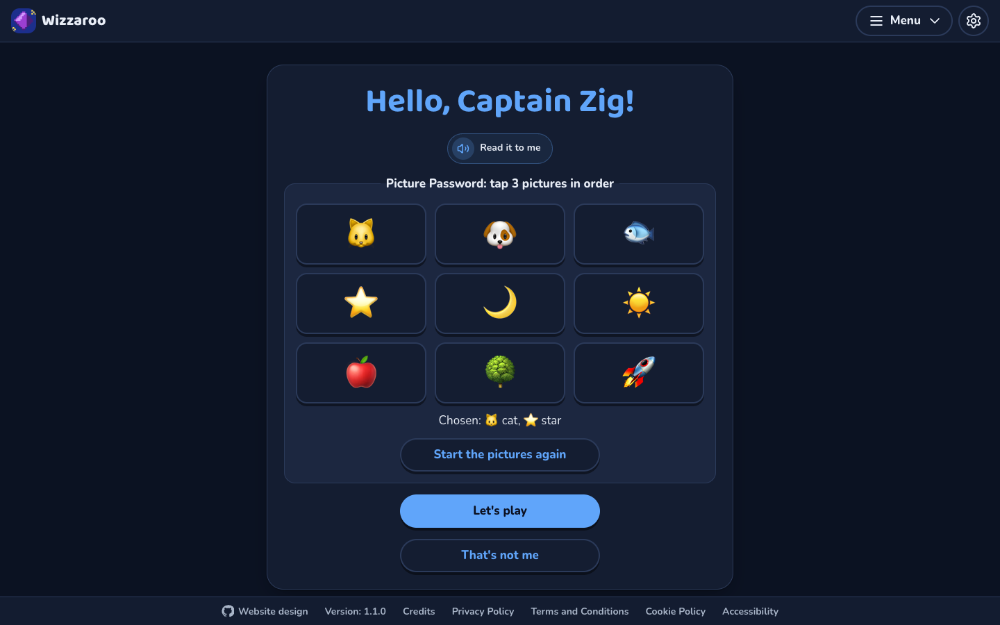

# Children

[← Back to the README](../../README.md) · [All guides](README.md)

> **Personal use only.** Wizzaroo is intended for your own personal use only. It is not intended for use with or by a school, teacher, parent or student. Only use it for yourself.

A Parent adds each Child on the dashboard. Wizzaroo asks for a nickname, the month and year they were born (never the day), whether they're in the usual school year for their age or one year either side, a name for their Character, the [Phonics Programme](curriculum.md#phonics-programmes) their school teaches, and a Picture Password, and nothing more: the API refuses a surname, a birthday, a photo or any other field. Adding a Child also creates their Character, with that name and the default look, ready for the Child to customise. A Parent can change all of these later, and set a new Picture Password at any time.

A Child's Year is worked out from their birth month and year with the English school year (`src/curriculum/year-groups.ts`): born September to December of year _B_, they start Year 1 in September of _B_ + 6, and born January to August, in September of _B_ + 5. So it moves up by itself every 1 September, adjustment and all. A Reception Child plays on Island 1, and a Child past Year 6 keeps Island 6 with every Island unlocked. A Child added before this has no birth month and year yet, and is asked for them the first time a Parent or the Admin opens them. Each Child belongs to one School too, and the dashboard says which Teachers there can see their progress.

The Admin, or a Teacher in their own Year Groups, can also add a Child to a Family. Such a Child has no Picture Password or Character yet: the first time they're opened on a Family Device, a Parent sets their Picture Password, then the Child makes and names their Character. Until then they show a placeholder portrait.

A Child who moves school just has their Phonics Programme changed. That changes only `children.phonics_programme_id`: phonics is then offered in the new programme's order, and their Mastery, which is kept per Skill, is untouched. A Child added before Phonics Programmes existed has none (`null`) until a Parent edits them, and the dashboard says so.

A Picture Password is 3 pictures in order, out of 9 (cat, dog, fish, star, moon, sun, apple, tree, rocket), and may repeat one. It is stored only as a salted PBKDF2-SHA256 hash, `pbkdf2-sha256$<iterations>$<salt>$<hash>` in hex, made with WebCrypto, so a browser can check it with no network. It keeps siblings apart and is not a security boundary. The dashboard never receives the hash. In Postgres no adult's reach can read it either: only a Family Device's reach is handed its own Family's hashes, through `wizzaroo_family_device_picture_password_hash`, and everyone else reads `has_picture_password`, which Postgres works out from the hash.

Every Child belongs to one Family and one School, and the Children routes take the caller's reach from their sign-in, never from the request. A Child outside it is answered as not found and left unchanged. The `children` table also holds `placement_by_subject` and `synced_limits`, which stay empty until Placement and limits are built.
