# The emails

[← Back to the README](../../README.md) · [All guides](README.md)

> **Personal use only.** Wizzaroo is intended for your own personal use only. It is not intended for use with or by a school, teacher, parent or student. Only use it for yourself.

Every email Wizzaroo sends, which template it uses, what it says and when it goes. Wizzaroo emails only Teachers and Parents, never a Child, and no email ever holds a Child's details. How emails are sent, the settings and the rules each one follows are in [Email](email.md).

Each email is one of the [email platform](https://github.com/adrianeyre/email-platform)'s 15 built-in Wizzaroo templates ([ADR 0069](../architectural-decision-record/0069-emails-are-sent-through-the-email-platform.md)). Wizzaroo sends it by the template's slug, through its helper on the `@adrianeyre/email-client` package's `email.builtIn`, and fills in its variables in `src/server/email/emails.ts`:

- **`email`** is always the address the email goes to.
- **Dates and times** are written out in UK time, such as `14 November 2026 at 13:52 (UK time)`.
- **Lifetimes** are words, such as `24 hours`, `1 hour` or `7 days`.
- **Names** (an adult's, a School's, a passkey's) are reduced to one plain line first (#321).
- **A new email address** is masked to its first letter and its domain, such as `m•••@example.com`, with the client's `maskEmailAddress`.
- **Links** are full URLs starting with `PUBLIC_URL`.

Everything else, the subject, the wording, the HTML layout and its plain-text part, the Wizzaroo header and footer, and the from address, lives in the email platform's template, not in this repo. So the subjects below are the built-in templates' own, and changing one is a change in the email platform. Every template has the same parts:

- **A heading** saying what happened, and a greeting.
- **A Security notice label** on emails about an account's sign-in, such as a password or passkey change.
- **Details**, such as the account and when it happened, in UK time.
- **A button** only where there is something to do, such as confirming an address or accepting an Invite, with its link written out under it. Security notices hold no link at all, so a copy sent by someone else can't lead anywhere.
- **A Wasn't you? box** saying exactly what to do if it wasn't them.
- **A footer** saying why the address got the email.

| Email                                                                                 | Helper                     | Template slug                           | Variables                                                    |
| ------------------------------------------------------------------------------------- | -------------------------- | --------------------------------------- | ------------------------------------------------------------ |
| [Confirm your email address](#confirm-your-email-address)                             | `confirmYourEmailAddress`  | `wizzaroo-confirm-your-email-address`   | `email`, `confirmationUrl`, `linkLifetime`                   |
| [Reset your password](#reset-your-password)                                           | `resetYourPassword`        | `wizzaroo-reset-your-password`          | `email`, `resetUrl`, `linkLifetime`                          |
| [A Teacher's Invite](#a-teachers-invite)                                              | `teacherInvite`            | `wizzaroo-teacher-invite`               | `email`, `name`, `schoolName`, `inviteUrl`, `inviteLifetime` |
| [A Parent's Invite](#a-parents-invite)                                                | `parentInvite`             | `wizzaroo-parent-invite`                | `email`, `name`, `schoolName`, `inviteUrl`, `inviteLifetime` |
| [Your password was changed](#your-password-was-changed)                               | `passwordChanged`          | `wizzaroo-password-changed`             | `email`, `changedAt`                                         |
| [A passkey was added](#a-passkey-was-added)                                           | `passkeyAdded`             | `wizzaroo-passkey-added`                | `email`, `passkeyName`, `addedAt`, `isFromQrCode`            |
| [A passkey was removed](#a-passkey-was-removed)                                       | `passkeyRemoved`           | `wizzaroo-passkey-removed`              | `email`, `passkeyName`, `removedAt`                          |
| [A change of email address was requested](#a-change-of-email-address-was-requested)   | `emailChangeRequested`     | `wizzaroo-email-change-requested`       | `email`, `newEmailMasked`, `requestedAt`                     |
| [Your email address was changed](#your-email-address-was-changed)                     | `emailAddressChanged`      | `wizzaroo-email-address-changed`        | `email`, `newEmailMasked`, `changedAt`                       |
| [Sign-in codes are paused](#sign-in-codes-are-paused)                                 | `signInCodesPaused`        | `wizzaroo-sign-in-codes-paused`         | `email`, `wrongCodes`, `pausedAt`, `pauseEndsAt`             |
| [A new Family Device was signed in](#a-new-family-device-was-signed-in)               | `familyDeviceSignedIn`     | `wizzaroo-family-device-signed-in`      | `email`, `signedInAt`, `parentPageUrl`                       |
| [Two-factor authentication was turned off](#two-factor-authentication-was-turned-off) | `twoFactorTurnedOff`       | `wizzaroo-two-factor-turned-off`        | `email`, `turnedOffAt`                                       |
| [Your email address is already in use](#your-email-address-is-already-in-use)         | `emailAddressAlreadyInUse` | `wizzaroo-email-address-already-in-use` | `email`                                                      |
| [A request to join your Family](#a-request-to-join-your-family)                       | `familyJoinRequest`        | `wizzaroo-family-join-request`          | `email`, `schoolName`, `parentPageUrl`                       |
| [An adult has joined your Family](#an-adult-has-joined-your-family)                   | `adultJoinedFamily`        | `wizzaroo-adult-joined-family`          | `email`, `joinedEmail`                                       |

The screenshots below are kept in [`docs/images/emails/`](../images/emails/). They were taken before the emails moved to the email platform, which keeps their wording and layout; take them again from the email platform's preview, or its Mailpit, whenever a template changes there.

## Links

Emails with a link to open. Each link works once and stops working after a set time.

### Confirm your email address

**Subject:** Confirm your email address for Wizzaroo  
**Template:** `wizzaroo-confirm-your-email-address`, with `linkLifetime` `24 hours`.  
**Sent to** the address a Parent, Teacher or the Admin wants to confirm, when they ask for a link, and when they ask to move to a new address. The link works for 24 hours. See [Email](email.md).

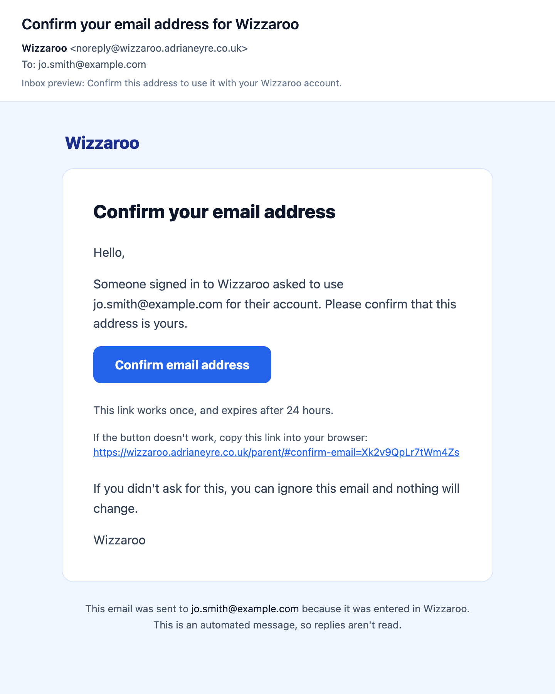

### Reset your password

**Subject:** Reset your Wizzaroo password  
**Template:** `wizzaroo-reset-your-password`, with `linkLifetime` `1 hour`.  
**Sent to** an account's confirmed address, after **Forgot your password?** on the sign-in form. The link works for 1 hour. An address that isn't confirmed gets nothing.

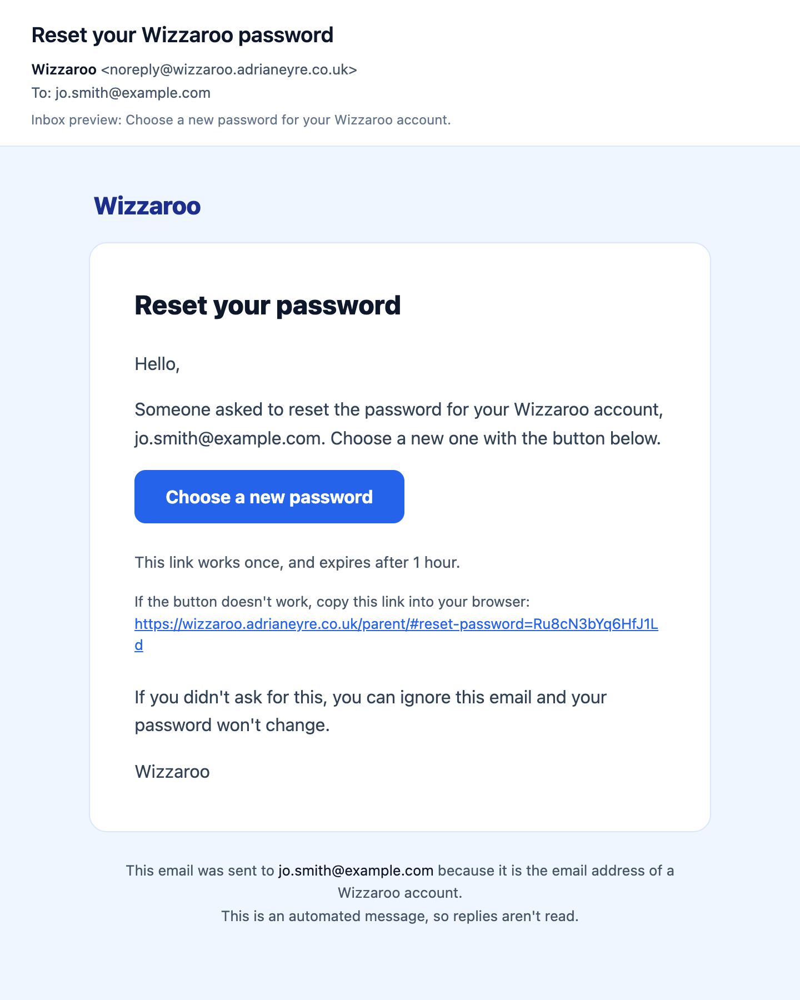

## Invites

### A Teacher's Invite

**Subject:** You're invited to Wizzaroo as a Teacher at _the School_  
**Template:** `wizzaroo-teacher-invite`, with the Teacher's `name`, the `schoolName` and `inviteLifetime` `7 days`.  
**Sent to** a new Teacher, when the Admin creates their login at a School, one at a time or in a bulk upload. The link works for 7 days. See [Signing in](signing-in.md#schools-teachers-and-invites).

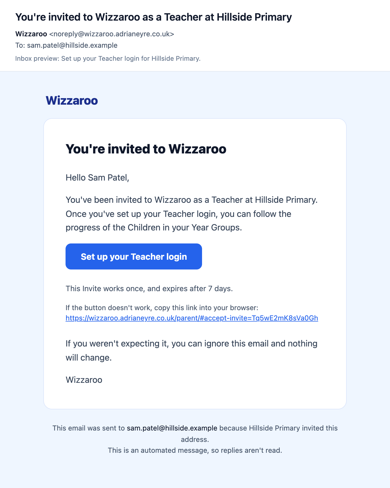

### A Parent's Invite

**Subject:** _The School_ invites you to Wizzaroo  
**Template:** `wizzaroo-parent-invite`, with the Parent's `name`, the `schoolName` and `inviteLifetime` `7 days`.  
**Sent to** a new Parent, when the Admin or a Teacher creates their login at the School, one at a time or in a bulk upload. The link works for 7 days. See [Signing in](signing-in.md#schools-teachers-and-invites).

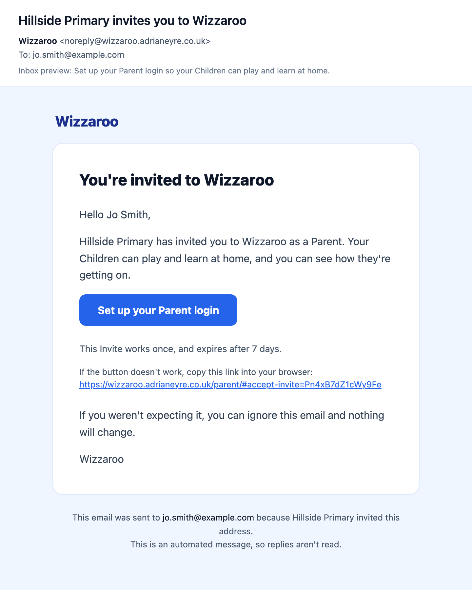

## Security notices

Each one is sent to the adult's confirmed address before the change is saved, so if it can't be sent, nothing changes. None holds a link.

### Your password was changed

**Subject:** Your Wizzaroo password was changed  
**Template:** `wizzaroo-password-changed`, with `changedAt`.  
**Sent** when an adult changes their password, or resets a forgotten one.

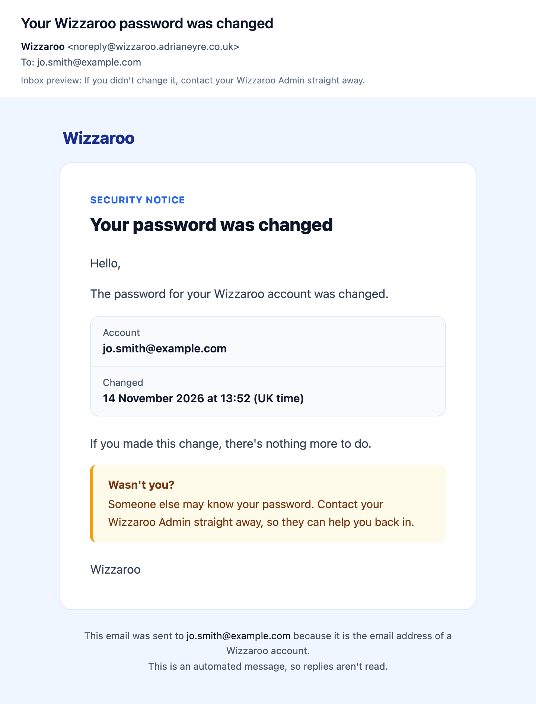

### A passkey was added

**Subject:** A passkey was added to your Wizzaroo account  
**Template:** `wizzaroo-passkey-added`, with the `passkeyName`, `addedAt`, and `isFromQrCode` `true` when it was added from a QR code.  
**Sent** when an adult adds a passkey, in this browser or from a QR code on their phone. The email names the passkey and says how it was added.

| Added in the browser                                                              | Added from a QR code on a phone                                                                                                    |
| --------------------------------------------------------------------------------- | ---------------------------------------------------------------------------------------------------------------------------------- |
| 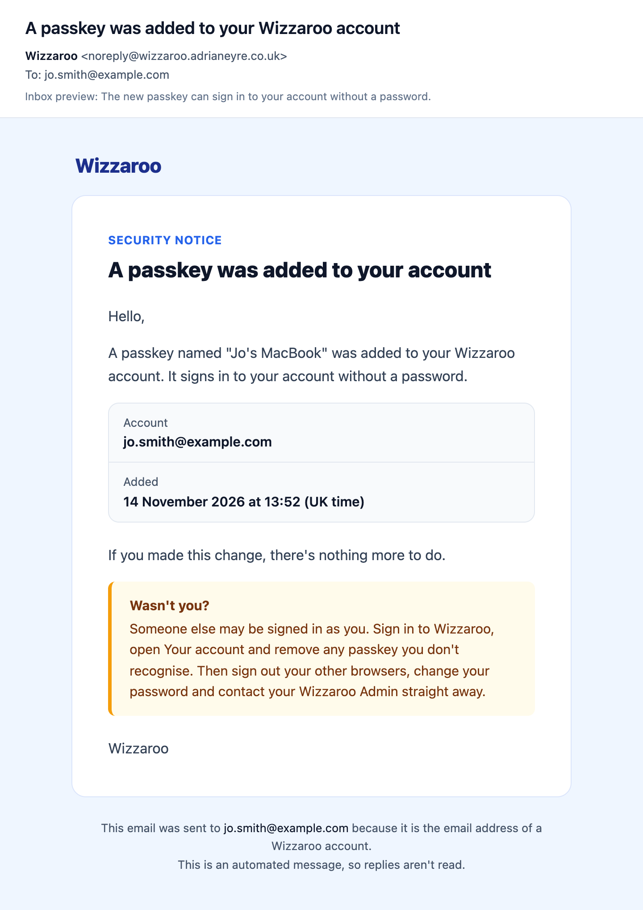 | 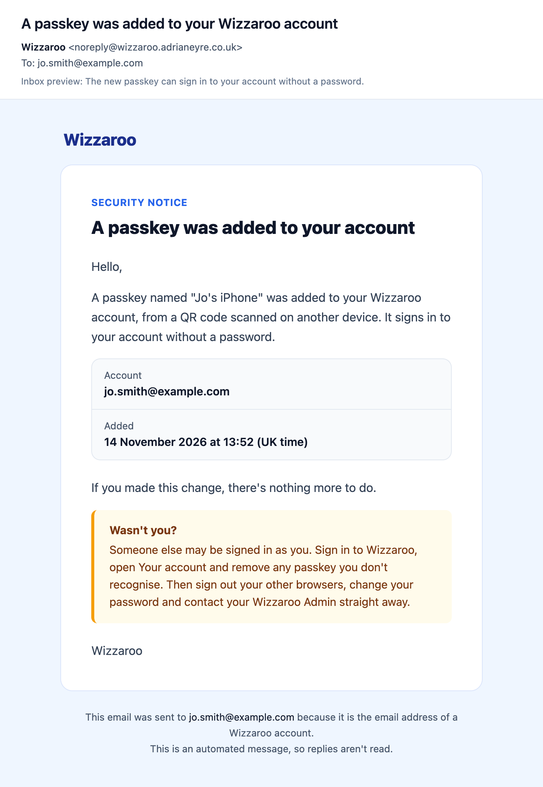 |

### A passkey was removed

**Subject:** A passkey was removed from your Wizzaroo account  
**Template:** `wizzaroo-passkey-removed`, with the `passkeyName` and `removedAt`.  
**Sent** when an adult removes one of their passkeys.

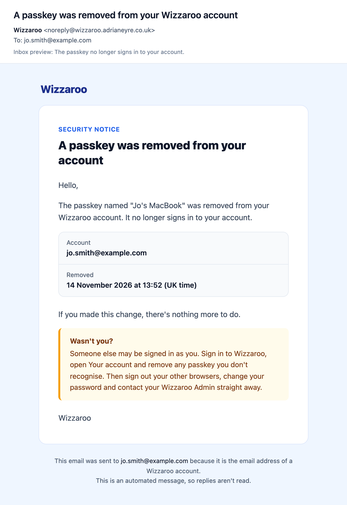

### A change of email address was requested

**Subject:** Someone asked to change your Wizzaroo email address  
**Template:** `wizzaroo-email-change-requested`, with `newEmailMasked` and `requestedAt`.  
**Sent to the old address** when an adult asks to move to a new one. It shows the new address masked, such as `m•••@example.com`.

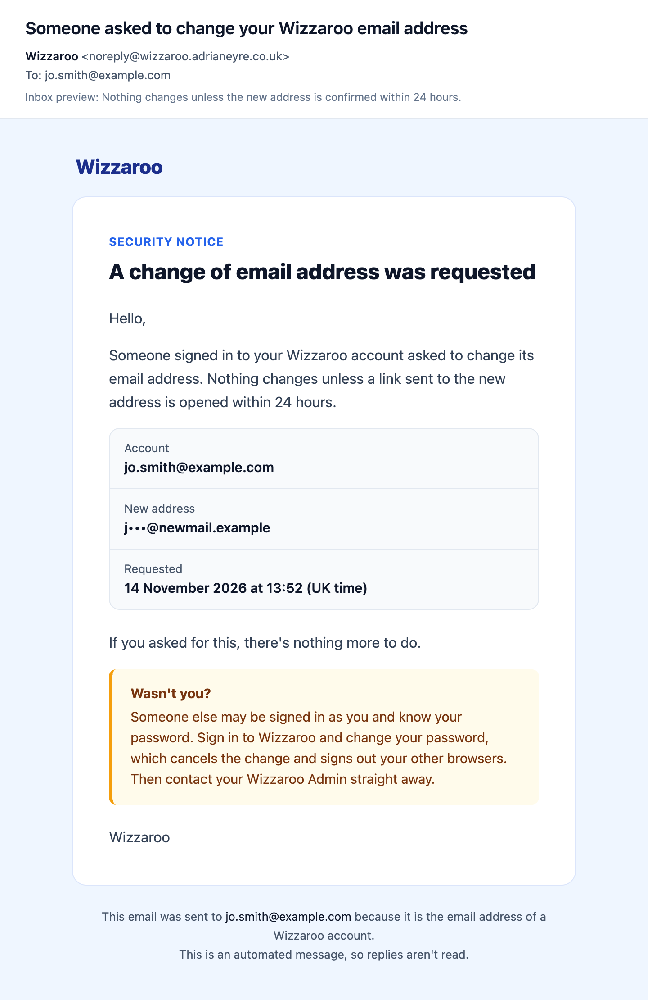

### Your email address was changed

**Subject:** Your Wizzaroo email address was changed  
**Template:** `wizzaroo-email-address-changed`, with `newEmailMasked` and `changedAt`.  
**Sent to the old address** once the new one is confirmed. Every email after it goes to the new address.

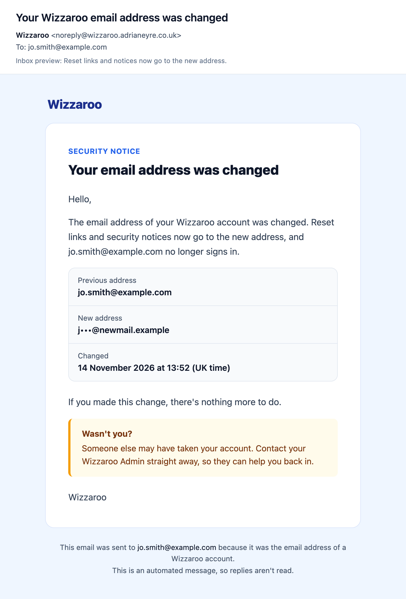

### Sign-in codes are paused

**Subject:** Wrong sign-in codes were given for your Wizzaroo account  
**Template:** `wizzaroo-sign-in-codes-paused`, with the number of `wrongCodes`, `pausedAt` and `pauseEndsAt`.  
**Sent** when 5 wrong two-factor codes in an hour pause an adult's codes. It says when the pause ends, and that whoever typed them knows the password.

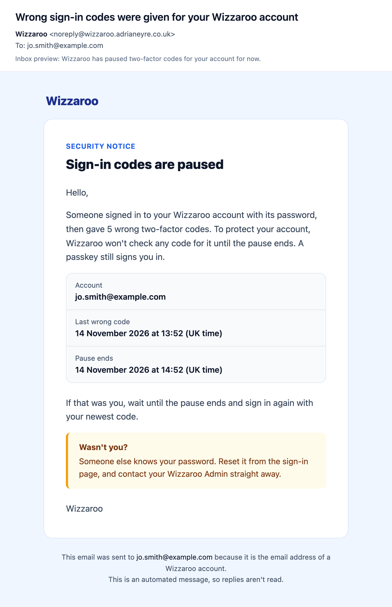

### A new Family Device was signed in

**Subject:** A new Family Device was signed in to Wizzaroo  
**Template:** `wizzaroo-family-device-signed-in`, with `signedInAt` and the Parent page's address as `parentPageUrl`.  
**Sent** when a Parent makes a browser a Family Device. Its **Review your Family Devices** button opens the Parent page, where a Family Device can be signed out. See [Family Devices](family-devices.md).

| On a computer                                                                                    | On a phone                                                                                           |
| ------------------------------------------------------------------------------------------------ | ---------------------------------------------------------------------------------------------------- |
| 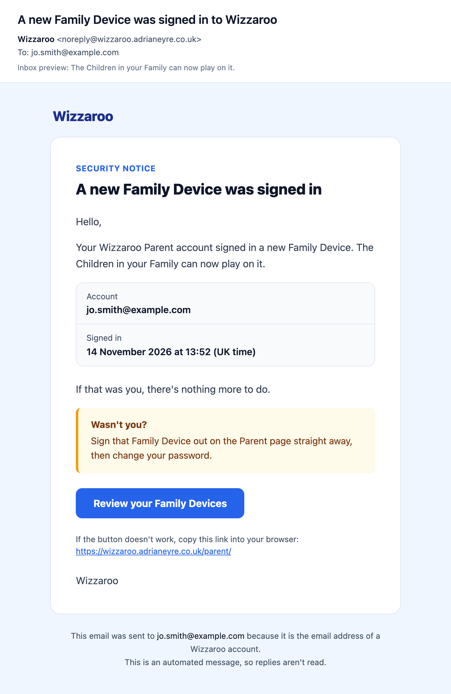 | 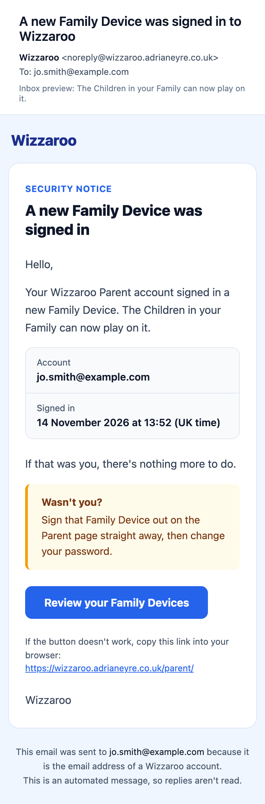 |

### Two-factor authentication was turned off

**Subject:** Two-factor authentication was turned off for your Wizzaroo account  
**Template:** `wizzaroo-two-factor-turned-off`, with `turnedOffAt`.  
**Sent** when an adult turns two-factor authentication off. Their recovery codes no longer work, and their password alone now signs them in.

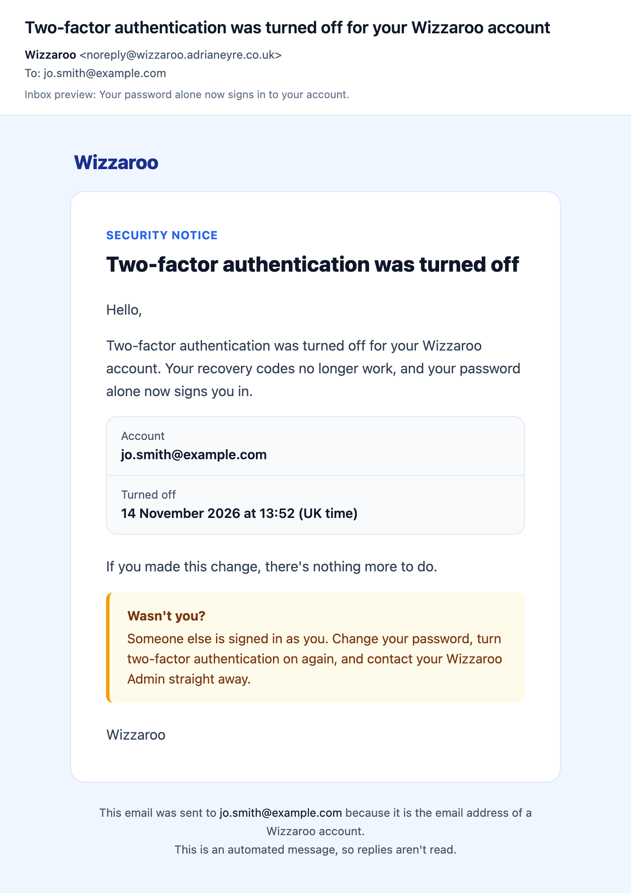

## Other notes

### Your email address is already in use

**Subject:** Someone tried to use your email address in Wizzaroo  
**Template:** `wizzaroo-email-address-already-in-use`, with only `email`.  
**Sent to an address that already has an account** when someone asks to move their own account to it. Nothing changes, and no confirmation link is sent anywhere. Only whoever reads that mailbox learns the address is taken.

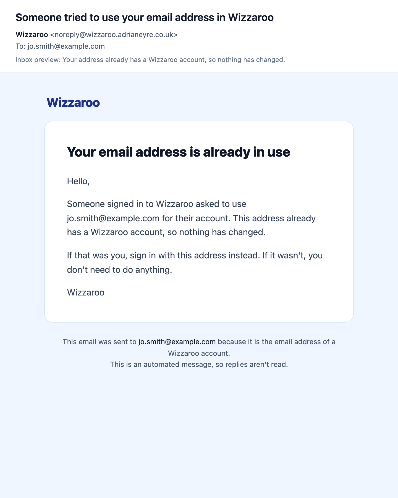

### A request to join your Family

**Subject:** Someone has been asked to join your Family in Wizzaroo  
**Template:** `wizzaroo-family-join-request`, with the `schoolName` and the Parent page's address as `parentPageUrl`. It names no one but the School.  
**Sent to the Family's Parents** when a Teacher brings in a household's next adult. Nothing changes unless one of the Family's Parents agrees in **Your Family's data**. See [Your Family's data and the Admin dashboard](family-data-and-admin.md).

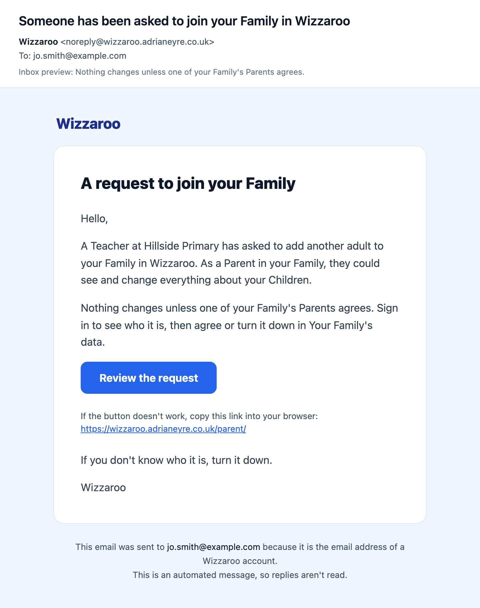

### An adult has joined your Family

**Subject:** An adult has joined your Family in Wizzaroo  
**Template:** `wizzaroo-adult-joined-family`, with the address of the adult who joined as `joinedEmail`.  
**Sent to the Family's Parents** when another adult joins the Family as a Parent: once a Parent lets a waiting adult join, or straight away when the Admin links a household's second adult.

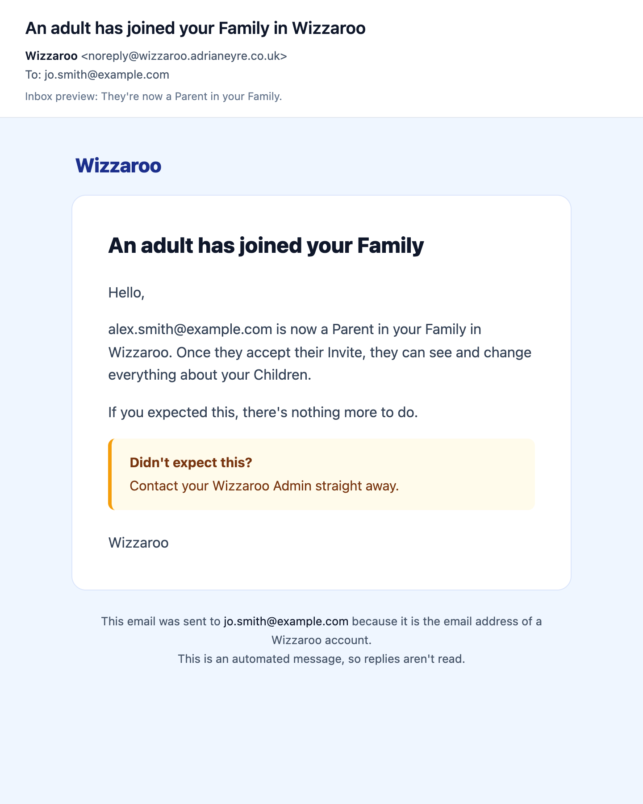
