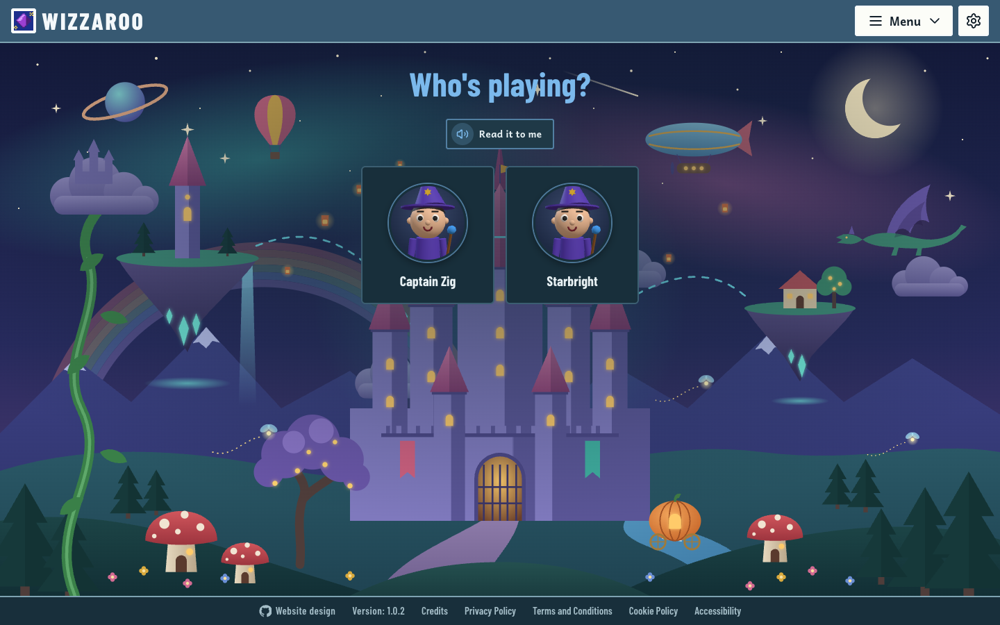
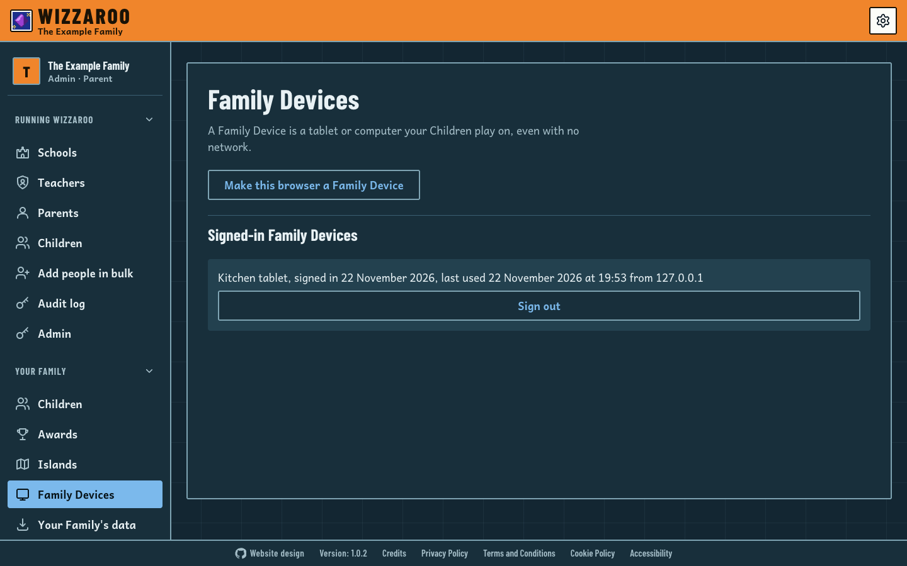

# Family Devices

[← Back to the README](../../README.md) · [All guides](README.md)

> **Personal use only.** Wizzaroo is intended for your own personal use only. It is not intended for use with or by a school, teacher, parent or student. Only use it for yourself.

A Family Device is a tablet or computer the Children play on. On the dashboard's **Family Devices** panel, a Parent taps **Make this browser a Family Device**, names it, such as Kitchen tablet, and proves it's them again: with their password, a code from their authenticator app, or **Use your passkey and make it a Family Device**. That signs the Parent out of that browser, so the Children who play there never hold a Parent's sign-in. The Parent's other browsers stay signed in.

- **Proving it's you.** A Family Device stays signed in long after the sign-in that made it, so a sign-in alone can't make one (#303). `POST /api/family-devices` takes the same proof as moving an email address: `currentPassword`, `code` (a TOTP or recovery code) or `passkey`, exactly one. With none it answers 403 `account-proof-required`, and with a wrong one 403. Each try counts against the Parent's email address with the sign-in's per-account limit for wrong passwords, and is refused with 429 past it; a right proof gives its try back. A Parent with only a passkey uses it. Teachers and the Admin, as at an email change, prove it with a passkey or a code.

- **The credential.** The browser gets a `wizzaroo_family_device` cookie of its own: HTTP-only, `Secure`, `SameSite=Strict`, sent only to `/api/play`, and kept for 400 days, the longest browsers keep a cookie, from the device's last contact, because every contact renews it. The server holds the credential to the same 400 days, whatever the browser presenting it was told: `family_devices` records each device's last contact in `last_seen_at`, and refuses a credential it hasn't seen for 400 days, which then behaves as a signed-out one and no longer appears in the Parent's list. `family_devices` holds only a hash of the credential. It opens the play routes, `GET /api/play/family`, `POST /api/play/events` and `GET /api/play/children/:childId/classmate-rooms`, and nothing else: no Parent route reads it, so on every one of them it gets no further than no credential at all, and a Parent's sign-in doesn't open `/api/play`.
- **Playing.** The game page asks who's playing, with a portrait for each Child's Character: a head-and-shoulders picture of their 3D Character, in the look they last saved, and its name. The Child taps theirs, then their Picture Password, on a screen that always fits between the header and the footer without scrolling: a slot fills for each picture tapped, the pictures grow or shrink to the height there is, and **Let's play** and **That's not me** sit side by side. Both screens stand in front of the fairytale backdrop, which shows its whole sky on any screen: on one wider than 16 by 9 it shows the whole picture, its sides fading into the same sky and hills, rather than cropping its top. Every time the page opens it fetches each of the Family's Children's ID, Character name, Picture Password hash, Phonics Programme, limits (see [Parent limits](parent-limits-and-sound.md#parent-limits)) and rewards (see [Stars and Items](stars-items-and-rooms.md#stars-and-items)), and the Family Chest, and nothing else about them, and keeps them in `localStorage`. So once a device has opened online, it checks Picture Passwords with WebCrypto and no network.
- **When and where it was last used.** Each contact records when, in `last_seen_at`, and the address it came from, in `last_seen_from`, read as the Audit Log reads a sign-in's: Cloudflare's `CF-Connecting-IP` when the request came through `cloudflared`, or the socket's ([keeping data safe](security-and-backups.md#the-address-a-request-comes-from)). The server writes at most once a minute from one address, and at once from a new one, as the database owner. Only the last address is kept. The panel lists each device as, say, "Kitchen tablet, signed in 1 November 2026, last used 14 November 2026 at 15:30 from 203.0.113.41", and the Family export carries both, so a device playing somewhere it shouldn't, or one no longer used, stands out (#302).
- **Signing a device out.** The panel lists the Family's signed-in Family Devices, and any Parent in the Family can sign one out. Its row stays in `family_devices` with `revoked_at` set and its last address cleared, and the API refuses its credential from then on. The next time the device reaches the server and is refused, it forgets the Children it kept and shows a signed-out screen. Any other failure, such as the 502 or 530 the tunnel answers while the home server is down, leaves the Children playing from what the device kept.
- **The security notice.** Signing in a Family Device emails the Parent's confirmed address to say so, with the Parent page's address to sign it out from if it wasn't them. It gives the time and nothing else, not even the device's name, because a Parent may name a device after a Child. Like the password-changed notice, it is sent before the device is saved, so if it can't be sent no device is signed in. A Parent whose address isn't confirmed gets no email.
- **A password change or reset signs devices out.** Each device records the adult whose sign-in made it, in `created_by_user_id`. When that adult changes their password, or resets it from a link, every device they made is signed out with their other sign-ins, and the Audit Log records each as `family-device.revoked`. So a device made from a stolen sign-in goes when the Parent takes their account back. The tablet at home goes too: the Parent makes it a Family Device again. Devices another Parent made keep playing, and so do devices made more than twelve months before this change, whose maker the Audit Log no longer held (#303).
