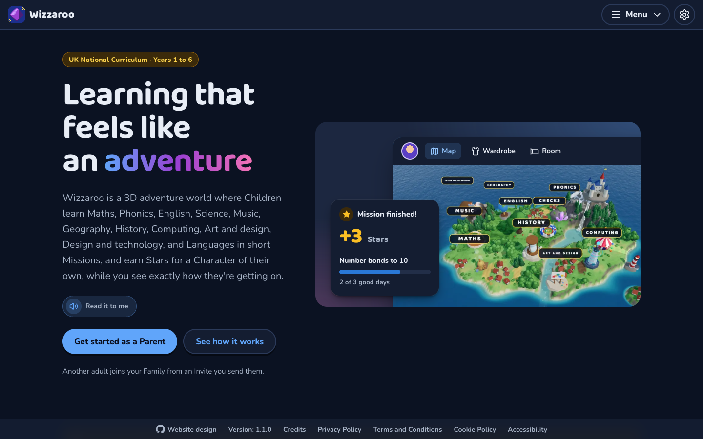
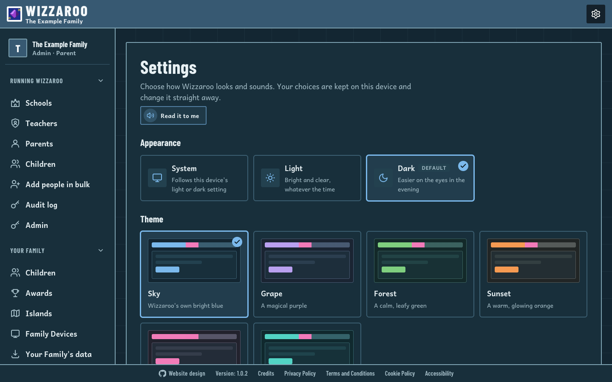

# The home page, title bar and Settings

[← Back to the README](../../README.md) · [All guides](README.md)

> **Personal use only.** Wizzaroo is intended for your own personal use only. It is not intended for use with or by a school, teacher, parent or student. Only use it for yourself.

## The home page

A browser that isn't a Family Device opens the game page's home page (`src/client/family-device/home-page.tsx`), built to the rules of the [Stageshow](https://github.com/benjitaylor/skills) skill: pictures of the real product, simplified and framed, rather than drawings standing in for it.

- **The hero** is Meadow Isle on the World Map, rendered by the game's own 3D scene on a clear day, inside the play bar's real chrome, with a **Mission finished!** card beside it whose Stars roll up and whose Mastery bar fills once it scrolls into view. The render is two WebP files in `src/client/public/home/`, one for phones and one for large screens.
- **Every Subject.** A tile for each of the 11 Subjects, in the order of `subjects`, each with its landmark icon, the first Region that teaches it, the Years it runs through and what a Child learns there, then the Brainwave Big Top and the Challenge Arena found on every Island. Adding a Subject adds its tile; `family-device-page.test.tsx` fails if one is missing.
- **Inside Wizzaroo** is a bento grid of five tiles: a Region panel with its Games, the number of Islands, a Picture Password being tapped, Items to spend Stars on, and a Parent's chart of the last 14 days. Each picture is built in HTML and CSS at a fixed design size and scaled to its tile (`home-pictures.tsx`), so its words stay real text; the hero and the Region panel switch to a second, compact layout in a narrow column.
- **Good to know** answers what a Parent asks first: who it is for, never a hard fail, Mastery and Reviews, exploring, playing as a Family, Parent limits, playing offline and privacy. Then **Playing in three steps** and **Get started as a Parent**, which opens the Parent page.

Each picture plays once, the first time it scrolls into view (`stage-cue.ts`), and shows its finished frame straight away when the device asks for reduced motion. The home page's pictures are left out of the offline download, since only a signed-out browser that is online sees them. It also says the device is signed out, so a Child on a device a Parent has signed out knows to ask. There is still no sign-up: the button leads to signing in, and another adult joins by [Invite](signing-in.md#schools-teachers-and-invites).

## The title bar and Settings

The browser tab's title always starts with the site's name, then the page, such as "Wizzaroo – Your World Map" or "Wizzaroo for Parents – Sign in" (`buildPageTitle` in `src/client/page-title.ts`).

Every page has a sticky title bar (`src/client/site-header/`) with the Wizzaroo logo and name at the far left, large and in the theme's colour fading into gold so it stands out (plain text where the system forces its own colours), a **Menu**, and a Settings cog at the far right. It steps away only while a Child plays, so the game keeps the whole screen. On the Parent page the menu holds every part the signed-in adult can reach: for the Admin, Schools, Teachers, Parents, Children, Add people in bulk and Admin (deletion requests); for a Teacher, Your Year Groups, Parents and Add people in bulk; for a Parent, Children, Islands, Family Devices and Your Family's data; then Your account, This device, Settings, a link home and Sign out. Each opens on its own, full screen, at its own address (`/parent/#children`, `#admin-schools`, `#teacher-year-groups`, `#account` and so on), so the browser's Back button and a bookmark both work. A Parent who isn't signed in sees only Sign in, This device and Settings. A link to confirm an email address lands on Your account.

The footer under every page links to the source on GitHub, then shows the **Version**, which links to the GitHub Releases in a new tab, then **Credits**, the Privacy Policy, Terms and Conditions, Cookie Policy and Accessibility statement, each opening in a dialog (`src/client/site-footer/`). **Credits** names Adrian Eyre first, as Wizzaroo's creator, then the voice and sound, the fonts and the software Wizzaroo is built with, each with its licence (`credits.tsx`); changing a dependency, a font or the voice means changing that list in the same commit.

Settings chooses **System** (the default, following the device), **Light** or **Dark**, and one of six themes: Sky, Grape, Forest, Sunset, Berry and Lagoon. The choice is kept in the browser's `localStorage` on that device only, and applied as `data-colour-mode` and `data-theme` on `<html>` before the page draws. Each theme is one block of colour tokens in `theme.css`, written with `light-dark()` so it carries its light and dark colours together, and every pairing meets WCAG AA contrast in both. The 3D world keeps its own palette whatever is chosen ([ADR 0003](../architectural-decision-record/0003-3d-with-a-retro-pixel-treatment.md)).

Settings also chooses the **reading voice** that **Read it to me** uses, from sixteen voices in one section: thirteen from around the UK, Jenny from Ireland, and Kristin and John from the US, with **Adrian**, a UK English male voice, chosen by default. Every voice is a 3D fantasy character of its own, such as Adrian the Star Wizard, Seren the Star Archer or Spike the Pirate King, drawn by the same Character model as a Child's, and between them they have every skin tone and many hairstyles. The chosen voice stands on a stage, live in 3D, beside its name, a speech bubble, a **Hear** button and whether this device has downloaded it yet; choosing one, or pressing Hear, says hello in it while its character shows off. Each card shows its character's portrait. The choice is kept in `localStorage` on that device too. See [Voice-over](voice-over.md#read-it-to-me) and [ADR 0074](../architectural-decision-record/0074-sixteen-voices-mostly-from-the-uk-each-a-fantasy-character.md).
