# The Islands

[← Back to the README](../../README.md) · [All guides](README.md)

> **Personal use only.** Wizzaroo is intended for your own personal use only. It is not intended for use with or by a school, teacher, parent or student. Only use it for yourself.

The World Map is a sea holding six Islands, one for each Year Group from Year 1 to Year 6 ([ADR 0025](../architectural-decision-record/0025-one-island-per-year-group.md)). Each has its own landscape, palette, music, Companion, Regions, Quest and Train. This page goes round them one by one. How the World Map works, moving around it and unlocking Games are in [the World Map](world-map.md).

The Islands, their Regions and their themes are data in `src/curriculum/world-map.json`. Each Island's landscape is built in code: Meadow Isle in `src/client/world-map-terrain.ts`, and the others in `src/client/islands/` (`frost-isle.ts`, `sunscorch-sands.ts`, `jungle-reach.ts`, `ember-isle.ts` and `starfall-isle.ts`).

## What every Island has

Every Island, locked or not, can be explored on foot from its **Explore** button, unless a Parent has locked it for exploring ([Parent limits](parent-limits-and-sound.md#parent-limits)), at six times its World Map size, with two new lands east and west of its old coast, each with a far reach beyond it ([ADR 0029](../architectural-decision-record/0029-islands-can-be-explored-on-foot.md), [ADR 0041](../architectural-decision-record/0041-islands-grow-new-lands-with-ring-races-and-the-ship-sails-the-world-map.md), [ADR 0068](../architectural-decision-record/0068-fifteen-more-attractions-on-the-far-reaches-of-every-island.md)). Each Island has:

- **Regions**, one for each Subject its Year teaches, each with ten Games. Languages (French) starts in Year 3, and Phonics runs in Years 1 and 2.
- **The Brainwave Big Top**, whose Games are all open, and on Years 1, 4 and 6, the years with national checks, a **Challenge Arena**.
- **A Quest** of thirty Puzzles, with Finds, ten Islanders, a Trophy and 50 Stars ([ADR 0058](../architectural-decision-record/0058-an-island-quest-with-finds-islanders-and-a-rucksack.md)).
- **104 treasures** to collect, **twelve friendly animals** to say hello to, **seven lookouts** to climb, **twenty hideaways**, **twenty-four fact signs**, **twenty bounce pads** and **two Ring Races** (`src/client/islands/island-adventures.ts`).
- **Twenty or twenty-one [Attractions](attractions.md)**: five or six dealt out at random, with a school on every Island, and **fifteen of its own** out on the far reaches of its new lands, eight west and seven east, each with a trail out over a little bridge and a loop round it ([ADR 0068](../architectural-decision-record/0068-fifteen-more-attractions-on-the-far-reaches-of-every-island.md)). It also has **twenty Curiosities** of its own ([ADR 0056](../architectural-decision-record/0056-twenty-curiosities-on-every-island.md)).
- **Wonders** found only by exploring the new lands: a grove of the Island's own trees, wildflowers, a hot-air balloon and sights of its own (`src/client/islands/island-wonders.ts`).
- **A Railway** with five Stations and its own [Train](transport.md#trains), **roads** for [Vehicles](transport.md#vehicles), and a **Dock**, **Runway**, **Helipad**, **Balloon Field** and **hover slipway** for [travelling between Islands](transport.md#travelling-between-islands).

Exploring on foot, the Character can't walk through anything solid: Attractions, Curiosities, Region landmarks, Wonders and their groves, trees, bushes, rocks, houses, signs, dens, lamps, watchtowers, friendly animals, the dock and the Stations. It walks under high roofs and branches, steps over kerbs, stands on decks and bridges, and slides along a wall it walks into at a slant. Treasures, bounce pads, Ring Race rings and Quest Finds stay passable, and every ride and place to visit can still be reached ([ADR 0061](../architectural-decision-record/0061-explore-mode-is-solid-worked-out-from-the-models.md)).

While an Island is getting ready to explore, its help says so with a spinner and a progress bar: first building its land, sea, trees and houses, then drawing it for the first time, then making the things near the Character solid, counted as they are done (`onLoadingChanged`, `ObstacleField.prepareAroundWithin`). The solid things are marked a few milliseconds each frame rather than all at once, so the page keeps answering. Pressing **Let's go!** before it is ready closes the help and shows the same progress over the Island until the Character can set off.

| Island                              | Year | Companion         | Treasures       | Friendly animals | Bounce pads       |
| ----------------------------------- | ---- | ----------------- | --------------- | ---------------- | ----------------- |
| [Meadow Isle](#meadow-isle)         | 1    | A round owl       | Golden Acorns   | Lambs            | Bouncy Hay Bales  |
| [Frost Isle](#frost-isle)           | 2    | A snowy owl       | Snow Crystals   | Penguins         | Snow Trampolines  |
| [Sunscorch Sands](#sunscorch-sands) | 3    | A desert fox      | Sun Coins       | Camels           | Sand Springs      |
| [Jungle Reach](#jungle-reach)       | 4    | A bright toucan   | Parrot Feathers | Monkeys          | Bouncy Mushrooms  |
| [Ember Isle](#ember-isle)           | 5    | A fire salamander | Fire Opals      | Lizards          | Steam Vents       |
| [Starfall Isle](#starfall-isle)     | 6    | A night raven     | Fallen Stars    | Owls             | Moon Bounce Rings |

The screenshots show each Island on the World Map by day, then exploring it on foot in the **Wide** view.

## Meadow Isle

**Year 1.** A bright, green fantasy land.

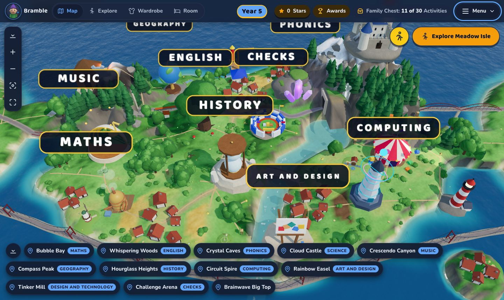

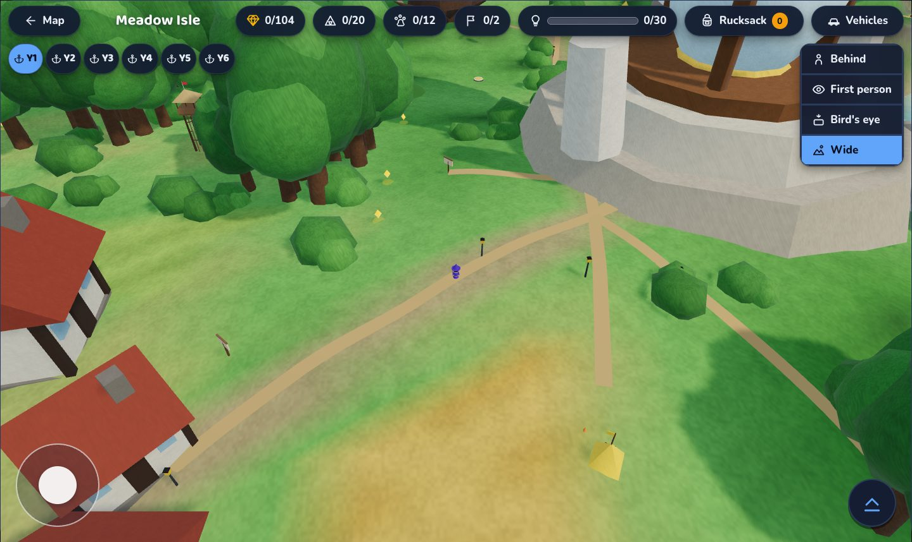

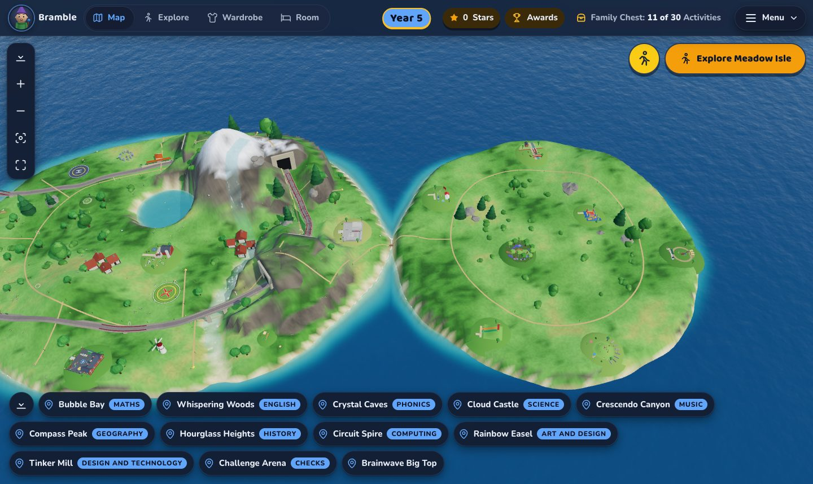

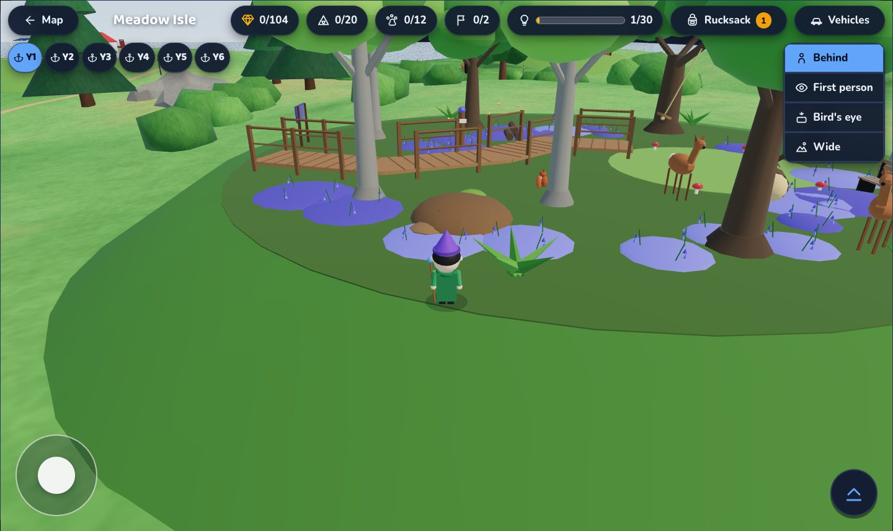

- **The land.** Beaches, rolling grassland and patchwork fields, a snowy mountain range with a lake in its foothills, a smoking volcano, a river running from the lake to the sea under a stone bridge, a waterfall pouring from the Cloud Castle's rock, three villages of timber-framed cottages and a lighthouse with a turning beam.
- **Regions.** Bubble Bay (Maths), Whispering Woods (English), Crystal Caves (Phonics), Cloud Castle (Science), Crescendo Canyon (Music), Compass Peak (Geography), Hourglass Heights (History), Circuit Spire (Computing), Rainbow Easel (Art and design) and Tinker Mill (Design and technology), with the Brainwave Big Top and the Challenge Arena.
- **The Quest: The Great Meadow Fair.** The fair opens tomorrow, but the gate is locked, the lamps are dark and the Mayor's grand chest is stuck shut. The Trophy is the Meadow Fair Hero.
- **Lookouts.** The Lighthouse gives a view over the whole Island, with six watchtowers.
- **Ring Races.** The Buttercup Run and the Windy Hill Race.
- **Wonders.** A windmill, a stone circle and a hot-air balloon.
- **Its own Attractions.** [Swan Boat Lake](attractions.md#swan-boat-lake), [Bouncy Castle](attractions.md#bouncy-castle), [Strawberry Field](attractions.md#strawberry-field), [Tractor Train](attractions.md#tractor-train), [Sheepdog Trials](attractions.md#sheepdog-trials), [Village Fete](attractions.md#village-fete), [Pony Stables](attractions.md#pony-stables), [Grass Sledge Hill](attractions.md#grass-sledge-hill), [Apple Orchard](attractions.md#apple-orchard), [Bluebell Wood](attractions.md#bluebell-wood), [Puppet Theatre](attractions.md#puppet-theatre), [Canal Lock](attractions.md#canal-lock), [Duck Race](attractions.md#duck-race), [Kite Hill](attractions.md#kite-hill) and [Cricket Pitch](attractions.md#cricket-pitch), out on the far reaches.
- **Curiosities.** A water mill, a windmill, stepping stones, a frog pond, a scarecrow, giant sunflowers, a haystack slide, a maypole, a rabbit warren, a wishing well, a snail race, a red telephone box and more.
- **Its Train.** The Meadow Steam Express, a green steam engine that puffs smoke.

## Frost Isle

**Year 2.** Snowfields, a frozen waterfall, an igloo village and the northern lights.

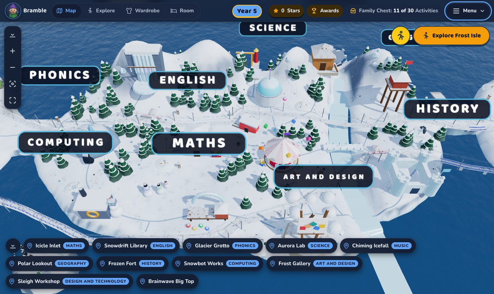

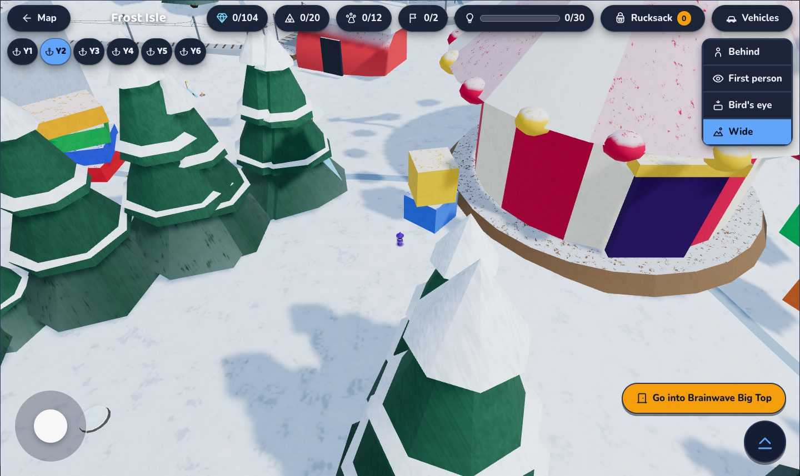

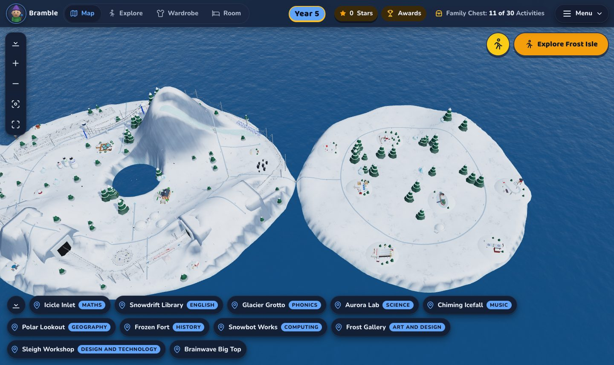

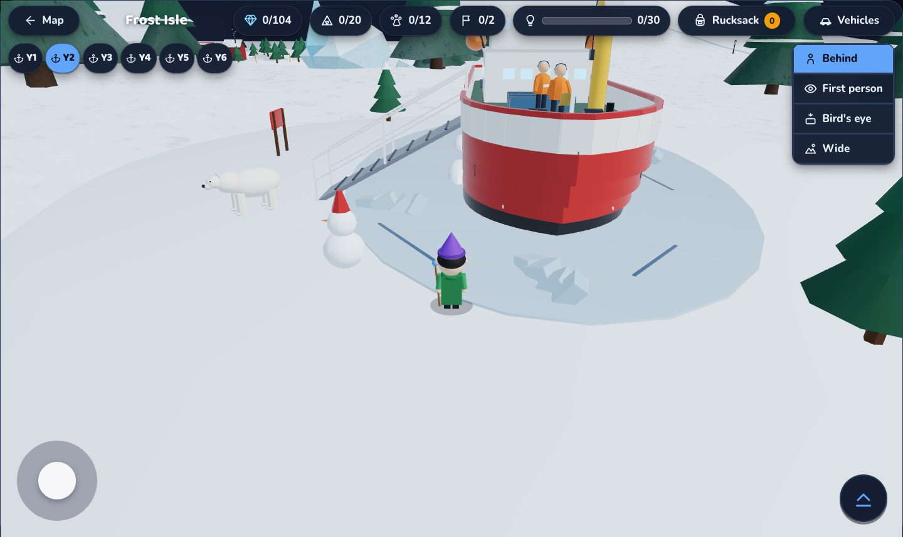

- **The land.** Snowfields and snowy pines, ice chunks, an igloo village, an ice bridge over a frozen channel, and an aurora in the sky. The Character slides on the ice.
- **Regions.** Icicle Inlet (Maths), Snowdrift Library (English), Glacier Grotto (Phonics), Aurora Lab (Science), Chiming Icefall (Music), Polar Lookout (Geography), Frozen Fort (History), Snowbot Works (Computing), Frost Gallery (Art and design) and Sleigh Workshop (Design and technology), with the Brainwave Big Top.
- **The Quest: The Northern Lights Frost Fair.** A blizzard has frozen everything before the Frost Fair: the ski lift is stuck, the cuckoo clock has stopped and the huskies are hungry. The Trophy is the Northern Lights Hero.
- **Ring Races.** The Snowshoe Sprint and the Icicle Dash.
- **Wonders.** A snowman family, a stone circle and a hot-air balloon.
- **Its own Attractions.** [Ice Palace](attractions.md#ice-palace), [Bobsleigh Track](attractions.md#bobsleigh-track), [Ski Jump](attractions.md#ski-jump), [Snowball Range](attractions.md#snowball-range), [Glacier Bridge](attractions.md#glacier-bridge), [Curling Sheet](attractions.md#curling-sheet), [Polar Research Base](attractions.md#polar-research-base), [Icebreaker Ship](attractions.md#icebreaker-ship), [Mountain Rescue Hut](attractions.md#mountain-rescue-hut), [Snowmobile Trail](attractions.md#snowmobile-trail), [Seal Lagoon](attractions.md#seal-lagoon), [Snow Tubing Hill](attractions.md#snow-tubing-hill), [Yeti Cave](attractions.md#yeti-cave), [Ice Climbing Wall](attractions.md#ice-climbing-wall) and [Mammoth Museum](attractions.md#mammoth-museum), out on the far reaches.
- **Curiosities.** A reindeer paddock, a ski lift, a husky sled, a toboggan run, a penguin colony, a polar bear den, an icicle xylophone, a hot chocolate hut, ice sculptures, a giant snow globe and more.
- **Its Train.** The Frost Peak Electric, an electric engine running under overhead wires.

## Sunscorch Sands

**Year 3.** Dunes, an oasis, desert ruins and a market town.

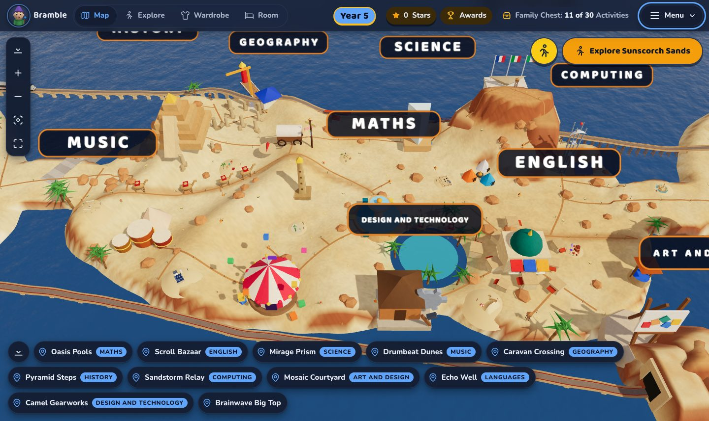

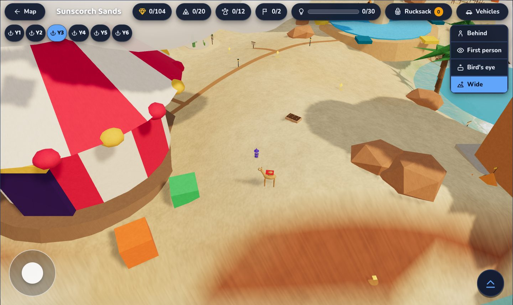

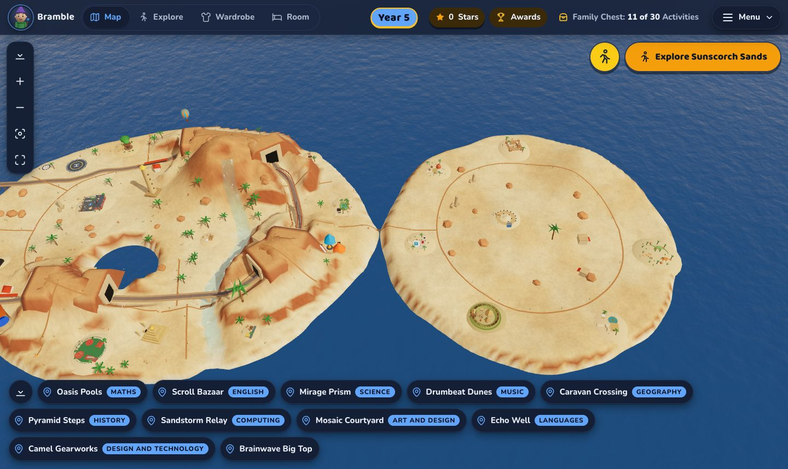

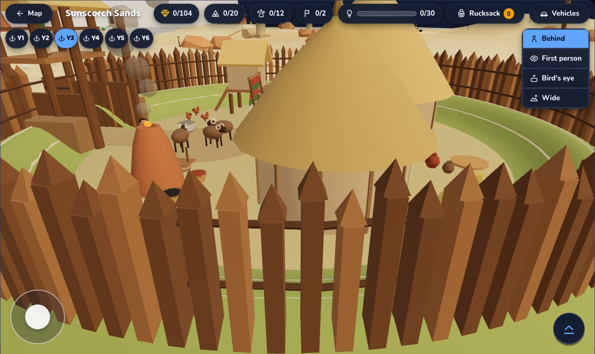

- **The land.** Golden dunes, an oasis, desert ruins, a market town and a caravan trail. It never rains on Sunscorch Sands.
- **Regions.** Oasis Pools (Maths), Scroll Bazaar (English), Mirage Prism (Science), Drumbeat Dunes (Music), Caravan Crossing (Geography), Pyramid Steps (History), Sandstorm Relay (Computing), Mosaic Courtyard (Art and design), Echo Well (Languages) and Camel Gearworks (Design and technology), with the Brainwave Big Top.
- **The Quest: The Secret of the Sun Crown.** A sandstorm has muddled the Island: the oasis has dried up, the camels have wandered off and the way into Pharaoh Nefer-Ra's tomb is buried. The Trophy is the Sun Crown Explorer.
- **Ring Races.** The Dune Dash and the Mirage Run.
- **Wonders.** A pyramid, a windmill and a hot-air balloon.
- **Its own Attractions.** [Stone Age Village](attractions.md#stone-age-village), [Iron Age Hillfort](attractions.md#iron-age-hillfort), [Chariot Racetrack](attractions.md#chariot-racetrack), [Desert Fort](attractions.md#desert-fort), [Sand Yachts](attractions.md#sand-yachts), [Dune Buggy Track](attractions.md#dune-buggy-track), [Date Palm Grove](attractions.md#date-palm-grove), [Papyrus Workshop](attractions.md#papyrus-workshop), [Sandstone Arches](attractions.md#sandstone-arches), [Dinosaur Park](attractions.md#dinosaur-park), [Archimedes Screw](attractions.md#archimedes-screw), [Pottery Kiln](attractions.md#pottery-kiln), [Sand Slide Tower](attractions.md#sand-slide-tower), [Windcatcher House](attractions.md#windcatcher-house) and [Painted Cave](attractions.md#painted-cave), out on the far reaches.
- **Curiosities.** A camel caravan, a sandboard dune, a Nile felucca, a fossil dig, a sphinx, a shaduf, a solar farm, a great sundial, a magic carpet, a meerkat mound and more.
- **Its Train.** The Sunscorch Desert Flyer, a high-speed diesel.

## Jungle Reach

**Year 4.** A rainforest of waterfalls, rope bridges and an overgrown temple.

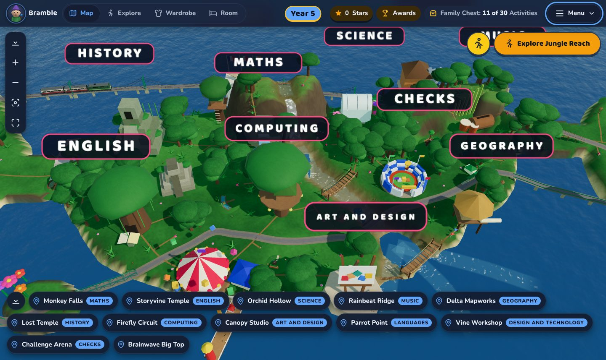

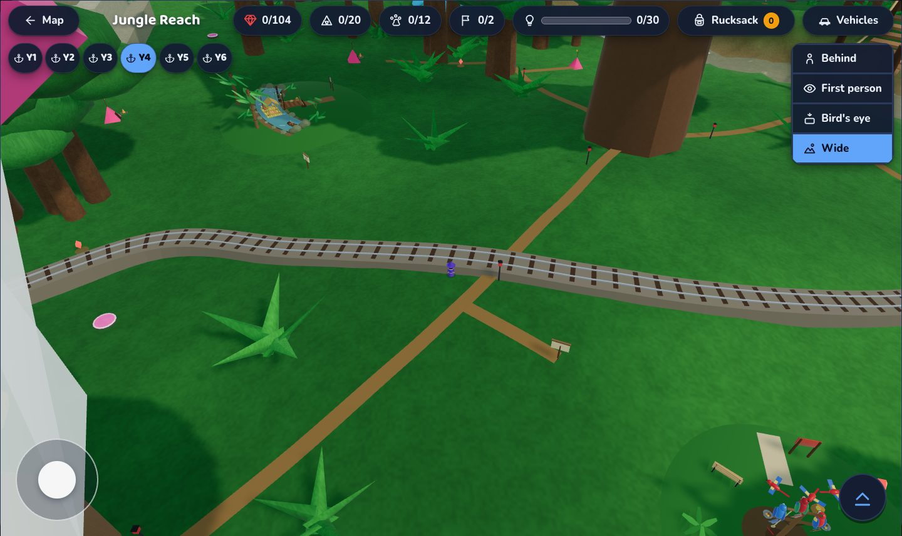

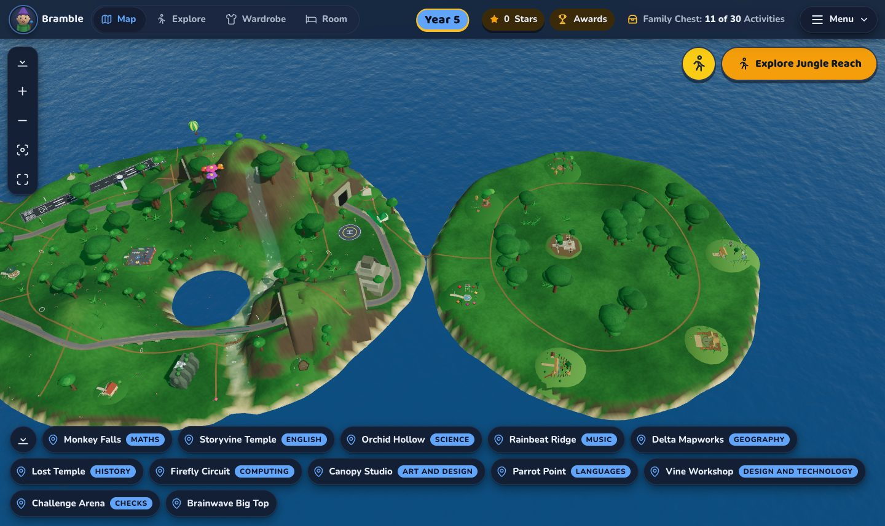

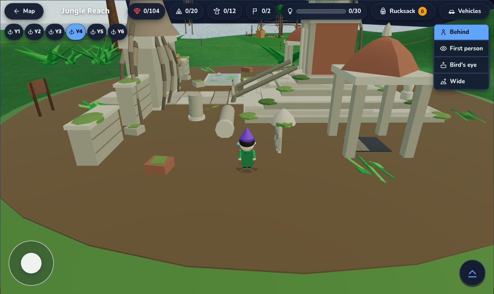

- **The land.** A rainforest canopy, waterfalls, a river delta, rope bridges and an overgrown temple. Its waterfall can be walked behind, along a dry ledge between the cliff and the falling water.
- **Regions.** Monkey Falls (Maths), Storyvine Temple (English), Orchid Hollow (Science), Rainbeat Ridge (Music), Delta Mapworks (Geography), Lost Temple (History), Firefly Circuit (Computing), Canopy Studio (Art and design), Parrot Point (Languages) and Vine Workshop (Design and technology), with the Brainwave Big Top and the Challenge Arena.
- **The Quest: The Golden Jaguar of Jungle Reach.** Before the Festival of the River Spirits, the research station has gone dark, the drums have fallen silent and the golden jaguar is locked in the old Maya temple. The Trophy is the Golden Jaguar Explorer.
- **Ring Races.** The Vine Dash and the Canopy Run.
- **Wonders.** The walk-behind waterfall, giant mushrooms and a hot-air balloon.
- **Its own Attractions.** [Vine Swing Glade](attractions.md#vine-swing-glade), [Strangler Fig Ruins](attractions.md#strangler-fig-ruins), [Rainforest Biome](attractions.md#rainforest-biome), [Stilt Village](attractions.md#stilt-village), [Cacao Farm](attractions.md#cacao-farm), [Gorilla Sanctuary](attractions.md#gorilla-sanctuary), [Elephant Pool](attractions.md#elephant-pool), [Jungle Coaster](attractions.md#jungle-coaster), [Bat Cave](attractions.md#bat-cave), [Hummingbird Garden](attractions.md#hummingbird-garden), [Hydro Power House](attractions.md#hydro-power-house), [Giant Kapok Climb](attractions.md#giant-kapok-climb), [Orchid House](attractions.md#orchid-house), [High Ropes Course](attractions.md#high-ropes-course) and [Insect House](attractions.md#insect-house), out on the far reaches.
- **Curiosities.** A river raft, a canopy walkway, a mangrove boardwalk, crocodile creek, a Mayan temple, a sloth hammock, giant lily pads, bamboo chimes, a drum circle, a leafcutter ant nest and more.
- **Its Train.** The Jungle Reach Express, a green diesel.

## Ember Isle

**Year 5.** A volcanic forge of lava rivers, obsidian cliffs and an iron keep.

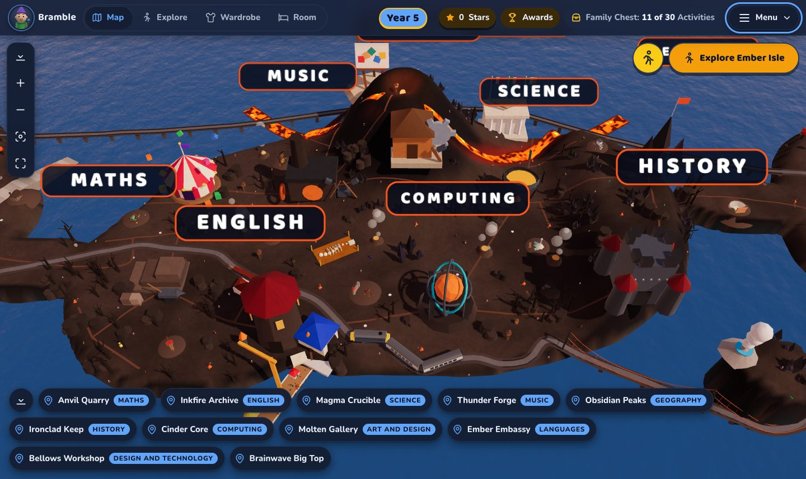

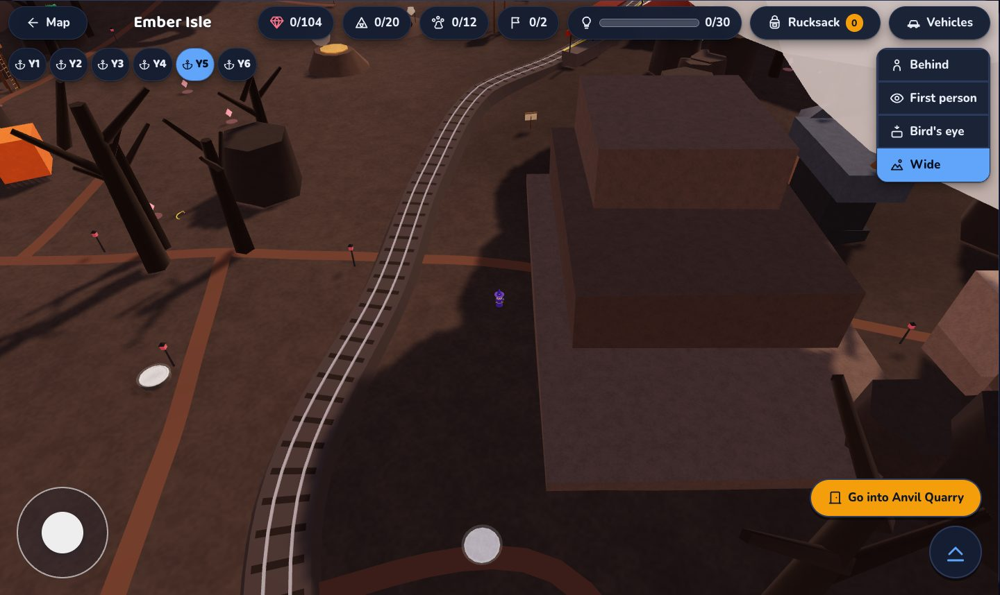

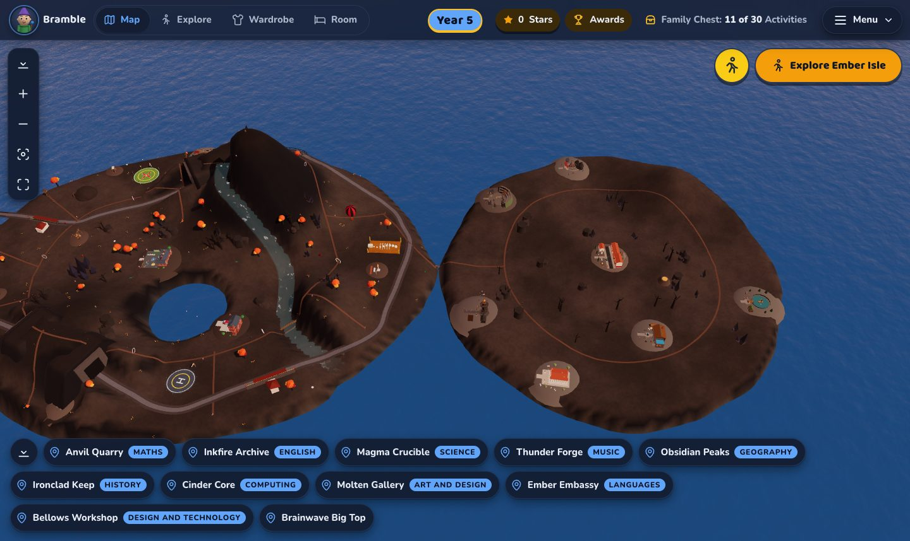

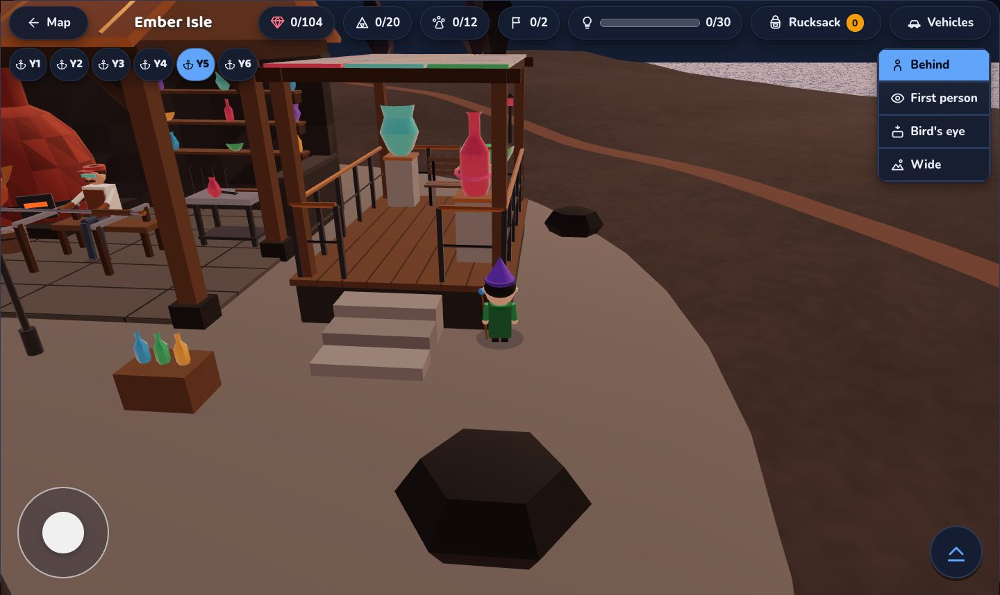

- **The land.** A volcanic forge, lava rivers, obsidian cliffs, an iron keep and steam vents. The Character is held back from the lava, and a cave can be walked into, where the Character's lantern lights up the dark.
- **Regions.** Anvil Quarry (Maths), Inkfire Archive (English), Magma Crucible (Science), Thunder Forge (Music), Obsidian Peaks (Geography), Ironclad Keep (History), Cinder Core (Computing), Molten Gallery (Art and design), Ember Embassy (Languages) and Bellows Workshop (Design and technology), with the Brainwave Big Top.
- **The Quest: The Heart of Fire.** Old Grumbler the volcano is rumbling: the Heart of Fire that kept it calm is lost, the Olympic flame has gone out and the Viking hoard is locked away. The Trophy is the Keeper of the Flame.
- **Ring Races.** The Cinder Sprint and the Magma Dash.
- **Wonders.** The lantern cave, giant mushrooms and a hot-air balloon.
- **Its own Attractions.** [Volcano Museum](attractions.md#volcano-museum), [Dragon Boat Lake](attractions.md#dragon-boat-lake), [Minotaur Labyrinth](attractions.md#minotaur-labyrinth), [Greek Temple](attractions.md#greek-temple), [Sutton Hoo Mound](attractions.md#sutton-hoo-mound), [Glassblowing Studio](attractions.md#glassblowing-studio), [Geothermal Plant](attractions.md#geothermal-plant), [Mine Cart Ride](attractions.md#mine-cart-ride), [Chilli Farm](attractions.md#chilli-farm), [Pompeii Street](attractions.md#pompeii-street), [Bronze Colossus](attractions.md#bronze-colossus), [Firework Tower](attractions.md#firework-tower), [Lava Flume](attractions.md#lava-flume), [Obsidian Quarry](attractions.md#obsidian-quarry) and [Dragon Hatchery](attractions.md#dragon-hatchery), out on the far reaches.
- **Curiosities.** A trebuchet, a Greek theatre, a sleeping dragon, a Viking longhouse and longship, a geyser, bubbling mud pools, basalt columns, a blacksmith's forge, a phoenix nest, a steam engine and more.
- **Its Train.** The Ember Valley Growler, a blue diesel.

## Starfall Isle

**Year 6.** Floating rocks, an observatory, standing stones and crystal spires under a comet.

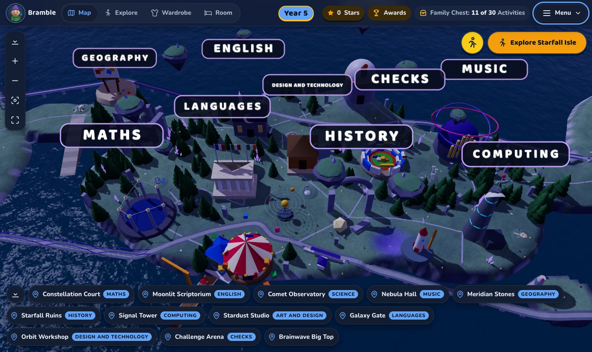

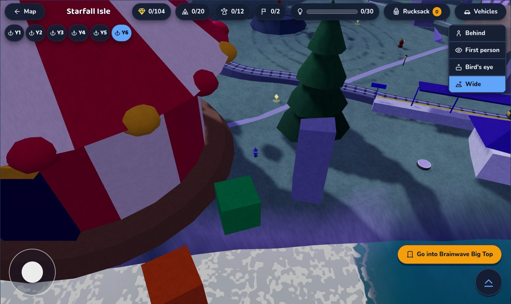

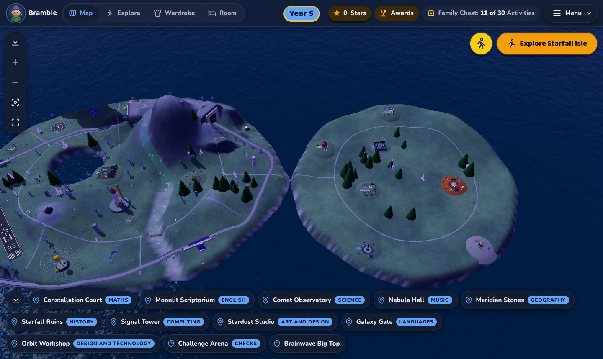

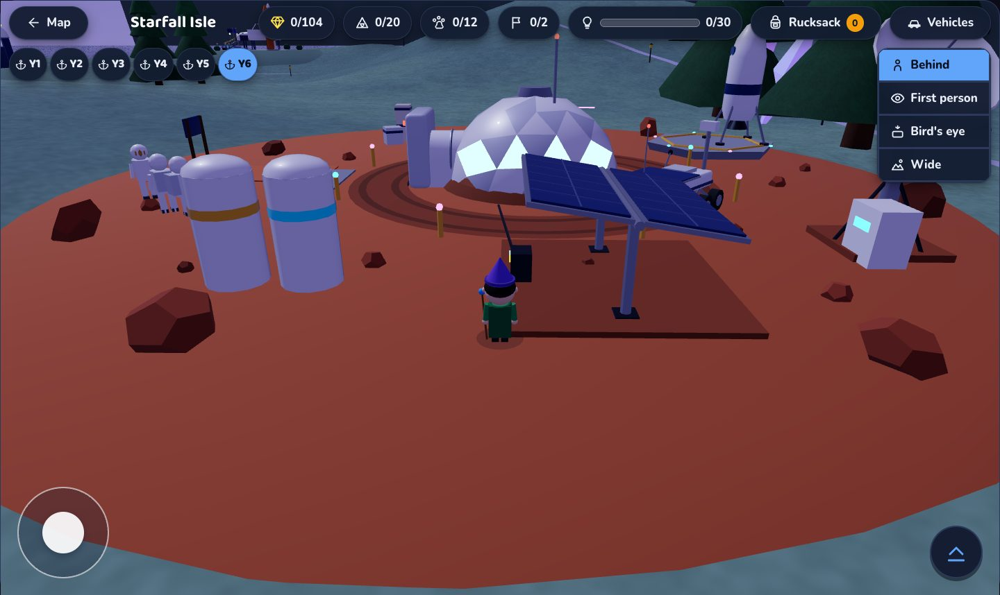

- **The land.** Floating rocks, an observatory, standing stones, crystal spires and a comet. Its gravity is low, so the Character jumps and floats higher.
- **Regions.** Constellation Court (Maths), Moonlit Scriptorium (English), Comet Observatory (Science), Nebula Hall (Music), Meridian Stones (Geography), Starfall Ruins (History), Signal Tower (Computing), Stardust Studio (Art and design), Galaxy Gate (Languages) and Orbit Workshop (Design and technology), with the Brainwave Big Top and the Challenge Arena.
- **The Quest: The Starfall Signal.** A signal is coming from the stars, but the space probe Kestrel has crash-landed, the gadgets have gone haywire and the observatory's star map has vanished. The Trophy is the Starfall Signal Hero.
- **Ring Races.** The Comet Run and the Moonbeam Dash.
- **Wonders.** A crystal arch, giant mushrooms and a hot-air balloon.
- **Its own Attractions.** [Planetarium Dome](attractions.md#planetarium-dome), [Mars Base](attractions.md#mars-base), [Drop Tower](attractions.md#drop-tower), [Space Shuttle](attractions.md#space-shuttle), [Star Flyer](attractions.md#star-flyer), [Mirror Maze](attractions.md#mirror-maze), [Camera Obscura](attractions.md#camera-obscura), [Astronaut Centrifuge](attractions.md#astronaut-centrifuge), [Beagle Ship](attractions.md#beagle-ship), [Giant Heart](attractions.md#giant-heart), [Home Front House](attractions.md#home-front-house), [Lunar Lander](attractions.md#lunar-lander), [Black Hole Slide](attractions.md#black-hole-slide), [Shadow Garden](attractions.md#shadow-garden) and [Inventors' Hall](attractions.md#inventors-hall), out on the far reaches.
- **Curiosities.** Wind turbines, a meteorite crater, an observatory, a moon phase garden, a satellite dish, a lunar rover, a UFO landing site, a robot workshop, a Morse code lamp, a moon bounce and more.
- **Its Train.** The Starfall Star Glider, a midnight-blue bi-mode.
