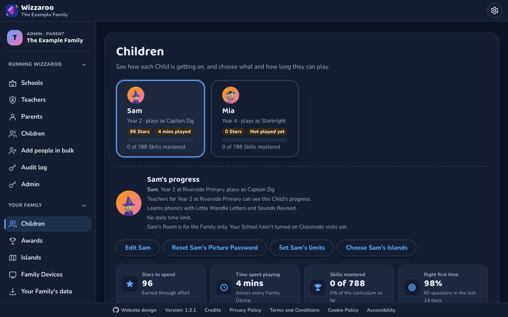
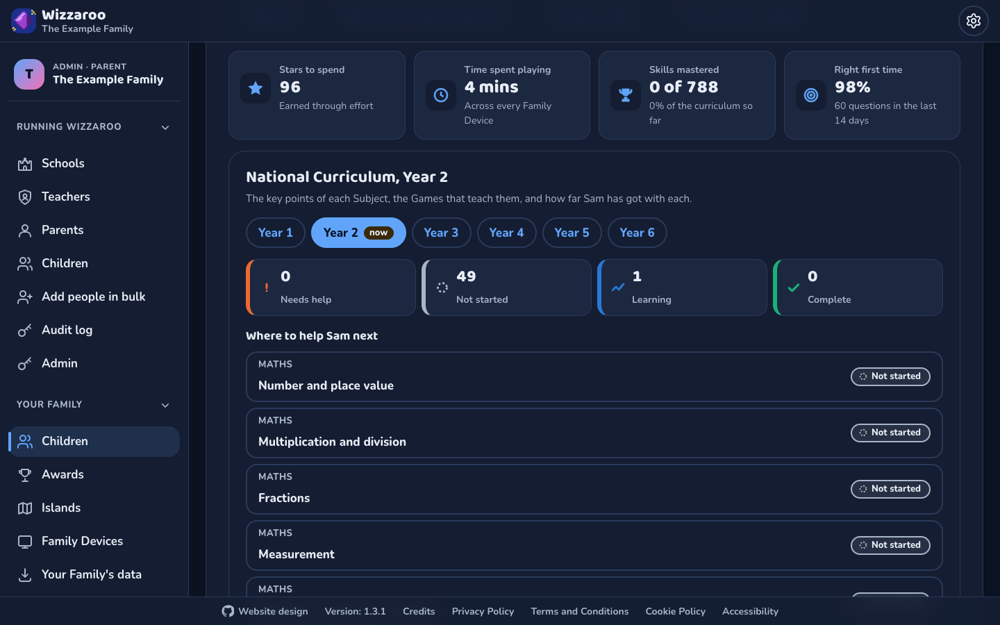
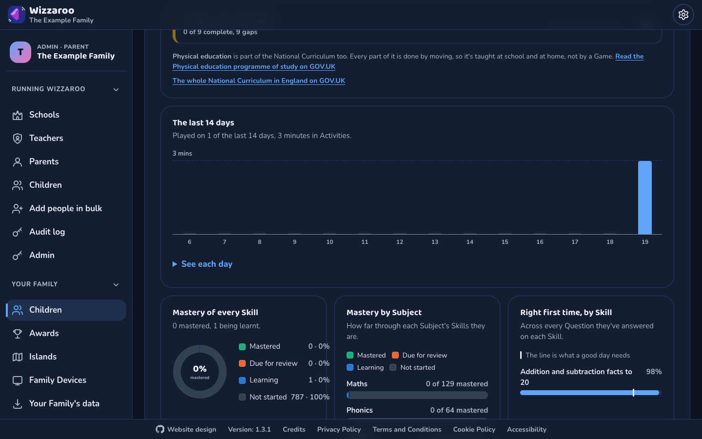

# Mastery and the progress dashboard

[← Back to the README](../../README.md) · [All guides](README.md)

> **Personal use only.** Wizzaroo is intended for your own personal use only. It is not intended for use with or by a school, teacher, parent or student. Only use it for yourself.

## Mastery

The server alone decides Mastery, by replaying a Child's Question answered and Activity finished events (`src/curriculum/mastery.ts`). It keeps what the replay has worked out and replays only the events it hasn't seen yet, whenever the dashboard asks ([ADR 0055](../architectural-decision-record/0055-the-server-keeps-each-familys-replay-and-picks-it-up.md)). Replaying the same events, in any order and however many times they were uploaded, always gives the same Mastery.

| Mastery        | When                                                                                                                                                                        |
| -------------- | --------------------------------------------------------------------------------------------------------------------------------------------------------------------------- |
| Not started    | No Question answered on the Skill                                                                                                                                           |
| Learning       | Answered, but fewer good days than the Skill's mastery rule asks for                                                                                                        |
| Mastered       | Enough good days: by default 3 separate days, each with 80% of that day's Questions right first time                                                                        |
| Due for review | Mastered, and its next Review is due. A good day then is a good Review: it makes the Skill Mastered again and doubles the time to the next Review. A poor one leaves it due |

A day is the device's own date when the Question was answered, so 80% three times in one afternoon is one good day, not three.

### The progress dashboard

The **Children** panel shows a tile for each Child, with their Character's 3D portrait, their Stars, time spent and how many Skills they have mastered. The portrait is the Character as they're dressed now, framed on the head and hat and taken as a still picture from one shared 3D studio (`ChildFace` in `src/client/parent/child-face.tsx`, `buildPortraitShot` in `src/client/character/item-picture.tsx`), so a long list never opens a 3D view per Child. It stands in for the Child everywhere they're shown, on their progress and in the staff Children lists too. A Child who hasn't made their Character yet, and any Child while their picture is being taken, shows the first letter of their nickname instead. The first Child's progress opens below the tiles, and tapping another tile switches to theirs. Each Child's progress shows:

| Part                                | What it shows                                                                                                        |
| ----------------------------------- | -------------------------------------------------------------------------------------------------------------------- |
| Four headline numbers               | Stars to spend, time spent playing, Skills mastered out of every Skill, and right first time over the last 14 days   |
| National Curriculum                 | Every Subject's Curriculum Points for a Year, each with a progress bar, its status and the Games that teach it       |
| The last 14 days                    | A column for each day's minutes in Activities; hovering shows the day's Questions and how many were right first time |
| Mastery of every Skill              | A donut of every Skill in the curriculum by Mastery: Mastered, Due for review, Learning and Not started              |
| Mastery by Subject                  | A bar for each Subject, split by Mastery                                                                             |
| Right first time, by Skill          | A bar for each practised Skill, with a line at the percentage a good day needs                                       |
| Time spent, by Skill and by Subject | Bars for each practised Skill, longest first, and a donut of minutes by Subject                                      |
| On the way to Mastery               | Good days so far out of those needed, for each Skill being learnt                                                    |
| Reviews coming up                   | Each Mastered Skill's next Review date, with those due now first                                                     |

**The National Curriculum.** The section opens on the Child's own Year, and a Parent can switch to any Year from 1 to 6. Each Subject taught that Year is a section with a bar for how far through it the Child is and how many of its Curriculum Points are complete or a gap. Inside, each Curriculum Point (a key point of the programme of study, such as Year 2 Statistics) shows its summary, a progress bar, a status and every Game that teaches it, with the Game's Region, Island and its own progress bar. A Skill counts towards its points by its good days out of those Mastery needs, and fully once Mastered; a point is the average of its Skills. A point is **Complete** when every Skill is Mastered, **Needs help** when right first time on one of its Skills is below what a good day needs, **Learning** once any Skill is played, and **Not started** (a gap) before that. **Where to help next** lists up to five gaps, the tricky ones first, and tapping one opens it; **Show only gaps** hides the rest. Status is always a word and an icon as well as a colour. The points live in `src/curriculum/curriculum-points.<subject>.json`: Maths, English, Science and Phonics by Year, and Music, Geography, History, Computing, Art and design, Design and technology and Languages by Key Stage, placed in the Year whose Games teach them. Each file has a `programmeOfStudyUrl` on GOV.UK, and each Subject's section links to it as **Read the … programme of study on GOV.UK**, opening in a new tab; Phonics links to the English programme of study. Below the Subjects, the page links to Physical education's programme of study, which no Game can teach, and to the whole National Curriculum in England. Loading them fails if any point has no Skill, if any Skill teaches no point, or if a Skill is from another Subject or Year, and a test checks every point is taught by a Game on the World Map. Handwriting, spoken language, local history studies, and the making, cooking and speaking parts of Art and design, Design and technology and Languages have no points, since a Game can't teach or check them; nor has Physical education. Every statutory statement a Game can teach has a Game, many of them lab games ([ADR 0039](../architectural-decision-record/0039-the-whole-national-curriculum-through-lab-games.md)).

Every chart says its numbers in words as well as colour: the legends carry counts and percentages, each chart has a text description for screen readers, and **See each day** and **Every Skill in a table** show the same numbers as tables. The charts are SVG and HTML drawn by `src/client/parent/progress-charts.tsx`, with no charting library, so they add almost nothing to the offline download.

`GET /api/children` gives the dashboard each Child's `loadout` (their Character as dressed now, or `null` before they've made one), their `mastery` and their `dailyPractice`: one entry for each of the last 14 days, ending on the server's today, with the Questions answered, how many were right first time and the seconds spent in Activities, across every Skill. A day with no practice is there with zeros.

**Spaced repetition.** The first Review is due 7 days after the day a Skill became Mastered. Each good Review doubles the interval (14 days, then 28, then 56…), counted from the day of that Review, so a Skill a Child knows well comes back less and less often over the six years. Practising a Mastered Skill before its Review is due leaves the schedule alone. The dashboard's Mastery carries each Skill's interval and next Review date.

The device shows a provisional Mastery until the server's arrives: the practice the server last gave it, by Skill and day, plus whatever this device has recorded since. Each time the game page opens it uploads its outbox, then fetches the server's practice and forgets its own copy of every event the server now has.
