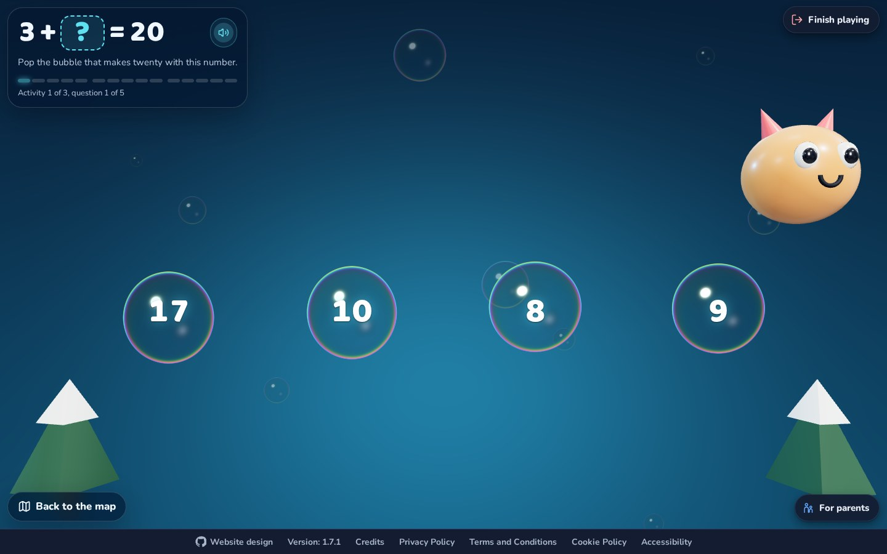
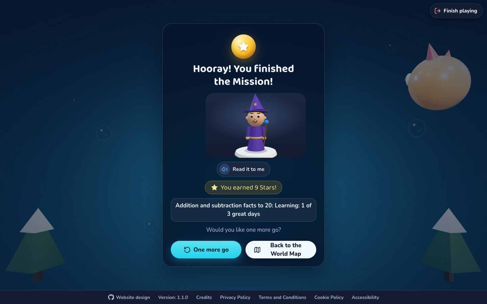
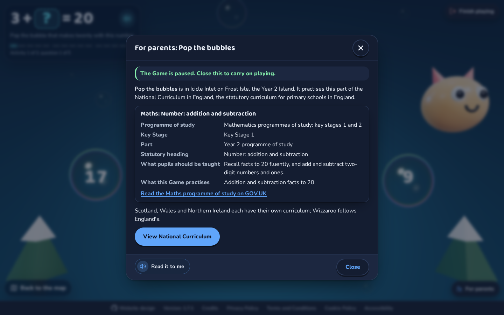

# Missions

[← Back to the README](../../README.md) · [All guides](README.md)

> **Personal use only.** Wizzaroo is intended for your own personal use only. It is not intended for use with or by a school, teacher, parent or student. Only use it for yourself.

Once a Child has opened their Character, they choose what to play from their [World Map](world-map.md): **Pop the bubbles** or **Listen and pick**. Each is a Mission of 3 Activities of 5 Questions, which ends with a celebration and **One more go**. The Mission logic (building a Mission, the order of its Questions, hints and finishing) is in `src/client/mission/mission.ts`, apart from the 3D scene, and `mission-play.tsx` is the screen around it.

- **Popping bubbles** is number bonds to 10. A number sentence such as `3 + ? = 10` is shown, and the Child pops the bubble that makes 10, out of 4. Its Activities use the generator at Difficulty 1, 1, then 2, and never ask the same Question twice in one Activity.
- **Listen and pick** is multiple choice with sound. The Child hears a phoneme and picks the letters that make it, out of 4 graphemes their programme teaches. None of the 3 wrong graphemes is one the programme also teaches for that sound, so there is only one right answer. It offers the Phonics Skills in the order of the Child's Phonics Programme (`orderPhonicsSkills`), any Due for review first, as Reviews, then the ones they haven't Mastered, and only those whose sound has a recording, so it appears once the first recordings are committed. Nothing in it is about phonics except the sound and the letters, so later Subjects reuse it as plain multiple choice.
- **Never a hard fail.** A wrong answer gets instant feedback: the choice disappears, the Companion thinks, and a hint is spoken and shown, such as "Count on from 3 until you reach 10". The Child tries again with the choices left, so every Question ends with the right answer. A right answer pops the bubble with sparkles and makes the Companion jump.
- **Voice-over on every instruction.** Starting a Mission speaks its instruction, from the Child's own tap so iPhones and iPads play it, and the speaker button says it again at any time. Listen and pick plays the next sound straight after each right answer.
- **Landscape, phone first.** Every choice is at least 64 pixels across, and 150 at most, sized from the screen's height, and works with a tap or a mouse click. The choices are buttons laid over the 3D scene at the same places the scene draws its bubbles. A phone held upright is asked to turn sideways.
- **Events.** Each Question answered records its Skill, the Activity, the device's own date, whether it was right first time and how many wrong answers came first. Each Activity finished records how long it took. Both go into the outbox like every other event, so a Mission played with no network syncs afterwards.

## For parents

Every Game in every Region on every Island tells a grown-up what it practises in the National Curriculum in England ([ADR 0078](../architectural-decision-record/0078-for-parents-and-games-first.md)), from two places:

- **The small button on a Game's card** in a Region's panel, labelled "For parents: what (Game) practises", which opens before the Game is played, locked or not.
- **For parents**, in the bottom-right corner while a Game is played (a Mission, a puzzle or a Check). It **pauses the Game**: its voice-over and music stop, and the Game's clock (`src/client/mission/game-clock.ts`) stands still, so an answer's time, a Check's countdown and a puzzle's seconds leave out the time spent reading, and no Games first time is counted. Closing it carries on where the Game was.

The dialog (`for-parents-dialog.tsx`) lists each Curriculum Point the Game's Skills teach, found by `findGameCurriculum` (`game-curriculum.ts`) through the same Skills its card and the Parent page's progress use. For each it names the Subject, the programme of study by its GOV.UK title (such as "Mathematics programmes of study: key stages 1 and 2"), the Key Stage, the part of the programme (such as "Year 2 programme of study", or English's "Lower key stage 2: Years 3 and 4 programme of study"), the statutory heading the point falls under (such as "Number: addition and subtraction", or "Reading: word reading" for phonics), what pupils should be taught, and the Skills this Game practises, with a link to that programme of study. `src/curriculum/curriculum-point-location.ts` works out where each point sits. **View National Curriculum** opens the National Curriculum collection on GOV.UK in a new tab. A test checks that every Game on the World Map names at least one point.

The scene is placeholder low-poly shapes (a Region of grass and trees, and a Companion) until the CC0 models arrive. It keeps to the [performance budget](../performance-budget.md), and lowers its resolution, then drops its effects, when the frame rate falls below 30 fps. Add `?performance` to the game page's address to see the frame rate, resolution and draw calls.
