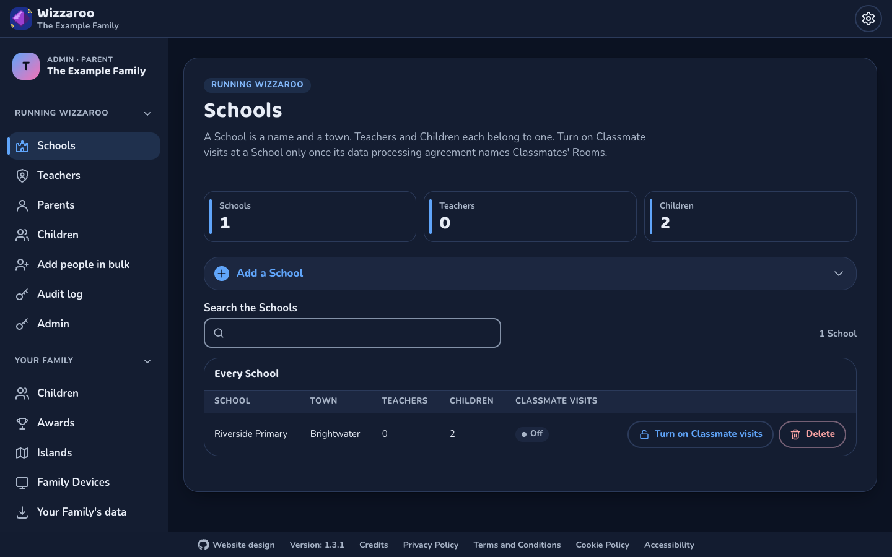

# Signing in

[← Back to the README](../../README.md) · [All guides](README.md)

> **Personal use only.** Wizzaroo is intended for your own personal use only. It is not intended for use with or by a school, teacher, parent or student. Only use it for yourself.



There is no sign-up page. Create the owner's account once, with the development database running:

```bash
pnpm seed:owner
```

It asks for the owner's email address, a password of at least 12 characters (twice, without showing it) and the Family's name, then creates the owner with the Admin and Parent roles in that Family, and a School for their Children that the Admin names on the Admin dashboard. Run it again and it refuses, changing nothing.

Then sign in at <http://localhost:4310/parent/>. The owner lands on the Admin dashboard, with their Family's dashboard one tap away in the sidebar; a Teacher lands on their Year Groups and a Parent on their Family. Every sign-in records the adult's last login. Signing in sets an HTTP-only, `Secure`, `SameSite=Strict` cookie, `__Host-wizzaroo_sign_in`, on `Path=/` with no `Domain`, so only Wizzaroo's own host can set it and no other host under the same domain can plant a sign-in of its own; the database holds only a hash of it, and signing out deletes it.

- **How long a sign-in lasts.** A Parent's sign-in lasts 30 days, and ends sooner once left unused for 14 days. The Admin's and a Teacher's (any adult with either role) last 7 days, and end once left unused for 12 hours, since they reach many Families' Children. Using a sign-in moves its last use (`sign_ins.last_used_at`) on, at most once a minute. A sign-in past either limit is answered `401`, and the adult signs in again. The figures are in `src/server/auth/sign-in-lifetimes.ts` and [ADR 0049](../architectural-decision-record/0049-sign-ins-end-when-left-unused.md), which is reviewed on 31 March 2027.
- **Guessing a password.** Wrong passwords count against the email address typed, whether or not it has an account, by [the request-rate policy](../product-requirements-document/pen-testing.md#pre-condition-the-request-rate-policy-before-a-second-school): 10 in an hour, and 5 in any one minute. Past that, Wizzaroo answers `429` without checking the password, the right one included, until the hour has moved on, and writes one `sign-in.rate-limited` entry in the Audit Log for the run of refusals. A right password doesn't count, and a passkey still signs the adult in. The sign-in form then says signing in with a password is paused for a while. Signing in, its code step, asking for and using a password reset, accepting an Invite and asking for passkey sign-in options also count together for each caller's address: 100 in 15 minutes, and 20 in any one minute.
- **Only Wizzaroo's own pages.** `SameSite=Strict` lets every other host under the same domain send the sign-in cookie, so the server also asks where a request came from. A request under `/api/` that a browser marks with a `Sec-Fetch-Site` other than `same-origin` or `none` is refused with `403` ("Wizzaroo answers only its own pages"), and so is a request that changes something whose `Origin` isn't `PUBLIC_URL`'s. Nothing runs before the refusal, so nothing changes and nothing is logged. curl and other tools that send neither header are let through, as before.

## Schools, Teachers and Invites

Wizzaroo serves Schools ([ADR 0026](../architectural-decision-record/0026-schools-and-teachers.md)). Nobody signs up: the Admin brings in Teachers, and the Admin and Teachers bring in Parents.

- **Schools.** Only the Admin creates a School (a name and a town), names any School that has no name yet, and deletes one, which works only once it has no Teachers or Children. Each School's row also has **Turn on Classmate visits**, which asks the Admin to confirm the School's data processing agreement names Classmates' Rooms first, and **Turn off Classmate visits**, which shuts every Classmate's Room there at once and keeps each Parent's choice for when it is turned on again (`PUT /api/schools/:schoolId/classmate-visits`, Admin only, logged as `schools.classmate-visits.approved` or `.withdrawn`).
- **Teachers.** The Admin creates a Teacher at one School with one or more Year Groups, changes them later, or deactivates them. Deactivating a Teacher or Parent blocks their sign-in at once, cancels any reset link or email address check they had waiting, and keeps their data.
- **Parents.** The Admin or a Teacher creates a Parent, at the Teacher's own School, either in a Family of their own or linked to an existing Family as a household's second adult. The Admin links a second adult at once, and the Family's Parents are emailed that they joined. A Teacher's reach is read-only, so their second adult joins only once a Parent of the Family agrees in [Your Family's data](family-data-and-admin.md#your-familys-data): until then they are in no Family and have no Invite, and every Parent of the Family is emailed to say a Teacher asked. Parents can't invite anyone.
- **Invites.** Creating a Teacher or Parent makes a single-use Invite (`/parent/#accept-invite=…`) that works for 7 days, copied as a link or emailed as the Teacher Invite or the Parent Invite, which names the School. Opening it asks only for a password, since the login and its email address already exist. A copied link asks the new adult to confirm their address; an emailed one proves it. Resending an Invite replaces any pending one, and lists show each adult's Invite as not sent, pending, accepted or expired. An Invite is only for an adult who has never set up a login: once they have a password, a passkey or an accepted Invite, staff can't send them one, an Invite still live is refused, and lists show them as accepted. An adult who keeps only passkeys is no exception, so whoever sends an Invite can never set their password. An adult who has lost their way in gets a password reset to their own confirmed address instead, which the sender never sees. An adult a Teacher asked to add to a Family gets their Invite only by email, at the address the Family's Parent agreed to: nobody can send them one, or a password reset, before that agreement, and a Teacher can never copy their link.
- **Names and addresses.** An adult's name, and a School's name and town, are one line of plain text: one holding a line break or any other control character, a bidirectional or other format control, or a link (`https://`, any `scheme://`, or `www.`) is refused with `400` from a form, and its row is skipped from a CSV upload, at preview and upload alike, with the reason "Parent 1's name can't hold a line break, a link or a control character" (`isPlainName` in `src/server/plain-names.ts`, #321). An email address must be one Nodemailer delivers to exactly that mailbox: letters, digits and the symbols RFC 5322 allows there (such as `+`, `_` and `'`) in dot-separated parts before the `@`, and letters, digits, hyphens and dots after it, with no quotes, spaces, commas, semicolons, colons, brackets or backslashes, and at most 254 characters. Anything else is refused as "isn't an email address", in the forms, both CSV uploads and the email-address check (`isEmailAddress`, #322).
- **Lists.** The Teachers, Parents and Children lists, and the Admin's Families, show 25 to a page (`src/client/staff/pagination.tsx`). The adult can choose 5, 10, 25, 50 or all of them a page, and step to the first, previous, next or last page or a numbered one. A new search goes back to the first page. With 5 or fewer, there are no page controls. Each Child's row has the Admin's Stars and Move each as a box with its button beside it, then Open progress.
- **Bulk creation.** The Admin uploads Teachers from a CSV file, and the Admin or a Teacher uploads Parents and Children together. Each has a template to download, and a preview that marks every row valid or names its problem before anything is created. Valid rows go through, invalid ones are skipped with a downloadable report, and a Family goes through only if all its rows are valid, so siblings are never split. A file may have at most 1,000 rows and no more columns than its template (a Teacher's may keep the Admin's School column, which is ignored). A wider file is refused before any row is read, and reading stops at row 1,001. "Create and email Invites now" is ticked by default. Every upload's emails join one queue for the whole deployment, which sends a couple at a time with a pause after each, to stay within the provider's limits. An email that fails doesn't stop the others: its Invite shows as "Invite email not sent" in the Parents or Teachers list, where the uploader sends a new one. A Teacher's row that names an existing Parent adds the Child to that Parent's Family only when the Parent is within the Teacher's reach. Otherwise, and for any other address that already has an account, staff included, the upload skips the row with one reason, "Someone in Wizzaroo already uses Parent 1's email, so the Admin adds this row", which names no role and no School. A Teacher's preview treats such an address as one no one has, so it can't be used to find out whose an address is.
- **Reach.** The API works out what each adult reaches from their sign-in, never from the request (`src/server/reach/reach.ts`). A Parent reaches their own Family; a Teacher the Children whose worked-out Year is one of their Year Groups at their School, read-only, plus those Children's Parents and the School's Parents with no Children yet; the Admin everything, and each time the Admin opens a Child's progress it is logged in `admin_access_logs`. The staff dashboard's list of Children carries each Child's progress too, so each time it serves the Admin (`GET /api/school-children`) it logs one row for every Child listed, in the same transaction as the read. So does every other reply that serves the Admin a Child's data: the Admin's Families and the Parents list, each Child they name; the Deletion Requests, each Child one names; and a change to a Child's details, limits, Teacher locks, Classmate visits, birth or School, the Child it replies with. A Teacher's reads aren't logged. A Teacher never changes how a Child plays.

## Passkeys and two-factor authentication

An adult signs in with their email address and password, or with a passkey. For Parents both are optional extras on the **Your account** panel, and a Parent who sets up neither signs in with their password exactly as before. Teachers and the Admin see many Families' Children, so they must sign in with a passkey or two-factor authentication: after a password-only sign-in they see only Your account until they set one up, and Wizzaroo won't let them remove their last one. Only staff with neither yet may set one up from a password alone, and only for 7 days: from when their login was made, from accepting their Invite, or from using a password reset link the Admin sent them. After that, a password alone, or a reset link they asked for themselves, can't set one up (403 `second-factor-setup-closed`): they ask the Admin for a reset link from the Teachers list (**Send _their name_ a password reset**), and using it opens 7 more days. The owner sets theirs up within 7 days of `pnpm seed:owner`. A Teacher or the Admin who already has a passkey and signs in with their password, or with a password a reset link set, first chooses **Use your passkey** to prove it's them (`/api/passkey-confirmations`); until then Wizzaroo refuses to add a passkey, make a QR code for a phone or turn on two-factor authentication (403 `second-factor-required`), so a password or a mailbox alone never stands in for the passkey they have.

- **Passkeys.** **Add a passkey** asks the browser for a discoverable passkey that checks it's the Parent (a fingerprint, face or screen lock), named for what it's on. **Sign in with a passkey** then needs no email address or password. Wizzaroo keeps only each passkey's public key and sign count, in `passkeys`, and checks every answer with [SimpleWebAuthn](https://simplewebauthn.dev). Each challenge works once and for 5 minutes. Expired ones are swept at most once a minute, through an index on when they expire, so asking for a challenge costs one insert however often it is asked for (#331). The relying party is `PUBLIC_URL`'s host name, so a passkey made on `localhost` doesn't work on `wizzaroo.adrianeyre.co.uk`. An adult can add as many passkeys as they like, several in one password manager if they wish. Each is registered under a WebAuthn user handle of its own, 32 random bytes made for that registration, so it is never the account id and a password manager keeps a new passkey beside the adult's others rather than replacing one. For the same reason the options exclude none of the adult's passkeys. Sign-in finds a passkey by its credential id, never its user handle ([ADR 0072](../architectural-decision-record/0072-an-adult-can-keep-several-passkeys.md)). A phone holding a QR code's secret is given only that fresh handle and the name "Wizzaroo", never the adult's email address or their passkeys' ids, and asking for its options again replaces the code's one challenge. Adding or removing a passkey, here or from a QR code, emails the adult's confirmed address a security notice ([email](email.md)).
- **Two-factor authentication.** Turning it on shows a key to type into an authenticator app (or an `otpauth://` link to open one), and it is on only once the Parent gives a code from the app. Wizzaroo then shows 10 recovery codes, once, and keeps only their hashes: each is argon2id with a salt of its own, as a password is, so a copy of the database is searched one code at a time, an argon2 hash per guess. From then on a right password asks for a code: the app's 6-digit code or a recovery code, each of which works once. After 5 wrong codes, or 5 minutes, the Parent starts again with their password. Wrong codes also count against the adult, however many sign-ins carry them: after 5 in an hour, Wizzaroo checks no code for that adult for the next hour, the right one included, and answers `429`. A passkey still signs them in, and their address, if confirmed, is emailed to say codes are paused, since whoever gave them knew the password. A right password likewise starts at most 10 sign-ins that ask for a code in an hour, and 5 in a minute, for one adult; past that it answers `429` too. A passkey signs in without a code, because it already checks it's the Parent. Turning it off takes a code too, and wrong codes sent to turn it off count against the same 5 an hour as the sign-in step's: after the fifth, every code is answered `429` unchecked until the hour is up. Each refused code is in the Audit Log, as `two-factor.turn-off-refused`, and turning it off emails the adult's confirmed address, as changing the password does. The secret the app makes codes from is kept sealed with AES-256-GCM under `TOTP_SECRET_KEY`, a key the database never holds, and bound to its adult, so a copy of the database, or a backup, makes no code ([ADR 0051](../architectural-decision-record/0051-totp-secrets-are-sealed-with-a-key-the-database-never-holds.md)). The codes are standard TOTP (RFC 6238: SHA-1, 6 digits, every 30 seconds, one step either side accepted).
- **Never locked out.** A Parent with a passkey can remove their password and sign in with passkeys only, and set one again later. Wizzaroo refuses to remove a Parent's last password or passkey, so there is always a way in. Removing the password, like changing or setting it, signs out the Parent's other browsers.
- **What ends which sign-ins.** Signing out ends only that browser's sign-in. Changing, setting or removing a password ends every other sign-in of the adult's and keeps the one that asked. Resetting a password from a link, and accepting an Invite, end every sign-in made before them. Confirming a change of email address ends every sign-in of the adult's too, but for the confirming browser's own sign-in if it has one; a link opened on a browser that isn't signed in as them ends them all. **Sign out your other browsers** on Your account (`DELETE /api/other-sign-ins`) ends every other sign-in with no password asked for, so a passkey-only adult can do it too, and writes `sign-out.other-browsers` to the Audit Log.
