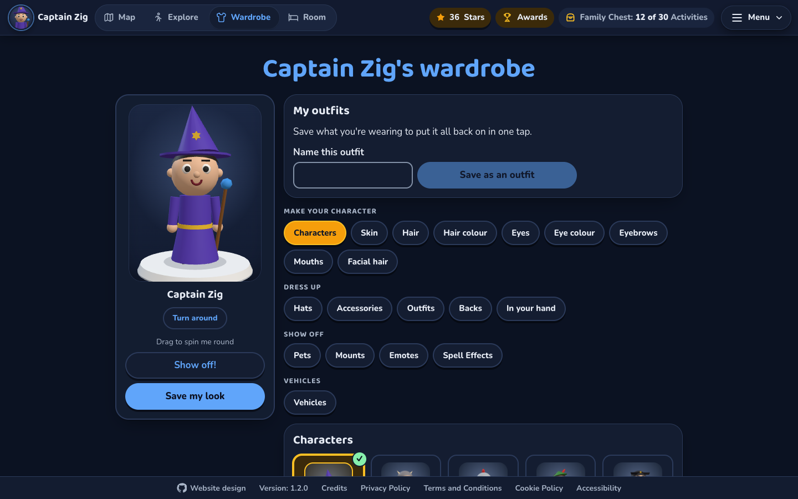
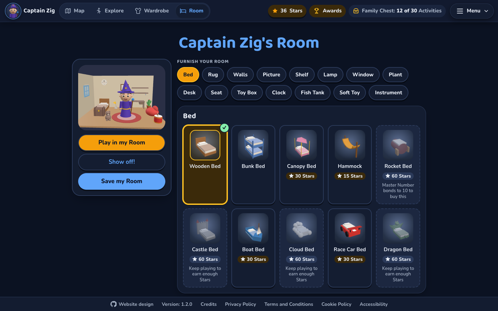
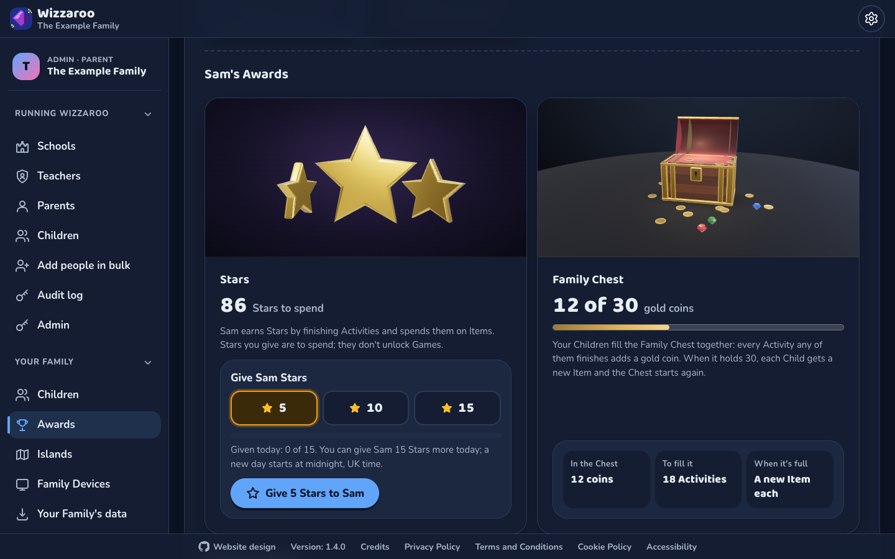
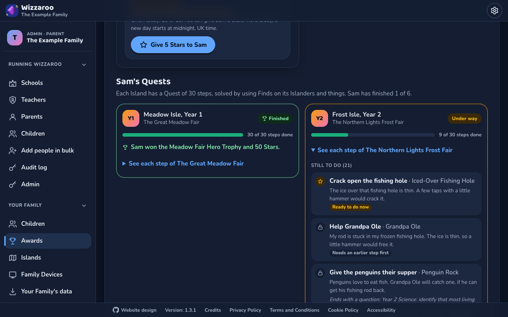

# Stars, Items, Rooms and Family play

[← Back to the README](../../README.md) · [All guides](README.md)

> **Personal use only.** Wizzaroo is intended for your own personal use only. It is not intended for use with or by a school, teacher, parent or student. Only use it for yourself.

## Stars and Items

Stars are the only currency, and only the server decides a Child's balance, by replaying the Family's events in the order they reached it, each upload in the order its events happened (`src/curriculum/rewards.ts`). The server keeps what each Family's replay works out and replays only what it hasn't seen yet, so a request costs the same however long the Family has played ([ADR 0055](../architectural-decision-record/0055-the-server-keeps-each-familys-replay-and-picks-it-up.md)). The launch values are data in `src/curriculum/rewards.json`, not code:

- **3 Stars for each Activity finished**, right or wrong, so a Mission of 3 Activities earns 9.
- **20 Stars once** when a Skill becomes Mastered. A Review bringing it back never pays it again.
- **Activities on a Mastered Skill earn Stars only as a Review**, that is while the Skill is Due for review.

The Catalogue (`src/curriculum/catalogue.json`) lists every choice with its slot, rarity, unlock rule, model and colour, and the Star price of each rarity: common 15, uncommon 30, rare 60. The model names the 3D shape the Character wears, and the colour paints it.

Each Character is a 3D person, built from low-poly parts in `src/client/character/` and drawn through the pixel pipeline without the 16-colour palette, so every skin and hair colour stays true ([ADR 0011](../architectural-decision-record/0011-the-character-keeps-its-own-colours.md)). It comes in two halves:

- **Features**, chosen for free at any time, with at least 10 choices each: 20 Character Types (Wizard, Warrior, Knight, Archer, Pirate, Ninja, Astronaut, Fairy, Explorer, Inventor, Superhero, Dragon tamer, Chef, Detective, Royal, Cowhand, Rock star, Gardener, Painter and Scientist), 15 skin colours, 15 hair styles, 15 hair colours, 15 eyes, 15 eye colours, 10 eyebrows, 15 mouths and 15 kinds of facial hair. The Catalogue refuses a Feature with fewer than 10 choices, or one that costs Stars. Until a Child chooses an eye colour, their eyes keep the colour their eye style came with, and every eye style's colour is one of the eye colours.
- **Items**, to dress it in, across five slots: hats, accessories (glasses, masks, scarves, medals, an apron, a sash, headphones), outfits, backs (capes, wings, shields, a jetpack) and something in the hand (wands, a sword, a bow, a torch, a dragon egg, a whisk, a magnifying glass, a guitar, a paintbrush). Each slot has a free starter set of 2 or 3 choices, and the rest are earned. Two are tied to Skills, the number bonds hat and the snake sound wand, and can't be bought until their Skill is Mastered.
- **Pets, Mounts, Emotes and Spell Effects**, to show off with, one of each at a time: 19 Pets, 3 Mounts (a broomstick, a cloud and a dragon), 14 Emotes and 19 Spell Effects ([every one](wardrobe-items.md)). Each slot starts empty, with no free starters, and one of each kind is tied to a Skill. A Pet stands beside the Character wherever it is drawn but never on the World Map, which is the Companion's; the Character rides its Mount. The Emote and Spell Effect play when a Mission ends and when the Child taps **Show off!**; with reduced motion asked for, they show as a still pose and a soft glow.
- **Vehicles**, to ride when exploring an Island: 30 of them, from a bicycle, a skateboard and a horse and cart to a family car, a sports car, a van, a motorbike, a fire engine, a double-decker bus and a tuk-tuk, bought with Stars (6 common, 13 uncommon and 11 rare). A Vehicle isn't worn, so it isn't part of the Character's look or an outfit; the Child puts it on the map from **Vehicles** in the explore bar and rides it ([ADR 0046](../architectural-decision-record/0046-railways-roads-and-vehicles-on-every-island.md)).

Every Character Type brings its own gear: the Knight a helmet, armour, a shield and a sword; the Astronaut a space helmet, a space suit, a jetpack and a flag. The Character wears it in any Item slot the Child leaves empty, so a new Character is already dressed, and **The Knight's own** in the wardrobe goes back to it.

The **Wardrobe**, from the World Map, shows the Character in 3D, turning gently, and the Child can drag it round. Its tabs are **Make your Character**, one for each Feature, **Dress up**, one for each Item slot, **Show off**, one each for Pets, Mounts, Emotes and Spell Effects, with **No Pet** and the like to empty them, and **Vehicles**, where a Vehicle the Child holds says it's ready to ride, showing every Item the Character can try on and what each locked Item needs. Each tile pictures its choice in 3D: a Character Type as the whole Character in its own gear, a hair style on the Child's own head, eyes, eyebrows, mouths and facial hair close up on the Child's own face, every accessory on the Character, framed on the accessory, and every other Item on its own, turned to show it off. One offscreen renderer draws every picture once and keeps it, so a tab full of tiles costs one WebGL context; the colour Features stay as swatches, and so does every tile on a device that can't draw WebGL. **Save my look** records a **Character dressed** event with the loadout; the server keeps only Items the Child holds, each in its own slot. **My outfits** saves the Items the Character is wearing, one per Item slot, under a name the Child types (up to 30 letters), as an **Outfit saved** event; a Child keeps up to 6, and saving under an outfit's own name saves over it. Tapping an outfit puts it back on as an **Outfit worn** event, leaving the Character's Features alone. An Item in it that the Child no longer holds is skipped, so that slot keeps what the Character wears there now. Buying records an **Item bought** event. Spending works with no network: the device spends from its provisional balance, and if two devices together spend more than a Child had, the server honours every purchase, both Items are kept, and the balance stops at zero.

The device shows a provisional balance, Items and loadout until the server's arrive, the same way it shows provisional Mastery: it replays the events it hasn't synced yet on top of what the server last gave it, using the same replay as the server. After a Mission the celebration shows the Character showing off, says how many Stars it earned and names any new Item.

## Rooms and Trophies

Each Child has a **Room**, opened from **Room** in the play bar, so it isn't placed on any Island and doesn't move when their Home Island changes. It is drawn in 3D (`src/client/character/room-scene.tsx`) with the Character, their Pet and Mount, and 8 places for Furniture: bed, rug, walls, picture, shelf, lamp, window and plant. Each place has 2 free starters and 4 Furniture Items to earn at the usual prices, one of them tied to a Skill; until a Child chooses, each place shows its first starter. **Save my Room** records a **Room furnished** event; the server keeps only Furniture the Child holds, each in its own place.

A **Trophy** stands on the shelf for each Region where the Child has earned enough Stars to unlock every Game themselves: `starsPerGameUnlock` for every Game after the first, so 90 for a ten-Game Region. Games a Parent opened, or kept from before Islands, don't count, and the Brainwave Big Top gives none. Trophies are worked out from Stars, which are worked out from events, so they are never bought and a Child who had already earned one has it. A Trophy also stands on the shelf for each Island whose Quest the Child has finished, named by the Quest, such as the Meadow Fair Hero; the thirtieth Puzzle also gives `starsPerQuest` Stars (50), once ([ADR 0058](../architectural-decision-record/0058-an-island-quest-with-finds-islanders-and-a-rucksack.md)). Each Quest's Trophy is also a 3D Award in the World Map's **Awards** window, beside those still to win, dulled ([ADR 0059](../architectural-decision-record/0059-quest-trophies-are-3d-awards-in-an-awards-window.md)). Classmates' visits show only Region Trophies.

- **Visiting a sibling.** From their Room a Child can visit a sibling's Room on the same Family Device, even with no network, to look only.
- **Visiting a Classmate** ([ADR 0031](../architectural-decision-record/0031-classmates-can-see-each-others-rooms.md)). A Classmate is a Child from another Family at the same School in the same Year Group. A Parent turns visiting on for each Child on the dashboard, off by default, and the one switch works both ways. The switch is disabled, saying "Your School hasn't turned on Classmate visits yet", until the Admin turns Classmate visits on for the Child's School, once its data processing agreement names them; `PUT /api/children/:childId/classmate-visits` refuses turning it on before then with a 409, but turning it off always works. With it on, **Visit your Classmates' Rooms** fetches, online only, the Rooms of Classmates whose Parents have turned it on too: each one's Room, Trophies and Character portrait with its Pet, never a name. Nothing of them is kept on the device, and there are no visit logs, likes, counts or messages. The server keeps what a Classmate may see in `room_showcases`, refreshed whenever the Family's play is uploaded, and row-level security lets a Family Device read only its opted-in Classmates' rows there.

## The Awards page

**Awards**, in the Parent page's Your Family group, shows a tile for each Child at the top and, for the chosen one ([ADR 0063](../architectural-decision-record/0063-parents-give-stars-and-follow-quests-from-an-awards-page.md)):

- **Their Stars**, beside three gold Stars turning in 3D, with **Give Stars**: choose 5, 10 or 15 (5 to start with) and give them. A Child's Parents can give them at most 15 a day between them, the day starting at midnight UK time, so a size that would pass that is disabled and the page says how many more can be given today. Stars a Parent gives are to spend, like the Admin's: they reach each Family Device when it next goes online, and unlock no Game. The Admin's don't count towards the 15. `POST /api/children/:childId/star-awards` takes `{ "stars": 5 }`, `10` or `15`, refuses anything else with a `400` and an award past the day's 15 with a `409`, and holds two Parents giving at once to 15 between them.
- **The Family Chest**, in 3D as the Children see it, with how many of its 30 gold coins it holds and how many more Activities fill it.
- **Their Quests**, one card for each Island in the Islands' order, with its Year, the Quest's title, how many of its 30 steps are done and whether it is finished, under way or not started. The Quest under way opens on its steps: what is still to do, each with its hint and whether the Child can do it now, and what is done, each with what happened. A step that ends with a question names the curriculum statement it asks about. An Island locked for the Child says so, and a finished Quest names its Trophy.

The 3D pictures are their own small module, with the Family Chest's, loaded only when the page draws them; a browser that can't draw WebGL shows flat pictures instead, and the Stars stand still with reduced motion asked for.

## Family play

None of these nudge a Child to play longer: there are no streaks and no expiring rewards.

- **The Family Chest.** Every Activity any Child in the Family finishes adds one, whatever their Year Group. At 30 the Chest is full: each Child gets their own Item from it, and it starts again. The World Map shows how full it is, and so does the Parent page's [Awards page](#the-awards-page).
- **Gifts.** A Gift is an Item a Child buys only to give to a sibling, from the wardrobe's **Gifts for your family**. The buyer pays and the sibling gets it; a Gift bought for themselves, or for anyone outside the Family, is ignored, and Stars never move between Children.
- **The welcome-back gift.** The first Activity a Child finishes on a new day, after their first day, gives them a welcome-back Item they don't hold yet. Nothing counts consecutive days, so a Child who comes back after a week gets exactly what one who played every day gets, and nothing is lost for missing a day.
- **Seasonal Items** can be bought only in their months, and come back in those months every year.
