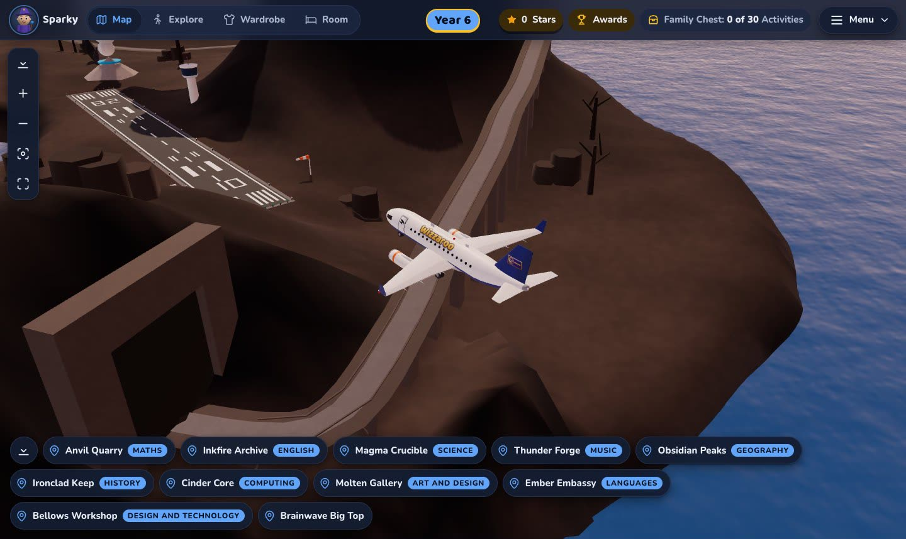
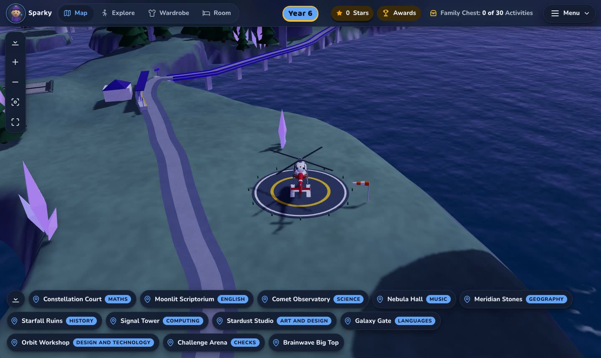
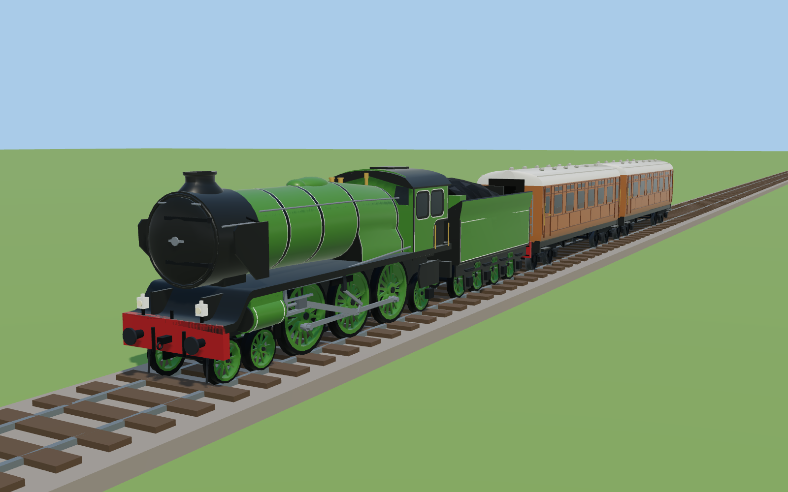
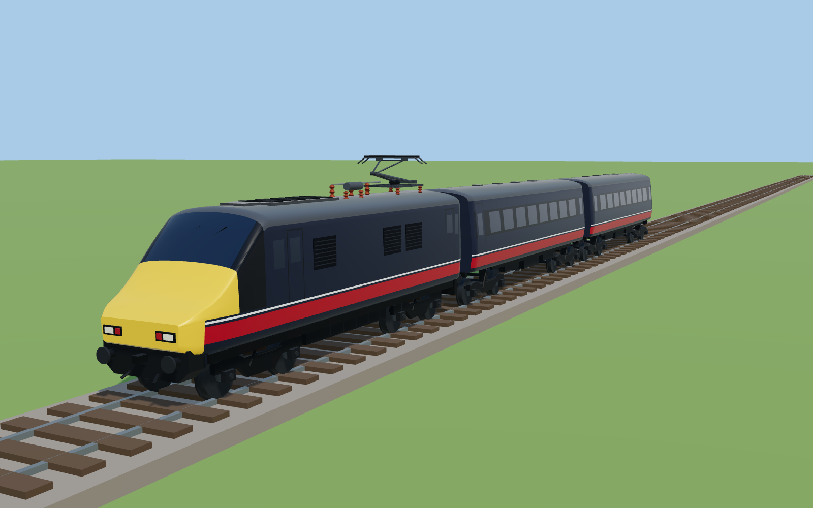
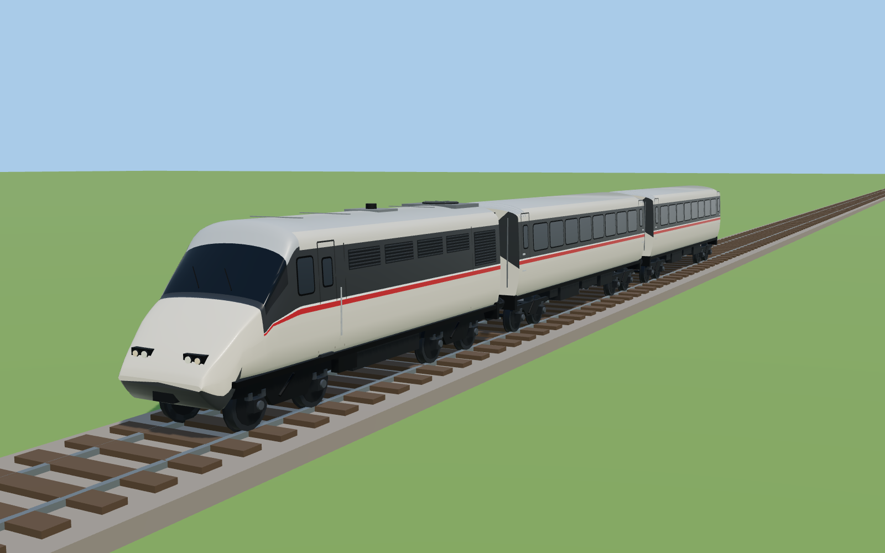
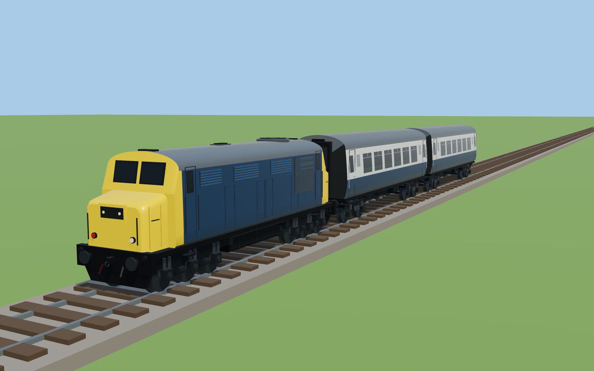
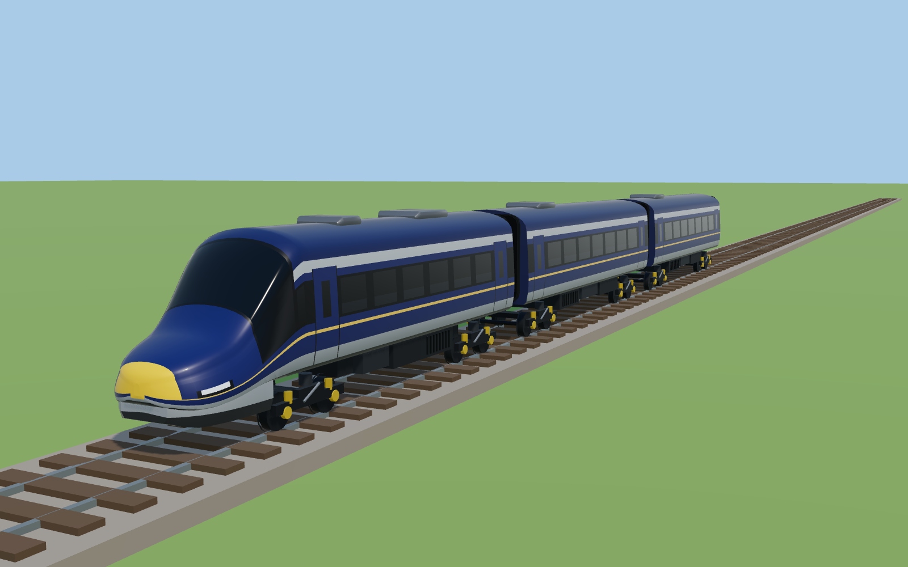
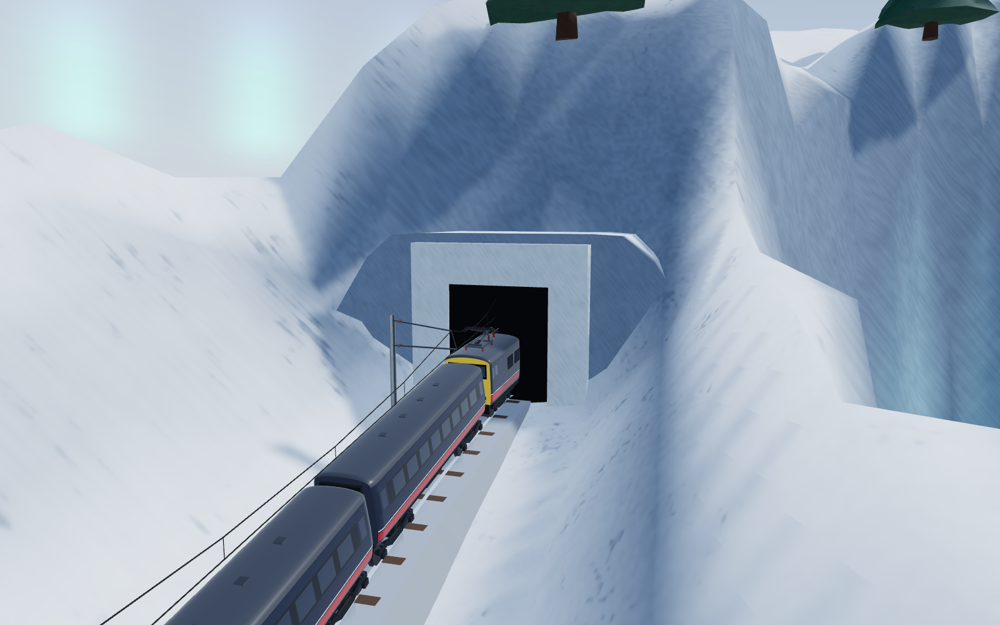
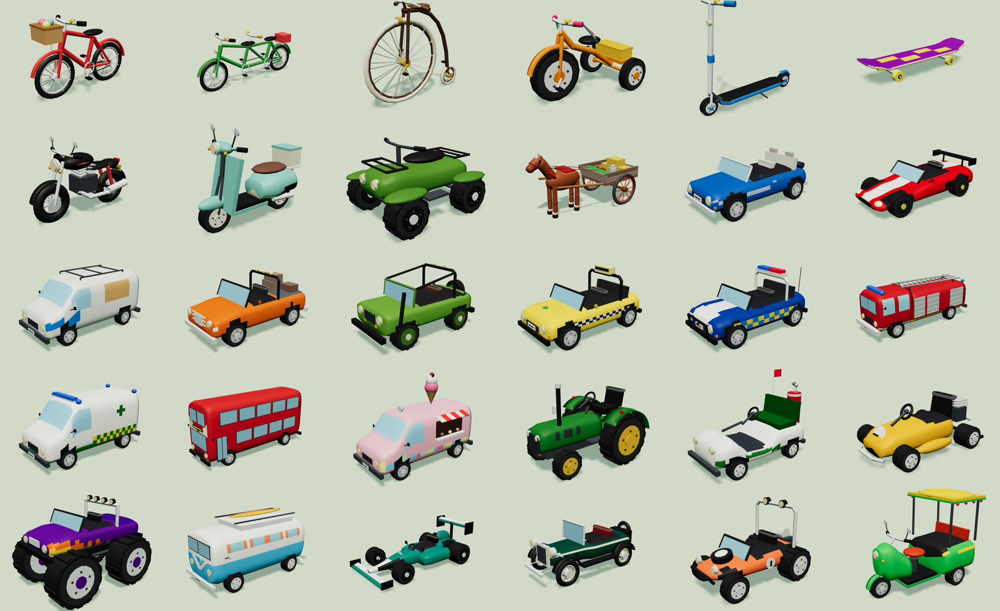

# Trains and transport

[← Back to the README](../../README.md) · [All guides](README.md)

> **Personal use only.** Wizzaroo is intended for your own personal use only. It is not intended for use with or by a school, teacher, parent or student. Only use it for yourself.

Everything a Child can ride in Wizzaroo: the six craft that carry them between Islands, each Island's own Train, and the 30 Vehicles they can buy and drive while exploring. Where each Island keeps them is in [the Islands](islands.md), and every detail of the journeys is in [the World Map](world-map.md).

## Travelling between Islands

Choosing another Island's Year, locked or not, on the World Map (**Islands** in the Menu) or with the **Y1** to **Y6** buttons in the explore bar, sends a craft to fetch the Character. It is picked at random from six (`chooseTransport` in `src/client/islands/island-journey.ts`), and a pop-up says which is coming, such as "All aboard! The hot-air balloon is floating to Meadow Isle." The camera follows the craft across the World Map, and **Fast forward** skips the rest of the journey at any point. Every craft carries the Wizzaroo flag and name.

Every Island has a place for each craft to come in: a **Dock** for the ship and the submarine, a **Runway**, a **Helipad**, a **Balloon Field** and a **hover slipway** ([ADR 0043](../architectural-decision-record/0043-aeroplanes-and-helicopters-fly-between-runways-and-helipads.md), [ADR 0045](../architectural-decision-record/0045-a-hovercraft-a-submarine-and-the-wizzaroo-flag-on-every-island-and-aircraft.md), [ADR 0050](../architectural-decision-record/0050-a-hot-air-balloon-floats-between-balloon-fields.md)).

The screenshots below were taken during real journeys, with the pop-up moved out of the way.

### The ship

It sails into the Dock, slides out a gangplank for the Character to walk aboard, and sails along the sea lane between the two rows of Islands to the other Island's Dock (`island-voyage.ts`, modelled in `island-ship-design.ts`). It has a lofted red and navy hull, a deckhouse and wheelhouse, lifeboats, a red funnel, a foremast with sails and bunting, and two waving Wizzaroo flags.

### The aeroplane

A twin-engined jet that lands on the Runway, opens its door and folds down its airstairs. The Character climbs aboard, and it takes off, banks into its turns over the World Map and lands on the other Island's Runway (`island-aeroplane-design.ts`).

### The helicopter

It hovers and settles onto the Helipad with its rotors turning, slides back its door for the Character, then lifts straight up and flies off (`island-helicopter-design.ts`).

### The hot-air balloon

It drifts in from the sea, fires its burners to soften its landing on the Balloon Field's cross, and opens the little door in its basket. The Character rides in the basket, in view for the whole flight (`island-balloon-design.ts`).

### The hovercraft

It comes in over the sea and rides up the hover slipway onto the land, where its bow ramp lowers for the Character. Then it backs down the slipway, turns on the water and hovers across the World Map just above the waves (`island-hovercraft-design.ts`).

### The submarine

It rises from deep under the sea and glides in beside the Dock, slides out its brow to the pier and opens its hatch. The Character climbs down the hatch, and it dives, crossing the World Map under the waves with only its masts showing (`island-submarine-design.ts`).

## Trains

Every Island has a Railway, a loop round its main land and both new lands with five Stations, and its own Train modelled on a real British engine ([ADR 0046](../architectural-decision-record/0046-railways-roads-and-vehicles-on-every-island.md), [ADR 0049](../architectural-decision-record/0049-british-engines-and-each-islands-own-carriages.md)). Each Train is in its own file in `src/client/islands/trains/`, and `island-train-design.ts` gives each Island its Train.

| Island          | Train                      | Engine                                                                    | Carriages                               |
| --------------- | -------------------------- | ------------------------------------------------------------------------- | --------------------------------------- |
| Meadow Isle     | the Meadow Steam Express   | an LNER A3-style steam locomotive in lined apple green, with its tender   | Gresley varnished-teak corridor coaches |
| Frost Isle      | the Frost Peak Electric    | a Class 91-style electric with a pantograph, in navy with a red band      | Mark 4 coaches in the same livery       |
| Sunscorch Sands | the Sunscorch Desert Flyer | an HST Class 43-style power car in InterCity grey, charcoal and red       | Mark 3 coaches                          |
| Jungle Reach    | the Jungle Reach Express   | a Class 47-style diesel in BR two-tone green                              | Mark 1 coaches in carmine and cream     |
| Ember Isle      | the Ember Valley Growler   | a Class 37-style diesel with nose bonnets, in BR blue with yellow ends    | Mark 2 coaches in blue and grey         |
| Starfall Isle   | the Starfall Star Glider   | a Class 800-style bi-mode driving car in midnight blue with a gold stripe | matching Class 800-style cars           |

|                                                                                  |                                                                                      |
| -------------------------------------------------------------------------------- | ------------------------------------------------------------------------------------ |
|                  |  |
|              |               |
|  |                    |
|                    |                     |
|            |           |

- **Riding the Train.** It runs to a timetable (`island-train-timetable.ts`): it waits 14 seconds at each Station, then speeds up and slows to stop at the next, and it is timed to come into the Station nearest the Character soon after they arrive. Near a Station the Child sees its name and how long until the Train comes. **Get on the train** puts the Character in the first carriage, with the camera following, and **Get off at** a Station's name puts them on its platform.
- **The steam engine** puffs smoke from its chimney with every chuff, slowly while it stands and faster as it speeds up (`island-steam-smoke.tsx`).
- **The electric engine** runs under an overhead line on Frost Isle, with steel masts and a contact wire hung at the height of its pantograph (`island-overhead-line.ts`).
- **Tunnels.** The Railway runs through tunnels under hills, and the Train disappears into them rather than running over the top ([ADR 0050](../architectural-decision-record/0050-trains-go-into-their-tunnels.md), [ADR 0057](../architectural-decision-record/0057-a-hill-over-every-tunnel.md)). A mound of land stands on every portal's stonework and reaches back into the hill, so the land meets the top of the portal with no gap, on the Island and on the World Map ([ADR 0064](../architectural-decision-record/0064-the-land-meets-the-top-of-every-tunnel-portal.md)).
- **On the World Map** each Island's Train runs round its Railway too, drawn from the same models in less detail (`island-map-train.tsx`).

## Vehicles

A Child buys Vehicles with Stars in the Wardrobe's **Vehicles** tab, and rides them while exploring. A Vehicle is an Item, but it isn't worn, so it isn't part of the Character's look or an outfit (`src/client/vehicles/vehicle-designs.ts`, [ADR 0046](../architectural-decision-record/0046-railways-roads-and-vehicles-on-every-island.md)).

- **Putting one on the map.** **Vehicles** in the explore bar shows all 30 Vehicles in 3D, in the Catalogue's order, sized so the whole set fits on the screen, a phone's included. The ones the Child holds can be chosen; the rest are faded and grey, with a dashed border, until they are bought in the Wardrobe. Choosing one puts it on the ground just in front of the Character, and **Ride** puts the Character in its seat.
- **Driving.** The joystick or arrow keys drive: forward speeds up to its top speed, slower off the roads; back brakes, then reverses slowly; and left and right steer once it is moving. It stops at the sea, lava, a cliff or anything in the way rather than going in (`vehicle-driving.ts`). **Get off** leaves it parked where it is.
- **Where to drive.** Every Island has roads joining its lands, and Vehicles can ride the [skate park's](attractions.md#skate-park) ramps.
- **Who can be seen.** The Character sits in view on every Vehicle but the six tall vans and buses, which hide them inside.

Prices and the full list live in the Catalogue, `src/curriculum/catalogue.json`.

| Vehicle           | Rarity   | How to get it |
| ----------------- | -------- | ------------- |
| Red Bicycle       | Common   | 15 Stars      |
| Tandem Bicycle    | Common   | 15 Stars      |
| Penny-farthing    | Uncommon | 30 Stars      |
| Trusty Tricycle   | Common   | 15 Stars      |
| Kick Scooter      | Common   | 15 Stars      |
| Skateboard        | Common   | 15 Stars      |
| Motorcycle        | Uncommon | 30 Stars      |
| Moped             | Uncommon | 30 Stars      |
| Quad Bike         | Uncommon | 30 Stars      |
| Horse and Cart    | Rare     | 60 Stars      |
| Family Car        | Uncommon | 30 Stars      |
| Sports Car        | Rare     | 60 Stars      |
| Delivery Van      | Uncommon | 30 Stars      |
| Pickup Truck      | Uncommon | 30 Stars      |
| Jungle Jeep       | Uncommon | 30 Stars      |
| Taxi              | Uncommon | 30 Stars      |
| Police Car        | Rare     | 60 Stars      |
| Fire Engine       | Rare     | 60 Stars      |
| Ambulance         | Rare     | 60 Stars      |
| Double-decker Bus | Rare     | 60 Stars      |
| Ice Cream Van     | Rare     | 60 Stars      |
| Tractor           | Uncommon | 30 Stars      |
| Golf Buggy        | Common   | 15 Stars      |
| Go-kart           | Uncommon | 30 Stars      |
| Monster Truck     | Rare     | 60 Stars      |
| Camper Van        | Rare     | 60 Stars      |
| Racing Car        | Rare     | 60 Stars      |
| Vintage Car       | Rare     | 60 Stars      |
| Dune Buggy        | Uncommon | 30 Stars      |
| Tuk-tuk           | Uncommon | 30 Stars      |
