# Trains and transport

[← Back to the README](../../README.md) · [All guides](README.md)

> **Personal use only.** Wizzaroo is intended for your own personal use only. It is not intended for use with or by a school, teacher, parent or student. Only use it for yourself.

Everything a Child can ride in Wizzaroo: the thirteen craft, scuba diving and the magic portal that carry them between Islands, each Island's own Train, and the 30 Vehicles they can buy and drive while exploring. Where each Island keeps them is in [the Islands](islands.md), and every detail of the journeys is in [the World Map](world-map.md).

## Travelling between Islands

Choosing another Island's Year, locked or not, on the World Map (**Islands** in the Menu) or with the **Y1** to **Y6** buttons in the explore bar, sends a craft to fetch the Character, or opens a portal for them. It is picked at random from fifteen (`chooseTransport` in `src/client/islands/island-journey.ts`) unless the Child has chosen one: **Transport** in the World Map's Menu lists **Random** first and then every craft, each with its icon, and a craft chosen there fetches them every time, on the World Map and while exploring, until they choose Random again. The choice is kept in this browser (`transport-choice.ts`, [ADR 0081](../architectural-decision-record/0081-a-child-chooses-their-transport-and-the-sea-comes-alive.md)). A pop-up says which is coming, such as "All aboard! The hot-air balloon is floating to Meadow Isle." The camera follows the craft across the World Map, and **Fast forward** skips the rest of the journey at any point. Every craft, the portal and the scuba gear carry the Wizzaroo crest and name.

Every Island has a place for each craft to come in: a **Dock** for the ship, the pirate ship, the submarine, the jetski, the surfboard, the windsurfer and scuba diving, a **Runway** for the aeroplane and the blimp, a **Helipad** for the helicopter and the rocket, a **Balloon Field** for the balloon, the portal and the dragon, and a **hover slipway** ([ADR 0043](../architectural-decision-record/0043-aeroplanes-and-helicopters-fly-between-runways-and-helipads.md), [ADR 0045](../architectural-decision-record/0045-a-hovercraft-a-submarine-and-the-wizzaroo-flag-on-every-island-and-aircraft.md), [ADR 0050](../architectural-decision-record/0050-a-hot-air-balloon-floats-between-balloon-fields.md), [ADR 0070](../architectural-decision-record/0070-a-pirate-ship-a-jetski-a-rocket-and-a-magic-portal.md), [ADR 0080](../architectural-decision-record/0080-a-dragon-a-blimp-scuba-diving-surfing-and-windsurfing.md)).

The screenshots below were taken during real journeys, with the pop-up moved out of the way; the close-ups of the nine newest were rendered from the same models, and the underwater pictures from the scuba crossing itself.

The Character rides the dragon, the surfboard, the windsurfer and the balloon in view, and on the dragon, the surfboard and the windsurfer they are drawn on the World Map too, sitting, surfing or holding the boom, in their own look (`island-craft-rider.tsx`). To ride, their legs bend at the hips and their arms at the shoulders: they sit astride the dragon's saddle, lie down to paddle a surfboard, crouch to ride a wave, lean back on a windsurfer's boom and swim in scuba gear (`src/client/character/character-stance.ts`).

### The ship

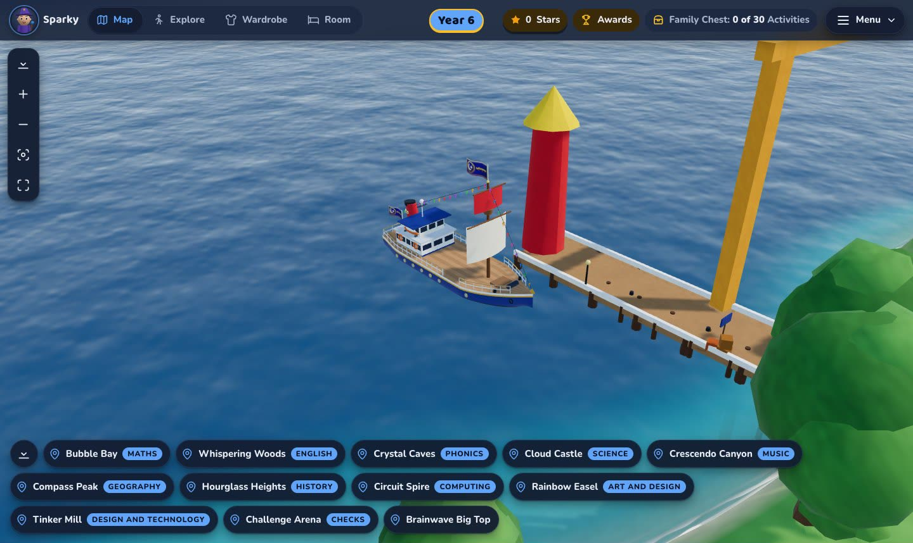

It sails into the Dock, slides out a gangplank for the Character to walk aboard, and sails along the sea lane between the two rows of Islands to the other Island's Dock (`island-voyage.ts`, modelled in `island-ship-design.ts`). It has a lofted red and navy hull, a deckhouse and wheelhouse, lifeboats, a red funnel, a foremast with sails and bunting, and two waving Wizzaroo flags.

### The aeroplane

A twin-engined jet that lands on the Runway, opens its door and folds down its airstairs. The Character climbs aboard, and it takes off, banks into its turns over the World Map and lands on the other Island's Runway (`island-aeroplane-design.ts`).

### The helicopter

It hovers and settles onto the Helipad with its rotors turning, slides back its door for the Character, then lifts straight up and flies off (`island-helicopter-design.ts`).

### The hot-air balloon

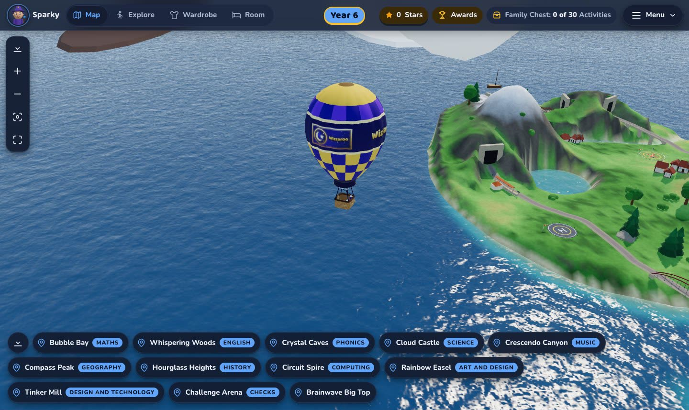

It drifts in from the sea, fires its burners to soften its landing on the Balloon Field's cross, and opens the little door in its basket. The Character rides in the basket, in view for the whole flight (`island-balloon-design.ts`).

### The hovercraft

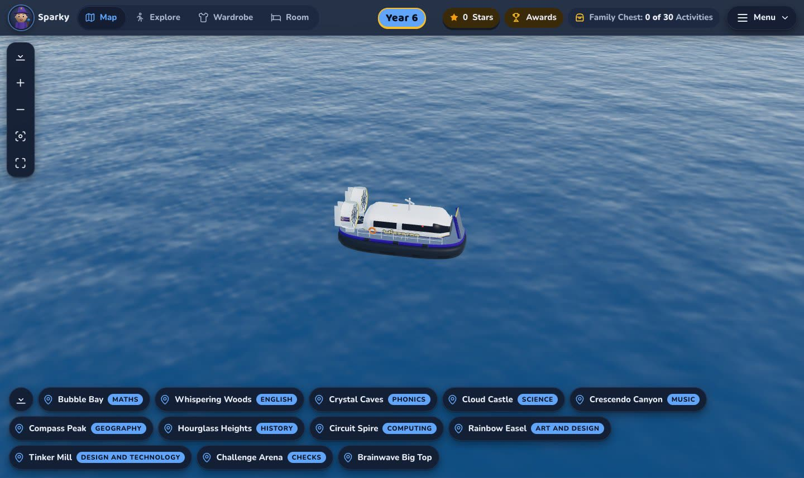

It comes in over the sea and rides up the hover slipway onto the land, where its bow ramp lowers for the Character. Then it backs down the slipway, turns on the water and hovers across the World Map just above the waves (`island-hovercraft-design.ts`).

### The submarine

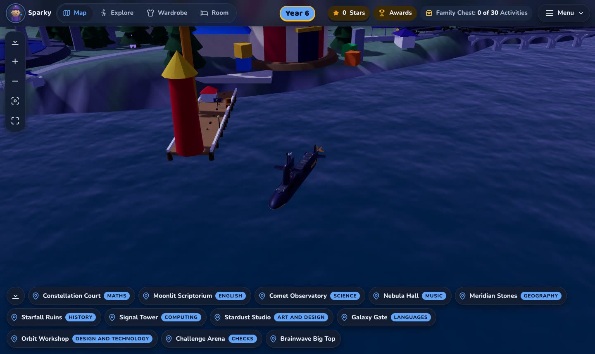

It rises from deep under the sea and glides in beside the Dock, slides out its brow to the pier and opens its hatch. The Character climbs down the hatch, and it dives, crossing the World Map under the waves with only its masts showing (`island-submarine-design.ts`).

### The pirate ship

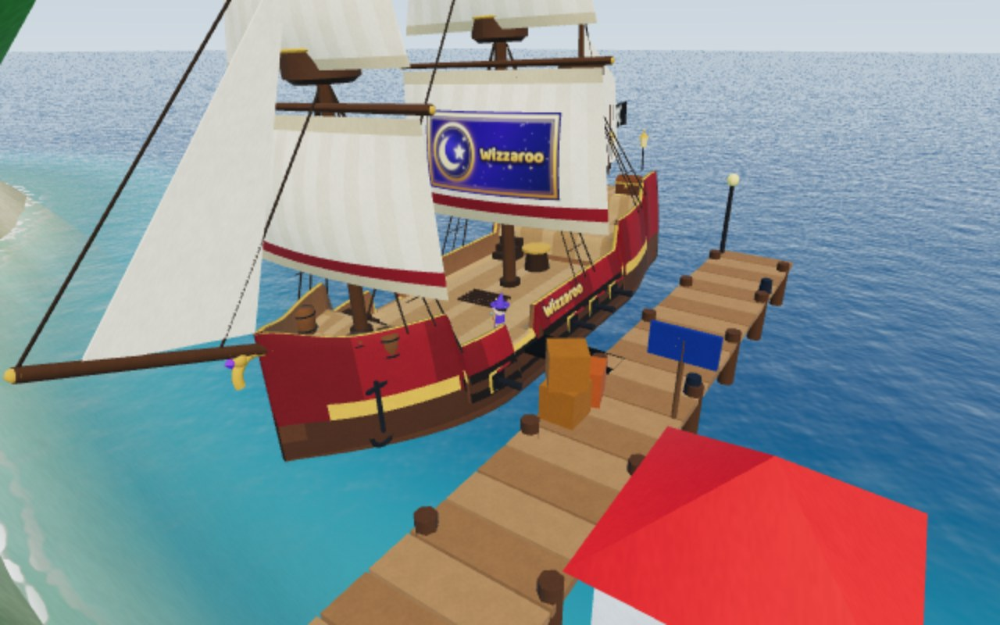

|                                                                                                                  |                                                                                                         |
| ---------------------------------------------------------------------------------------------------------------- | ------------------------------------------------------------------------------------------------------- |
| 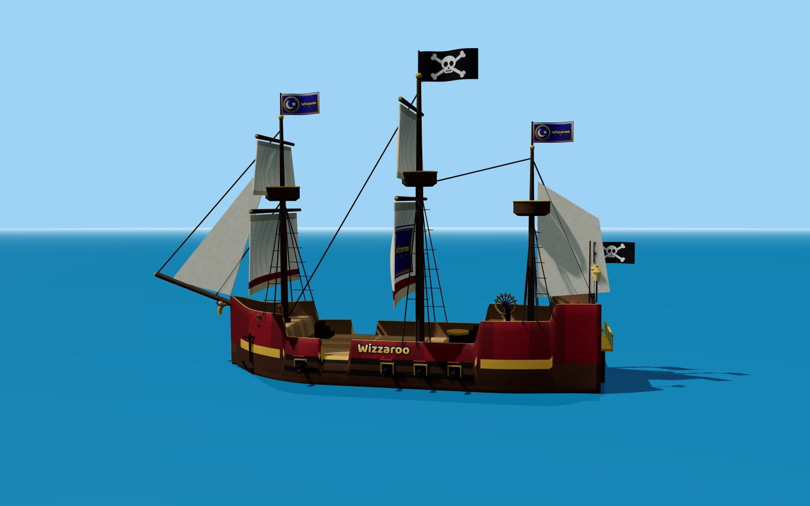 | 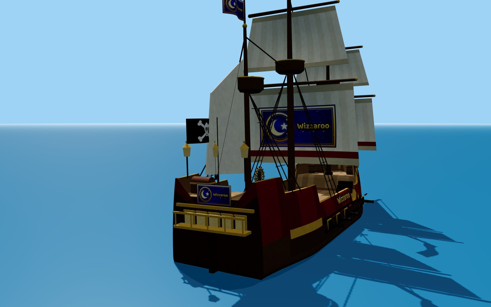 |

A three-masted galleon that comes in exactly like the ship: it sails into the Dock, slides out the gangplank to an entry port in its bulwark, and the Character walks aboard onto its waist deck (`island-pirate-ship-design.ts`). It flies the **Jolly Roger**, a white skull over crossed bones on black, from its main masthead and its stern (`jolly-roger-flag.ts`), and Wizzaroo flags from its fore and mizzen mastheads. Its mainsail carries the Wizzaroo crest, its hull the gold Wizzaroo name, and its stern the crest above a gallery of lit windows and three lanterns. It has a raised forecastle and quarterdeck, gunports with cannons, billowing cream sails with red bands, rigging and ratlines, a ship's wheel, barrels and a treasure chest of gold coins.

### The jetski

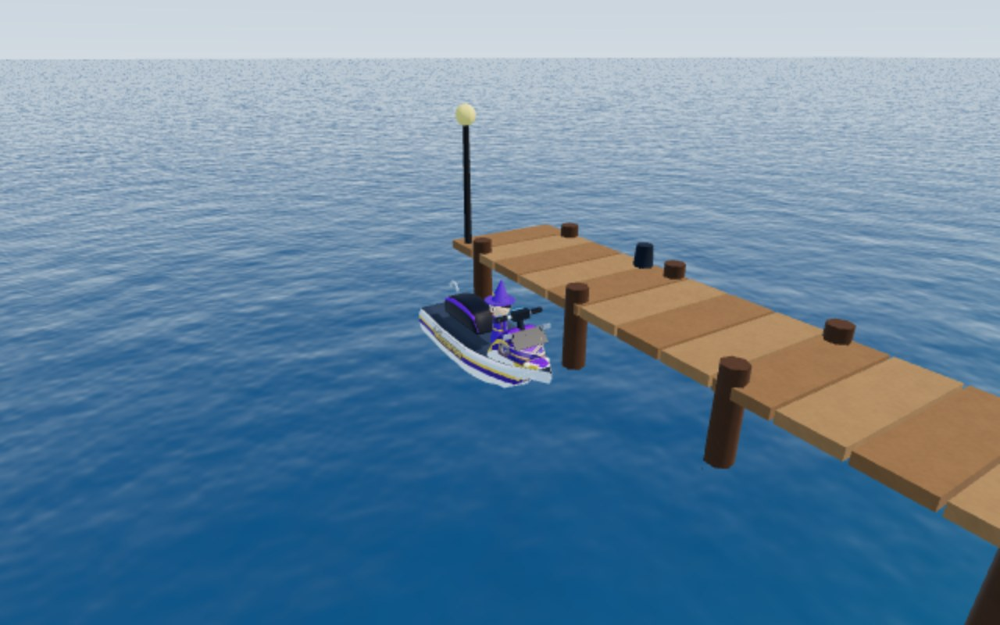

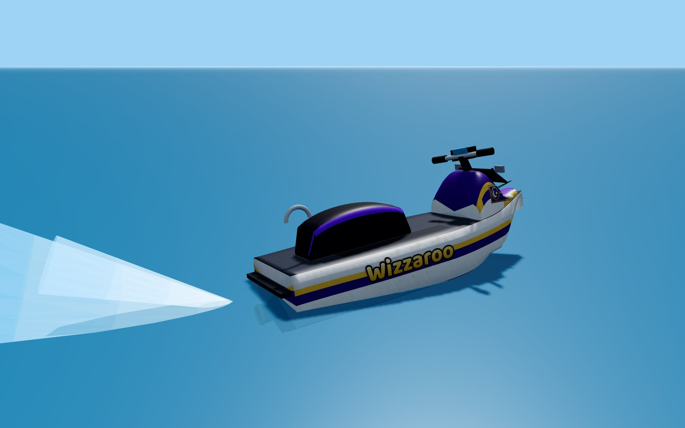

It zooms in from the sea in a curve, nose up, and stops beside the end of the pier. The Character steps down from the pier onto its footwell behind the handlebars and rides it standing, in view the whole way. It swings away from the pier, turns and speeds off, kicking up a rooster tail of spray, and skims the sea lane across the World Map (`island-jetski-design.ts`). It is white with a purple and gold stripe, the Wizzaroo name on both sides and the crest on its purple cowl.

### The rocket

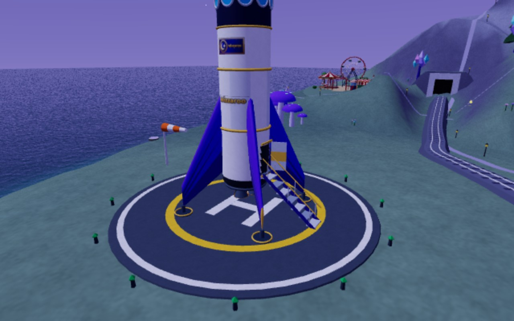

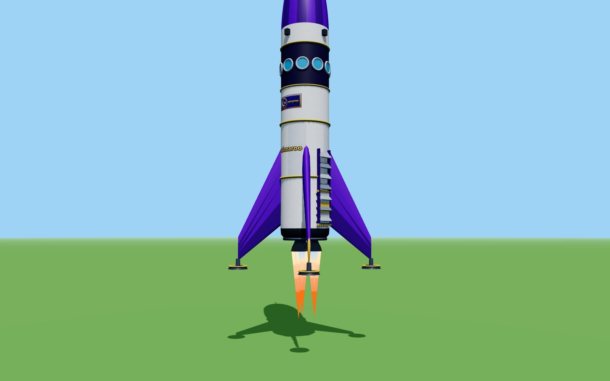

It comes down engine first onto the Helipad on a landing burn and stands on the feet of its four fins. Its stair folds down from the hatch and the Character climbs aboard; then the stair folds up, the hatch shuts, and it blasts off straight up. Over the World Map it arcs high above the sea, nose first as it climbs, flipping over the top and coming down engine first onto the other Island's Helipad (`island-rocket-design.ts`). It is white with a purple nose and fins, gold bands and a crew band of round windows, with the Wizzaroo name and crest on three sides.

### The magic portal

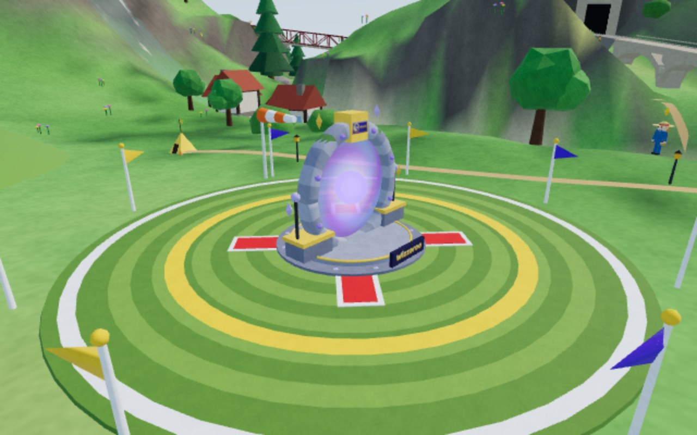

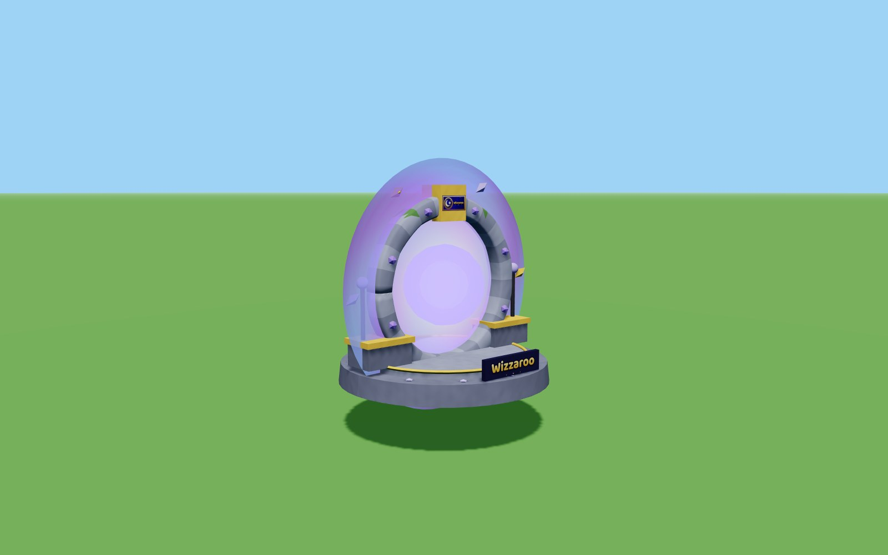

A standing ring of carved stone on a round dais opens on the Balloon Field while the Character waits, growing up around a swirling disc of violet and cyan light with rune stones orbiting it. The Character walks up onto the dais and through the light, and the portal closes behind them to a wisp of light that shoots up and streaks across the World Map. It falls onto the other Island's Balloon Field, opens there, and the Character walks out of it (`island-portal.ts`, `island-portal-design.ts`). The crest is on its gold keystone and the Wizzaroo name on a plaque at its foot.

### The dragon

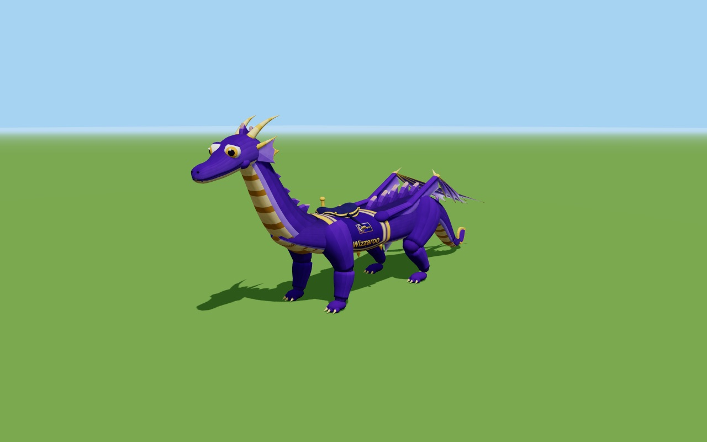

|                                                                                                                          |                                                                                                                |
| ------------------------------------------------------------------------------------------------------------------------ | -------------------------------------------------------------------------------------------------------------- |
| 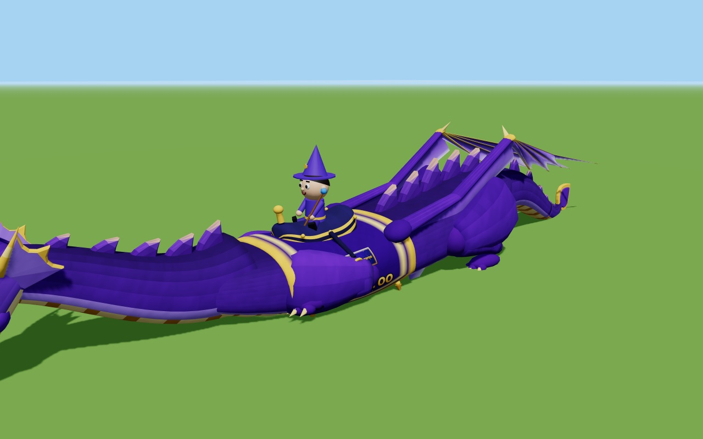 | 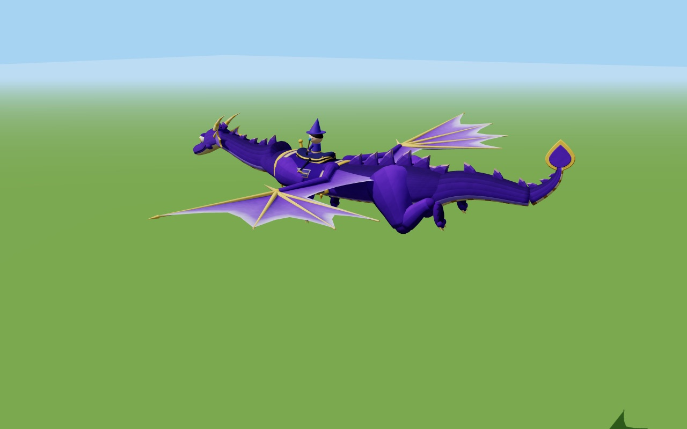 |

A friendly purple dragon glides in over the sea, flares with its wings spread and lands on the Balloon Field. It folds its wings, lies down with its legs tucked under it and bows its head to the grass, and the Character steps up onto its folded foreleg, climbs onto the saddle on its back and sits down. It stands up with them in the saddle, spreads its wings, leaps into the air and flies off, its wings beating slowly, banking into its turns over the World Map. At the other Island it lands and bows again so they can climb down (`island-flight.ts`, modelled in `island-dragon-design.ts`). It has a cream and gold ridged belly, purple-to-gold spines, gold horns and claws, big amber eyes, violet cheek frills, a spade-tipped tail and bat-like wings of violet membrane on gold finger bones. Its night-blue saddle has gold piping and stirrups, on a purple blanket with gold tassels carrying the Wizzaroo crest and name on both sides.

### The blimp

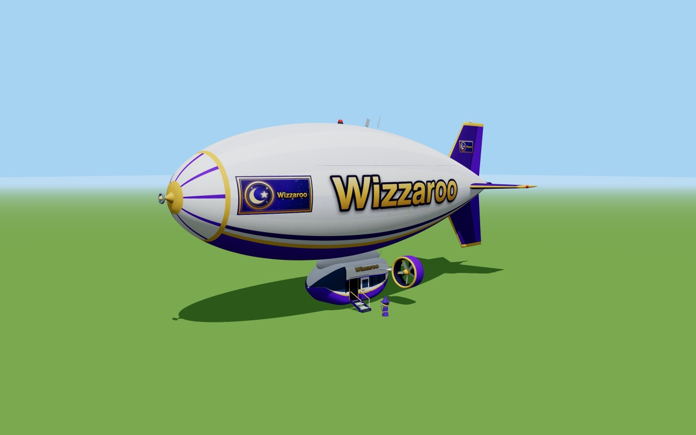

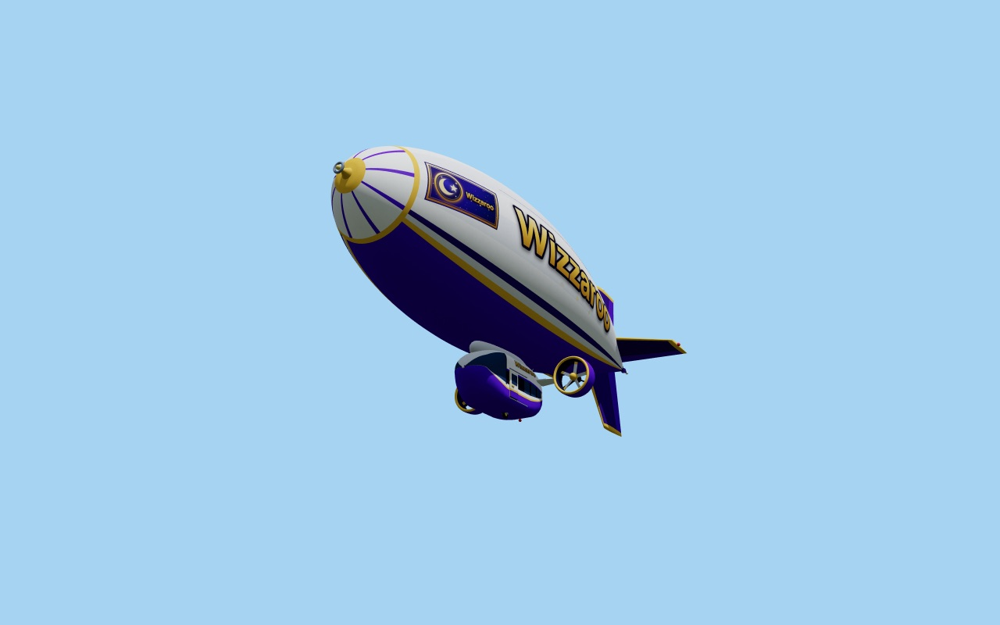

It drifts down the Runway's approach and settles onto the Runway on its landing wheel. Its gondola door slides back and a step folds down; the Character walks up the step and in, the door shuts, and it lifts straight up, noses forward and floats slowly away over the World Map, settling onto the other Island's Runway the same way (`island-flight.ts`, modelled in `island-blimp-design.ts`). It has a pearl envelope with a purple underbelly and gold pinstripes, violet nose battens and a gold mooring cone, four purple tail fins with rudders and elevators, a gondola with a wraparound windscreen and a band of windows, two ducted propellers that turn, and navigation lights. The Wizzaroo name is large along both sides of the envelope with the crest in front of it, the crest is on the top fin, and the name is on the gondola.

### Scuba diving

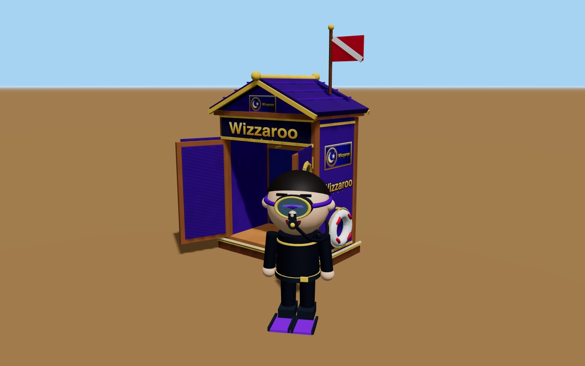

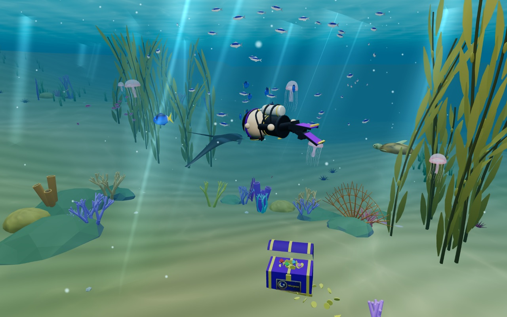

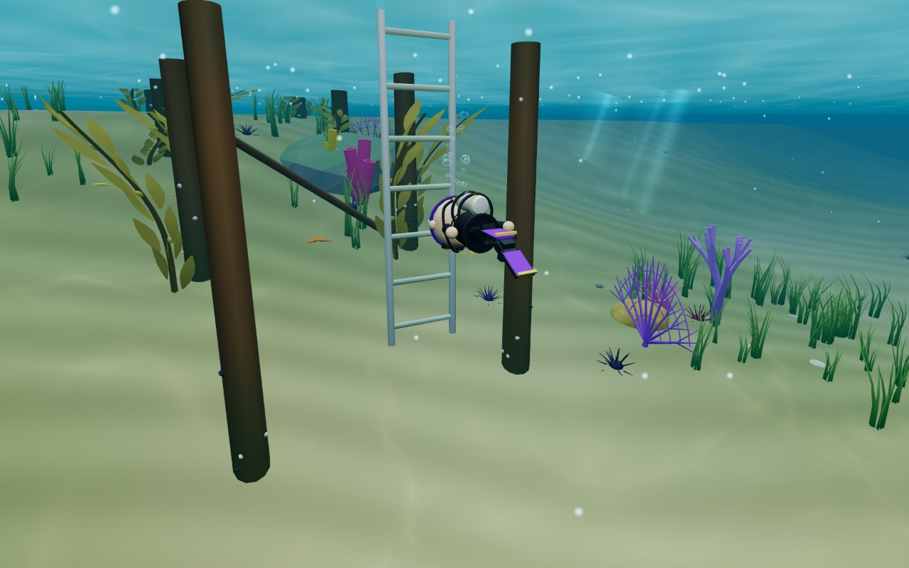

A Wizzaroo dive locker grows up on the Dock's pier. Its doors open, and the Character walks up to it and puts on its scuba gear: a black wetsuit with Wizzaroo purple panels and gold piping, a mask, fins, and an air tank carrying the Wizzaroo name and crest, their hat, glasses and wand put away (`character-scuba-gear.tsx`). They walk to the end of the pier, jump in and swim away under the sea (`island-scuba.ts`). The crossing is seen under the water instead of on the World Map: the camera follows them through blue haze under the rippling surface and light shafts, over sand, rocks, coral, kelp and sea grass, through shoals of fish and past a turtle, a manta ray, jellyfish and a sunken Wizzaroo treasure chest. Two bottlenose dolphins race past side by side, one rolling over; a curious sea lion corkscrews round the diver on its front flippers; and further out a grey reef shark cruises slowly the other way, its tail sweeping. The three are modelled in full detail, with smooth lofted bodies, fins with real thickness, countershaded skin, gill slits, eyes and whiskers (`island-sea-life-design.ts`, [ADR 0081](../architectural-decision-record/0081-a-child-chooses-their-transport-and-the-sea-comes-alive.md)), with bubbles rising from their regulator (`island-underwater-crossing.tsx`). At the other Island they swim in under its pier, surface by the end of it, climb out and hang the gear up in a locker that has grown there, which then shrinks away. The locker is purple with a teak frame, gold trim and brass fittings, a peaked roof, a dive flag and a life ring, with the Wizzaroo name on a sign board above its doors and the crest and name on both sides (`island-scuba-design.ts`).

### The surfboard

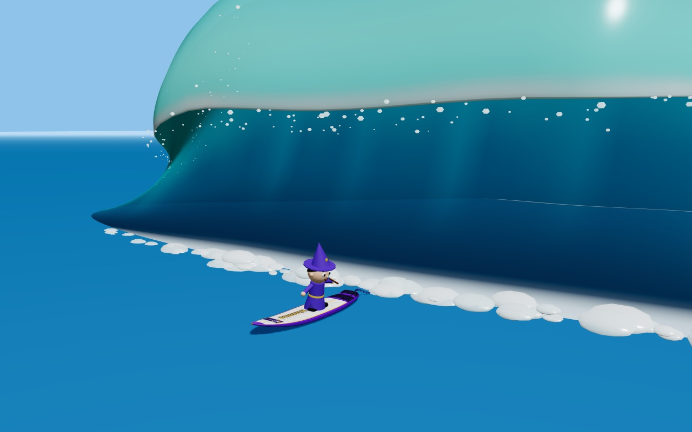

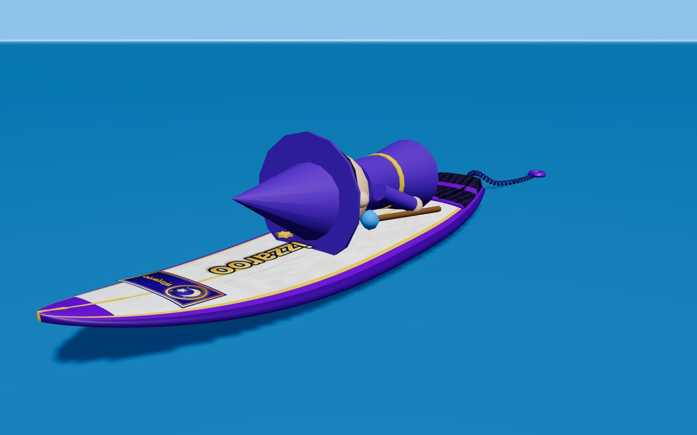

The surfboard glides in on a small swell beside the end of the pier. The Character steps down onto it and lies on it; it turns away from the pier and they paddle out to sea. A massive breaking wave rises up beside them and lifts them onto its face; they stand up and ride it, carving diagonally down the face on the open shoulder with the barrel curling behind them and the lip arcing high overhead, the board leaning into the wall of water. The wave carries them across the World Map and dies away, setting them back down beside the other Island's pier (`island-sea-craft.ts`, modelled in `island-surfboard-design.ts`, [ADR 0081](../architectural-decision-record/0081-a-child-chooses-their-transport-and-the-sea-comes-alive.md)). The board is white with purple rails, a gold stringer, a traction pad, three fins and a leash, with the Wizzaroo crest and name on its deck and underneath. The wave's face is deep blue rising to turquoise, its lip curls over high above the Character, with a white foam crest, spray and whitewater at its foot.

### The windsurfer

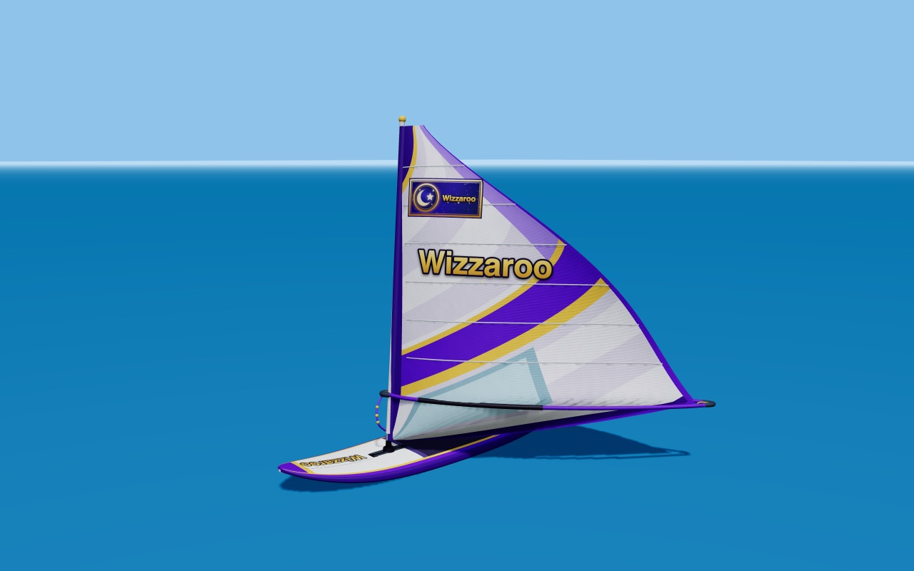

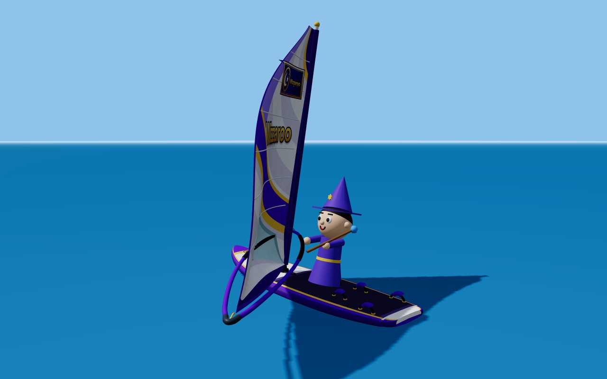

It sails in beside the end of the pier, always on the side that keeps its sail out over open water rather than under the jetty ([ADR 0081](../architectural-decision-record/0081-a-child-chooses-their-transport-and-the-sea-comes-alive.md)). The Character steps onto the board from the side away from the sail, takes the wishbone boom and leans back, and it sails off, heeling with the wind, across the World Map (`island-sea-craft.ts`, modelled in `island-windsurfer-design.ts`). It has a freeride board with footstraps, a mast and a cambered sail with battens and a clear window, in white with purple and gold bands. The Wizzaroo name is large on both sides of the sail with the crest above it, and the name is on the board.

## Trains

Every Island has a Railway, a loop round its main land and both new lands with five Stations, and its own Train modelled on a real British engine ([ADR 0046](../architectural-decision-record/0046-railways-roads-and-vehicles-on-every-island.md), [ADR 0049](../architectural-decision-record/0049-british-engines-and-each-islands-own-carriages.md)). Each Train is in its own file in `src/client/islands/trains/`, and `island-train-design.ts` gives each Island its Train.

| Island          | Train                      | Engine                                                                    | Carriages                               |
| --------------- | -------------------------- | ------------------------------------------------------------------------- | --------------------------------------- |
| Meadow Isle     | the Meadow Steam Express   | an LNER A3-style steam locomotive in lined apple green, with its tender   | Gresley varnished-teak corridor coaches |
| Frost Isle      | the Frost Peak Electric    | a Class 91-style electric with a pantograph, in navy with a red band      | Mark 4 coaches in the same livery       |
| Sunscorch Sands | the Sunscorch Desert Flyer | an HST Class 43-style power car in InterCity grey, charcoal and red       | Mark 3 coaches                          |
| Jungle Reach    | the Jungle Reach Express   | a Class 47-style diesel in BR two-tone green                              | Mark 1 coaches in carmine and cream     |
| Ember Isle      | the Ember Valley Growler   | a Class 37-style diesel with nose bonnets, in BR blue with yellow ends    | Mark 2 coaches in blue and grey         |
| Starfall Isle   | the Starfall Star Glider   | a Class 800-style bi-mode driving car in midnight blue with a gold stripe | matching Class 800-style cars           |

|                                                                                  |                                                                                      |
| -------------------------------------------------------------------------------- | ------------------------------------------------------------------------------------ |
|                  | 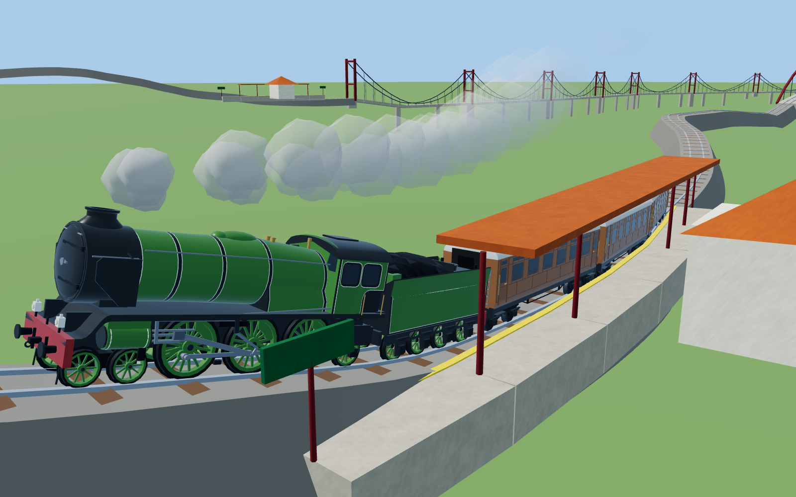 |
|              | 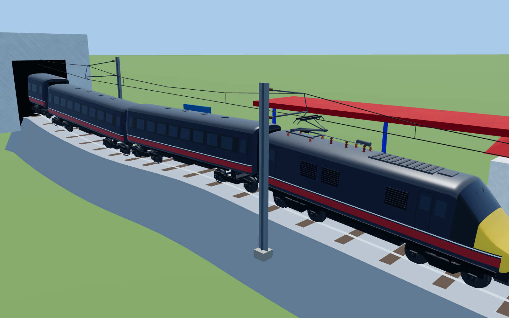              |
|  | 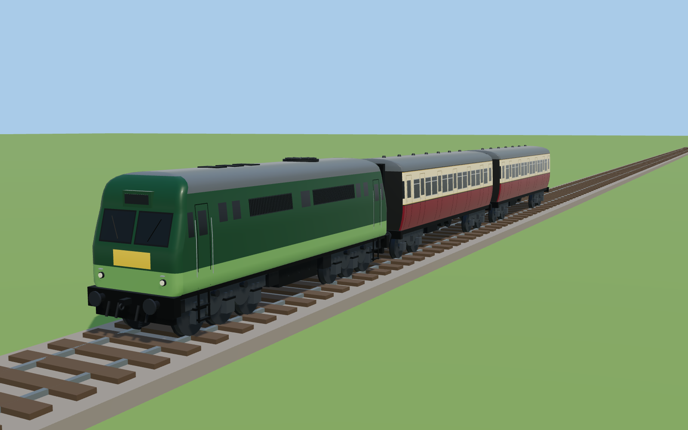                   |
|                    |                     |
|            | 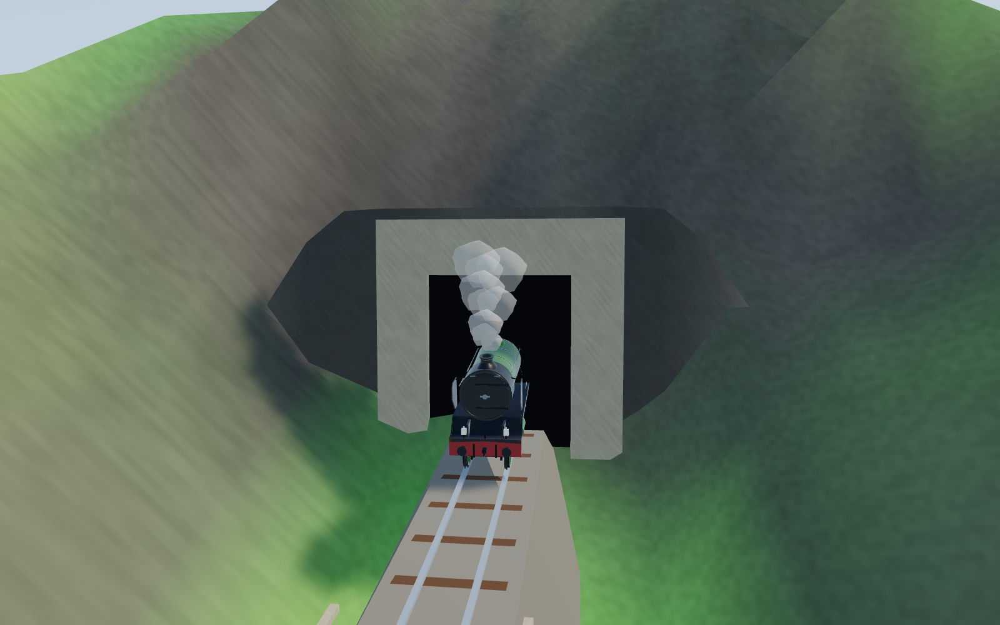          |

- **Riding the Train.** It runs to a timetable (`island-train-timetable.ts`): it waits 14 seconds at each Station, then speeds up and slows to stop at the next, and it is timed to come into the Station nearest the Character soon after they arrive. Near a Station the Child sees its name and how long until the Train comes. **Get on the train** puts the Character in the first carriage, with the camera following, and **Get off at** a Station's name puts them on its platform.
- **The steam engine** puffs smoke from its chimney with every chuff, slowly while it stands and faster as it speeds up (`island-steam-smoke.tsx`).
- **The electric engine** runs under an overhead line on Frost Isle, with steel masts and a contact wire hung at the height of its pantograph (`island-overhead-line.ts`).
- **Tunnels.** The Railway runs through tunnels under hills, and the Train disappears into them rather than running over the top ([ADR 0050](../architectural-decision-record/0050-trains-go-into-their-tunnels.md), [ADR 0057](../architectural-decision-record/0057-a-hill-over-every-tunnel.md)). A mound of land stands on every portal's stonework and reaches back into the hill, so the land meets the top of the portal with no gap, on the Island and on the World Map ([ADR 0064](../architectural-decision-record/0064-the-land-meets-the-top-of-every-tunnel-portal.md)).
- **On the World Map** each Island's Train runs round its Railway too, drawn from the same models in less detail (`island-map-train.tsx`).

## Vehicles

A Child buys Vehicles with Stars in the Wardrobe's **Vehicles** tab, and rides them while exploring. A Vehicle is an Item, but it isn't worn, so it isn't part of the Character's look or an outfit (`src/client/vehicles/vehicle-designs.ts`, [ADR 0046](../architectural-decision-record/0046-railways-roads-and-vehicles-on-every-island.md)).

- **Putting one on the map.** **Vehicles** in the explore bar shows all 30 Vehicles in 3D, in the Catalogue's order, sized so the whole set fits on the screen, a phone's included. The ones the Child holds can be chosen; the rest are faded and grey, with a dashed border, until they are bought in the Wardrobe. Choosing one puts it on the ground just in front of the Character, and **Ride** puts the Character in its seat.
- **Driving.** The joystick or arrow keys drive: forward speeds up to its top speed, slower off the roads; back brakes, then reverses slowly; and left and right steer once it is moving. It stops at the sea, lava, a cliff or anything in the way rather than going in (`vehicle-driving.ts`). **Get off** leaves it parked where it is.
- **Where to drive.** Every Island has roads joining its lands, and Vehicles can ride the [skate park's](attractions.md#skate-park) ramps.
- **Who can be seen.** The Character sits in view on every Vehicle but the six tall vans and buses, which hide them inside.

Prices and the full list live in the Catalogue, `src/curriculum/catalogue.json`.

| Vehicle           | Rarity   | How to get it |
| ----------------- | -------- | ------------- |
| Red Bicycle       | Common   | 15 Stars      |
| Tandem Bicycle    | Common   | 15 Stars      |
| Penny-farthing    | Uncommon | 30 Stars      |
| Trusty Tricycle   | Common   | 15 Stars      |
| Kick Scooter      | Common   | 15 Stars      |
| Skateboard        | Common   | 15 Stars      |
| Motorcycle        | Uncommon | 30 Stars      |
| Moped             | Uncommon | 30 Stars      |
| Quad Bike         | Uncommon | 30 Stars      |
| Horse and Cart    | Rare     | 60 Stars      |
| Family Car        | Uncommon | 30 Stars      |
| Sports Car        | Rare     | 60 Stars      |
| Delivery Van      | Uncommon | 30 Stars      |
| Pickup Truck      | Uncommon | 30 Stars      |
| Jungle Jeep       | Uncommon | 30 Stars      |
| Taxi              | Uncommon | 30 Stars      |
| Police Car        | Rare     | 60 Stars      |
| Fire Engine       | Rare     | 60 Stars      |
| Ambulance         | Rare     | 60 Stars      |
| Double-decker Bus | Rare     | 60 Stars      |
| Ice Cream Van     | Rare     | 60 Stars      |
| Tractor           | Uncommon | 30 Stars      |
| Golf Buggy        | Common   | 15 Stars      |
| Go-kart           | Uncommon | 30 Stars      |
| Monster Truck     | Rare     | 60 Stars      |
| Camper Van        | Rare     | 60 Stars      |
| Racing Car        | Rare     | 60 Stars      |
| Vintage Car       | Rare     | 60 Stars      |
| Dune Buggy        | Uncommon | 30 Stars      |
| Tuk-tuk           | Uncommon | 30 Stars      |
