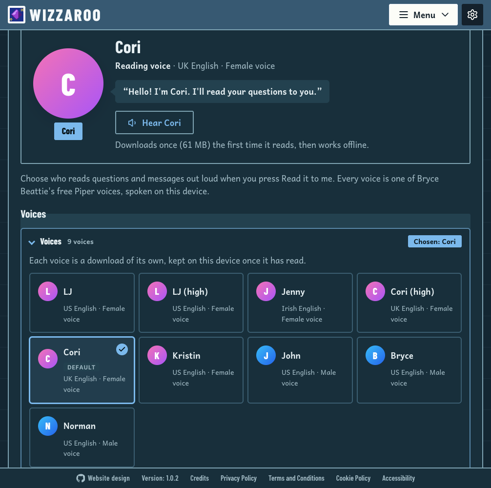

# Voice-over

[← Back to the README](../../README.md) · [All guides](README.md)

> **Personal use only.** Wizzaroo is intended for your own personal use only. It is not intended for use with or by a school, teacher, parent or student. Only use it for yourself.

Every instruction a Child hears is a voice-over line in `src/client/voice-over/voice-over-lines.json`, under a key that never changes once the game uses it:

```json
{
  "bubbles.pop-the-bond": "Pop the bubble that makes ten with this number."
}
```

The audio is made before release and committed beside the lines, never spoken while a Child plays. After adding or changing a line, make its audio with Piper:

```bash
pipx install piper-tts
pnpm generate:voice-over
```

The first run downloads the UK English voice, `en_GB-cori-high` (about 110 MB), into `node_modules/.cache/piper-voices`. Each line's audio is named after its key and a fingerprint of its words and the voice, such as `bubbles.pop-the-bond.fea67e2cc614.wav`, so a run speaks only the lines that are new or whose words changed, and deletes the audio of lines that changed or were removed. Changing the voice speaks every line again. `pnpm test` fails while any line's audio is missing or out of date. The voice is public domain; its source and licence are recorded in [`voice-licence.md`](../../src/client/voice-over/voice-licence.md).

Piper is the engine `generate-voice-over.ts` is handed. Another tool, such as Azure, can replace it with an engine of its own that names its voice and writes a line to a WAV file.

In the game, `playVoiceOver("bubbles.pop-the-bond")` says a line, such as the question a Game opens with. When the device already has the voice the Child chose on Settings, the line's words are said in that voice; otherwise its recording plays, and a chosen voice the device hasn't got yet starts downloading, so the lines after it are heard in it and the Game never sits silent waiting ([ADR 0075](../architectural-decision-record/0075-a-games-lines-are-said-in-the-chosen-voice.md)). `waitForVoiceOverToEnd` waits for either. A key that isn't in the lines file doesn't type-check. Call it straight from a tap, because iPhones and iPads only play sound in answer to one. A new line cuts off the one playing. When the game opens, it keeps every line in the browser's cache and in memory, so voice-over plays without a network once the game has been opened online; lines that are no longer used leave the cache. ESLint rejects browser speech synthesis everywhere but `src/client/voice-over/read-aloud.ts`.

## Read it to me



Every Game has a **Read it to me** button that reads its question out loud, and so do the sensible messages across the site: every popup and dialog (an Islander or friend talking when exploring, help boxes, the rucksack, Awards, the Family Chest), the Region panel, a Mission's feedback and celebration, the Big Top's and Challenge Arena's messages, Who's playing, the first-open screens, the home page, Settings, and the Parent pages' email, invite, password and passkey messages. It reads only when pressed, in the Piper voice chosen on Settings ([ADR 0060](../architectural-decision-record/0060-read-it-to-me-reads-questions-and-messages-in-a-chosen-voice.md), [ADR 0062](../architectural-decision-record/0062-read-it-to-me-speaks-with-every-piper-voice-on-the-device.md), [ADR 0067](../architectural-decision-record/0067-every-voice-reads-only-in-its-own-voice.md)).

- `<ReadAloudButton text="..." />` reads its text; `<ReadAloudButton readsSection />` reads the headings, paragraphs and list items of its nearest dialog, `section`, `article` or `data-read-aloud-section`, leaving out buttons, fields, tables and hidden parts. `<ReadAloudMessage>` puts a small one beside a single message. `MovablePopup` and `ModalDialog` have one already; pass `isReadAloud={false}` to a popup with nothing worth reading.
- Every one looks the same: a quiet, tonal pill with a round speaker badge, at least 44px tall, styled by `button.read-aloud-button` in `theme.css`. A Mission, Puzzle, Check or the home page's call to action changes only its colours, by setting `--read-aloud-ink`, `--read-aloud-accent` and `--read-aloud-icon-ink`. While its words are being read it says **Stop reading**, its badge shows rising and falling bars (still, with reduced motion), and pressing it again stops the voice.
- Where a page has several, pass `describedBy` the id of the heading each one reads, so a screen reader tells them apart. On the home page each one sits after the words it reads, as wide as its label and quieter than the Get started call to action.
- `describeQuestionAloud` puts every Mission prompt into words, and `toSpokenWords` reads its symbols: "9 + ? = 20" is "9 plus what equals 20". It never reads what the Child is meant to read: a Phonics word, a check's words to read, or a story's text.
- A Mission's button plays the recorded line when the device can't read out loud at all; elsewhere the button isn't shown then.
- **The voices** are sixteen: Adrian (the default), Cori, Alba, Kofi, Seren, Ravi, Niamh, Hamish, Arlo, Prudence, Poppy, Spike and Obadiah from around the UK, Jenny from Ireland, and Kristin and John from the US. They are listed in `read-aloud-voices.ts`, each with its accent and its 3D fantasy character from `voice-characters.ts`, from the pinned models in `src/curriculum/piper-voice-models.ts`: four of Bryce Beattie's and four of Piper's own en_GB voices. The voice is chosen on Settings and kept in `localStorage`; a voice a device chose that is no longer offered reads as Adrian ([ADR 0074](../architectural-decision-record/0074-sixteen-voices-mostly-from-the-uk-each-a-fantasy-character.md)).
- **They are spoken on the device**: a worker (`piper-worker.ts`) turns each sentence into phonemes with eSpeak NG (joining the vowel pairs a Piper 1.5 voice, such as Alba or VCTK, lists as one, in `piper-phonemes.ts`) and runs the voice's model with ONNX Runtime Web, and `piper-speech.ts` plays each sentence as it is made. A device downloads a voice (60 to 74 MB, one download for all the readers of a many-speaker voice) and the engine (about 15 MB) the first time it is chosen or reads, keeps them in the `wizzaroo-voices` cache and reads offline from then on. Until the voice has arrived, Read it to me waits for it and shows the download's progress, so every voice is heard as itself. The device's own speech voice reads only if the download fails, and never says a voice's hello on Settings ([ADR 0067](../architectural-decision-record/0067-every-voice-reads-only-in-its-own-voice.md)).
- **Settings shows all sixteen voices in one section**, each card with its character's portrait, photographed once in the shared 3D studio, and the chosen voice's character live in 3D on the stage above.
- **The server serves the voices from its own origin**, at `/voices/<fingerprint>/<file>`, from `VOICE_MODELS_DIRECTORY` (`voice-models/` by default). Fill it once with `pnpm download:voices`, which fetches every pinned file (about 510 MB) from Bryce Beattie's bucket or Hugging Face and refuses any that doesn't match its SHA-256; in Compose the `voices` service does it. In development (`pnpm dev`) you needn't: the server fetches, checks and keeps a missing voice the first time a device asks for it ([ADR 0067](../architectural-decision-record/0067-every-voice-reads-only-in-its-own-voice.md)). Production never fetches one itself, so a voice the `voices` service hasn't fetched shows **This voice couldn't be downloaded** on Settings. Changing a voice means changing its pin in `piper-voice-models.ts` and [`voice-licence.md`](../../src/client/voice-over/voice-licence.md) in the same commit.

## Phoneme recordings

The pure phonemes listen-and-pick plays (/m/, not "em") can't be made with text-to-speech, so they are recorded, or taken from a properly licensed set, and committed as `src/client/voice-over/phonemes/<sound>.wav`, named after one of the 44 sounds, such as `s.wav` or `oo-long.wav`. `pnpm test` fails on a recording named anything else. `playPhoneme("s")` plays one, and the game offers a sound in listen-and-pick only once its recording exists. The owner records them from the guide in [`phonemes/README.md`](../../src/client/voice-over/phonemes/README.md), then `pnpm prepare:phonemes ~/phoneme-takes` trims each take, turns it into 16 kHz mono and sets it to the voice-over's loudness, using `ffmpeg` (`brew install ffmpeg`) only to read the take. Who made them and on what terms is in [`phoneme-licence.md`](../../src/client/voice-over/phonemes/phoneme-licence.md).
