# Wardrobe Items

[← Back to the README](../../README.md) · [All guides](README.md)

> **Personal use only.** Wizzaroo is intended for your own personal use only. It is not intended for use with or by a school, teacher, parent or student. Only use it for yourself.

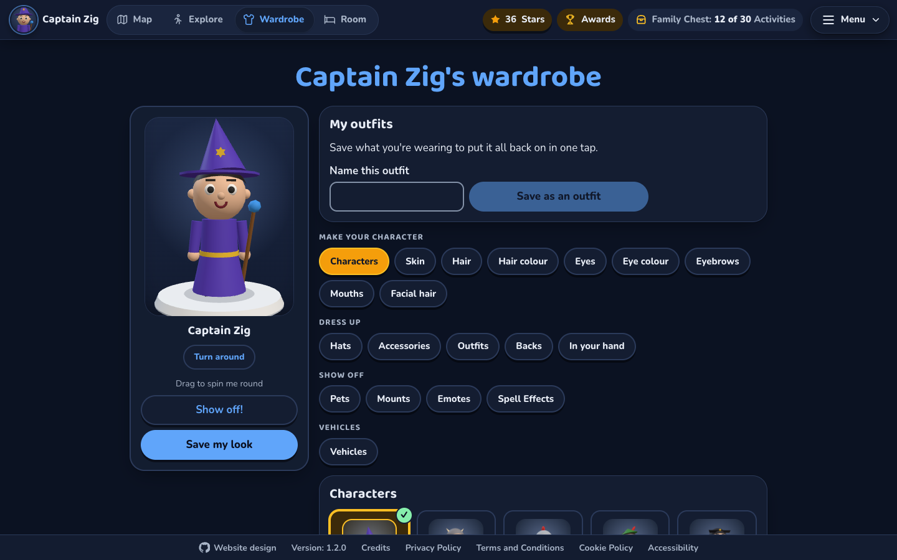

Every Feature and Item a Child can choose for their Character in the **Wardrobe**, opened from **Wardrobe** in the play bar. How Stars are earned, saving outfits, Rooms and the Family Chest are in [Stars, Items, Rooms and Family play](stars-items-and-rooms.md).

Prices and the full list live in the Catalogue, `src/curriculum/catalogue.json`, which is the source of truth: these tables were written from it, and a new Item is added there first. Each Item's rarity sets its price: **common 15 Stars, uncommon 30, rare 60**.

The pictures show the Wardrobe of a Child who has just started, Sparky the Wizard, with no Stars yet, so most Items are still to earn. Each tile pictures its choice in 3D, and says what it costs or what it needs.

## How Items are earned

| How                      | What it means                                                                                                 |
| ------------------------ | ------------------------------------------------------------------------------------------------------------- |
| Free from the start      | Every Feature, and a starter set of 2 or 3 in each Dress up slot                                              |
| Stars                    | Bought with Stars, at the rarity's price                                                                      |
| Once a Skill is Mastered | Bought with Stars, but only once the Child has Mastered the Skill named                                       |
| Only in some months      | Seasonal Items can be bought only in their months, and come back in those months every year                   |
| As a Gift for a sibling  | Bought from **Gifts for your family**, to give to a brother or sister; the buyer pays and the sibling gets it |
| From the Family Chest    | Given when the Family Chest is full: every 30 Activities finished by anyone in the Family                     |
| A welcome-back gift      | Given for the first Activity finished on a new day, after a Child's first day                                 |

Every Character Type also brings its own gear, such as the Knight's helmet, armour, shield and sword. The Character wears it in any Dress up slot the Child leaves empty, and a tile such as **The Wizard's own** puts it back on.

## Make your Character

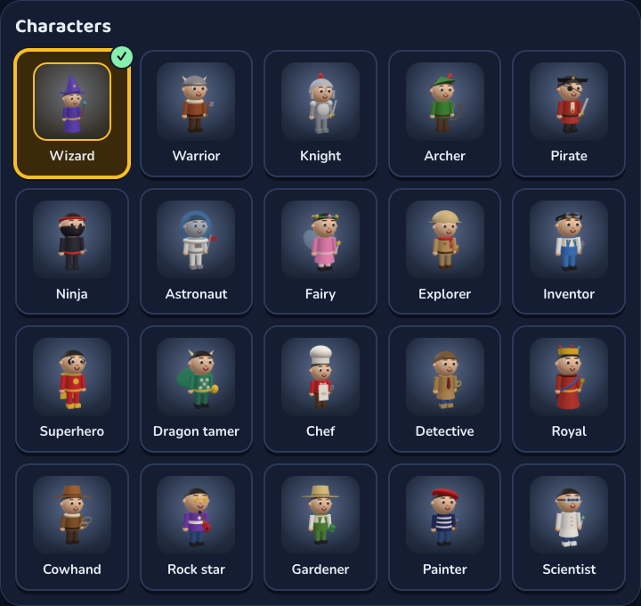

Features are free, and can be changed at any time. Each has at least 10 choices:

- **Characters:** 20 Character Types: Wizard, Warrior, Knight, Archer, Pirate, Ninja, Astronaut, Fairy, Explorer, Inventor, Superhero, Dragon tamer, Chef, Detective, Royal, Cowhand, Rock star, Gardener, Painter, Scientist.
- **Skin:** 15 skin colours.
- **Hair** and **Hair colour:** 15 hair styles and 15 hair colours.
- **Eyes** and **Eye colour:** 15 eyes and 15 eye colours.
- **Eyebrows, Mouths** and **Facial hair:** 10 eyebrows, 15 mouths and 15 kinds of facial hair.

## Dress up

Items the Character wears, one in each slot.

### Hats

25 hats.

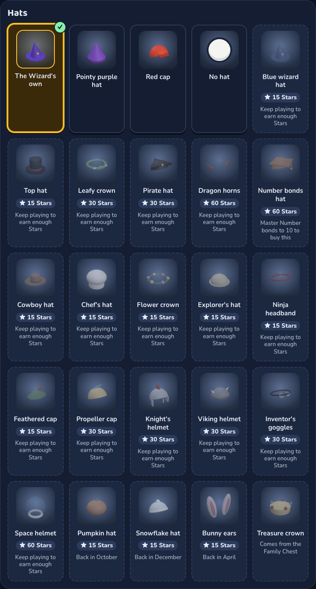

| Item               | Rarity   | How to get it                                     |
| ------------------ | -------- | ------------------------------------------------- |
| Pointy purple hat  | Common   | Free from the start                               |
| Red cap            | Common   | Free from the start                               |
| No hat             | Common   | Free from the start                               |
| Blue wizard hat    | Common   | 15 Stars                                          |
| Top hat            | Common   | 15 Stars                                          |
| Leafy crown        | Uncommon | 30 Stars                                          |
| Pirate hat         | Uncommon | 30 Stars                                          |
| Dragon horns       | Rare     | 60 Stars                                          |
| Number bonds hat   | Rare     | 60 Stars, once **Number bonds to 10** is Mastered |
| Cowboy hat         | Common   | 15 Stars                                          |
| Chef's hat         | Common   | 15 Stars                                          |
| Flower crown       | Common   | 15 Stars                                          |
| Explorer's hat     | Common   | 15 Stars                                          |
| Ninja headband     | Common   | 15 Stars                                          |
| Feathered cap      | Common   | 15 Stars                                          |
| Propeller cap      | Uncommon | 30 Stars                                          |
| Knight's helmet    | Uncommon | 30 Stars                                          |
| Viking helmet      | Uncommon | 30 Stars                                          |
| Inventor's goggles | Uncommon | 30 Stars                                          |
| Space helmet       | Rare     | 60 Stars                                          |
| Pumpkin hat        | Common   | 15 Stars, only in October                         |
| Snowflake hat      | Common   | 15 Stars, only in December                        |
| Bunny ears         | Common   | 15 Stars, only in April                           |
| Bow tie            | Common   | 15 Stars, as a Gift for a sibling                 |
| Treasure crown     | Rare     | From the Family Chest                             |

### Accessories

20 accessories: glasses, masks, scarves, medals and more.

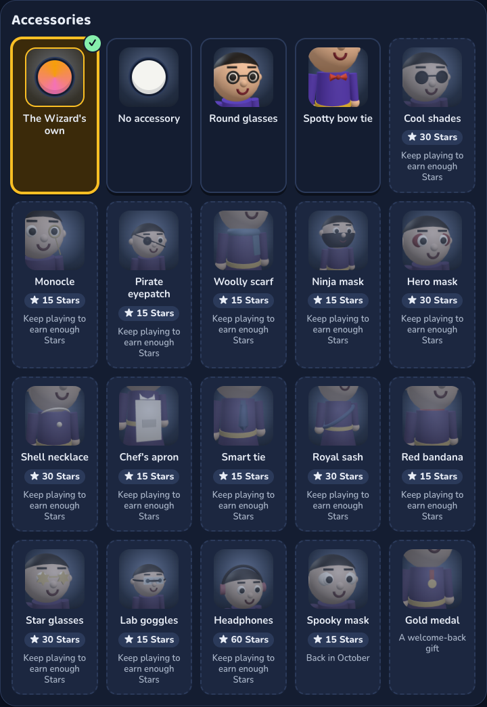

| Item            | Rarity   | How to get it                     |
| --------------- | -------- | --------------------------------- |
| No accessory    | Common   | Free from the start               |
| Round glasses   | Common   | Free from the start               |
| Spotty bow tie  | Common   | Free from the start               |
| Cool shades     | Uncommon | 30 Stars                          |
| Monocle         | Common   | 15 Stars                          |
| Pirate eyepatch | Common   | 15 Stars                          |
| Woolly scarf    | Common   | 15 Stars                          |
| Ninja mask      | Common   | 15 Stars                          |
| Hero mask       | Uncommon | 30 Stars                          |
| Shell necklace  | Uncommon | 30 Stars                          |
| Chef's apron    | Common   | 15 Stars                          |
| Smart tie       | Common   | 15 Stars                          |
| Royal sash      | Uncommon | 30 Stars                          |
| Red bandana     | Common   | 15 Stars                          |
| Star glasses    | Uncommon | 30 Stars                          |
| Lab goggles     | Common   | 15 Stars                          |
| Headphones      | Rare     | 60 Stars                          |
| Spooky mask     | Common   | 15 Stars, only in October         |
| Heart glasses   | Common   | 15 Stars, as a Gift for a sibling |
| Gold medal      | Common   | A welcome-back gift               |

### Outfits

20 outfits.

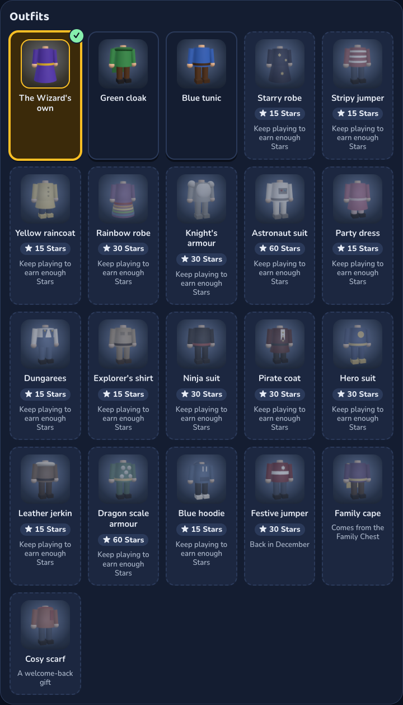

| Item                | Rarity   | How to get it              |
| ------------------- | -------- | -------------------------- |
| Green cloak         | Common   | Free from the start        |
| Blue tunic          | Common   | Free from the start        |
| Starry robe         | Common   | 15 Stars                   |
| Stripy jumper       | Common   | 15 Stars                   |
| Yellow raincoat     | Common   | 15 Stars                   |
| Rainbow robe        | Uncommon | 30 Stars                   |
| Knight's armour     | Uncommon | 30 Stars                   |
| Astronaut suit      | Rare     | 60 Stars                   |
| Party dress         | Common   | 15 Stars                   |
| Dungarees           | Common   | 15 Stars                   |
| Explorer's shirt    | Common   | 15 Stars                   |
| Ninja suit          | Uncommon | 30 Stars                   |
| Pirate coat         | Uncommon | 30 Stars                   |
| Hero suit           | Uncommon | 30 Stars                   |
| Leather jerkin      | Common   | 15 Stars                   |
| Dragon scale armour | Rare     | 60 Stars                   |
| Blue hoodie         | Common   | 15 Stars                   |
| Festive jumper      | Uncommon | 30 Stars, only in December |
| Family cape         | Uncommon | From the Family Chest      |
| Cosy scarf          | Common   | A welcome-back gift        |

### Backs

14 things to wear on the back: capes, wings, shields, a jetpack and more.

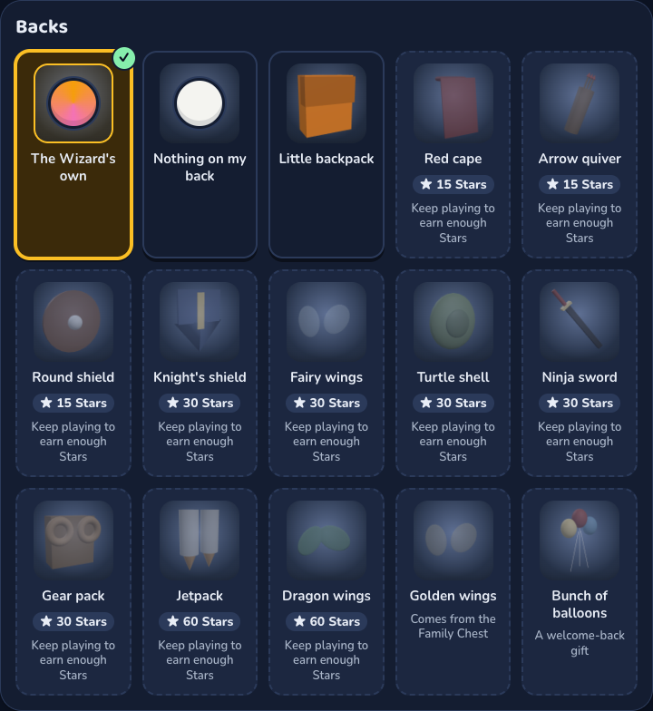

| Item               | Rarity   | How to get it         |
| ------------------ | -------- | --------------------- |
| Nothing on my back | Common   | Free from the start   |
| Little backpack    | Common   | Free from the start   |
| Red cape           | Common   | 15 Stars              |
| Arrow quiver       | Common   | 15 Stars              |
| Round shield       | Common   | 15 Stars              |
| Knight's shield    | Uncommon | 30 Stars              |
| Fairy wings        | Uncommon | 30 Stars              |
| Turtle shell       | Uncommon | 30 Stars              |
| Ninja sword        | Uncommon | 30 Stars              |
| Gear pack          | Uncommon | 30 Stars              |
| Jetpack            | Rare     | 60 Stars              |
| Dragon wings       | Rare     | 60 Stars              |
| Golden wings       | Rare     | From the Family Chest |
| Bunch of balloons  | Common   | A welcome-back gift   |

### In your hand

20 things to hold: wands, a sword, a bow, a torch, a dragon egg and more.

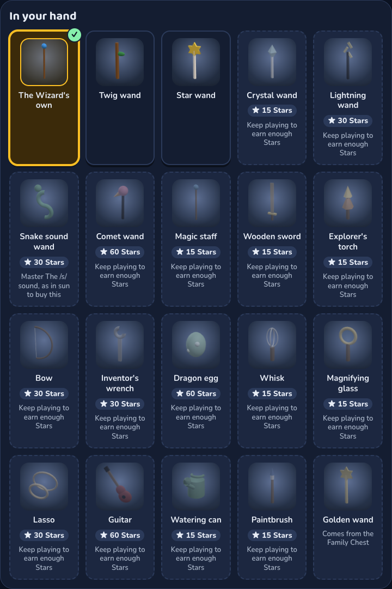

| Item              | Rarity   | How to get it                                           |
| ----------------- | -------- | ------------------------------------------------------- |
| Twig wand         | Common   | Free from the start                                     |
| Star wand         | Common   | Free from the start                                     |
| Crystal wand      | Common   | 15 Stars                                                |
| Lightning wand    | Uncommon | 30 Stars                                                |
| Snake sound wand  | Uncommon | 30 Stars, once **The /s/ sound, as in sun** is Mastered |
| Comet wand        | Rare     | 60 Stars                                                |
| Magic staff       | Common   | 15 Stars                                                |
| Wooden sword      | Common   | 15 Stars                                                |
| Explorer's torch  | Common   | 15 Stars                                                |
| Bow               | Uncommon | 30 Stars                                                |
| Inventor's wrench | Uncommon | 30 Stars                                                |
| Dragon egg        | Rare     | 60 Stars                                                |
| Whisk             | Common   | 15 Stars                                                |
| Magnifying glass  | Common   | 15 Stars                                                |
| Lasso             | Uncommon | 30 Stars                                                |
| Guitar            | Rare     | 60 Stars                                                |
| Watering can      | Common   | 15 Stars                                                |
| Paintbrush        | Common   | 15 Stars                                                |
| Heart wand        | Common   | 15 Stars, as a Gift for a sibling                       |
| Golden wand       | Rare     | From the Family Chest                                   |

## Show off

One of each at a time, to show off with. Each starts empty, with no free starters, and **No Pet** and the like empty it again. A Pet stands beside the Character wherever it is drawn, but never on the World Map, which is the Companion's. The Emote and Spell Effect play when a Mission ends and when the Child taps **Show off!**; with reduced motion asked for, they show as a still pose and a soft glow.

### Pets

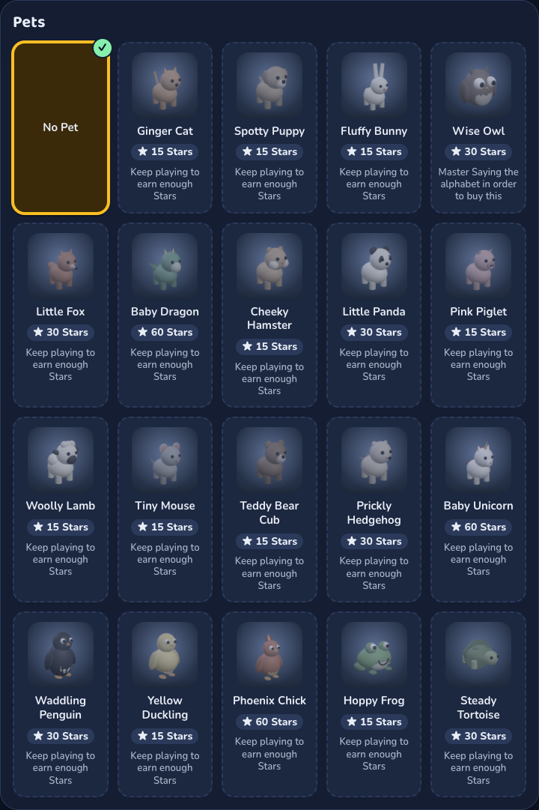

| Item             | Rarity   | How to get it                                               |
| ---------------- | -------- | ----------------------------------------------------------- |
| Ginger Cat       | Common   | 15 Stars                                                    |
| Spotty Puppy     | Common   | 15 Stars                                                    |
| Fluffy Bunny     | Common   | 15 Stars                                                    |
| Wise Owl         | Uncommon | 30 Stars, once **Saying the alphabet in order** is Mastered |
| Little Fox       | Uncommon | 30 Stars                                                    |
| Baby Dragon      | Rare     | 60 Stars                                                    |
| Cheeky Hamster   | Common   | 15 Stars                                                    |
| Little Panda     | Uncommon | 30 Stars                                                    |
| Pink Piglet      | Common   | 15 Stars                                                    |
| Woolly Lamb      | Common   | 15 Stars                                                    |
| Tiny Mouse       | Common   | 15 Stars                                                    |
| Teddy Bear Cub   | Common   | 15 Stars                                                    |
| Prickly Hedgehog | Uncommon | 30 Stars                                                    |
| Baby Unicorn     | Rare     | 60 Stars                                                    |
| Waddling Penguin | Uncommon | 30 Stars                                                    |
| Yellow Duckling  | Common   | 15 Stars                                                    |
| Phoenix Chick    | Rare     | 60 Stars                                                    |
| Hoppy Frog       | Common   | 15 Stars                                                    |
| Steady Tortoise  | Uncommon | 30 Stars                                                    |

### Mounts

The Character rides its Mount.

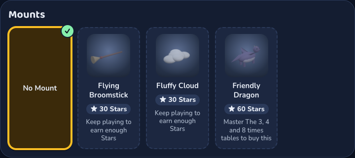

| Item              | Rarity   | How to get it                                              |
| ----------------- | -------- | ---------------------------------------------------------- |
| Flying Broomstick | Uncommon | 30 Stars                                                   |
| Fluffy Cloud      | Uncommon | 30 Stars                                                   |
| Friendly Dragon   | Rare     | 60 Stars, once **The 3, 4 and 8 times tables** is Mastered |

### Emotes

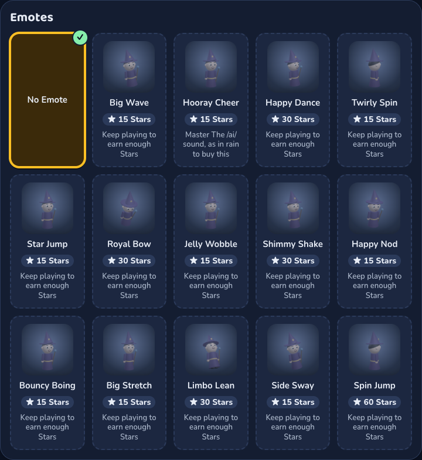

| Item         | Rarity   | How to get it                                             |
| ------------ | -------- | --------------------------------------------------------- |
| Big Wave     | Common   | 15 Stars                                                  |
| Hooray Cheer | Common   | 15 Stars, once **The /ai/ sound, as in rain** is Mastered |
| Happy Dance  | Uncommon | 30 Stars                                                  |
| Twirly Spin  | Common   | 15 Stars                                                  |
| Star Jump    | Common   | 15 Stars                                                  |
| Royal Bow    | Uncommon | 30 Stars                                                  |
| Jelly Wobble | Common   | 15 Stars                                                  |
| Shimmy Shake | Uncommon | 30 Stars                                                  |
| Happy Nod    | Common   | 15 Stars                                                  |
| Bouncy Boing | Common   | 15 Stars                                                  |
| Big Stretch  | Common   | 15 Stars                                                  |
| Limbo Lean   | Uncommon | 30 Stars                                                  |
| Side Sway    | Common   | 15 Stars                                                  |
| Spin Jump    | Rare     | 60 Stars                                                  |

### Spell Effects

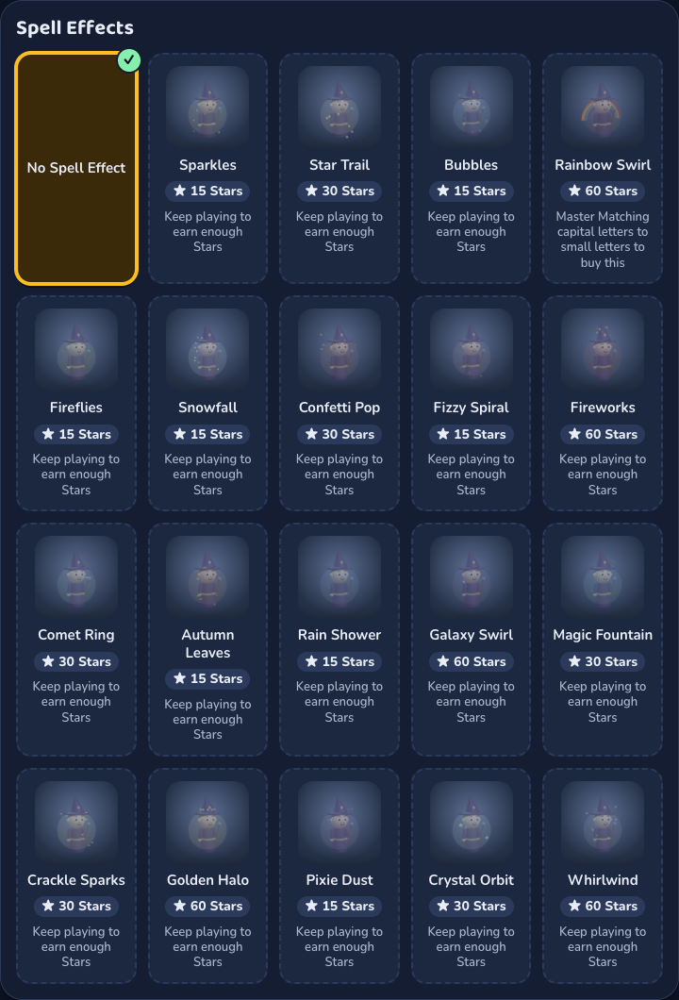

| Item           | Rarity   | How to get it                                                            |
| -------------- | -------- | ------------------------------------------------------------------------ |
| Sparkles       | Common   | 15 Stars                                                                 |
| Star Trail     | Uncommon | 30 Stars                                                                 |
| Bubbles        | Common   | 15 Stars                                                                 |
| Rainbow Swirl  | Rare     | 60 Stars, once **Matching capital letters to small letters** is Mastered |
| Fireflies      | Common   | 15 Stars                                                                 |
| Snowfall       | Common   | 15 Stars                                                                 |
| Confetti Pop   | Uncommon | 30 Stars                                                                 |
| Fizzy Spiral   | Common   | 15 Stars                                                                 |
| Fireworks      | Rare     | 60 Stars                                                                 |
| Comet Ring     | Uncommon | 30 Stars                                                                 |
| Autumn Leaves  | Common   | 15 Stars                                                                 |
| Rain Shower    | Common   | 15 Stars                                                                 |
| Galaxy Swirl   | Rare     | 60 Stars                                                                 |
| Magic Fountain | Uncommon | 30 Stars                                                                 |
| Crackle Sparks | Uncommon | 30 Stars                                                                 |
| Golden Halo    | Rare     | 60 Stars                                                                 |
| Pixie Dust     | Common   | 15 Stars                                                                 |
| Crystal Orbit  | Uncommon | 30 Stars                                                                 |
| Whirlwind      | Rare     | 60 Stars                                                                 |

## Vehicles

The Wardrobe's **Vehicles** tab sells 30 Vehicles, which aren't worn but ridden when exploring an Island. They are on [Trains and transport](transport.md#vehicles).
