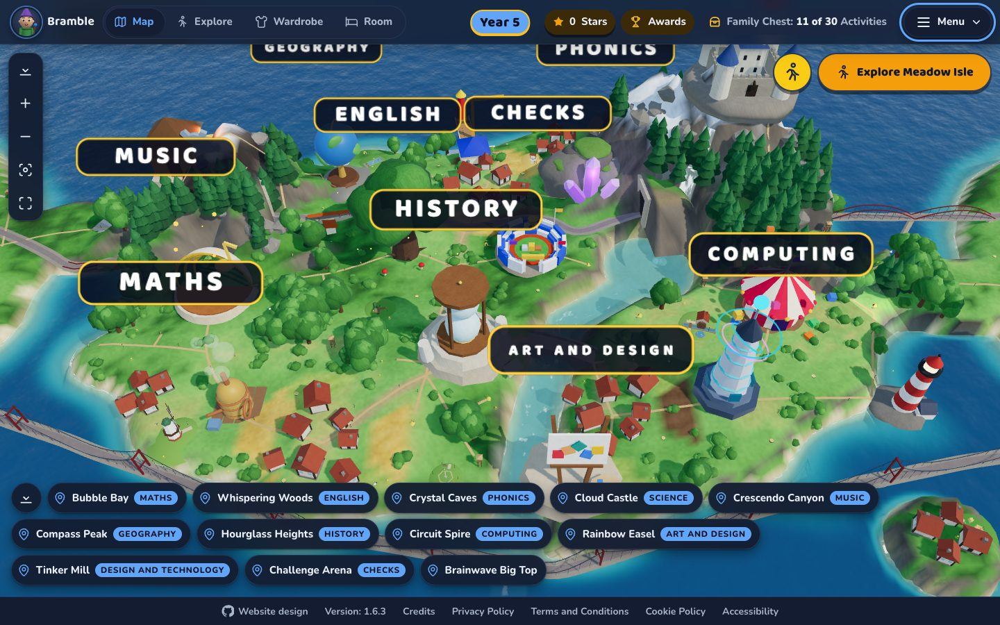
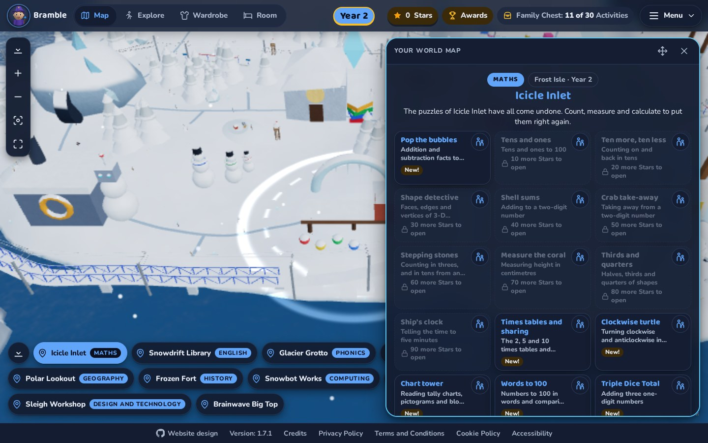
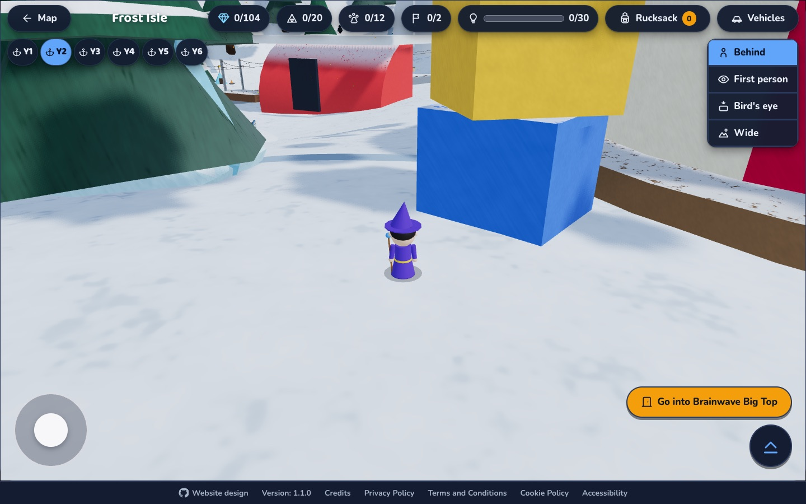

# The World Map

[← Back to the README](../../README.md) · [All guides](README.md)

Each Island one by one is in [the Islands](islands.md), every Attraction in [Attractions](attractions.md), and the craft, Trains and Vehicles in [Trains and transport](transport.md).

> **Personal use only.** Wizzaroo is intended for your own personal use only. It is not intended for use with or by a school, teacher, parent or student. Only use it for yourself.

The World Map is a sea holding six Islands, one per Year Group ([ADR 0025](../architectural-decision-record/0025-one-island-per-year-group.md), `src/client/world-map-islands.tsx`). The Island in view is drawn in full detail and the other five as one low-detail shape each, which load their detail when the Child pans to them. Island 1, Meadow Isle, is one big 3D fantasy land (`src/client/world-map-scene.tsx`); Islands 2 to 6 have landscapes of their own (`src/client/islands/`). The World Map is, drawn in full detail rather than through the pixel pipeline ([ADR 0012](../architectural-decision-record/0012-the-world-map-is-drawn-in-full-detail.md)): at the screen's own resolution, with antialiasing, sunlight and soft shadows, and the same automatic quality scaling as the Mission scene. Its terrain is worked out in code (`src/client/world-map-terrain.ts`), the same every visit: beaches, rolling grassland and patchwork fields, a snowy mountain range with a lake in its foothills, a smoking volcano with a lava glow, a river running from the lake to the sea under a stone bridge, a waterfall pouring from the Cloud Castle's rock into the lake, three villages of timber-framed cottages joined by footpaths, forests, bushes and boulders, a lighthouse with a turning beam and a sailing boat going round. The sea shades from turquoise shallows to deep blue, with moving waves, sun glints and foam along the shore (`src/client/world-map-shaders.ts`). Every model is built in code (`src/client/world-map-models.ts`) and merged into one mesh, and the trees, bushes, houses and rocks are each one instanced mesh, so a hundred trees cost one draw call.

- **Night and day.** The map follows the device's own clock (`src/client/world-map-sky.ts`): day from 7am, twilight from 6am and 7pm, and night from 9pm to 6am, under a starry sky and a moon, with the cottage windows and the lighthouse lit. It checks the clock every minute, so night falls while a Child plays.
- **Weather.** Each visit to the map brings weather at random: clear (the most likely), cloudy, rain, a thunderstorm with lightning, snow that covers the land, the trees and the roofs, wind that sways the trees and blows leaves about, or fog. **Weather** in the Menu opens a side panel listing the seven, each with its icon and name, and changes it to any of them straight away, with the current weather lit. Each Island's theme turns weather it would never see into weather it would (no rain on Sunscorch Sands, say), but snow a Child chooses falls on every Island; the zoom buttons start just under the top bar and stop above the Region chips; on a short landscape screen they sit in a row, and on a phone they hide while a Region panel is open. Rain, snow and leaves are drawn and animated on the GPU (`src/client/world-map-weather.tsx`), and still show at the lowest render quality, with fewer drops and flakes, so a chosen weather is always seen. With reduced motion asked for, nothing moves and the lightning never flashes. Each Region is a place on that land, at its `mapPosition` in `src/curriculum/world-map.json`, marked by its `landmark` (bubbles, a forest, crystals, a castle, a circus tent, a band shell, a globe, a circuit tower, an easel for Art and design, a workshop for Design and technology or an embassy for Languages), alongside its story problem, its Subject and its ten Games in the order they unlock. Each Island has its own theme: a palette, music, model set and Companion style. A Region on a locked Island, or one a Parent has turned off, is greyed out under a cloud with a padlock.

- **Everything from explore mode.** The Island in view shows, in miniature, everything a Child meets exploring it on foot: its trails and bridges, watchtowers, fact signs, hideaways, lamps, bounce pads, the treasure still to find, the Ring Race rings, its Friends, its Wonders, every Attraction and Curiosity with the people and animals about them (the fifteen of each Island's own out on the far reaches of its new lands, [ADR 0068](../architectural-decision-record/0068-fifteen-more-attractions-on-the-far-reaches-of-every-island.md)), and the Quest's Islanders, things and Finds (`src/client/islands/island-map-adventure.tsx`, [ADR 0062](../architectural-decision-record/0062-the-world-map-shows-everything-from-explore-mode.md)). They are only to look at: tapping one chooses the Region underneath, as tapping the land does. The Attractions stand still on the map, and the Character and Vehicles appear only when exploring.
- **Moving around.** Drag to pan, scroll or pinch to zoom, and right-drag or two-finger drag to turn the map (three.js `MapControls`). The camera can't dip below the sea or fly out of sight. The **+**, **−** and **⤢** buttons zoom in, zoom out and show the whole map, so nothing needs a mouse or a pinch.
- **Pointing at a Region.** Pointing at a Region, on the map or in the Region guide, lights up its area on the map in white and shows its story and Missions in the **Your World Map** panel while the pointer stays there, without moving the camera; pointing away shows the chosen Region again. Tabbing to a Region's button does the same.
- **Choosing a Region.** Tapping a Region's landmark, the land near it, or its button in the Region guide along the bottom, flies the camera to it, bounces a marker above it, and shows its story and Missions in the Region panel. A drag that ends on the land doesn't count as a tap. The **Your World Map** panel can be dragged anywhere by its title bar, moved with the arrow keys from its ✥ button, and resized from its corner, and it can't be dragged off the screen. Tapping ✥ swaps it to the other side, and Escape or its ✕ closes it. While it is open the **Explore** button hides, and on a phone so do the zoom buttons, so it never covers a control the Child can still reach; a Region button tabbed to in the Region guide scrolls fully into view. The map fills the whole screen, and **⛶** shows it full screen, hiding the browser's own bars, wherever the browser allows it (not on iPhones). The map opens on the Child's Home Island with no Region chosen, framing its centre land, where the Regions are, rather than the new lands east and west of it; the camera stands far enough back for that land to fill the screen's width and height, whatever the screen's shape (`findIslandOverview`). **Islands** in the Menu lists each Island with its Year, and choosing one flies to it and frames it the same way. With reduced motion asked for, the camera jumps rather than flies.
- **Exploring an Island on foot.** Every Island, locked or not, has an **Explore** button (and the walker can be dropped on any of them), which opens it with the Child's own Character standing on it (`src/client/islands/island-explore.tsx`, with the controls in `island-explore-hud.tsx`, [ADR 0029](../architectural-decision-record/0029-islands-can-be-explored-on-foot.md)). The Child walks with the arrow keys, W A S D, a touch joystick or the mouse (click the ground to walk there, or hold the button to keep walking towards the pointer), right-drags to look around, jumps with Space, and switches between Behind, First person, Bird's eye and Wide views with V or the camera buttons. Walking follows each Island's own ground, so they climb mountains and volcanoes, swim rivers and the sea out to an islet offshore, slide on Frost Isle's ice, float higher in Starfall Isle's low gravity, and are held back from Ember Isle's lava. The Island is explored at six times its World Map size, and each Island has two new lands, east and west, joined to its old coast, giving it at least three times the land ([ADR 0041](../architectural-decision-record/0041-islands-grow-new-lands-with-ring-races-and-the-ship-sails-the-world-map.md)). Trails linking every Region, seven lookouts to climb (such as Meadow Isle's lighthouse, for a view over the whole Island), twenty-four fact signs, twenty hideaways to explore, twelve friendly animals to say hello to (each Island has its own kind, such as Meadow Isle's Lambs or Frost Isle's Penguins, and the HUD counts the ones met), twenty bounce pads, a hundred and four treasures, two Ring Races and a Dock per Island are data in `src/client/islands/island-adventures.ts`. The new lands are filled with the Island's own scenery, copied in the same pattern, and a copy of each of its sights; each has a mountain peak, and a lake to swim to a treasure in the middle of ([ADR 0042](../architectural-decision-record/0042-filled-new-lands-movable-pop-ups-a-gangplank-and-the-walker.md)). Each new land also has a river running down from its peak to the sea or its lake, and the new lands hold Wonders found only by exploring (`src/client/islands/island-wonders.ts`): a grove of the Island's own trees, patches of wildflowers, a hot-air balloon, and sights such as a windmill, a stone circle, snowmen, a pyramid, giant toadstools and a crystal arch. Jungle Reach has a waterfall the Character can walk behind, along a dry ledge between the cliff and the falling water, and Ember Isle has a cave to walk into, where the Character's lantern lights up the dark ([ADR 0044](../architectural-decision-record/0044-new-lands-are-filled-with-rivers-a-walk-behind-waterfall-and-a-lantern-lit-cave.md)). Each Island's new lands also have five or six Attractions, dealt out at random but kept in place, with a school on every Island (`src/client/islands/attractions/`, [ADR 0055](../architectural-decision-record/0055-attractions-on-every-island.md)):
  - **Play:** a playground, an adventure playground, a skate park, a hedge maze, a bandstand, crazy golf, a splash pool, a seaside pier and a funfair.
  - **Village and town:** an ice rink, a village green, a post office, a bakery, a fire station, a lighthouse, the school, a library and allotments.
  - **Nature:** a farm, a treehouse, a campsite, rock pools, hot springs, an oasis, a bird hide and nature trail, and beehives with a wildflower meadow.
  - **Landmarks:** a castle, a shipwreck, a volcano lookout and a rocket launch pad.

  Walking up to an Attraction's sign offers **Visit**, a card with a fact. The library offers a story in the Island's English Region, and the post office gives the Character a parcel to deliver to another Attraction. Walking onto the swings, the slide, the zip wire, the helter-skelter, the carousel and the other rides gives the Character a go on them. The ice rink is slippery, Vehicles can ride the skate park's ramps, the hedge maze can be walked to its statue, and the bandstand plays a tune as the Character comes near. Every Island also has twenty Curiosities of its own, spread out over the whole Island, old lands and new, such as Meadow Isle's windmill and water mill, Frost Isle's icicle xylophone, Sunscorch Sands' sphinx, Jungle Reach's canopy walkway, Ember Isle's geyser and Starfall Isle's observatory (`src/client/islands/curiosities/`, [ADR 0056](../architectural-decision-record/0056-twenty-curiosities-on-every-island.md)). Each one does something as the Character comes near: sails speed up, rabbits pop out, a lamp comes on. Many can be ridden, walked on or played as well. Its card gives a fact from the National Curriculum and a button, such as **Make a wish**, which shows what happened. The walking itself is a pure step function (`island-walker.ts`). Walking up to a Region offers **Go into** it, which opens its Region panel; after a Game the Child is back beside that Region. Treasures last for the session and earn nothing.

- **The Island Quest.** Every Island has an adventure of its own, in the spirit of _Monkey Island_ and _Indiana Jones and the Fate of Atlantis_ (`src/curriculum/island-quests/`, [ADR 0058](../architectural-decision-record/0058-an-island-quest-with-finds-islanders-and-a-rucksack.md)), such as Meadow Isle's Great Meadow Fair or Starfall Isle's Starfall Signal.
  - **What's on each Island.** Each Quest has thirty Finds to pick up or be given, ten Islanders (a Police Officer, a Firefighter, a Baker, an Astronaut and the like) and twenty things to use Finds on, which make thirty Puzzles.
  - **Picking up and talking.** Walking onto a Find picks it up into the rucksack. Walking up to an Islander offers **Talk to**: they say what they need, give hints (**Ask for a hint**, then **Another hint**), and **Give something** offers the Finds in the rucksack. An Islander with something still to ask has a yellow diamond above them.
  - **Using Finds.** Walking up to a thing offers **Look at the** thing, and **Use something** tries a Find on it. The right Find solves the Puzzle, often with a Find given in return, and the thing changes: a gate swings open, a lamp lights up. A wrong one does nothing, gently.
  - **Questions.** The last Puzzle of each of the ten lines asks a question from the Island's Year of the National Curriculum. A wrong answer is crossed out, and the Child tries again.
  - **The explore bar.** It shows a progress bar of the Puzzles solved, out of thirty, whose part still to solve is a clear grey channel in every colour mode and theme, and a **Rucksack** button with the number of Finds inside. Resting the pointer on any of the explore bar's controls, or reaching one with the keyboard, shows what it is just below it, such as "Back to the World Map", "Golden Acorns found: 3 of 104" or "Travel to Frost Isle, Year 2".
  - **The rucksack.** It tells the Quest's story, with the Quest's progress bar across the whole width of the window, and shows a 3D picture of every Find as a grid of cards: in the rucksack, used, or a ? still to find. Choosing one turns it round.
  - **Finishing.** Solving all thirty Puzzles gives the Quest's Trophy and 50 Stars ([Stars, Items, Rooms and Family play](./stars-items-and-rooms.md)), and the finishing card shows the Trophy as its turning 3D Award.
  - **Awards.** **Awards**, after the Stars in the play bar on the World Map, the wardrobe and the Room, opens a window of every Island's Quest Trophy as a high-detail 3D Award, each with its name and its Island, turning slowly round all the time (standing still with reduced motion asked for). Awards still to win are shown too, dulled in grey, with "Finish the Quest on" their Island ([ADR 0059](../architectural-decision-record/0059-quest-trophies-are-3d-awards-in-an-awards-window.md)).
  - **Saved as you go.** Each Find picked up and Puzzle solved is a play event, kept in the database and replayed by the server, so a Child carries on where they left off, on any Family Device, even after playing with no network.
- **Ring Races.** Each new land has a loop trail with eight glowing rings. Running through the gold first ring starts the race; the next ring grows and pulses, and the HUD shows the ring and the seconds left. Finishing in time shows the time taken and counts the race as won in the explore bar (`src/client/islands/island-races.ts`).
- **Moving pop-ups.** Every pop-up on the play screens, such as the voyage banner, the help box and the cards from signs, hideaways, animals and the Dock, can be dragged out of the way, or moved with the arrow keys from its grip at the top (`src/client/movable-popup.tsx`). Where each box was left, and where the Your World Map panel was moved to, is kept in this browser's local storage (`wizzaroo.popup-positions`, listed in the Cookie Policy), so it opens there next time, pulled back on screen if the screen is smaller. The help box is wide, with its tips in two columns on a wide screen, and never taller than the play area, so it stays clear of the top of the screen and the footer; if its words still don't fit, they scroll inside it.
- **Dropping the walker.** The yellow walker button beside **Explore** can be dragged onto the map; exploring starts where it's let go, on the nearest dry ground, on any Island the Child can explore.
- **Minimising the map's buttons.** The map buttons and the Region buttons each have a button to minimise them to one button and maximise them again. Which groups are minimised is kept in this browser's local storage (`wizzaroo.minimised-groups`, listed in the Cookie Policy, `src/client/minimised-groups.ts`), so the map opens set up the same way next time.
- **The Menu.** At the far right of the World Map's top bar, **Menu** drops down six options (`src/client/mission/play-menu.tsx`). **Subject** opens a side panel listing each Region on the Island in view with its Subject, and choosing one opens its Region panel. **Islands** lists each Island with its Year. **Weather** lists the seven weathers with their icons and names. **View** lists **Map**, **Explore** (the Island in view), **Wardrobe** and **Room**. **Settings** opens the Settings page in the game, with the play bar to go back, and **Finish playing** ends the turn. Each option has a short hint under its name, the four that open a side panel show a › and stay lit while theirs is open, and Settings and Finish playing sit apart below a divider, with Finish playing in red. The Menu follows the WAI-ARIA menu button pattern: the up and down arrows, Home, End and a typed first letter move through it, Escape closes it back onto its button, and Tab closes it and moves on; each option is named by its label and described by its hint. A side panel grows to fit its longest row, so each Island's name and Year, and each Region's name and Subject, sit on one line; on a screen narrower than 36rem the Year or Subject drops under the name instead. Opening a panel moves focus to its chosen (or first) item, and it closes with its ✕, with Escape, or by choosing the Menu option again, putting focus back on the Menu button. The Year buttons and weather buttons are no longer on the map, and neither the map nor exploring has a separate Finish playing button; Settings and every Mission still do.
- **The Menu on the Wardrobe and the Room.** The Wardrobe and the Room have a Menu at the far right of their top bar too, in place of a Finish playing button, with three options: **World Map**, **Settings** and **Finish playing**, below its divider in red.
- **Railways, Stations and Trains.** Every Island has a Railway looping round all its land masses, crossing the sea and its rivers on bridges in six styles (stone viaducts, steel trusses, suspension bridges, timber trestles, girder bridges and bowstring arches, each in the Island's colours) and running through tunnels under its hills ([ADR 0046](../architectural-decision-record/0046-railways-roads-and-vehicles-on-every-island.md)). A Train going into a tunnel disappears into the portal's dark opening and comes out of the other portal, with no smoke or wires over the hill (`island-train-tunnels.ts`, [ADR 0050](../architectural-decision-record/0050-trains-go-into-their-tunnels.md)); the opening is wider and taller than every Train, and the World Map draws its portals at the map Train's size ([ADR 0052](../architectural-decision-record/0052-tunnel-portals-are-bigger-than-the-train.md)); and each tunnel goes under a hill higher than its portals, kept in `island-tunnel-hill-sites.ts` by `pnpm run generate:tunnel-hills` (`island-tunnel-hills.ts`, [ADR 0057](../architectural-decision-record/0057-a-hill-over-every-tunnel.md)), with a mound of land on every portal's stonework, drawn at the portal's own size in the hillside's colours, so the land meets the portal's top with no gap (`buildTunnelMoundPart`, [ADR 0064](../architectural-decision-record/0064-the-land-meets-the-top-of-every-tunnel-portal.md)). The route and its five Stations are kept in `src/client/islands/island-transport-plans.ts`; `island-railway.ts` shapes the track's heights and finds its bridges and tunnels, and `island-railway-design.ts` draws them. Each Island's Train has its own British engine and its own carriages, each in its own file in `src/client/islands/trains/` ([ADR 0049](../architectural-decision-record/0049-british-engines-and-each-islands-own-carriages.md)): Meadow Isle's apple-green express steam engine and tender, which puffs smoke from its chimney, with teak coaches; Frost Isle's high-speed electric, its pantograph raised to the overhead wires hung over its Railway (`island-overhead-line.ts`), with Mark 4 coaches; Sunscorch Sands' high-speed diesel power car with Mark 3 coaches; Jungle Reach's two-tone green diesel with carmine and cream coaches; Ember Isle's blue diesel with nose bonnets and blue and grey coaches; and Starfall Isle's midnight-blue bi-mode with matching cars. `island-train-design.ts` names them. It runs to a timetable (`island-train-timetable.ts`), waiting 14 seconds at each Station, and is coming into the Station nearest the Character soon after they start exploring. Near a Station a pop-up names it and says when the Train comes; **Get on the train** works while it waits there, and **Get off at** a Station works when it stops at one. The Character walks along the track and the platforms.
- **The Railway on the World Map.** The Island in view on the World Map shows its Railway too: the track, its bridges, tunnel mouths and Stations, merged into the Dock's one mesh, and its Train going round to the same timetable, drawn from a lighter version of the same engine and carriages at 2.6 times its size so it can be seen from the map's height, with the steam engine's smoke and Frost Isle's overhead wires (`IslandTrainOnMap` in `island-map-train.tsx`, [ADR 0047](../architectural-decision-record/0047-the-railway-and-its-train-on-the-world-map.md), [ADR 0049](../architectural-decision-record/0049-british-engines-and-each-islands-own-carriages.md)).
- **Riding a Vehicle.** **Vehicles** in the explore bar lists the Vehicles the Child has bought in the wardrobe. Choosing one puts it on the map in front of the Character, and it drives fastest along the trails and the track. There are no roads ([ADR 0048](../architectural-decision-record/0048-the-islands-have-no-roads.md)); **Ride** gets on, the joystick or arrow keys drive (forward to go, back to brake and reverse, left and right to steer), and **Get off** parks it. A Vehicle won't drive into the sea, lava or up a cliff (`src/client/vehicles/vehicle-driving.ts`). It isn't kept when the Child leaves the Island.
- **The Dock on the World Map.** Each Island in view on the World Map shows its Dock with a wide pier, a beacon at its end, a harbour hut on a pale paved quay and a crane, all drawn half as big again as they would be when exploring, so it can be seen from the map's height (`island-map-harbour.ts`).
- **Travelling between Islands.** Every Island has a Dock, a Runway, a Helipad, a Balloon Field and a hover slipway, drawn on the World Map as well as when exploring ([ADR 0043](../architectural-decision-record/0043-aeroplanes-and-helicopters-fly-between-runways-and-helipads.md), [ADR 0045](../architectural-decision-record/0045-a-hovercraft-a-submarine-and-the-wizzaroo-flag-on-every-island-and-aircraft.md), [ADR 0050](../architectural-decision-record/0050-a-hot-air-balloon-floats-between-balloon-fields.md)). Choosing another Island's Year, locked or not, on the World Map or in the explore bar, picks a ship, an aeroplane, a helicopter, a hovercraft, a submarine, a hot-air balloon, a pirate ship, a jetski or a rocket at random, or opens a magic portal ([ADR 0070](../architectural-decision-record/0070-a-pirate-ship-a-jetski-a-rocket-and-a-magic-portal.md)) (`chooseTransport` in `src/client/islands/island-journey.ts`), and the pop-up says which is coming. **Fast forward** skips the rest of any journey at any point, and arriving doesn't show the Island's help box again. While the craft travels, the camera follows it but the Child can still zoom, pan and tilt the map with the mouse or fingers, and while it comes in and out of the Island when exploring, drag and the wheel turn and zoom the view around the Character. Locking an Island only keeps its Regions' Games shut: the Child can still travel there and explore it ([ADR 0053](../architectural-decision-record/0053-locked-islands-can-be-travelled-to-and-explored.md)).
  - **The ship** comes into the Dock of the Island the Child is on: it picks them up, pulls away from the pier, sails along the sea lane between the two rows of Islands, and sails into the other Island's Dock. When exploring, the ship slides out a gangplank once docked, and the Character walks across it onto the open deck, and down it onto the other Island's pier. The ship is solid while it is beside the pier. Its phases and paths are pure functions in `island-voyage.ts`; it is modelled in `island-ship-design.ts` (a smooth lofted hull painted red below the waterline, with a navy band, a gold stripe and portholes; a planked deck with railings; a deckhouse and wheelhouse with windows, lifeboats and life rings; a raked red funnel; a foremast with a crow's nest and curved sails; bunting from bow to stern; a closed stern with a rail, a gold name board and stern lights; and two waving Wizzaroo flags, at the masthead and the stern, painted at runtime in `wizzaroo-flag.ts` with the name in gold and a crest of a crescent moon and star), and drawn with the Dock in `island-ship-models.tsx`.
  - **The aeroplane** comes in on a glide slope over the end of the Runway, flares, touches down and brakes to a stop beside the Character. Its front door swings forward against the fuselage and its stairs fold down; the Character climbs them and goes inside. The stairs fold up, the door closes, and it rolls down the Runway, lifts off, climbs away, banks into its turns as it flies over the World Map, and lands the same way on the other Island's Runway, where the Character walks down the stairs. It is a twin-engined jet modelled in `island-aeroplane-design.ts`: a lofted fuselage in white with a navy belly and an orange cheatline, cockpit and cabin windows, swept wings with flap fairings and navy winglets, two turbofans with fan blades, spinners and exhaust cones, a navy tail fin carrying the Wizzaroo flag, the gold Wizzaroo name along both sides of the fuselage, a tailplane, landing gear, navigation, beacon and landing lights, and the door and airstairs as moving parts.
  - **The helicopter** flies in, slows with its nose up, hovers and settles onto the Helipad with its rotors turning. Its side door slides back, the Character climbs in, and it lifts straight up, dips its nose and flies off, landing the same way on the other Island's Helipad. It is a twin-engined helicopter modelled in `island-helicopter-design.ts`: a red and white cabin with a yellow stripe, a wide windscreen and chin windows, an engine cowling with grilles and exhausts and the Wizzaroo flag on both sides, a tail boom with the gold Wizzaroo name and a fin, a stabiliser with end plates, skids and steps, lights, and a four-bladed main rotor, a tail rotor and the sliding door as moving parts.
  - **The hot-air balloon** drifts in from the sea side of the Balloon Field, sinking as it slows, fires its burners to soften its landing and settles on the landing cross. The little door in its basket swings open, the Character walks in and stands in the basket, where they stay in view for the whole flight. The door shuts, the burners roar, and it rises almost straight up and drifts out to sea, floating upright over the World Map and coming down the same way on the other Island's Balloon Field. It is modelled in `island-balloon-design.ts`: a natural-shape envelope of 16 gores, bulging between darker load tapes, with a gold crown and vent, purple and violet gores, a night-blue band carrying the Wizzaroo flag and crest on the front and back and the gold Wizzaroo name on both sides, harlequin gold and purple panels, a dark scoop and a skirt with a gold hem; a woven wicker basket with a padded leather rim, a plank floor, the door, fuel tanks in purple covers and sandbags; a burner frame on padded flexi-rods with twin coiled burners, blast valves and a fuel hose; sixteen flying wires; and a glowing burner flame that flickers while the burners blast ([ADR 0050](../architectural-decision-record/0050-a-hot-air-balloon-floats-between-balloon-fields.md)).
  - **Trees keep clear of the trails and the airfield.** Every scattered tree, bush and rock, its copies on the new lands and far reaches, and the Wonders' groves stand more than a trail's width clear of every trail, and off the Runway, the strip beyond each end that aeroplanes fly low over, the Helipad and the Balloon Field (`isClearOfTrailsAndAirfield` in `src/client/islands/island-adventures.ts`, `isOnAirfield` in `src/client/world-map-terrain.ts`), so the Character can walk the trails and aircraft can take off and land without passing through a tree, on the World Map and when exploring. `island-scenery-clearance.test.ts` checks it on every Island.
  - **The Balloon Field.** Each Island's Balloon Field (`balloonField` in its airfield) sits on ground that was already nearly flat, clear of Regions, sights, wonders, the Railway, the Helipad and the Runway's approach, and is levelled like the Helipad. It has a round mown pad in two greens, a white edge, a gold ring, a red and white landing cross, eight purple and gold pennants and a windsock, drawn with the Runway and the Helipad.
  - **The Runway and the Helipad.** Each Island's Runway (`runway` in its airfield) and Helipad sit where the ground was flattest and clear of Regions, sights, trails and water, and the ground under them is levelled (`levelAirfield` in `src/client/world-map-terrain.ts`), so the Character walks across them and nothing grows on them. The Runway has edge lines, a dashed centre line, threshold bars, aiming points and touchdown marks, its numbers at each end from the compass bearing it points along, edge and threshold lights, PAPI lights, a windsock and a control tower. The Helipad has an H, a yellow circle, a white edge, green lights and a windsock. Both are drawn with the Dock as one mesh (`island-airfield-design.ts`).
  - **The hovercraft** comes in over the open sea to the Island's hover slipway (`hoverPad` in its adventure), rides up the concrete slipway onto the land and lets its skirt down. Its bow ramp lowers to the ground and the Character walks up it and inside. The ramp closes, the skirt puffs up, and it backs down the slipway, turns round on the water and hovers across the World Map just above the waves, coming up the other Island's slipway the same way. It is modelled in `island-hovercraft-design.ts`: a purple and gold buoyancy hull, a white cabin with a wraparound windscreen and side windows, a black rubber skirt with fingers that stretches down as it lifts, twin ducted propellers with guards and rudders, a lift-fan intake, handrails, lifebuoys, fenders, navigation lights, a horn and a turning radar, with the Wizzaroo name on the cabin and the flag on each duct.
  - **The submarine** rises from deep under the sea, surfaces and glides in beside the Dock. Its brow slides out to the pier and its hatch opens; the Character walks across the brow and climbs down the hatch. The brow slides back, the hatch shuts, and it pulls away from the pier, turns and dives, crossing the World Map under the waves with only its masts showing, and surfaces beside the other Island's Dock. It is modelled in `island-submarine-design.ts`: a lofted hull with red anti-fouling below a gold boot-topping, draught marks and limber holes, a tiled casing deck, a sail with a bridge, sail planes, a periscope, a radar mast and a snorkel, a cruciform tail, a seven-bladed bronze propeller, a sonar dome, cleats and two hatches, with the Wizzaroo flag on the sail and the name on the hull.
  - **The hover slipway.** Each Island's slipway runs from a spot on the land, chosen gently sloping, dry and clear of Regions, sights, the Dock and the airfield, down into the sea at a slope of one in five, with open water beyond it. Its spots are adventure places, so scenery keeps off them. The hovercraft rides over whichever is higher, the ground, the slipway or the sea (`findHoverSurface` in `island-sea-craft.ts`).
  - **The Wizzaroo flag on every Island.** A flagpole on a stone plinth beside the landward end of each Dock flies the Wizzaroo flag, waving out to sea, when exploring (`island-flagpole.ts`).
  - **The pirate ship, the jetski, the rocket and the magic portal** come in at the Dock, beside the pier, on the Helipad and on the Balloon Field; every detail is in [Trains and transport](transport.md#the-pirate-ship).
  - The aeroplane's, helicopter's, balloon's and rocket's paths, the hovercraft's, submarine's and jetski's paths, the portal's (`island-portal.ts`), the walk aboard and the routes between Islands are pure functions in `island-flight.ts`, `island-sea-craft.ts` and `island-journey.ts`; the craft are drawn in `island-aircraft-models.tsx`, where their doors, stairs, ramps, brows, hatches, skirts, propellers and rotors move inside one mesh, the balloon's burner flame glows as a mesh of its own (`island-moving-parts.ts`), and their Wizzaroo flag and name are a third mesh painted from one texture (`island-livery.ts`). The journey on the World Map is in `island-map-voyage.tsx`. An aircraft standing on the ground is solid; once it is flying it isn't.
- **Getting around the game.** A play bar at the top of the World Map, the wardrobe, the Room and Settings shows the Character, the Stars, the Family Chest, and **Map**, **Explore**, **Wardrobe** and **Room** buttons, with the World Map's **Menu** at its far right; on the World Map, the wardrobe and the Room, **Awards** sits after the Stars. **Explore** starts exploring on foot: on the World Map the Island in view, and from the wardrobe, the Room or Settings the Child's Home Island. A Mission has **Back to the map** to leave part-way; what was answered is already recorded. Back to the map, and **Back to the World Map** when a Mission finishes, open that Game's Region panel again, so the Child can choose another Game straight away. Every Game fits a laptop or a tablet, either way up, above the footer with nothing to scroll; a long reading text scrolls inside its own box. Every screen still scrolls when it is taller than the device, so nothing is cut off at the bottom.

Every Game on an Island plays that Island's Year, whatever the Child's own. Every Island can be travelled to and explored, whatever the Child's Year, but only the Islands for their own Year and below are open to play by default: the Regions on the Islands above stay locked until a Parent opens them early, and a Parent or their Teacher can lock any Island ([ADR 0071](../architectural-decision-record/0071-islands-above-a-childs-year-are-explored-but-not-played-by-default.md)). Tapping a Region on a locked one shows a padlock and "Ask a grown-up to open this Island". In each Region only the first Game is open; the next unlocks once the Child earns `starsPerGameUnlock` (10) more Stars there, or after one Activity in a Game whose Skill is already Mastered. The Brainwave Big Top's Games are all open. The device works out unlocks from the same events as the server (`applyPlayRecords`), so a Game opens the moment it is earned, even with no network. A locked Game card says how many more Stars open it, and a Game whose Skill is Due for review shows "Review waiting". The map keeps to the [performance budget](../performance-budget.md), checked by `src/client/world-map-islands.test.tsx`.
