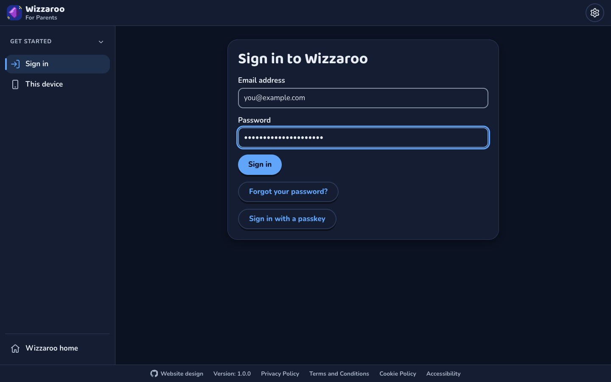
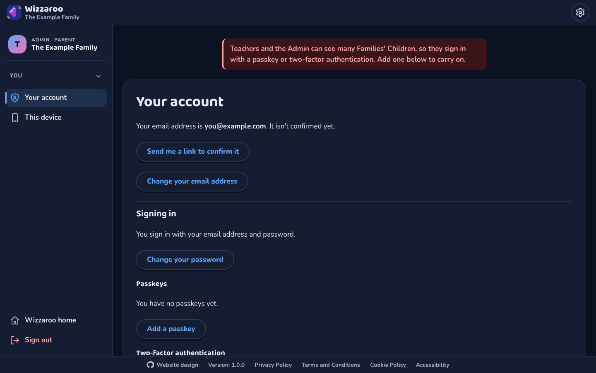
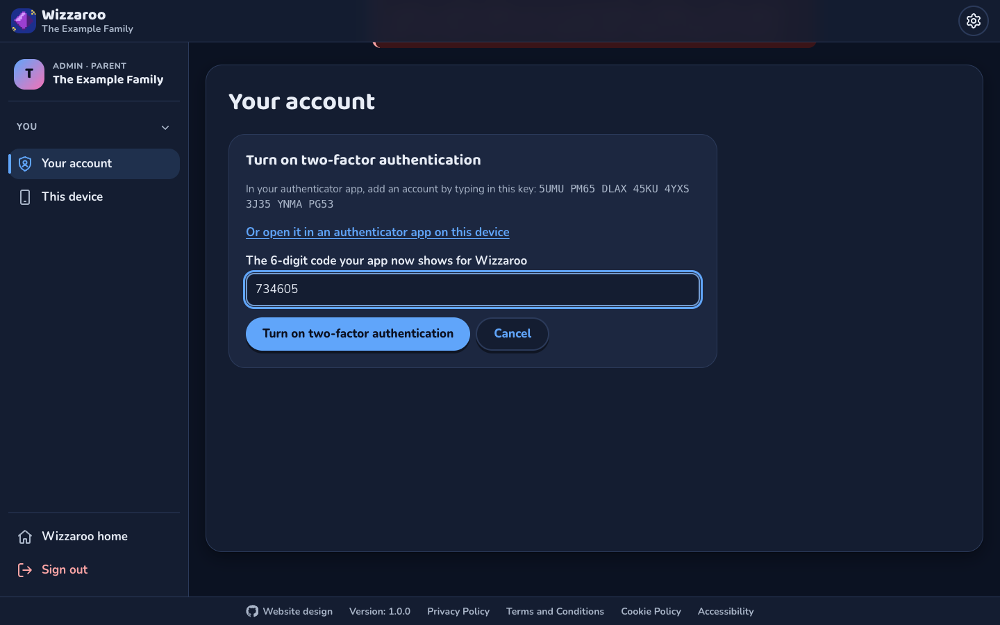
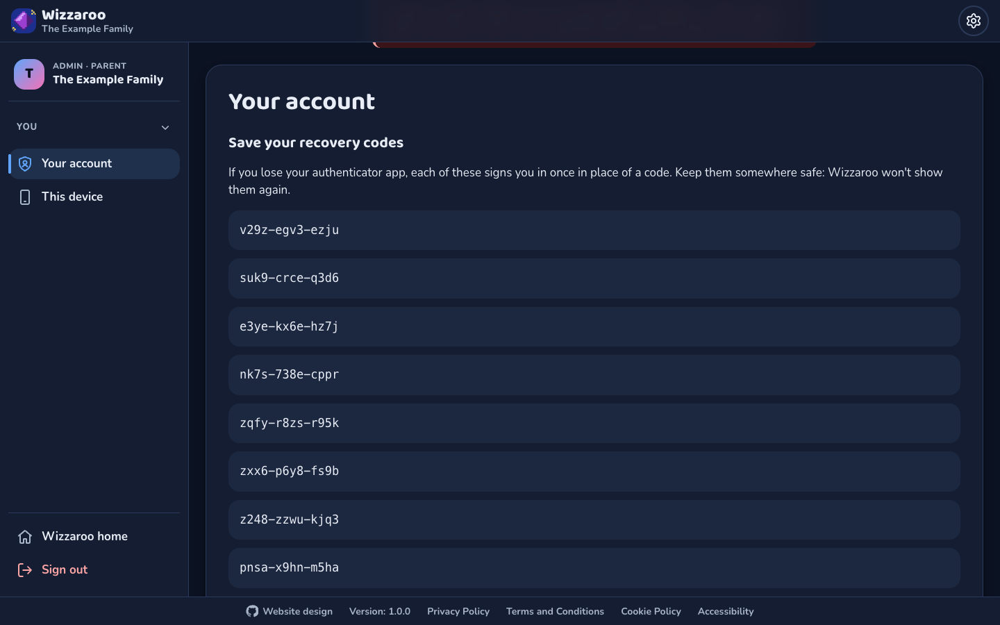
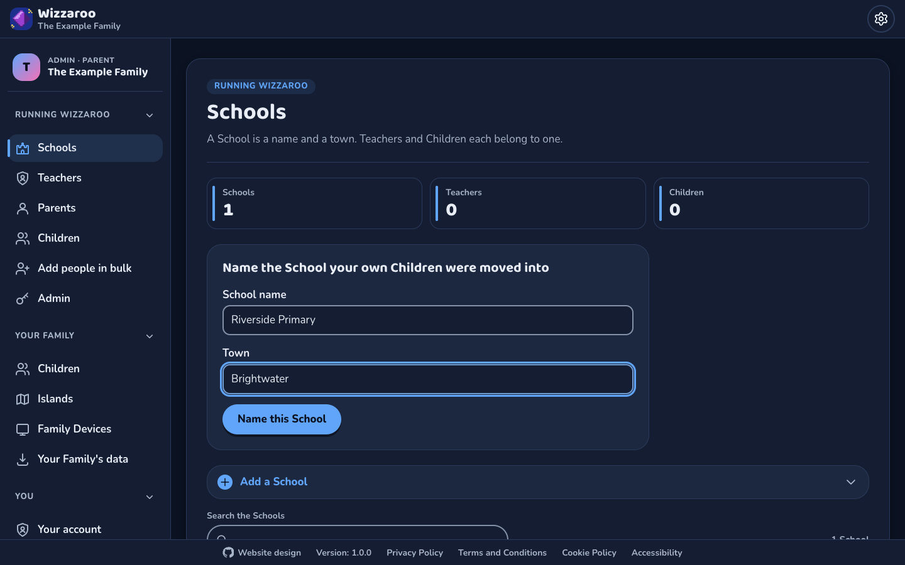
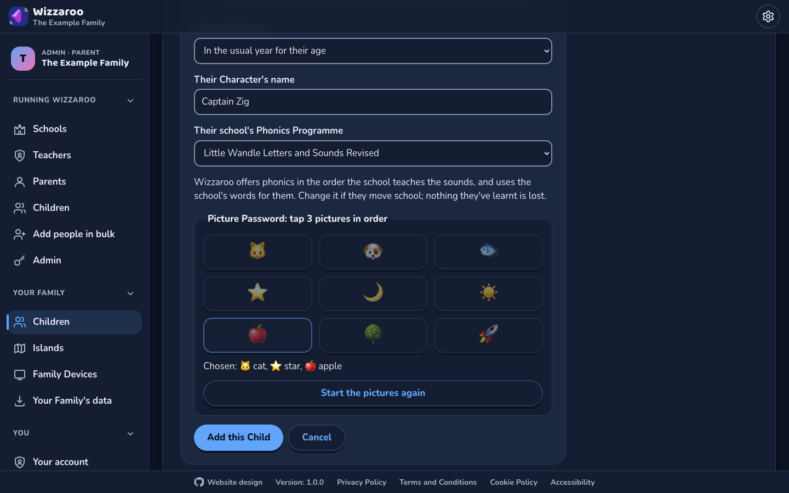
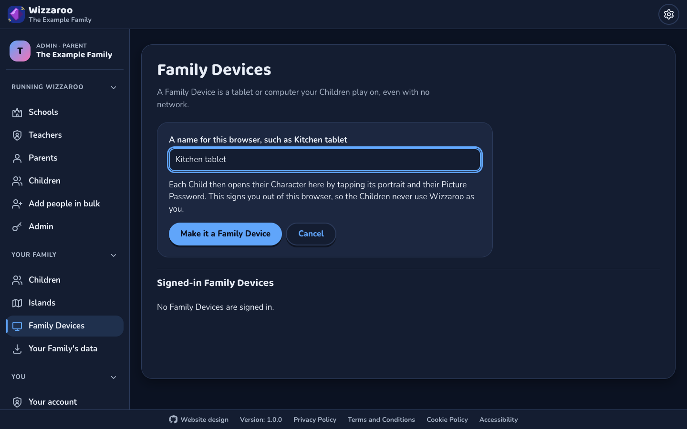
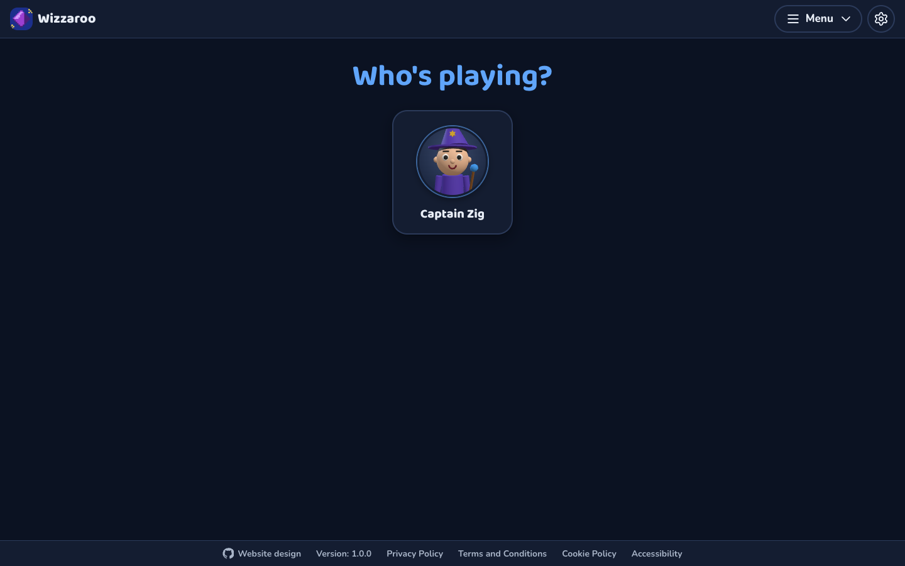
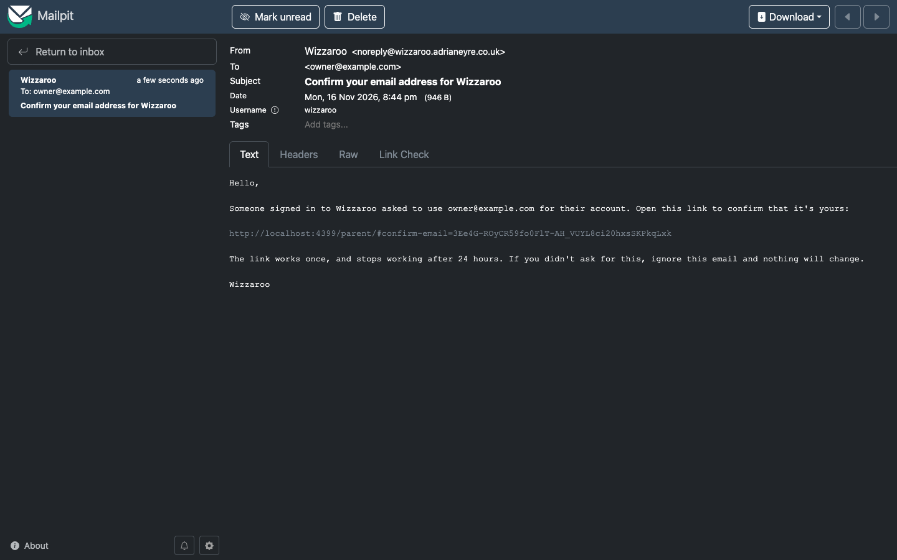

# Installing and setting up Wizzaroo

[← Back to the README](../../README.md)

> **Personal use only.** Wizzaroo is intended for your own personal use only. It is not intended for use with or by a school, teacher, parent or student. Only use it for yourself.

This guide takes a computer with nothing installed to Wizzaroo running locally, with an owner account, a School, a Child and a Family Device that Child can play on. Allow about 30 minutes, most of it downloads.

## 1. Install the tools for your computer

Pick your operating system. Each page installs the same four things and checks them, then comes back here.

| Your computer                                        | Guide                 |
| ---------------------------------------------------- | --------------------- |
| Windows 10 (22H2) or Windows 11                      | [Windows](windows.md) |
| macOS 14 Sonoma or later, Apple silicon or Intel     | [macOS](macos.md)     |
| Ubuntu 22.04 or later, Debian 12, Fedora 40 or later | [Linux](linux.md)     |

| Tool                                                      | Version                  | Why Wizzaroo needs it                                                  |
| --------------------------------------------------------- | ------------------------ | ---------------------------------------------------------------------- |
| [Git](https://git-scm.com)                                | any                      | To get the code                                                        |
| [Node.js](https://nodejs.org)                             | 26 or later              | Runs the server, the build and the tests (`engines` in `package.json`) |
| [pnpm](https://pnpm.io)                                   | 12.21.0                  | Installs the packages (`packageManager` in `package.json`)             |
| [Docker](https://docs.docker.com/get-started/get-docker/) | with Compose v2 or later | The development database, the email platform and the integration tests |

Only changing the voice-over also needs [Piper](../guide/voice-over.md), which needs Python. Nothing else is needed to run the game, but sending email needs two things more:

- **A GitHub token.** Wizzaroo sends email with the `@adrianeyre/email-client` package, which comes from GitHub Packages, not npm. The repo's `.npmrc` takes the `@adrianeyre` scope from there; the login goes in your own user-level `.npmrc`, since pnpm takes no token from a repo's. Create a [personal access token (classic)](https://github.com/settings/tokens) with only the `read:packages` scope, and set `GITHUB_TOKEN` to it in the terminal you install from, or in your shell's profile. Without it, `pnpm install` fails with `401` or `404` on `@adrianeyre/email-client`.
- **The email platform.** Wizzaroo sends every email through the self-hosted [email platform](https://github.com/adrianeyre/email-platform), which runs from its own repo with its own Mailpit. Step 3 sets it up.

## 2. Get the code and its packages

These commands are the same on every computer, apart from setting `GITHUB_TOKEN` and copying `.env`, which each OS page shows.

```bash
git clone https://github.com/adrianeyre/wizzaroo.git
cd wizzaroo
export GITHUB_TOKEN=ghp_…
pnpm install
cp .env.example .env
```

`pnpm install` reads the repo's `.npmrc`, which says where the `@adrianeyre` scope comes from:

```ini
@adrianeyre:registry=https://npm.pkg.github.com
```

pnpm ignores a token written in a repo's own `.npmrc`, so once, before the first `pnpm install`, add this line to your user-level `.npmrc` (`~/.npmrc` on macOS and Linux, `%USERPROFILE%\.npmrc` on Windows). It names the token only as `${GITHUB_TOKEN}`, which pnpm reads from the environment, so the file never holds the token itself:

```ini
//npm.pkg.github.com/:_authToken=${GITHUB_TOKEN}
```

`.env.example` already holds the values that work with the development database and a local email platform. Only `EMAIL_API_KEY` needs changing, in step 3:

```bash
DATABASE_URL=postgres://wizzaroo_app@localhost:54320/wizzaroo
DATABASE_OWNER_URL=postgres://wizzaroo@localhost:54320/wizzaroo
PORT=4310
PUBLIC_URL=http://localhost:4310
EMAIL_BASE_URL=http://localhost:4320
EMAIL_API_KEY=ek_development_key_from_the_local_email_platform
SECOND_SCHOOL_GATE_MET=false
TOTP_SECRET_KEY=0123456789abcdef0123456789abcdef0123456789abcdef0123456789abcdef
TUNNEL_PROXY_ADDRESS=
```

The development database trusts local connections, so it has no password. The app logs in as `wizzaroo_app`, a role that can't skip row-level security; `DATABASE_OWNER_URL` is the database's owner, which only applies the schema, and in development the server and `seed:owner` do that each time they start. `PORT` may also be left empty, which means 4310. `EMAIL_BASE_URL` is the email platform's own development address, and `EMAIL_API_KEY` is a placeholder for a key you make in it ([email](../guide/email.md)). The example's `EMAIL_API_KEY` and the `TOTP_SECRET_KEY` below are public, so the server accepts them only from the `pnpm` scripts, which run development's entry point ([development](../guide/development.md)). Wizzaroo deliberately avoids the common default ports (3000, 5173, 5432, 1025, 8025) so it never collides with other projects running on the same machine; 1025 and 8025 are the email platform's Mailpit.

`TOTP_SECRET_KEY` seals each adult's two-factor secret in the database ([signing in](../guide/signing-in.md#passkeys-and-two-factor-authentication)). It is 32 random bytes as 64 hexadecimal characters, and the server won't start without it, or with anything else. The example's key is for development only and is public; any other deployment makes its own with `openssl rand -hex 32`. A `.env` from before the key existed needs the line added. If the key changes, the secrets sealed under the old one stop working: each adult with two-factor authentication then signs in with a recovery code and sets it up again.

`TUNNEL_PROXY_ADDRESS` names the one socket whose `CF-Connecting-IP` header the server believes as the caller's address: `cloudflared`'s, behind the tunnel ([keeping data safe](../guide/security-and-backups.md#the-address-a-request-comes-from)). Development has no tunnel, so it leaves it empty and the header is believed from no socket: every request is recorded, and limited, under the address it really came from, which is `127.0.0.1` from your own browser. Outside development the server won't start without it; production's Compose file sets it to `cloudflared`'s fixed address. If set, it must be an IP address.

## 3. Start the database and the email platform

With Docker running:

```bash
docker compose -f docker-compose.dev.yml up -d
```

That starts Postgres on port 54320. It keeps running, and starts again with Docker, until `docker compose -f docker-compose.dev.yml down`. Add `-v` to that to delete the development database too.

Then run the email platform beside it, from [its own repo](https://github.com/adrianeyre/email-platform), as [its local setup](https://github.com/adrianeyre/email-platform/blob/main/docs/getting-started/local-setup.md) says. Its development stack starts its own Postgres and Mailpit, on 1025 (SMTP) and <http://localhost:8025> (its inbox), and `pnpm local` serves its UI and API at <http://localhost:4320>. In the email platform:

1. Under **Delivery**, set the SMTP provider to its Mailpit: host `localhost`, port `1025`, no TLS and no username. Nothing is then delivered to a real inbox.
2. Add the built-in Wizzaroo templates: `pnpm cli templates:add-built-ins`.
3. Make an API key, under **API keys** or with `pnpm cli apikey:create "Wizzaroo development"`. It is shown once.

Put the key in Wizzaroo's `.env` as `EMAIL_API_KEY`. Without the email platform, Wizzaroo still runs, but every email fails, and so does whatever sends one, such as a reset link or an Invite.

## 4. Create the owner's account

There is no sign-up page. Create the owner once:

```bash
pnpm seed:owner
```

It asks for the owner's email address, a password of at least 12 characters (twice, without showing it) and the Family's name. The owner is the Admin and a Parent in that Family. Any email address works in development, since nothing is ever delivered.

## 5. Run Wizzaroo

```bash
pnpm dev
```

This builds the client, applies the database schema and starts the server at <http://localhost:4310>. Leave it running; `Ctrl+C` stops it. There is no hot reload: run `pnpm dev` again after changing the client. [Development](../guide/development.md) lists every other script.

## 6. Sign in and set up your Family

Open <http://localhost:4310/parent/> in Chrome, Edge, Firefox or Safari.

**Sign in** with the owner's email address and password.



**Turn on two-factor authentication.** The Admin sees many Families' Children, so Wizzaroo shows only **Your account** until they add a passkey or two-factor authentication. **Turn on two-factor authentication** shows a key: add it to an authenticator app (1Password, Google Authenticator, Microsoft Authenticator, Authy and the like), type the 6-digit code it shows, and save the 10 recovery codes it gives you. A passkey works instead, but one made on `localhost` works only on `localhost`.







**Name the School.** The menu now shows everything the Admin can reach. Under **Schools**, name the School the owner's Children belong to.



**Add a Child.** Under **Children**, **Add a Child** asks for a nickname, the month and year they were born, their Character's name, their school's Phonics Programme and a Picture Password of 3 pictures. [Children](../guide/children.md) explains each.



**Make a Family Device.** Children play on a Family Device. Under **Family Devices**, **Make this browser a Family Device** names this browser and signs the Parent out of it. From then on that browser signs out any adult whenever it lists the Children, and its Parent page asks for a password or passkey every time and signs out after five idle minutes, so use a different browser, or a private window, for the Parent page while you set up.



**Play.** Open <http://localhost:4310/> in that browser. The Child taps their Character, then their Picture Password, and lands on their World Map.



**Check the email.** Every email Wizzaroo sends in development is in the email platform's **Logs**, at <http://localhost:4320>, and in its Mailpit at <http://localhost:8025>. Try **Your account** → **Send me a link to confirm it**:



## 7. Check everything works

```bash
pnpm typecheck && pnpm lint && pnpm test
```

`pnpm test` starts its own Postgres containers for `src/integration.test.ts` and `src/backup-restore.test.ts`, so Docker must be running. Without it those suites skip with a warning rather than fail, and a green run has verified nothing against Postgres.

## When something goes wrong

| What you see                                                              | What to do                                                                                                                                                                           |
| ------------------------------------------------------------------------- | ------------------------------------------------------------------------------------------------------------------------------------------------------------------------------------ |
| `ECONNREFUSED 127.0.0.1:54320` when the server starts                     | The database isn't running. Start Docker, then `docker compose -f docker-compose.dev.yml up -d`                                                                                      |
| `Bind for 127.0.0.1:54320 failed: port is already allocated`              | Something else uses that port, often an older copy of this database. `docker ps` shows what; stop it, or change the port in both `docker-compose.dev.yml` and `DATABASE_URL`         |
| `EADDRINUSE` on 4310                                                      | Another `pnpm dev` is already running. Stop it, or set `PORT` and `PUBLIC_URL` in `.env` to another port                                                                             |
| `401` or `404` for `@adrianeyre/email-client` from `pnpm install`         | `GITHUB_TOKEN` isn't set in this terminal, or the token lacks `read:packages`. Set it to a classic token with that scope, as in step 1                                               |
| An email fails, with `ECONNREFUSED` for port 4320 or a `401` in the log   | The email platform isn't running, or `EMAIL_API_KEY` isn't a key it made. Start it, or make a key and put it in `.env` (step 3)                                                      |
| `Unsupported engine` or `ERR_PNPM_UNSUPPORTED_ENGINE` from `pnpm install` | Node is older than 26. `node -v` says which is in use; install 26 as your OS page shows and open a new terminal                                                                      |
| `seed:owner changed nothing` when seeding                                 | The owner already exists in this database. Sign in with that account, or start again with `docker compose -f docker-compose.dev.yml down -v`, which deletes the development database |
| Signed in, but only **Your account** shows                                | The owner is the Admin, who must turn on two-factor authentication or add a passkey first (step 6)                                                                                   |
| The game page says it's signed out                                        | That browser isn't a Family Device yet. Make it one from **Family Devices** on the Parent page                                                                                       |
| A rebuilt client doesn't show                                             | The service worker shows a new build on the second reload, not the first; see [Playing offline](../guide/offline-and-link-previews.md#installing-and-playing-offline)                |
| The integration tests say they were skipped                               | Docker isn't running, or your user can't reach it. On Linux, check you are in the `docker` group                                                                                     |
