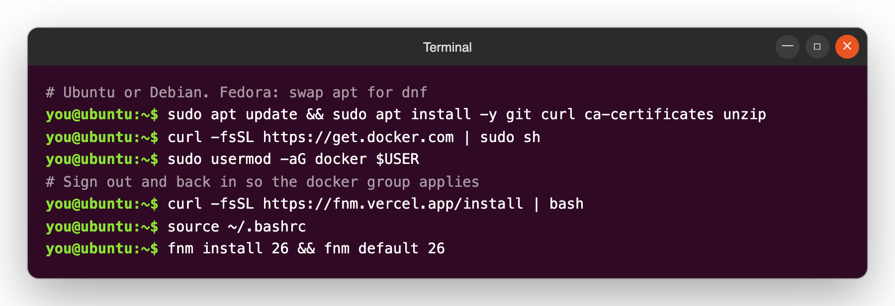
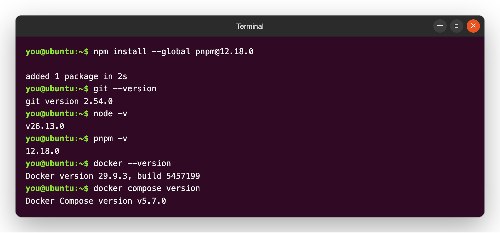
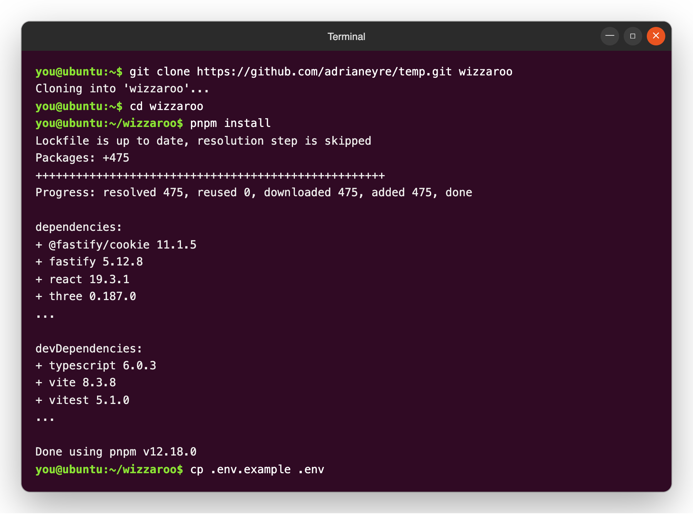
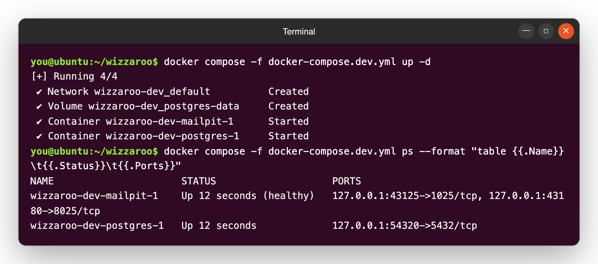
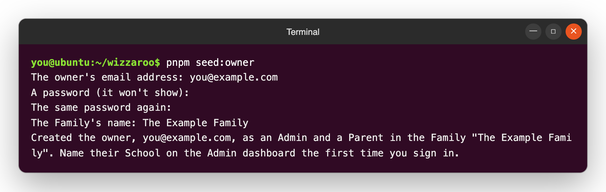
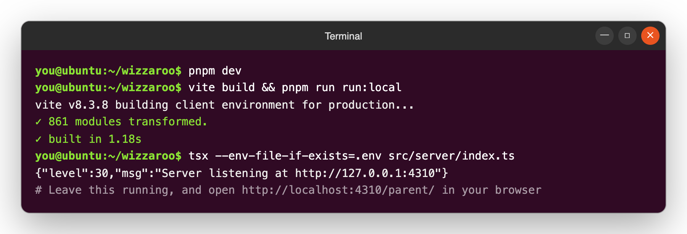

# Installing on Linux

> **Personal use only.** Wizzaroo is intended for your own personal use only. It is not intended for use with or by a school, teacher, parent or student. Only use it for yourself.

[← Installing and setting up](README.md) · [Windows](windows.md) · [macOS](macos.md)

For Ubuntu 22.04 or later and Debian 12, with notes for Fedora 40 or later. Every command runs in a terminal (`Ctrl+Alt+T` on Ubuntu), as a user who can use `sudo`.

## 1. Install Git, Docker Engine and Node.js

```bash
sudo apt update && sudo apt install -y git curl ca-certificates unzip
curl -fsSL https://get.docker.com | sudo sh
sudo usermod -aG docker $USER
curl -fsSL https://fnm.vercel.app/install | bash
source ~/.bashrc
fnm install 26 && fnm default 26
```



- On Fedora, swap the first line for `sudo dnf install -y git curl unzip`, and after Docker's script run `sudo systemctl enable --now docker`.
- [Docker's convenience script](https://docs.docker.com/engine/install/ubuntu/#install-using-the-convenience-script) installs Docker Engine with the Compose plugin from Docker's own repository. If you'd rather add the repository by hand, follow [Docker's guide for your distribution](https://docs.docker.com/engine/install/). The `docker.io` package Ubuntu ships may lack `docker compose`.
- `usermod` lets you use Docker without `sudo`, which the integration tests need. **Sign out and back in** for it to apply (or run `newgrp docker` in this terminal).
- [fnm](https://github.com/Schniz/fnm) installs Node.js 26. If you already use [nvm](https://github.com/nvm-sh/nvm), `nvm install 26` does the same. Your distribution's `nodejs` package is usually too old.

## 2. Install pnpm and check every tool

```bash
npm install --global pnpm@12.21.0
git --version
node -v
pnpm -v
docker --version
docker compose version
```



`node -v` must say `v26` or later, `pnpm -v` must say `12.21.0`, and `docker` must answer without `sudo`.

## 3. Get the code and its packages

```bash
git clone https://github.com/adrianeyre/wizzaroo.git
cd wizzaroo
export GITHUB_TOKEN=ghp_…
pnpm install
cp .env.example .env
```



`GITHUB_TOKEN` is a GitHub personal access token (classic) with the `read:packages` scope, which `pnpm install` needs for the `@adrianeyre/email-client` package ([why](README.md#1-install-the-tools-for-your-computer)). `export` sets it for this terminal only; add the line to your shell's profile to keep it.

## 4. Start the database and the email platform

```bash
docker compose -f docker-compose.dev.yml up -d
```



Then run the email platform from its own repo, and put an API key from it in `.env` as `EMAIL_API_KEY`, as [step 3 of the setup](README.md#3-start-the-database-and-the-email-platform) shows.

## 5. Create the owner's account

```bash
pnpm seed:owner
```



The password doesn't show as you type it.

## 6. Run Wizzaroo

```bash
pnpm dev
```



Then open <http://localhost:4310/parent/> in Firefox or Chrome and carry on from [Sign in and set up your Family](README.md#6-sign-in-and-set-up-your-family).

## Linux problems

| What you see                                                            | What to do                                                                                                          |
| ----------------------------------------------------------------------- | ------------------------------------------------------------------------------------------------------------------- |
| `permission denied while trying to connect to the Docker daemon socket` | You aren't in the `docker` group yet. Sign out and back in, or run `newgrp docker`; `groups` should list `docker`   |
| `docker: 'compose' is not a docker command`                             | The Compose plugin is missing. Install `docker-compose-plugin` from Docker's repository                             |
| `Cannot connect to the Docker daemon`                                   | Start it with `sudo systemctl start docker`, and `sudo systemctl enable docker` to start it with the computer       |
| `fnm: command not found`                                                | Open a new terminal, or `source ~/.bashrc`. With zsh, add `eval "$(fnm env --use-on-cd --shell zsh)"` to `~/.zshrc` |
| The 3D scenes are slow or blank                                         | Turn on hardware acceleration in the browser (Chrome: `chrome://gpu` should show WebGL as hardware accelerated)     |
