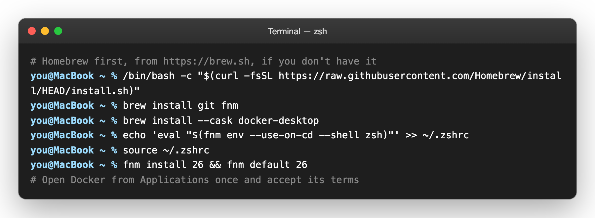
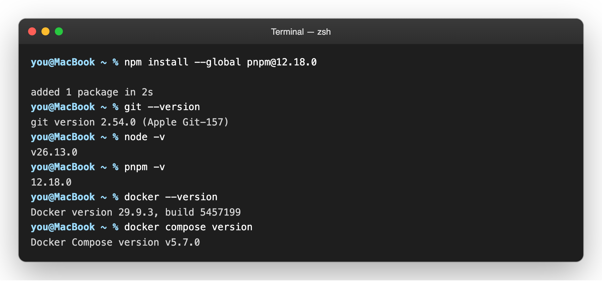
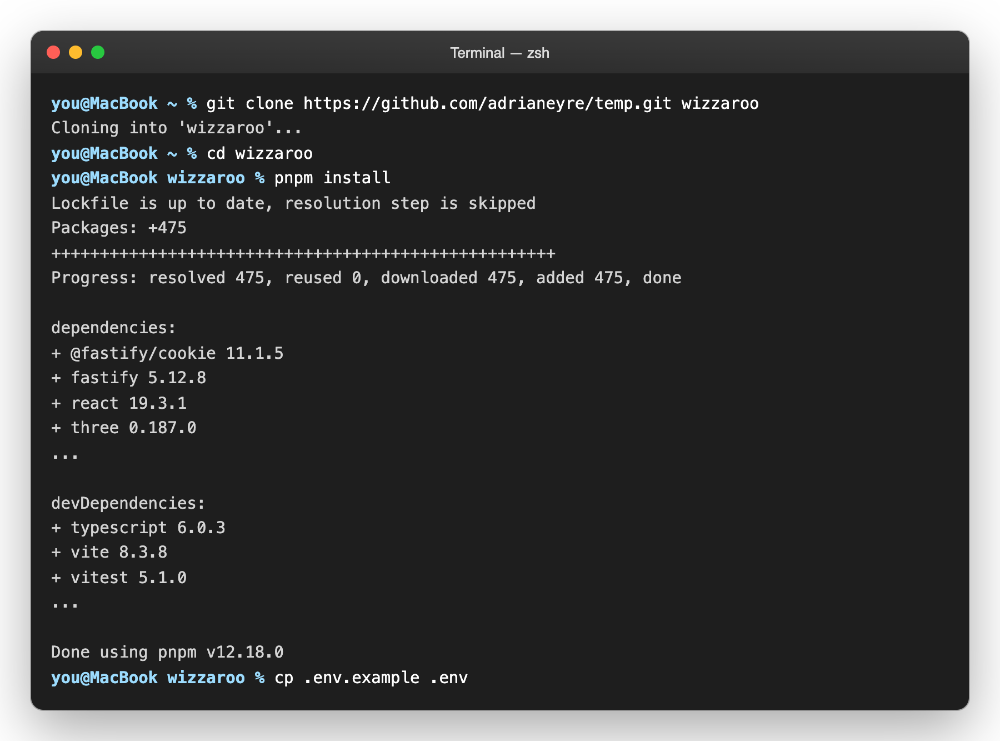
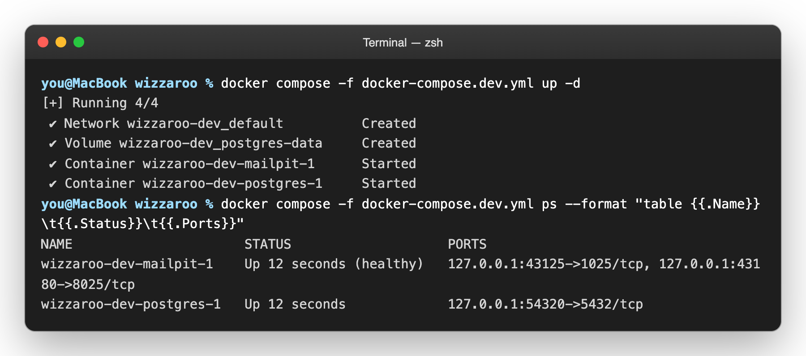
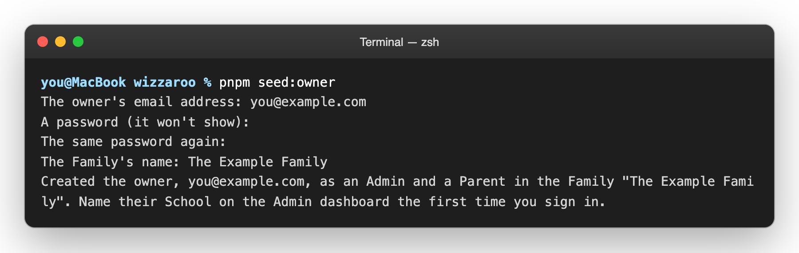
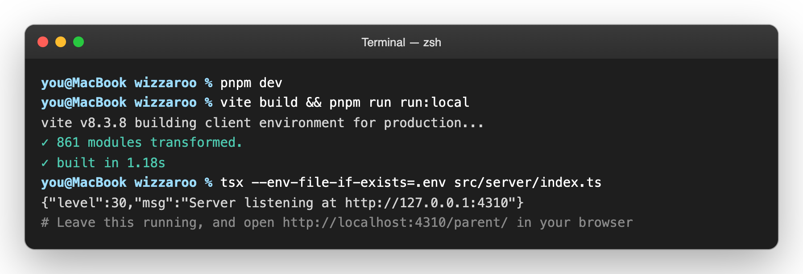

# Installing on macOS

> **Personal use only.** Wizzaroo is intended for your own personal use only. It is not intended for use with or by a school, teacher, parent or student. Only use it for yourself.

[← Installing and setting up](README.md) · [Windows](windows.md) · [Linux](linux.md)

For macOS 14 Sonoma or later, on Apple silicon or Intel. Every command runs in **Terminal**: press `⌘ Space`, type `Terminal`, and press Return.

## 1. Install Git, Node.js and Docker Desktop

[Homebrew](https://brew.sh) installs everything else. If `brew --version` already answers, skip its line.

```bash
/bin/bash -c "$(curl -fsSL https://raw.githubusercontent.com/Homebrew/install/HEAD/install.sh)"
brew install git fnm
brew install --cask docker-desktop
echo 'eval "$(fnm env --use-on-cd --shell zsh)"' >> ~/.zshrc
source ~/.zshrc
fnm install 26 && fnm default 26
```



- The Homebrew installer asks for your Mac password, may install the Xcode Command Line Tools, and at the end prints two `eval` lines to add Homebrew to your `PATH`; run them.
- [fnm](https://github.com/Schniz/fnm) installs Node.js 26 and switches to it. If you already use [nvm](https://github.com/nvm-sh/nvm), `nvm install 26` does the same. `brew install node` works too, as long as `node -v` says 26 or later.
- Open **Docker** from Applications once, accept its terms and let it finish starting: the whale in the menu bar stops animating. Docker Desktop is free for personal use, education and small businesses; see [its licence](https://docs.docker.com/subscription/desktop-license/). [OrbStack](https://orbstack.dev) and [Colima](https://github.com/abiosoft/colima) work in its place.

## 2. Install pnpm and check every tool

```bash
npm install --global pnpm@12.21.0
git --version
node -v
pnpm -v
docker --version
docker compose version
```



`node -v` must say `v26` or later, and `pnpm -v` must say `12.21.0`.

## 3. Get the code and its packages

```bash
git clone https://github.com/adrianeyre/wizzaroo.git
cd wizzaroo
export GITHUB_TOKEN=ghp_…
pnpm install
cp .env.example .env
```



`GITHUB_TOKEN` is a GitHub personal access token (classic) with the `read:packages` scope, which `pnpm install` needs for the `@adrianeyre/email-client` package ([why](README.md#1-install-the-tools-for-your-computer)). `export` sets it for this terminal only; add the line to your shell's profile to keep it.

## 4. Start the database and the email platform

With Docker running:

```bash
docker compose -f docker-compose.dev.yml up -d
```



Then run the email platform from its own repo, and put an API key from it in `.env` as `EMAIL_API_KEY`, as [step 3 of the setup](README.md#3-start-the-database-and-the-email-platform) shows.

## 5. Create the owner's account

```bash
pnpm seed:owner
```



The password doesn't show as you type it.

## 6. Run Wizzaroo

```bash
pnpm dev
```



Then open <http://localhost:4310/parent/> in Safari or Chrome and carry on from [Sign in and set up your Family](README.md#6-sign-in-and-set-up-your-family).

## macOS problems

| What you see                                              | What to do                                                                                               |
| --------------------------------------------------------- | -------------------------------------------------------------------------------------------------------- |
| `zsh: command not found: brew`                            | Run the two `eval` lines the Homebrew installer printed, or open a new Terminal window                   |
| `node -v` shows an older version                          | `fnm default 26`, then open a new Terminal window. `which node` shows which Node is first on your `PATH` |
| `Cannot connect to the Docker daemon`                     | Docker isn't running. Open it from Applications and wait for the whale to stop animating                 |
| macOS asks whether `node` may accept incoming connections | Allow it. The server listens on every network interface so other devices on your network can reach it    |
