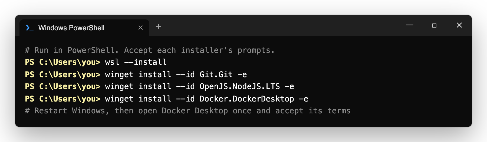
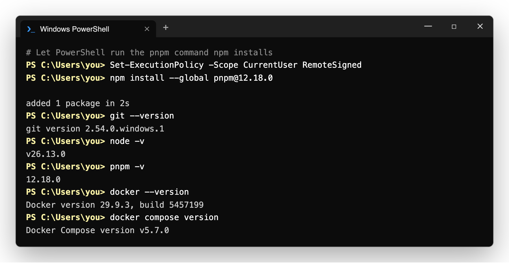
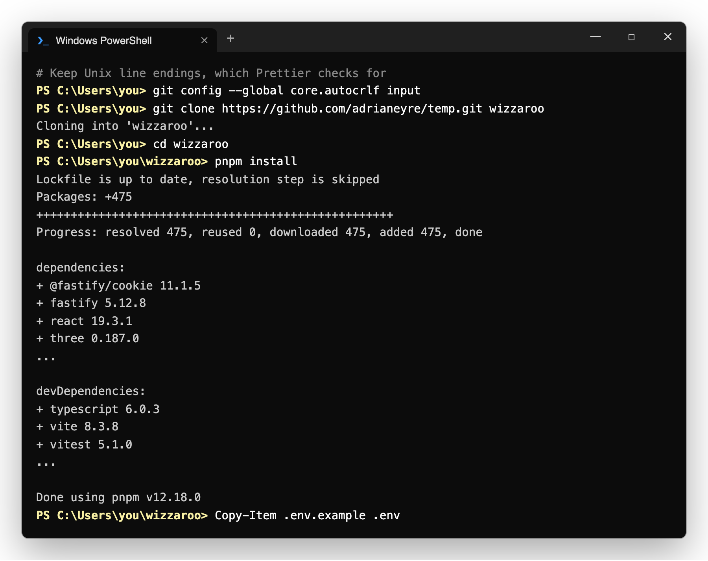
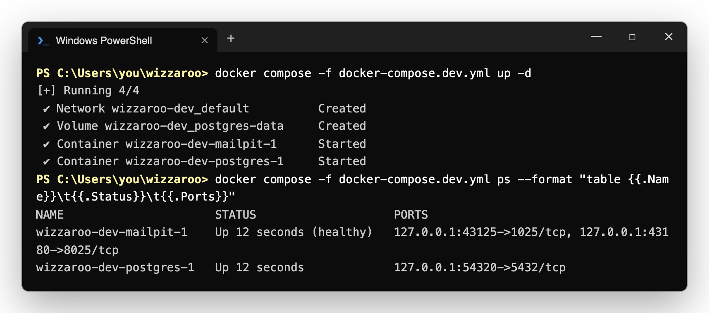
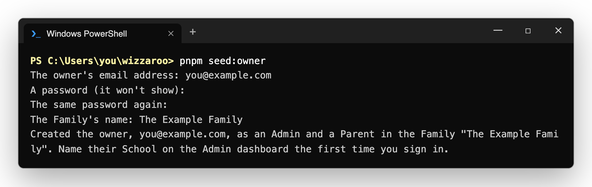
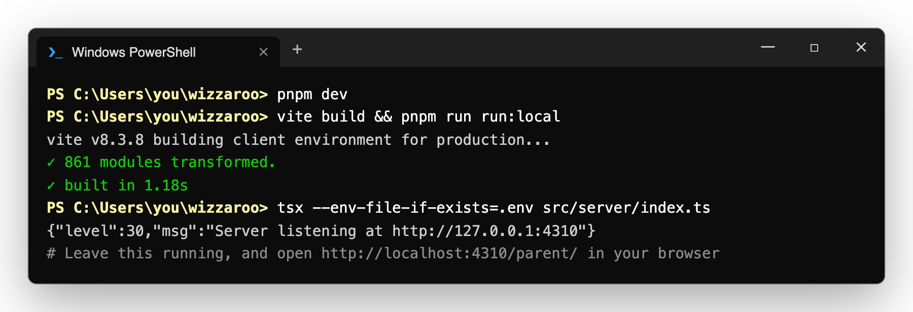

# Installing on Windows

> **Personal use only.** Wizzaroo is intended for your own personal use only. It is not intended for use with or by a school, teacher, parent or student. Only use it for yourself.

[← Installing and setting up](README.md) · [macOS](macos.md) · [Linux](linux.md)

For Windows 10 (22H2) or Windows 11, on a user who can install software. Every command runs in **Windows PowerShell** or **Windows Terminal**: press Start, type `PowerShell`, and open it. Wizzaroo runs natively on Windows; Docker Desktop uses WSL 2 underneath, but you don't need to work inside Linux.

## 1. Install WSL 2, Git, Node.js and Docker Desktop

[winget](https://learn.microsoft.com/windows/package-manager/winget/) comes with Windows 11 and current Windows 10. If `winget` isn't found, install **App Installer** from the Microsoft Store.

```powershell
wsl --install
winget install --id Git.Git -e
winget install --id OpenJS.NodeJS.LTS -e
winget install --id Docker.DockerDesktop -e
```



- `wsl --install` turns on the Windows Subsystem for Linux, which Docker Desktop runs on. If it says WSL is already installed, carry on.
- `OpenJS.NodeJS.LTS` installs the current Node.js LTS, which is 26 or later. If you already use [nvm-windows](https://github.com/coreybutler/nvm-windows) or [fnm](https://github.com/Schniz/fnm), run `nvm install 26` or `fnm install 26` instead.
- **Restart Windows**, then open **Docker Desktop** from the Start menu once, accept its terms, and keep the defaults ("Use WSL 2 based engine" is on). Wait until the whale icon in the taskbar says Docker Desktop is running. Docker Desktop is free for personal use, education and small businesses; see [its licence](https://docs.docker.com/subscription/desktop-license/).

## 2. Install pnpm and check every tool

Open a **new** PowerShell window, so it finds what was just installed.

```powershell
Set-ExecutionPolicy -Scope CurrentUser RemoteSigned
npm install --global pnpm@12.21.0
git --version
node -v
pnpm -v
docker --version
docker compose version
```



`Set-ExecutionPolicy` lets PowerShell run the `pnpm` command npm installs; without it, `pnpm` stops with "running scripts is disabled on this system". `node -v` must say `v26` or later, and `pnpm -v` must say `12.21.0`.

## 3. Get the code and its packages

Keep Unix line endings before you clone, because `pnpm prettier` checks for them:

```powershell
git config --global core.autocrlf input
git clone https://github.com/adrianeyre/wizzaroo.git
cd wizzaroo
$env:GITHUB_TOKEN = "ghp_…"
pnpm install
Copy-Item .env.example .env
```



`GITHUB_TOKEN` is a GitHub personal access token (classic) with the `read:packages` scope, which `pnpm install` needs for the `@adrianeyre/email-client` package ([why](README.md#1-install-the-tools-for-your-computer)). `$env:` sets it for this PowerShell window only; set it again in a new one before `pnpm install`.

Clone somewhere under your user folder, such as `C:\Users\you\wizzaroo`, not into OneDrive, which syncs `node_modules` and slows everything down. If Windows Defender asks whether Node.js may use the network, allow it on private networks.

## 4. Start the database and the email platform

With Docker Desktop running:

```powershell
docker compose -f docker-compose.dev.yml up -d
```



Then run the email platform from its own repo, and put an API key from it in `.env` as `EMAIL_API_KEY`, as [step 3 of the setup](README.md#3-start-the-database-and-the-email-platform) shows.

## 5. Create the owner's account

```powershell
pnpm seed:owner
```



The password doesn't show as you type it.

## 6. Run Wizzaroo

```powershell
pnpm dev
```



Then open <http://localhost:4310/parent/> in Edge or Chrome and carry on from [Sign in and set up your Family](README.md#6-sign-in-and-set-up-your-family).

## Windows problems

| What you see                                                                               | What to do                                                                                                       |
| ------------------------------------------------------------------------------------------ | ---------------------------------------------------------------------------------------------------------------- |
| `pnpm : File ...\pnpm.ps1 cannot be loaded`                                                | Run `Set-ExecutionPolicy -Scope CurrentUser RemoteSigned`, then open a new PowerShell window                     |
| `docker: error during connect` or `The system cannot find the file specified`              | Docker Desktop isn't running. Start it from the Start menu and wait for the whale icon to settle                 |
| Docker Desktop says **WSL 2 installation is incomplete** or **Virtualization is disabled** | Run `wsl --update`, restart, and turn on virtualisation (Intel VT-x or AMD-V/SVM) in your PC's firmware settings |
| `pnpm prettier` fails on every file                                                        | The clone has Windows line endings. Run `git config --global core.autocrlf input`, then clone again              |
| `node` or `pnpm` isn't recognised                                                          | Open a new PowerShell window; installers only update the `PATH` of windows opened after them                     |
